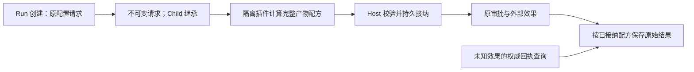
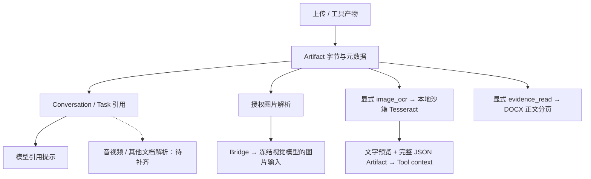
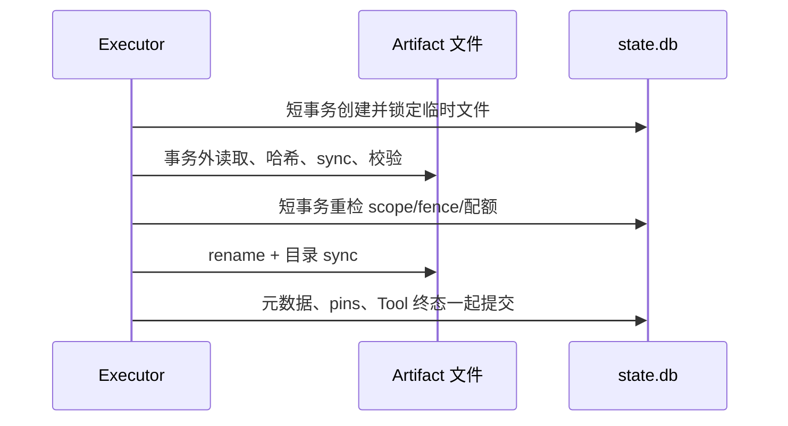

# 文件产物与多模态输入：技术方案

[功能与需求](../features/artifacts-media.md) · [测试方案](../test-plans/artifacts-media.md) · [主索引](../feature-map.md)

本文的架构与流程描述当前有效实现；明确标记的待实现方案不表示已落地。实现级协议仍服从 [跨功能协议与约束](product-overview.md#contract-0-文档效力与实现规则)。

## 当前架构

文件字节位于 Artifact store，引用与权限由 Host 解析。Conversation 保留语义引用；支持的用户图片与显式选择的工具图片在 dispatch 时由 Host 解码，再送入冻结 Provider envelope。

### Artifact 插件边界

仓库私有、实验级的 `artifact-workbench` 在隔离进程中实际执行 Unicode 名称／MIME 匹配、按创建时间排序、文本／二进制读取配方、产物默认元数据／保留期与清理候选排序。它仅接收匿名元数据、原始请求和 Host 已批准的候选位置，不接收引用、路径、scope、数据库、文件内容或凭据；输出不能新增事实或授权删除。

目前搜索／读取接通真实已接纳 Tool：Host 先按原归属、grant、到期与 Task 保护规则收集可见描述，释放 SQLite 事务，再通过既有完整输入流调用 Run 冻结的版本。返回位置经去重、范围与原窗口约束检查，随后重新检查 claim、隐私代次、Guardian、原调用和描述版本，再投影真实引用及字段。没有新增目录总量上限；大输入沿用明确授权的 `ReadServiceStream`，不放宽普通输入预算。读取先打开并校验原始文件描述符，插件仅选择表示与窗口；Host 强制原始范围／UTF-8、最大读取预算，并在返回文本或二进制引用前复查授权、原描述与 Guardian。Run 内工具大文本／二进制／附件输出、生成元数据／回执、发布回执和保留期已消费接纳配方。普通所有者保存、渠道导入和代码报告也在 staging 前调用同一私有配方；Web、飞书和 Main 发布消费文件创建时接纳的附件类型事实。清理经独立插件选择后由 Host 整批复查并接纳删除。这些业务已迁入私有四服务，标准三十包组合与真实渠道／PR 创建、原二十九包执行／引用恢复已纳入验收；真实调用、独立换版／回退／停用、原语义与安全围栏均按所属测试方案维护。

可信存储机制保留原字节／哈希、授权、配额、不可变身份、pin／发布事务、删除 eligibility 与恢复；搜索／排序及默认配方归插件。输出配方须先于外部效果接纳并固定，不能在真实效果发生后因插件不可用触发重试；显式配置与调用方元数据不得被默认值覆盖。所有者路径无需模型、Skills 或 Run 初始化；已清理被替代的当前实现，具名历史入口的消费者、保留理由和删除条件见下文。不开放通用变换 DSL、KV、任意文件或 SQL 接口，也不稳定公开内部 Descriptor。

`schema69` 只为新已迁移 Run 写入 `run_artifact_request`；零代表配置未填写，显式的三十天仍保持显式。`config.Artifact` 用可空整数区分缺省与显式选择，现有 YAML 字段及硬配额／大小验证不变。历史 Run、引用、模型请求和原保留期不回填、不重算。请求在模型／费用派发前固定，Child 复制父请求；完整配方首次经版本固定的纯读 RPC 返回后，Host 验证有限媒体种类、元数据、字节界限及显式值，再写不可变 `run_artifact_recipe`。二者承担不同事实，避免首次保存时读取变化配置；不为每次 Tool 另建重复方案日志。

Artifact save／publish、外部效果及不可安全重放的提供方在原 `Prepare` 中先接纳配方；原 `Start` 在执行事务中独立核对持久方案。纯操作只有实际产生 Artifact 时才准备方案，普通内联结果及独立控制无需 Artifact 计算。SQL writer 内不执行候选。输出接纳及无 claim 的权威查询恢复只读取既有配方，不调用被隔离或当前版本的方法；显式文件名／MIME、回调结果和原字节仍归调用方事实，原效果身份与 unknown 不重发语义不变。上下文归档在创建文件前准备同一 Run 配方，不改冻结消息／模型前缀。

清理与切换同步：已删除无生产消费者的 `ListTx` 包装；原搜索收口到 `search_legacy.go:SearchLegacyTx`、原读取策略收口到 `artifact_legacy.go:legacyArtifactReadPolicy`，原生成元数据／回执收口到同文件 `legacyArtifactRecipe`，消费者分别为冻结服务清单中没有 `steward.artifact-selection/1`／`steward.artifact-read/1`／`steward.artifact-recipe/1` 的历史 Run 及其后代，所有这类执行显式退役后可删除。已跨过边界的 Run 缺包、停用或失败不能调用该解释器。原 MIME 分类已移至 `internal/artifact/legacy.go`，只解释原有 NULL 方法引用；原所有者创建／清理分别收口到 `creation_legacy.go` 与 `cleanup_legacy.go`，只服务迁移时存在的旧安装及显式原生嵌入夹具。没有保留第二套默认实现；旧消费者全部退役后删除对应解释器。

所有者创建在事务外获取所选已激活图的有限配方，Host 将图、保留天数、媒体种类与原 Agent／隐私代次形成私有快照。staging 深拷贝快照；最终短事务重新验证图曾被接纳且未被 Guardian 停机／隔离、隐私代次和原归属，再提交原字节与元数据。`artifact.method_graph`／`semantic_kind` 是不可变内部事实，不进入公开 Descriptor JSON；MIME、名称、哈希及原始字节契约不变。换版不重算既有文件类型，旧 NULL 方法引用不回填。普通换图／停用不撤销已接纳的版本；新操作无可用所选服务时明确失败，紧急撤权使用 Guardian 停机／隔离。

`schema69` 只在前向迁移中为实际存在的 Run、Artifact 或已激活控制记录建立不可伪造、不可替换的 `legacy_artifact_owner`。新生产安装缺包时不能获得原生创建／清理权限。Artifact 服务一旦激活，旧所有者资格永久关闭；回退到二十九包、停用或缺包不能复活它。已有二十九包选择不自动扩成三十包；所有者须经过原安装、独立验证及激活流程。原始读取、描述、显式删除和 orphan／tombstone 恢复保持独立，插件或模型不可用不会阻断这些控制。

清理先沿用原授权、引用、过期和 Task 保护规则收集候选；插件只获得匿名到期时间流与显式批量选择，返回有界位置。Host 在一个短事务内重新检查整组引用、版本、到期、保护与撤权，全部通过才写 tombstone；任一陈旧项使整组失败。物理 unlink 仍由提交后的原恢复机制完成。排序／默认批量归插件，是否允许删除归 Host，不开放 SQL、任意谓词或路径。

### 用户图片输入与职责边界（F-013）

1. Web 根据附件 MIME 产生 image ContentPart；CLI 通过显式 `type:image` 引用。现有入站接纳验证并 pin 可访问 Artifact，Conversation 与 checkpoint 仅保存语义引用。
2. `agent/messages.go` 统一角色、内容与媒体引用投影。只有真实 user 图片和原有显式 Tool 图片可选择像素；runtime 证据、assistant 附件和 Task 更新不自动变成图片输入。Root/Child 的正文与 Artifact refs 仍保持显式委派边界，不借此复制 Main 图片上下文。
3. 新建 Run 的 `run_context_policy` 冻结 `user_images:true`；Child 复制 Parent 的原始策略。字段缺失表示旧用户引用模式，旧请求和压缩缓存的输入/策略 hash 不重写。该标记属于 Host 的投影版本约定，不是 YAML 配置或新模型能力。schema 29 与 Bridge 格式保持不变，升级时统一停止旧进程，禁止不同投影实现混跑。
4. `agent/sqlite/images.go` 只给未完成、已接纳的视觉 generation 安装临时 resolver。resolver 限定该请求选择的 refs，再通过既有 Artifact 权限、完整性验证及 claim/隐私二次 fence 读取；未选择和未授权引用均拒绝。已完成 generation 直接复用结果，不重新读图；文本模型不安装 resolver。
5. `llm/bridge/images.go` 将请求选择/去重/总量预算与单图解码/预览生成分开。PNG/JPEG 上限为 8 MiB、约 3355 万像素（32 × 1024²），每图最长边 640（极窄图仍至少 1 像素），JPEG 预览最多 48 KiB；工作集最多 8 张，激进重试 4 张，总 base64 预算 512 KiB，复用 1 MiB RPC 上限。单图解码与大小限制归 `media/image.go`，视觉 Bridge 和 OCR 共用；每次模型请求的图片数量预算仍归 LLM。
6. 图片字节仅存在于临时 provider envelope，observer、SQLite generation、Conversation 和摘要档案均不写 base64。格式、大小、损坏与权限失败在供应商调用前拒绝。语义摘要不隐式获得图片；文本模型的 working set 明确说明像素不可用。

Settings 不再提供图片复选框。ChatGPT 账户模型按认证目录的图片能力默认启用；自定义兼容端点通过 Host 蓝色方块 Probe 与同一图像 envelope 验证，后者不把目录声明当行为证明。更新模型只影响新 Run，现有模型快照保持冻结。

### 本地 OCR 工具（F-013 增强）

- `builtin__image_ocr({artifactRef})` 是默认 Host builtin；`read_only`、`safe`、30 秒、64 KiB 结果上限。模型不能提供 Host 路径、URL、语言目录、可执行命令或引擎。Main/Root/Child 按既有权限裁剪和 Artifact grant 使用；不扩大 Child 作用域。
- `agent/sqlite/image_ocr.go` 只负责读取持久化的调用参数、冻结资源身份、scope/fence 与结果接纳。它与 generation 共用 `readImage`，保持同 fd 完整性校验、事务外读取与短事务授权重检。像素解码、TSV 解析和引擎执行内聚于 `media/ocr`，不接触数据库或凭据。
- App 一次发现本地 Tesseract，将同一实例用于注册和执行。`ResourceHash` 包含引擎文件 SHA-256、报告的版本、已安装 eng/chi_sim/chi_tra 文件哈希和固定 LSTM/PSM3/TSV 参数。缺失依赖有固定 unavailable 身份；安装和更新只形成新的能力快照，不重写旧数据。恢复时资源身份不匹配由既有 Registry 拒绝 `MODEL_INCOMPATIBLE`；同进程执行检测到文件替换返回 `PERMISSION_DENIED`。
- 每次调用验证引擎、复制并校验冻结语言文件到私有临时目录。先将系统临时父目录解析为绝对规范路径，使 Seatbelt 按实际路径授予单次作业访问。作业在既有 Linux bubblewrap / macOS Seatbelt 边界中经 stdin 处理原图，以 TSV 返回。无网络、无模型凭据，进程环境为固定白名单；仅作业目录可写，沿用系统运行库只读挂载。完成后再次验证引擎，取消时杀死并等待进程组；正常退出清理临时目录。崩溃临时文件位于 OS temp，由系统临时文件清理策略回收，不作为 Artifact 或可重放输入。
- 原图上限 8 MiB/32 × 1024² 像素；引擎 stdout 上限 2 MiB，丢弃 stderr。TSV 严格验证列、UTF-8、有限置信分数与原图范围内的词框；最多 4096 词/128 KiB 文本，明确截断。预览限制为 2048 字节文字、16 词框，每词最多 128 字节；完整 JSON 走既有 BinaryOutput → Artifact → Tool 终态原子提交，原图和结果均 pin。坐标不经过视觉缩图变换。
- 通过共享 Executor/Code Mode/OutputStore 处理期限、并发、取消、错误和重放。已完成调用不重新识别；未完成的只读调用可按原冻结身份重试。OCR 不自动 publish，不写长期 Memory，不修改 system prompt，也不切换模型。返回的文字是低信任证据，空结果不证明图片没有文字或无需视觉分析。
- 比较 [Codex view_image](https://github.com/openai/codex/blob/ce2d47bdc4dd2513d5b3567090593b07b0fdfa0a/codex-rs/core/src/tools/handlers/view_image.rs#L99)：它要求视觉模型并返回 InputImage，本链路没有 OCR 回退。借鉴统一媒体处理，保留 Steward 的 Artifact 引用和独立 OCR 语义。本增强不新增 feature 编号，也不把 OCR 质量评测放入 CI。

### DOCX 正文证据（F-014）

- 用户提供 DOCX Artifact ref 后，Main 与本地操作者可沿用证据读取。工具定义、输入 schema、角色、审批与授权均沿用现有入口。新 Run 在 `run_context_policy` 冻结 `docx_text:true`；缺失字段时沿用原二进制元数据结果，已提交调用照常复用。统一停止旧进程后再升级。
- Host 按标准 DOCX MIME 选择冻结解释器。已启用的独立 `docx-reader` 包使用 `steward.docx-text/1`，通过本次调用的不可变分块输入解析原始字节；插件不接触文件路径或数据库。新 Run 在首次成功激活该服务后冻结 `docx_plugin:true`，并绑定确切插件图；缺失该标记的历史 Run 保留原生解释器，Child 继承父政策。停用后的新工作明确返回不可用，不绕回原生实现。所有者可携带上一页的 `reader_revision` 继续已验收旧版本；该字段不进入 Main 工具 schema，未激活候选、停机和被隔离解释器拒绝读取。读取同一授权 fd 并校验哈希，在 SQLite 事务外提取；返回前重检源文件存活、授权、claim 和隐私。结果是低信任 Tool 回执文本，正文和 ZIP 字节不另存为派生产物。没有 schema migration 或新 Tool。
- ZIP 只打开三个固定部件。根关系必须唯一选择内部 `word/document.xml`，且内容类型声明为普通 Word 主文档。拒绝歧义部件、重定向或声明型 XML 实体，正常 XML 字符转义可以解码。只提取正文普通段落、直接表格单元格及超链接标签；换行分段或分行，Tab 分单元格。布局、样式、修订、嵌套表格、页眉页脚、绘图与其他嵌入内容不参与正文投影。解析器不加载关系目标、运行宏或渲染 Office。
- ZIP 限 8 MiB、512 个条目、声明解压总量 32 MiB；主文档 XML 限 2 MiB，两个包描述 XML 各 64 KiB。实际打开的部件校验长度和 CRC，XML 限 64 层、每部件 200,000 个 token，完整提取文字限 256 KiB。页长 4–4096 字节，`docx_text` 表示按提取文本而非压缩包分页。托管 Run 将确切输入摘要和提取结果写入原插件调用回执，分页复用同一结果；每次仍检查源对象和执行权，Forget 清除调用正文。所有者的纯只读入口不写回执，历史 Run 保留原提取路径。

### 短事务与文件所有权（F-039）

临时对象保持进程所有的文件锁；回收器在元数据事务内以非阻塞 flock 跳过活跃文件。进程死亡自动释放锁，未提交对象由现有回收扫描删除。读取绑定同一 fd，在事务外验证完整性；Run/Computer 使用前再次检查 owner/隐私 fence。显式 publish 的整组内容先在事务外校验，短事务重检每项授权、存活和版本，再一起写最终选择。配额仍由单一即时事务接纳。

## 当前流程与目标差异

上传或保存 → 绑定授权引用 → Agent 读取/处理 → 显式 publish → Main 选择最终附件 → 渠道交付。媒体内容理解需另经支持的解析或视觉路径。

- **F-012**：Artifact 存储、哈希校验、发布选择、Task 引用与渠道文件入口已实现。 保存文件不等于理解内容；发布仅选择当前 Run 最终输出，不授予外部发送权限。
- **F-013**：新 Run 将显式用户图片投影为 ImageRefs。Host 在 dispatch 时以当前 claim/隐私 fence 和 Run grant 读取、验证及缩图，通过既有 Bridge 送给冻结的视觉模型；文本模型保留引用并显式说明无像素，可另经默认本地 OCR 工具读取文字。
- **F-014**：授权 DOCX 证据读取提供段落和普通表格文字，保留原文件引用。音视频、其他文档格式和复杂版面仍待覆盖。

## 代码与依赖

- [internal/artifact/tools/tools.go](../../internal/artifact/tools/tools.go)
- [internal/agent/sqlite/artifacts.go](../../internal/agent/sqlite/artifacts.go)
- [internal/app/artifacts.go](../../internal/app/artifacts.go)
- [internal/agent/messages.go](../../internal/agent/messages.go)
- [internal/agent/sqlite/images.go](../../internal/agent/sqlite/images.go)
- [internal/agent/sqlite/image_ocr.go](../../internal/agent/sqlite/image_ocr.go)
- [internal/media/docx/text.go](../../internal/media/docx/text.go)
- [internal/media/image.go](../../internal/media/image.go)
- [internal/media/ocr/engine.go](../../internal/media/ocr/engine.go)
- [internal/computer/sandbox/process.go](../../internal/computer/sandbox/process.go)
- [internal/llm/images.go](../../internal/llm/images.go)
- [internal/llm/bridge/images.go](../../internal/llm/bridge/images.go)
- [internal/agent/sqlite/codemode.go](../../internal/agent/sqlite/codemode.go)

## 验证与交付

验收场景、已有入口和剩余覆盖统一在 [测试方案](../test-plans/artifacts-media.md) 维护。软件证据验证真实入口、最终供应商 HTTP 请求与恢复，不代表真实模型视觉质量或真实账户验收。

## 协议、实现与配置约束

本功能协议在此维护。既有编号用于追溯协议，不代表所有设计目标均已实现；完成状态以需求主索引为准。

#### 4.3 Artifact 协议

- 持久记录用 `artifact_ref` 关联文件、图片、视频等产物；新 Run 的模型投影只呈现普通对象 ID，操作所属领域负责解析，内部键与授权关系不变。
- 模型不得直接输出 `MEDIA:/绝对路径`。
- Artifact 的真实位置、生命周期和访问方式由 Artifact/Computer 层解析。
- Artifact 二进制内容不内联写入可重放的 Conversation 或 Run 历史，避免长会话因 Base64 媒体持续膨胀。
- 模型可见 Artifact 工具为 `builtin__artifact_manage/search`，经过同一个 ToolInvocation/Executor。`manage` 使用严格的 `operation: save | read | describe | publish` 联合 Schema；`search` 无 query 时浏览，有 query 时按名称或 MIME 子串筛选，按可访问结果取最近 1–50 条。`manage` 整体使用 `artifact_write`，只允许本地不可变新产物、读取和显式最终输出选择，不允许外部发送、上传或删除；`search` 使用 `read_only`。单用户安装的 principal 绑定 data root 与 OS 用户，模型不能选择 user/Agent/Task/Run 作用域。详见 [Artifact 实现与运维](../features/artifacts-media.md)。

### Tool contract

The consolidated Artifact builtins use the existing Tool Registry, frozen
Capability Snapshot, ToolInvocation, Executor, claim/epoch fence and error normalization. Replay
policy is `safe`, timeout is 10 seconds, result limit is 64 KiB, risk is low.
Only the Host executes them. No direct Tool bypass or separate invocation
pipeline exists. Main and Worker share these capabilities; Workers still lack
Task controls and user delivery.

| Tool | Arguments | Result | Permission |
| --- | --- | --- | --- |
| `builtin__artifact_manage` (`operation: save`) | `name`, `mediaType`, `text` (8192 characters; 16 KiB total call cap) | opaque ref in `artifact_refs` | `artifact_write` (local immutable write) |
| `builtin__artifact_manage` (`operation: read`) | `artifactRef`, optional byte `offset`, `limit` 1–4096 | bounded text range; binary content returns a ref | `artifact_write` |
| `builtin__artifact_manage` (`operation: describe`) | `artifactRef` | name, MIME, hash, size, dates, version | `artifact_write` |
| `builtin__artifact_manage` (`operation: publish`) | `artifactRefs` (0–127) | selected refs | `artifact_write` |
| `builtin__artifact_search` | optional `query`, `limit` 1–50 (default 50) | accessible descriptors by Unicode-lowercased name/MIME substring, newest first; no query browses | `read_only` |

Unknown fields, ownership/Run IDs, URLs and path inputs are rejected. Inaccessible,
forged, expired, deleted or corrupt references return `NOT_FOUND`; invalid
names/MIME/ranges return `INVALID_ARGUMENT`; quota/size failures return
`RESOURCE_LIMIT`. Storage failures do not become successful results. Byte ranges
must contain valid UTF-8; callers can adjust boundaries when a character is cut.
Binary media remain references. This API does not base64 encode media.

Save and Tool output publication commit metadata with the normalized Tool result.
Runtime idempotency uses the accepted invocation ID, never model-supplied keys.
Large text exceeding the frozen Tool output limit and internal provider binary
streams become Artifacts before any result event, checkpoint or next generation.
Small Tool outputs retain their existing representation. Only an accepted
`publish` invocation can select final outputs; provider result fields cannot
select them. Binary consumption and publication validation keep the same frozen
Tool deadline. The Executor closes returned closable streams, including on
expiry/cancellation, and joins cancellation cleanup before returning. Failed
normalization rolls back metadata, pins and publications before committing the
Tool error. An external-effect stream timeout remains `unknown` and never
retries the effect. Authoritative Query receipts use that same atomic
normalization for reclaimed running calls and terminal `unknown` calls. The
caller, persisted result, reconciliation proof and replay expose the committed
ref. The frozen Query deadline includes receipt consumption and stream closure.
Unusable receipts retain `unknown`; storage errors propagate without settling or
redispatching the effect. Query-only reconciliation never revives the old Run.
A published reference is a resource address; it grants no external upload permission or approval.

`publish` explicitly adds selected final outputs for that Run; it is idempotent
and additive. Intermediate saves are excluded. The union of final selections is bounded to
127 refs, leaving one text part in the 128-part Conversation envelope. A call
exceeding that aggregate limit returns `RESOURCE_LIMIT` without changing the
selection. Root results carry only the
Root's explicit publications in Task updates; Main explicitly selects outputs
for final Conversation parts, preserving image/audio/video semantic types and
using file parts for other MIME types. Direct Child admission and result handoff are covered by [Child operations](delegation.md).
Changing content creates a new ref; no overwrite operation exists.

### Recovery, quota and retention

Defaults: 30 days, 1 GiB per local user, 64 MiB per object, 100 expiry candidates
per cleanup batch. `artifact` configuration sets positive bounds; quota must
cover max object size. Quota counts all live metadata, including expired objects
until deletion. Streaming, syncing and full integrity verification happen outside
state.db transactions. Short immediate transactions serialize quota admission,
metadata publication and recovery scans. Staged files keep an exclusive file
lock until metadata commits or the owner closes; orphan recovery skips locked
files across processes. A crash releases the lock, permitting orphan cleanup.
Rename and directory sync precede atomic metadata/Tool result commit. A committed
Tool result is reused after restart. Existing data needs no schema migration;
stop older binaries before upgrading because their recovery ignores file locks.
Filesystem access uses `os.Root`, generated flat keys, regular-file checks and
no caller-controlled paths. A symlink as the Artifact root fails startup;
symlink objects and path escapes fail closed. The configured data root and OS
account remain trusted deployment boundaries.

Startup always performs orphan recovery first. Cleanup of committed metadata defaults to dry-run. It reports expired, unreferenced candidates and
orphan counts without mutating them. Apply tombstones a bounded batch, commits,
and then removes bytes. Active/paused Task outputs are protected from automatic
cleanup. References to input history, Tool results, Tasks and explicit outputs
pin content. These audit references are durable; retention does not silently
release them. Future history pruning must release its references in the same
transaction before storage can be reclaimed. After Task protection ends, effective expiry rejects content reads.

## 当前设计取舍与兼容约束

图像和文件以引用持久化，像素仅在授权 dispatch 时加载，不把 Base64 写入对话或恢复记录。用户图片使用冻结 context policy，旧 Run 保留旧表示，Child 权限不扩大。

OCR 与原生环境工具共用 sandbox 的进程组、取消、等待和有界输出；原生工具使用 SIGTERM 清理，OCR 使用 SIGKILL，启动前后失败与未知效果仍须区分。`builtin__image_ocr` 共用授权读图及单图校验，由 Tesseract 处理原图；冻结引擎与语言身份，依赖变化须重启并新建 Run，既有快照不自动获得工具。

Artifact 流读取与校验在 SQLite 事务外完成；配额与结果接纳保留短事务，文件锁保护活跃对象。升级文件回收协议前须停止旧进程，不允许不同回收协议混跑。

## OCR 插件与可信原生驱动

`builtin__image_ocr` 的接纳、原图读取、冻结引擎哈希、原图与结果关联、Artifact 提交及取消仍由 Host 完成。新 Run 的 `image_ocr_plugin` 按首次成功选择的服务冻结，Child 继承父级；历史 Run 保持原生解释器。已选择服务随后停用时不回退原生。具体隔离／传输见 [插件协议的 OCR 边界](steward-rsi-plugins.md#ocr-的本地计算边界)。

独立 Go 包拥有识别布局策略、TSV 解析、文字拼接、词框与截断；可替换包或独立换版。Host 计算资源只执行固定原生引擎并返回当前输入的有界 TSV，不解析业务文档或写数据库。插件结果还受源图尺寸、词框包含、4096 词／128 KiB 正文约束。原生引擎和语言包是单独冻结的本地依赖，变更时拒绝旧资源继续执行，已提交 Artifact 和调用回执继续复用；此轮未建设引擎动态库的多版本归档。

选择该边界是为了保留 Linux／macOS 已有原生识别能力与沙箱，同时允许插件独立改进识别／解析策略。放开插件任意子进程权限、仅给原生完整 OCR 加代理，以及让插件直接拥有 Artifact 存储均被排除。

Artifact 名称与媒体类型约束由内部 `artifact.Input.Validate` 统一维护，staging 与 Computer 导出展示接纳复用，原限制与授权不变。Computer 方法只能选择缺省展示字段，不能改原字节、路径或 ArtifactRef；集成场景见 [Computer 测试方案](../test-plans/computer-use.md)。

审阅预览由原工作台版本选择，链接携带对应工作台引用；每次读取仍校验当前文件授权。Host 将文本强制为纯文字，核对 JPEG/PNG 解码配置、尺寸与预算，并保留独立的原字节下载。
