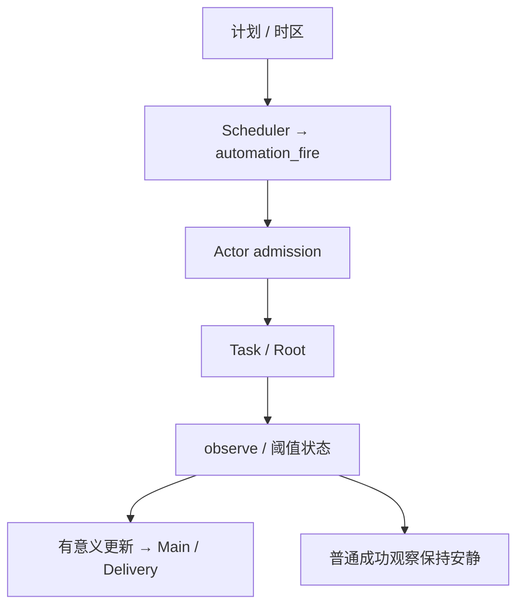

# 自动化与安静监控：技术方案

[功能与需求](../features/automation.md) · [测试方案](../test-plans/automation.md) · [主索引](../feature-map.md)

本文的架构与流程描述当前有效实现；明确标记的待实现方案不表示已落地。实现级协议仍服从 [跨功能协议与约束](product-overview.md#contract-0-文档效力与实现规则)。

## 当前架构

Scheduler 仅产生持久 fire。Actor 通过同一事务关联 ongoing Task 和新 Root；Root 观察后经 Reporter/Main 决定交付。

## 当前流程与目标差异

Host 在分页前排除撤权的托管计划，接纳前重查原图和版本；按触发时间和 ID 越过缺失日历包的候选，保留每次扫描最多 100 个可接纳项。

建立计划 → 到期保存 fire → 校验计划/隐私版本 → 创建或复用 Task 并新建 Root → 执行 → 必要时通知。取消和旧版本触发不能重新激活已停止意图。

- **F-015**：计划、触发记录、Task/Root admission、版本去重和恢复已接通。 执行需要应用或前台 worker 在运行；不自动分离守护进程。
- **F-016**：Root observe 写入每次 fire 的观察值，保存阈值跨越状态并控制 Reporter 通知。 本需求是监控机制，不内置价格或其他在线数据源；真实数据接入由 F-025 跟踪。

## 代码与依赖

- [internal/automation/automation.go](../../internal/automation/automation.go)
- [internal/agent/sqlite/automation.go](../../internal/agent/sqlite/automation.go)
- [internal/agent/sqlite/reporter.go](../../internal/agent/sqlite/reporter.go)
- [internal/app/automation.go](../../internal/app/automation.go)

## 待实现方案

以下方案尚未实现。接口、持久化结构、迁移与精确时序须在实现前确定；当前执行仍遵循已有运行时契约。验收范围见功能说明及并列测试方案。

### F-045 · 主动规则的观察与启用

当前使用者是已经授权 F-042 GitHub PR 监听的本机所有者。他可以先对一项已有 Task 查看规则决策，再决定是否交给现有 Main 和 Task/审批管线。规则范围来自确切 PR 配置和不可变 Task 目标，控制面只扩展已有 `github bind/binding/unbind` 与只读 `github decisions`。这组 CLI 字段处于实验阶段，决策表及状态协议为私有实现。

所有者选择事件类型、可选 CI 失败筛选和模式，宿主负责匹配、身份去重、授权和事务接纳。绑定复用已有 CAS version 和 generation。成功轮询事务按扫描开始时捕获的代次校验当前绑定、Task 和隐私作用域，并原子保存观察与决策。CI 规则比较持久化的结构化结论，只有规范的 `failure` 匹配。未识别结论映射为 `unknown`，决定不采纳来自检查名称或正文的判断。决策冻结 Task、模式、筛选和当时的安全结论，代次取自不可变观察。理由由冻结字段得出，查询范围和返回数量沿用已有裁决。规则匹配无需模型。

未绑定或撤销后为关闭模式。观察模式可评估并保存决策。显式自动模式只允许当前代的匹配观察进入现有单 Main 接续，随后仍受同 Task、作用域、未知副作用及审批约束。规则修改原子推进代次和序列水位，撤销未接纳的旧因果 Main。已接纳的 Root 归原 Task 管理，旧冻结请求不被改写。迟到的旧代轮询可以保存原始观察，重试同一版本仍无法获新代授权。迁移 038 保留旧绑定的无筛选自动行为，只允许迁移前已落盘且越过旧水位的无代次观察走旧规则；新观察在旧格式绑定下也必须匹配当前代。

有界决策、Task 和授权代次是正确性与审阅所需的状态。规则直接使用已存在的事件种类和绑定，避免额外规则版本、通用语言、批次调度器和独立执行面。暂不开放模型研判、其他来源或跨 Task 自动分配。

迁移 041 以空结论保存原来只按类型筛选的绑定和已排队决策。显式结论决定接续时，当前筛选需与已接纳决策的预期结论一致。该额外谓词沿用实验 CLI 和既有观察来源。检查结论参见 [GitHub Checks API](https://docs.github.com/en/rest/checks/runs)。

## 验证与交付

验收场景、已有入口和剩余覆盖统一在 [测试方案](../test-plans/automation.md) 维护。实际执行结果以对应版本的 PR 或 CI 证据为准；架构说明不证明回归或 Live 验证通过。

## 协议、实现与配置约束

本功能协议在此维护。既有编号用于追溯协议，不代表所有设计目标均已实现；完成状态以需求主索引为准。

#### 3.11 Automation 与 RunScheduler

- 保留独立的 `RunScheduler`，因为定时提醒、周期性简报、持续跟进等能力会较早进入产品。
- 对外能力和领域对象统一命名为 `Automation`；不使用 `ScheduledTask`，避免与 Agent 为并行执行创建的内部 `Task` 混淆。
- `Automation` 表示用户持久化的自动执行意图；一期 `trigger` 支持单次 `at` 与周期 `cron`，并显式保存用户时区。
- `RunScheduler` 只负责持久化触发条件并在到期时产生统一的调度事件，不直接执行 Agent Loop，也不承载业务逻辑。
- 调度事件进入 `AgentActor`，由正常路由规则创建或唤醒 Main Run/Worker Run；定时触发与用户消息复用同一套 Run、权限、工具和交付链路。
- 实际执行仍由 `RunExecutor` 消费 `run_ready`、调用 `RunStore.Claim` 后完成，Scheduler 不绕过 RunClaim。
- 一期不在 Scheduler 内实现资源编排或复杂工作流；未来云端可将触发器实现替换为分布式调度服务，而保持内部事件协议不变。
- 本地 CLI 的 `automation work` 在前台以同一个 Actor/RunClaim 路径消费触发；`automation tick` 只生成事件。运行命令、Tool Schema、升级和证据见 [Automation operations](../features/automation.md)。
- cron 使用五个数字字段，支持列表、范围、步长；weekday `0L`～`6L` 表示当月最后一个对应星期。不存在的 DST 分钟跳过，回拨的两个 UTC 分钟分别触发。错过多次时合并为持久化的原到期触发，下一次 cron 严格晚于扫描时间。
- 持久化 fire 身份、独立 schedule version 和 Inbox 收据。修改使旧排队触发/结果失效；取消复用 Task epoch 停止树，不创建新 Run。每个 Automation 绑定 ongoing Task，每次触发按序新建 Root；Model/Capability 在 admission 时冻结。
- Automation 接受时冻结隐私 epoch；admission 在创建首个 Task 前校验该意图与当前 Forget 屏障，撤销的 fire 持久化 skipped 与 Inbox。收据重放、调度更新或新 Task 时间戳不能恢复旧意图；升级时缺少 provenance 的旧意图在已有 Forget 后保守跳过（ADR 003）。list 对撤销意图仅返回 Host 生成的引用、当前版本和 enabled 控制状态，清空指令/调度/时区并省略 nextFire/below；本地审计保留，新的意图仍完整可见。
- 可选整数 `below` 阈值由绑定 Root 的普通 ToolInvocation 记录观测；同一 fire 的多来源同值幂等，异值拒绝。仅从阈值外进入阈值内允许完成通知；无有效观测报告 needs_input，不伪造数据。

统一链路为：

`Automation → trigger → RunScheduler → AgentActor → Run → AgentLoop → Delivery`

### Tool contract and compatibility

| Tool | Exposure | Permission | Replay | Errors |
| --- | --- | --- | --- | --- |
| `builtin__automation_manage` | Main | `task_control` | safe; frozen invocation and source/action receipt | invalid request/CAS: `INVALID_ARGUMENT`; missing ref: `NOT_FOUND`; Worker: hidden/denied |
| `builtin__automation_observe` | Only monitoring Automation Root; Main/ordinary Roots/Children hidden | `automation_observe` | safe; immutable per-fire observation | invalid value: `INVALID_ARGUMENT`; wrong role/fire: `PERMISSION_DENIED`; value drift: `NON_DETERMINISTIC_REPLAY` |

The shared ToolExecutor enforces frozen schemas and exact action approval for
any downstream external effect. Automation grants no credentials or effect
approval. Existing frozen capability snapshots gain no Tools. New Root trees
freeze the active profile at admission, not when the schedule or fire was created.

Migration 023 adds Automation, fire identities, source/action receipts, due and
pending indexes, version/transition/audit constraints. Empty and all prior schemas
upgrade forward. Populated v22 migration and partial-DDL rollback have dedicated
tests. Back up the whole data root with the process stopped before upgrading.
Migration 024 adds the immutable intent privacy epoch. Legacy Automation rows
retain their audit and default to epoch zero: they remain eligible without a
Forget barrier; with a barrier they are conservatively skipped, even if their
calendar timestamps appear newer. Create a new Automation from fresh independent
input to establish intent after Forget. Existing fire/request receipts are not
rewritten. Partial-DDL rollback and populated v23 preservation are tested. Older
binaries reject schema 24. No credentials enter these records.

## Web 所有者直接编辑

具体需求是让所有者在 Task 页面看见待执行安排并手工修改配置，参考成熟自动化表单的指令／频率／时间层级。CLI 与 Main 工具已共用 Runs 的事务、automation_request 收据、schedule_version fencing；它们的 cancel 同时取消关联 Task，无法充当可恢复的安排停用开关。

新增内部 OwnerConfiguration/OwnerReceipt 与 ConfigureAutomation，使用同一 Runs.write 和不可变收据机制。此为私有所有者配置契约，不扩展模型 Tool schema，不把 TaskReader 改成写入接口，也不新增数据库表。版本、当前所有者和原意图 privacy epoch 在事务内校验；仅更新安排及触发版本，不修改已接单 fire、Task 指令或 Run 快照。停用不取消 Task；已过时的未接单 fire 由既有版本检查拒绝，旧版本阈值观察不再具备通知资格。

Web 使用独立的 ScheduleSettings 读写适配。source_id 保留跨未知响应的重试身份；匹配收据在当前版本检查前返回，改变同 key 的请求被拒绝。未修改的单次时刻通过原始精确 Spec/时区证明保留秒、小数和既定偏移；新写入须在事务内匹配原配置与提交版本，避免隐藏字段成为任意回写入口。新输入必须选定真实时刻。夏令时空缺标出本地时间，回拨时显示两个可选 UTC 偏移。历史版本仍拒绝未明确的重复时刻。

保留了原始任务和完成规则不可变的边界；没有引入可编辑 Task anchor、通用工作流、结束日期或单项模型选择。安排读失败仅降级安排区域，普通任务仍可读。此实现不承诺执行恰好发生在触发时间，也不新增后台守护进程。

## 定时功能的插件迁移边界

`schedule` 1.0.1 在原编辑器配方上返回阈值下限。Web、CLI 与 Main 接纳新建或修改的计划时均应用同一固定配方。严格小于的整数观测规则保持不变，旧计划的本地停用或已接纳回执继续按原版本处理。

1.0.2 的本地时间配方使用随包固定的时区数据按真实时刻排列回拨选项。编辑器只提交所选 UTC 偏移，Host 在相同创建请求中重新调用配方，保存确切 UTC 时刻并沿用现有幂等键。没有选择时不消耗该键；保存后相同请求重试复用回执。插件只返回有界字段标识与合法偏移。Web 对确定的字段错误返回 422，版本冲突返回 409，暂时不可用返回 503。

真实消费者为 Main 管理工具、CLI、Web 所有者编辑和到期扫描。现有合同包括 cron／DST／最后星期规则、显式时区、原 request key／CAS、schedule_version、旧计划／fire／Task、隐私代次和恢复。日历方法采用仓库私有实验服务 `steward.schedule-next/1`，只接收类型、表达式、时区及原时钟，返回下次时间或参数错误；不公开指令、内部 Task／Run、账户、凭据或数据库。

四条计算路径均在写事务外调用真实隔离插件。所有者按当前选择准备，Main 使用不可变 Run 图，扫描使用计划保存的图。提交复核原所有者／claim、版本、隐私和 Guardian；原 action 回执先于重新计算和新版本检查。结构解码不预先调用旧算法。新建或修改禁用配置仍须验证并绑定方法；原样停用属于不依赖生产者的 Host 控制。CLI／Main 的临时拒绝分支已删除。

schema74 为计划和已接纳 fire 保存 method_graph。只有新的 schedule_version 可更改计划图，fire 图不可改写；原有 NULL 图不补造版本。授权、权威事实、事务／outbox、版本冻结、隐私撤回和去重接纳留在 Host；日历算法与时区规则归插件。这些是领域所需边界，不引入通用 scheduler framework、任意状态接口或写事务内 RPC。

时区档案取自固定 Go 1.26.10 的 zoneinfo.zip，并直接嵌入插件；来源、哈希和声明见插件的 zoneinfo-NOTICE.md。插件使用 LoadLocationFromTZData，不读取系统时区文件或 ZONEINFO。更新时区数据需要新的插件版本及既有验证／激活流程。拒绝依赖系统文件变化却声称图版本已冻结。

原生解释器隔离为 `internal/automation/calendar_legacy.go` 的 HistoricalNext，仅服务首次激活前所有者、NULL 方法图的旧计划，以及服务清单不含 schedule-next 的历史 Run。对应消费者全部消失后删除，不能作为托管失败的回退。升级／回退只影响新配置；旧计划、旧 fire 和在途 Run 保留原图。

默认发行已加入 schedule，组成32个包；独立 Owner 日历样例固定预期值，不取候选输出作 oracle。F-015 的日历、编辑、展示、工具说明及默认配方均已进入同包托管路径，并完成行为、生命周期与兼容清理验收；它们共享功能版本，不拥有各自独立的生命周期。F-016 阈值业务另有原子功能归属，不能将其当前原生策略计为本项已迁移。

本地分钟转换已提取为私有 `steward.schedule-local-time/1`，只接收日期、时分和时区，复用同一包内固定时区数据并保留 gap／fold 拒绝规则。Web 新建／改动的本地分钟已作为未解析输入进入原保存路径，在既有回执检查之后、同一图内依次转换和计算，再事务接纳。新增输入字段为空时不参与编码，保留旧配置命令的哈希；回执按原始输入而非转换结果确定身份。HTTP 解码不做 RPC。Web 的 exactLocalOnce 已删除，首次激活前兼容代码具名保留为 HistoricalLocalTime。写入中的精确 Spec／偏移匹配也已由同一方法执行，原样停用继续不依赖生产者；NULL 记录的首次读投影仍为迁移边界。

升级前的 Web 单次表单已将转换后 Spec 纳入回执哈希。新表单格式重试这类已接纳请求时，具名历史转换只用于验证旧哈希并返回原回执，不调用生产者、不更新计划、不接受新配置；同 key 的时刻漂移仍拒绝。此兼容代码与前本地输入格式的 owner 回执一起保留，相关回执不再有消费者时删除。它保留旧系统时区解释依赖，不扩大为托管失败的原生回退。

周期表单也以未解析频率输入进入同一回执优先路径，私有 `steward.schedule-frequency/1` 仅接收 frequency／clock／weekday／day，返回表达式或参数错误；不接收指令、引用、权限或数据库。转换和 next 计算使用同一原图，事务继续接纳最终 Spec。Web 原日／周／月到 cron 算法已删除。

schema75 的可空 owner_frequency_json 保存该版本实际接纳的强类型原始频率输入；更改它要求 schedule_version 递增。真实消费者为配置读取和不依赖生产者的原样停用。配置读直接还原原输入，不能按新表达式反推；停用对比已接纳事实并保留 Spec／图／原输入，修改则仍经方法。CLI 显式更新用该次 Spec 的原图投影替换旧输入来源，扫描不修改它；撤权后读取不返回它。这个可选事实字段是无损迭代与本地控制所需，不是通用表单状态层，对外 JSON 不暴露新领域模型。

旧记录保持 NULL，不补造历史输入；其原样停用及旧回执认证保留具名 HistoricalFrequency，只验证原表达式／已接纳哈希，不接受托管新工作。相关旧记录／回执不再有消费者时删除该兼容解释器。拒绝“用当前或原生算法反推所有原输入”：独立插件可以合法产生不同表达式，那会破坏停用和重试。首次时刻读投影已按下述原图方法接入；列表表达已按下述原图方法接入；工具声明仍是待迁移业务。

已有单次安排的分钟匹配已从 Web 写入解码移入同一 LocalTime 方法：Host 先以原配置／版本／时区认证 submitted original Spec，再交方法决定保留原精确值还是转换新分钟。返回原值时保留完整秒、小数及偏移，包括重复小时的两个既定瞬间；新分钟仍拒绝 gap／fold。新增可选 original_spec 的上限沿用原256字符合同，不能截短旧值。

schema76 的 owner_local_json 只保存实际接纳的日期／分钟编辑事实，更改须递增 schedule_version；读取直接恢复原输入，离线原样停用比较保存事实并保留原 Spec／图，不调用生产者。显式 CLI 更新用该次 Spec 的原图投影替换旧输入来源，撤权读取不返回它。NULL 不补造历史事实；旧 NULL 输入配置和旧回执保留具名 HistoricalLocalMatch 进行兼容认证，迁移前所有者保留旧转换解释。CLI／Main 直接 Spec 配置的首次本地展示现已通过下述投影接线；NULL 旧记录保留具名历史解释，列表格式已由下述展示方法接入。

私有 `steward.schedule-editor/1` 接收 type／Spec／timezone 并返回原表单所需的有限频率／日期／时分／星期／日字段。Main／CLI／所有者直接 Spec 保存时，在原图内计算并与原配置原子接纳到既有 editor 事实字段；已有原始编辑输入优先保留，不用派生表达式覆盖它。读取与停用只消费已接纳事实，不启动候选；投影只是表达策略，不能改 Spec、next、权限或事实身份。

旧 Run 的不可变服务清单若不含 editor 方法，仍按原 graph／next 方法创建历史 NULL 编辑事实配置，升级不补填快照。Web 原反推代码移至 schedules_legacy.go，仅供不声明 editor 方法的 NULL 历史记录；声明该方法的新图若缺少事实，权威读取拒绝而非原生回退。新增的图声明检查是防止静默 fallback 的必要接纳完整性约束，有真实配置读取消费者，不是通用视图框架。旧记录／在途 Run 不再需要时删除历史解码器。

私有 `steward.schedule-display/1` 持有现有频率名称及本地时间的中英文表达，只接收 type／Spec／timezone，返回四个有界普通文本字段；不返回 HTML、样式、资源或控制命令。Host 在同一冻结图内计算并以 schema77 的 presentation_json 随配置版本原子接纳；更改展示要求新的 schedule_version。保存两种现有语言让切换语言和停机时的原配置展示不需要启动候选，不推广成通用翻译或页面框架。

Task／安排读取按同一可见性判断释放已接纳展示事实。Web 模板只选择既有语言并按普通文本转义，不再在默认路径解释 cron 或读取系统时区做表达；旧格式化代码具名移入 schedules_legacy.go。原图声明 display 却缺少必需事实时读取拒绝，不能恢复原生算法；旧图和不可变服务快照不含 display 的在途 Run 保留 NULL 历史解释，旧记录不补造展示。原样停用保留展示，修改配置与显式 Spec 更新采用新图的展示；Forget 后展示同样不可见。此字段是离线展示与历史版本保持所需事实，不是跨功能视图缓存。

调度首次创建 Task 的标题复用已有 `steward.task-label/1`，不在 schedule 包另建标题算法。标题属于新 Task 的接纳，而非先前日历计算：在写事务外按当次所有者、当前选择、原 fire／schedule_version／隐私准备；提交复核同一输入、选择与 Guardian。此纯计算尚未接纳时可在下一次尝试重新准备，已经创建的 Task 不重算标题。

schema78 在实际创建 Task 的同一事务，为对应 fire 保存 task_title、task_label_graph 与 task_label_managed；接纳后不可修改，旧 fire 及复用已有 Task 的后续 fire 保持 NULL，不补造来源。Root 的选择与标题接纳处于同一 writer，原 brief／anchor 不被标题重写。Task-label 曾激活后，缺失／停止生产者不能恢复原生标题；首次激活前兼容在准备路径具名保留并记录 managed=false。原生的默认 Task.Title 调用已从 Task 接纳分支删除，保留的共享标题验证属于现有80字符／规范化数据合同。

拒绝把候选 RPC 放入事务、按日历图强制绑定无关 Task 方法或另建通用调度框架；Task 标签是独立功能，首次新 Task 与该次 Root 使用实际接纳时的选择，日历原图仍保持原身份。后续业务余项是工具说明、列表中的指令摘要及调度到 Root 的可替换提示；审批、原始意图、因果事实与事件／Task／Run 接纳仍由 Host 保持。

管理列表的指令摘要由 schedule 自己的私有 `steward.schedule-instruction-label/1` 生成；该方法只收到已授权原文，不收到计划身份、时区、凭据或状态能力。它与新 Task 名称是不同生命周期的表达：摘要随配置图版本保留，Task 名称随首次 Task 接纳决定，因此不把两种政策绑为通用文本平台。Host 只要求列表字段为非空、有界普通文本，不强制 Task 名称的措辞或空白政策。

保存时在同一图内生成 instruction_label 并放入既有版本化 presentation_json；直接 Spec、频率和本地输入都保留原始 instruction，不用摘要替换它。列表不启动候选，按资源原图释放已接纳摘要；新图声明该方法却缺少有效事实则拒绝，旧图明确使用 automation_legacy.go 的原 formatter，随旧资源退休删除。隐私撤回先于摘要读取校验，仍只返回原有最小控制元数据；新字段为空时省略，旧展示事实可继续读取。

管理工具说明采用私有 `steward.schedule-guidance/1`，输入为空，输出仅有 Description 普通文本。沿现有 MCP／Apps／UI 的批量准备路径，在事务回滚后执行候选，再以原 capability 隐私／选择 fence 创建快照；没有在 writer 内发 RPC，也没有增加事务尝试次数。内存仅按图缓存不含用户数据的说明，内容哈希随说明存入原能力快照；Run 的实际 Registry 只从该快照恢复说明与资源身份，不重新选择当前版本。

Host 保持已发布工具名称、Main-only 权限、版本、结构 schema 和 safe replay／接纳身份。这些是现有 Main／CLI／事务消费者的权威合同，日历语言解释已经归插件；说明不能修改它们。旧 Run 继续使用冻结说明，撤回贡献后新 Run 的说明为空但固定本地控制合同保留，不恢复原生措辞。原说明具名放在 declaration_legacy.go，仅服务基础注册和首次 guidance 激活前快照，随这些消费者退休。

调度到 Root 的固定封装仅包含原 fire 的 UTC 触发时刻和未改写 brief，是保护因果事实／原始意图的 Host 接纳职责；Task／instruction／Root／fire 在同一事务关联，既有 frozen request 继续保留原字节。不为这段事实封装新增任意提示改写接口。条件性的“记录观察值／仅入阈值时通知”属于 F-016 的方法指引，仍在该独立功能迁移范围，不计为 F-015 已迁移业务。此取舍保留必要权威接缝，拒绝把整个受保护意图交候选重写。

新建／编辑草稿的默认频率、时间、时区、日期／cron／星期／日字段和启用状态由私有 `steward.schedule-defaults/1` 返回，只包含既有 UI 草稿字段，不含身份、指令、权限或效果。新建页按当前选择读取公共元数据；保存时在同一图生成配方并随既有 presentation_json 接纳，编辑旧配置直接使用其保存配方，不启动候选。Host 只校验有限字段结构、生成 source_id 并维护原保存语义，不新增通用配置／页面框架。

新图声明 defaults 却缺少已接纳配方时，安排读取拒绝；贡献停止／撤回时新草稿明确不可用，不恢复硬编码默认值。首次激活前嵌入器及旧图记录保留具名 LegacyEditorDefaults，随这些历史消费者退休。升级／精确回退改变后续新草稿，先前配置配方不变；隐私撤回沿既有展示事实围栏。F-015 的实现、生命周期与兼容清理已完成验收；后续修改仍须使用固定源码／二进制完成适用的跨模块检查，不能用单项 RPC 或页面测试代替。

## 阈值通知的插件迁移边界

实际消费者是 Automation Root 的 `builtin__automation_observe` 与原 Reporter。当前规则是新鲜观察首次严格低于 below 时通知，持续在区间内保持安静，退出再进入重新通知；迟到观察不回写更新的状态。F-016 已接通同一 schedule 包中的阈值判断、Root 观察指引和工具说明；真实32包分发、原 Root 生命周期、隐私／恢复、提示冻结与跨模块验收均已通过，F-016 已完成迁移。

该策略与安排的 below 配置、fire 生命周期共同变更，当前没有独立选版消费者，因此复用同一 schedule 包，不新增插件、进程或通用规则引擎。私有实验事实仅含 value／below／entered／fresh，输出状态与通知决定；不开放 Task／Run／fire 实体、时间戳、数据库或交付权限。fresh 来自 Host 的权威顺序，不由候选读取或构造。

阈值比较与安静／通知转换是业务政策；Root 身份、原 claim、隐私与 schedule version、同 fire 相同值幂等／异值拒绝、单调观察接纳及状态／事件事务是必要机制。observe 已在 writer 外使用原 Run 冻结图计算，在事务内重复 claim、原调用参数、fire、配置版本、隐私代次与原阈值状态围栏；已接受观察先走原持久事实，相同值不依赖运行中的插件，异值仍拒绝。旧 Run 保留具名旧判断，新托管失败不得静默 native 兜底。不以纯函数单测将 F-016 标为完成。

观察工具说明和 Root 指引复用现有 `schedule-guidance/1` 公共元数据，不新增服务或任意提示编辑器。私有可选 observation 字段含说明及阈值前后两段普通文本，Host 只在两段之间插入已授权的实际整数；不解析模板语言，也不把原 brief／fire／阈值身份交给插件重写。元数据仍在 writer 外准备，原三次事务机制接纳时复查图、Guardian 与隐私，Root 指令和能力在同一 admission 冻结。

旧元数据协议只有 description、没有 threshold 服务的历史 Run 保持原工具说明和具名旧判断。首次阈值迁移后，新 Root 若在撤回或旧元数据图下缺少观察配方须拒绝，不能补造 native 指引；本地取消继续可用。Registry 仅从各 Run 原能力快照恢复说明／内容哈希，不改变固定名字、schema、权限、replay 或工具版本。冷元数据准备期间真实 Forget 不得借事务重试复活原意图。

Reporter 只消费已接纳的 observed_value／notify：成功且安静的检查不交付，缺失观察只能报告未建立观察，不能伪造事实。该分支与原身份绑定的失败报告属于 Host 的事实／回执完整性机制，必须独立于生产者可用性保留；它不再比较阈值，不新增报告策略接口。旧判断仅服务不含 threshold 方法的冻结 Run，随历史消费者退役删除。

Web 的已验证浏览器时区只作为新建表单的显示输入。工作台插件决定是否使用它；无有效时区则选择原计划配方默认值。历史表单和保存值保留其版本含义。展示下一次触发时只换算已保存的精确时刻，载明当地 UTC 偏移。

### 所有者试运行

工作台插件提供显式表单，Host 将已授权的计划版本、隐私代次与相同请求回执绑定在同一事务。新任务使用当前托管 schedule 的指引与阈值算法，按原有 Root 的权限和审批冻结。每个试运行仅有一个已接纳的 fire，复制进入阈值状态，不进入生产的到期扫描和计划列表。试运行回报通过同一 Main 结果通道固定回 Web，按试运行任务分组。原配置、偏好与历史 fire 保持自己的身份。该接线是供本机所有者验证计划的一条私有路径。
