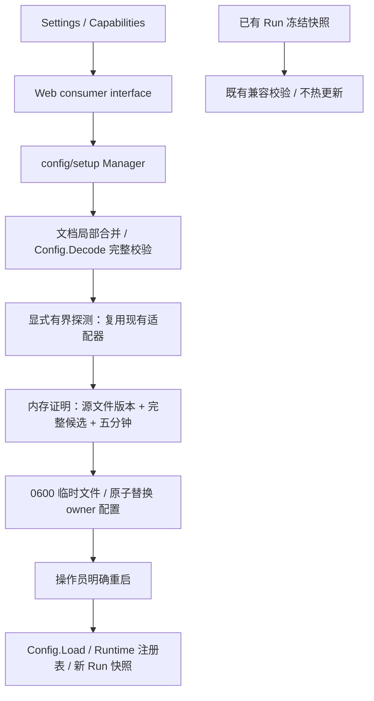

# 能力连接与就绪引导：技术方案

[功能与需求](../features/capability-setup.md) · [测试方案](../test-plans/capability-setup.md) · [主索引](../feature-map.md)

实现级协议服从 [跨功能协议与约束](product-overview.md#contract-0-文档效力与实现规则)。

## 自动默认资源

正常安装启动推导 `defaults: {memory: true, search: true, skills: true, computer: true}`；显式 `-config` 不自动加入该段。具体资源配置优先，带自定义路径、toolchain 或 repository source 的本地执行覆盖默认 Computer。Manager 在启动时准备有效资源，owner 文档保留自动模式，读取 Settings 和 doctor 不下载、不引导 Guest。

Memory 使用跨进程锁分配随机 SecretStore 引用，确认 32 字节密钥可读后原子保存 `default-memory.json`。已有引用丢失或锁定时不重新生成；已有加密数据但无默认引用时要求恢复原密钥。本地凭据文件不可用时 Settings 显示需要处理，本地 Conversation 搜索仍可用。备份包含引用元数据，不包含凭据文件。

本地搜索直接查询已有 SQLite 文本索引，支持中文子串；不调用 embedding 服务、不制造向量、不绑定向量空间。加密 Memory 的明文索引仍只在内存中。可在设置中接入自定义 embedding，既有向量身份变更仍要求离线迁移。Conversation-only 与包含 Memory 的默认搜索具有不同冻结资源身份。

普通表单以 Auto／自动显示自动选项，当前模式由选中态表达，不附加默认或推荐标记；底层仍通过 `mode: automatic` 表达自动候选，Manager 将其转换为 `defaults` 对应开关并删除自定义 section；自动 Computer 同时移除本地执行覆盖。关闭同时清除自动开关，重启不会重新开启。Memory 关闭还原子清除 embedding section 并关闭 defaults.search；重新开启 Memory 默认恢复本地检索。自定义密钥仍必须与既有默认密钥一致。

Computer 的详细下载、Guest 准备与等待协议见 [Computer 方案](computer-use.md#自动桌面准备)。自动资源的连接测试只确认选择默认模式，实际进度独立显示；不把配置选择当作桌面已启动。

## 当前架构

`config/setup` 持有 owner 配置文档、候选验证、诊断证明和原子保存。Web 在消费侧定义 CapabilitySettings 接口，只负责认证后的页面与原生表单。App 只注入服务，不参与配置业务规则。运行时仍从启动 Config 创建现有能力注册表，不引用设置服务。

## 编辑与保存流程

- `GET /settings/capabilities` 只投影已保存配置；底层详情路径限定为六个已知 ID，主列表仅展示五个入口；embedding 通过 Memory → 高级设置进入。普通读取不发起探测。`POST /capability/configure` 使用现有 owner 认证、Host/Origin 检查，普通 Save 在同一请求中先 Test 再 Save，成功后 303 回详情；失败保留草稿，不写配置。高级编辑仍支持单独测试与精确证明保存。页面不轮询重建编辑器。
- 每次编辑最多 64 KiB，源文件最多 256 KiB。YAML AST 仅替换当前 section，随后调用共享严格 Decode 校验全部字段、单文档、版本、引用和路径隔离。启动与设置共享 ValidateSourcePath，拒绝把 owner 配置暴露于执行、toolchain、Skills 或 provider 目录（包括符号链接别名）。自定义 Computer 编辑包含 computer/javascript，保留冲突检查；选择自动 Computer 则切回默认桌面并移除 execution 覆盖。
- 测试使用现有 Memory Vault、embedding HTTP adapter、Skill catalog、MCP 沙箱发现、Local execution 和 Computer provider。单次总时限 30 秒，同进程仅一项探测，探测期间不持有配置互斥锁。错误只返回固定诊断文案，不回显底层错误或凭据。
- 内存保存最多六项有界草稿，详情刷新保留当前源版本下的未保存候选。成功证明绑定源文件 SHA、规范能力值、完整候选文档 SHA 和时间；测试结束再次读取源版本，外部变更使结果作废。五分钟过期可保留草稿，但失去保存资格。证明不跨重启，不视为持续健康承诺。
- 保存串行化并持有配置父目录 advisory flock，拒绝同版本并发 Steward 写入；通过 os.Root 固定目录，拒绝符号链接/非普通源文件，0600 临时文件 fsync 后再次校验版本，再 rename 并同步目录。保留未改 section/注释。外部编辑器不参与 advisory lock，不能承诺任意第三方在最后 rename 瞬间的写入都受 CAS 保护；应避免同时手改。
- 默认 owner 文件不存在时，从启动配置生成必要资源 section；不持久化托管 broker 临时端口或安装时推导的模型 Bridge 路径。Load 自动发现 data_root/config.yaml，显式 -config 始终优先；读取和 doctor 不创建文件。已存在源文件被删除后，当前服务拒绝默默重建覆盖。

## 生命周期与数据边界

Manager 持有不可修改的 startup Config 副本，与已保存配置比较生成 PendingRestart。保存不调用 Registry、Run、ModelProfile 或数据库迁移；明确重启后新 Run 冻结新能力。旧快照继续现有兼容/重放协议，发生身份冲突时拒绝恢复。

Memory 密钥引用变更必须解析到同一密钥，不能把连接设置当作加密数据迁移。已保存或启动时的 embedding identity（provider/endpoint/model/dimensions）不能通过 Save 直接更换，须先离线重建索引。停用并不删除旧数据，跨进程再次启用仍须操作员保留原身份；既有存储绑定继续拒绝向量空间混用。

Computer `Provider.Probe` 与实际执行的 lock 路径共用 checkHost，校验独立存储、禁用遥测/缓存与精确版本，诊断额外校验 sealed base 和凭据可用性；不分配 Guest。平台真实兼容性仍由 Computer 功能自己的 native/live 证据界定。

## 代码与依赖

- [config/setup](../../internal/config/setup/manager.go)：状态/证明/保存编排；[document.go](../../internal/config/setup/document.go)：文档编辑与原子写入；[resources.go](../../internal/config/setup/resources.go)：六类资源投影；[probe.go](../../internal/config/setup/probe.go)：适配器诊断。
- [Config.Load/Decode](../../internal/config/config.go)：默认发现、严格共享校验。
- [Web control plane](../../internal/interaction/web/capabilities.go) 与 [v1 owning 视图](../../internal/plugin/capabilityforms/v1/view/capabilities.html)。随包发布的 1.0.0 和显式 v1 兼容入口使用同一份 Go 投影和视图资源。已托管调用仍按图执行独立包，Host 继续校验资源身份与候选配置。
- [Computer shared probe](../../internal/computer/macosvm/probe.go)。

无新依赖、模型工具、DB schema、CI gate 或评测体系。自动 Computer 使用由宿主进程管理的私有 Lume 服务。设置层前端复用现有样式、原生输入与按钮；共用提交增强保留 clicked action，避免禁用按钮丢失表单字段，并保留初始 disabled 状态供 bfcache 返回恢复。

## 验证与交付

验收场景和证明范围见 [测试方案](../test-plans/capability-setup.md)。系统测试复用现有 channels gate 和 owned peers，不将界面截图或受控模型回复当作真实模型质量分数。

## 表单优先的能力配置

当前消费者是六类 Web 能力配置页；CLI、配置文件、CapabilitySettings 的校验与存储契约保持不变。界面沿用 design.md 的共享控件与键值同行，MCP 开关不再作为包含输入的网格标签。Memory 的 Semantic search 是具名子设置；Computer 的兼容和运行时字段按需展开。YAML 导入、原始编辑器、模板和宿主配置文件路径不出现在 Settings。

私有 Web 表单只提交具名字段与 revision。普通页面和字段提交使用 List 的已保存投影，避免上次失败探测的临时候选充当新基线；兼容旧检查链接的 Detail 路径仍保留。服务端从当前配置读取基线，并通过 YAML AST 定点更新，保留未展示的合法配置；随后仍由 Manager Test/Save 验证精确候选和源版本。序列化格式是内部机制，不再往返隐藏表单；提交者附带的整份文档不能覆盖 guided 基线。无法无损映射的配置保留原值并显示不可编辑状态，拒绝退回通用文档编辑器或静默改写。

自动保存单次处理候选，失败保留输入，挂起期间的后续字段修改按最近一次已接纳快照排队，包含改回初始值。MCP 增加行仅重绘草稿；有效删除随既有 apply 链路校验保存，最后服务删除停用 MCP；提交保留原 revision，不默默重基。必要目录、端点、权限是领域复杂度；通用表单引擎、公开字段 schema、格式编辑器和新持久层属于未证实复杂度，本次不引入。原生无脚本仍可提交，重启与冻结快照的边界保持原样。

默认应用使用数据根 `secrets/` 的文件 SecretStore 准备 Memory 密钥，不请求系统钥匙串。已有密钥引用始终复用；文件丢失时保留原引用并显示不可用，迁移保留既有加密身份。账户文件继续使用独立 account-secrets 目录。

## Guided forms 的托管边界

具体消费者是已有能力设置 GET 与 guided POST。原问题是 Web 直接实现六类表单解释与编码，无法独立换版。现将完整表单策略放入一个 `capability-settings` 包：`prepare` 接收当前能力 ID、owner YAML 文档与默认密钥引用；`submit` 再接收表单字段和明确动作，返回强类型 Form、候选文档、草稿／动作及有界校验文案。接口仅仓库内部实验级，不公开 Web Capability、配置领域模型、yaml.Node、数据库或 SecretStore。YAML 是现有所有者配置格式，插件不读取实际密钥；附加 POST 文档、配置版本及无关请求字段不传入。原生 codec 回归迁至 owning 包，普通 Web codec 已移除。

Host 的 `capability_guard` 属于领域必需的授权接纳：只允许现有表单可编辑路径变化，拒绝隐式 YAML alias、重复键、隐藏字段漂移、外来 provider 高级数据及未经原表单选择的关闭。MCP 保留各行原 identity 与未显示配置，新增行不能继承其他行的私有字段。仅允许原删除操作触发既有 apply 语义，不允许插件把普通新增草稿改成自动保存。Test／Save 和成功候选绑定仍由原 Manager 完整验证，不把插件输出当配置事实。

默认表单值、组件转字段、增删行及校验表达是可迭代业务；认证、凭据、未显示数据完整性、事务／证明／版本以及旧能力快照是固定机制。拒绝按每个能力字段拆插件、通用任意 patch API、任意配置访问或新的状态表。`legacyv1` 只解释从未激活服务的历史图／嵌入；停用、缺包和当前读取失败均不回退。原 Advanced YAML 控制面继续原授权及 Test／Save 语义。说明、顺序、检索入口和诊断展示已在同包托管；本批整体验收与跨 feature 资源预置审计完成前仍不宣告整个 F-030 闭环。

### 配置说明与诊断投影

实际消费者是 Manager.List／Detail 和 Manager.Test。一个 `steward.capability-presentation/1` 读取返回六类说明、示例、列表顺序／Memory 子入口标记及完整诊断词表，共用表单包版本。输入只有用于原示例路径的应用数据根，不传配置正文、凭据、私有诊断错误或内部配置模型。Host 校验六个已知 ID 恰好一次及文本大小；只绑定这些 ID 的原权威字段。列表顺序和检索的 Memory 归属从 owning 输出读取，原直接过滤和说明 switch 已清理。

诊断执行与成功证明保留 Host：固定的 SecretStore 摘要、embedding 诊断句、catalog/discovery、隔离命令和 Computer 检查不能被文字投影扩大。driver 只返回真实状态、已知诊断代码及实际计数。Host 在任何诊断效果前读取词表，之后只绑定 dimensions／providers／tools 三个现有计数，不执行通用模板。原证明保留接纳时的文字；之后版本变化或停用不能覆盖它，也不能把失败状态变成 ready。读取失败不能触发新诊断；List／Detail 仍返回原事实，以 PresentationUnavailable 和基础故障诊断区分缺失，不恢复旧业务文案。

本次未开放自动启动配方接口。256 位密钥分配、确认后发布引用、进程锁和既有私有资源身份属于 Host 机制，实际消费者是启动、原加密数据、配置身份检查、Run／Child 冻结资源和备份恢复。已发布 `mode: automatic` 与 Memory／search 联动是现有配置协议的解释与原子接纳；不允许通过仅重构改变其含义。自动 Skills 的原 agent 目录身份沿用，变更身份应走显式配置／迁移。Computer 的具体驱动预置仍由 F-027 清单审计，不能以本段把它宣布为可信内核或已迁移业务。拒绝在此次迁移中新造启动框架、通用策略表或配置补丁语言。

### 同包视图与词条

`prepare`／`submit` 的现有读取可请求同包 view／copy 资源，资源名、路径及 source digest 必须匹配确切包 manifest。设置页只消费本次读取已接纳的资源；提交结果在 Test／Save 前固定并按实际字段验证视图，效果后不再重新读取生成器。Host 复用既有私有模板校验器，能力页仅暴露显示 DTO 与同一强类型 Form，不暴露配置正文、路径、Server／Manager 或其他页面。原生模板已清理为解析所需的空槽，实际读取失败返回不可用，不执行旧普通视图。历史嵌入和从未激活该服务的图只使用具名 legacyv1 同包解释。

原 HTML 搬入封存资源并使用独立 capabilityTr 词表。130 项原中英文随包读取；共享外壳仍用 Host 词表，专属旧词条已删除。缺少 owning 词条时保留原文，不借另一版本补齐。带数量的原诊断仅支持现有数字位置。共享 help／icons／控件继续由 Host 提供，不接受候选脚本、任意 CSS、外链资源或通用格式化函数。

DOM 接纳只允许原同源 capability configure 表单及六类内部链接，绑定原能力／版本和 MCP 行 identity；拒绝未知字段、外部目标、隐藏凭据字段、原生事件、脚本和 noscript 网络资源。模板只能遍历真实的记录／provider／tools 数组，校验私有辅助模板展开预算，并限制输出字节。字段编码还与原提交逐项绑定，禁止在隐藏设置保留的同时偷换有效凭据、端点、私有路径或工具授权。这里的额外检查是当前 owner 表单的授权与效果接纳，不是通用表单框架。
