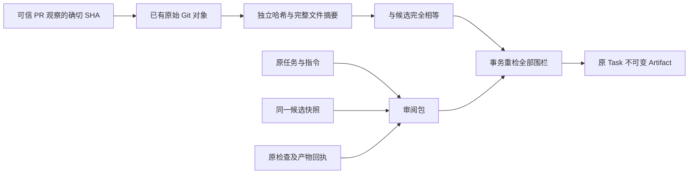
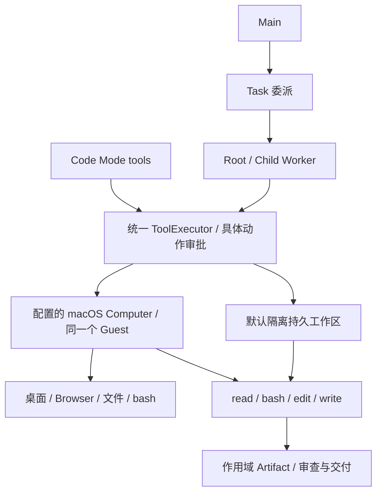
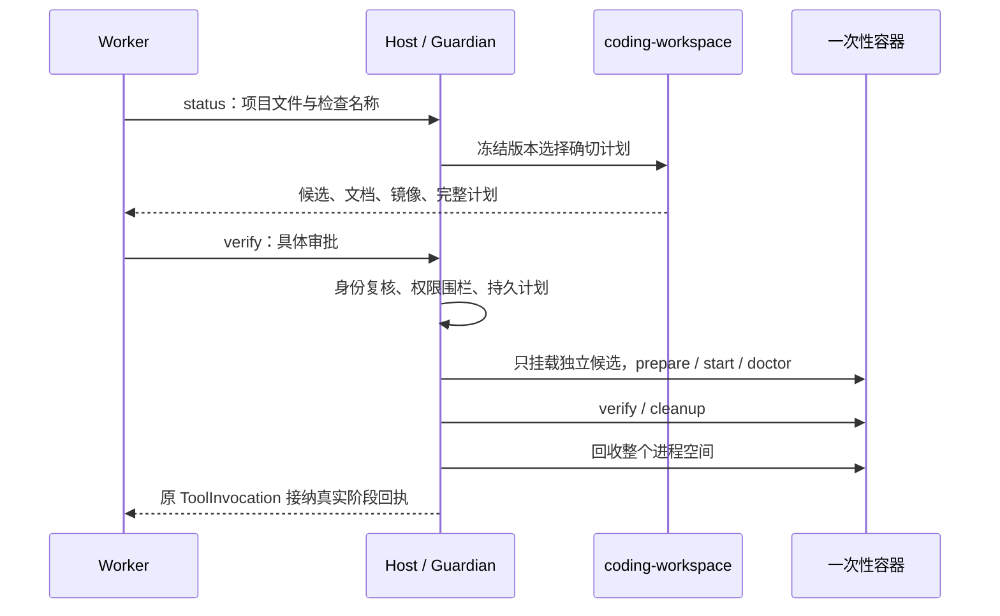
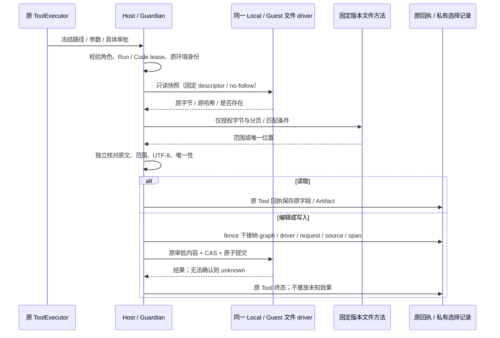
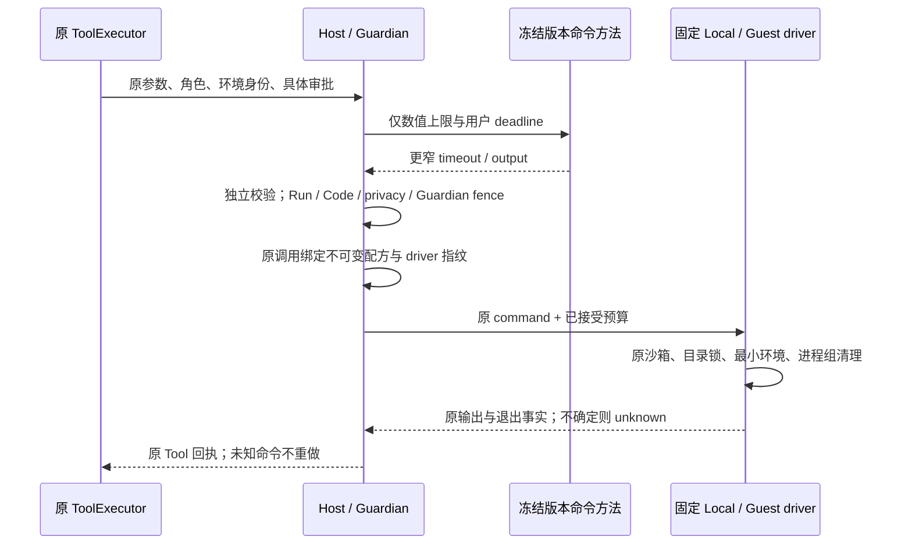
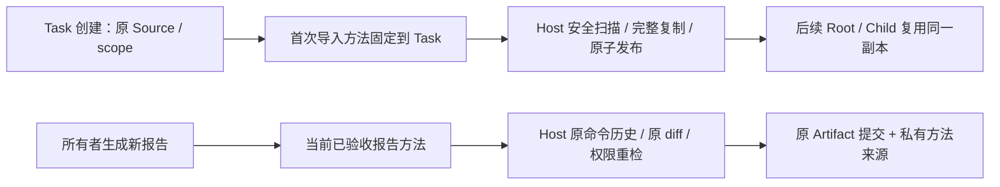

# 文件、命令与代码工作：技术方案

[功能与需求](../features/coding.md) · [测试方案](../test-plans/coding.md) · [主索引](../feature-map.md)

## 开发环境升级目标与验收基准

本节定义已请求的 quality / quantity 升级目标，逐项实现状态仍以功能文档、代码和实际回执为准；目标描述不代表能力已经可用。当前消费者是仓库所有者、Main 委派的 Task、Root/Child、独立验证者和交付审阅者，不建立公共工程 SDK。

以成熟产品的可观察工作流为基准：[Cursor 环境准备](https://cursor.com/docs/cloud-agent/setup)及 [Builds](https://cursor.com/docs/cloud-agent/builds) 将可复用安装与每次启动分开，任务从准备好的独立环境工作；[GitHub agent 环境](https://docs.github.com/en/copilot/how-tos/copilot-on-github/customize-copilot/customize-cloud-agent/customize-the-agent-environment) 支持项目依赖准备和独立检查环境；[pstack 验证方法](https://github.com/cursor/plugins/tree/main/pstack/skills/create-verification-skill) 要求启动、健康检查、真实操作、证据与清理。借鉴行为，由 Steward 自主实现；不引入这些产品的 agent SDK 或插件运行时，也不承诺复刻其全部功能。

| 必须实现的结果 | 可审查的完成证据 |
| --- | --- |
| 当前候选和验证绑定 | 原始源码、依赖、环境及方法身份可追溯；测试后修改输入，旧通过结果不再覆盖当前交付；失败/取消/unknown 不被标成通过 |
| 可复现项目准备 | 显式项目配方区分准备、启动、健康检查、验证及清理；空环境能走通，准备失败与代码失败分别可诊断 |
| 独立候选与验证环境 | 不同任务/候选不共享可写源码、端口、数据库或浏览器状态；独立验证者运行确切候选；同一工作区仍序列化 |
| 可用并行而非全局等待 | 不同私有 Task 可同时执行；共享 Guest/工作区及旧在途调用仍保留原冲突与恢复边界 |
| 可操作功能地图 | 项目有稳定驱动入口、前置条件、动作和结果；真实操作后核对持久后果，维护不能通过修改预期掩盖回归 |
| 可执行结构约束 | 从真实重复错误选取规则；错误变体被拒绝且诊断指出正确入口；原子业务归插件，历史兼容代码有真实消费者 |
| 关键状态机验证 | 审批/效果/回执、claim 或撤权至少一个关键模型具有代码映射、假设和界限；破坏变体产生反例且在真实代码回放 |
| 可审查交付和质量/吞吐事实 | 目标、候选、实际检查、未验证项、成本与耗时可检查；远端交付核对确切内容/修订；不以 PR 数或工具成功冒充质量 |

可信不变量继续属于 Host/Guardian：授权、凭据、事实、事务、冻结版本、撤权、unknown 不重放、证据身份接纳及审计。项目配方、检查选择、验证驱动、解释和风险审阅策略归所属原子功能插件。输入摘要与回执关联是作者、验证者和审阅者共同消费的必要机制；插件不得自行授予权限或改写权威事实。

新接口先保持仓库内私有/实验级，沿原 Task、Run、Artifact 和 ToolInvocation 扩展，不另造顶层任务/调度系统。保留必要的目录、进程、服务与版本隔离，拒绝任意 Host 执行、通用工作流 DSL、通用品质总分和每 helper 一套插件生命周期。原生离线环境不会因环境升级暗中取得网络或宿主凭据；已冻结调用和历史报告不回写。后续交付须分别证明插件独立换版/回退/停用、旧 Run/Child/引用、审批、Forget 和 unknown 语义。

## 审阅事实与确切内容交接

具体消费者只有所有者 CLI、原 Task 审阅者和现有 Artifact 读者。`review` 复用 Task 的不可变 anchor/附件、跨 epoch 指令及现有 Run、provider_usage、spend_reservation 账本，读取同一 SQL 快照。指令窗口最多 32 条、64 KiB，保留 epoch/sequence、附件引用及显式截断；最初 Task 单独保留。统计截止点来自已持久接纳的 Task/Run/指令/用量/工具活动，未变事实保持字节稳定；Task wall time 到终态时间或最近活动为止、包含其间等待，报告保留 Task 状态，不把活跃任务的这段已观测耗时冒充最终总时长。模型请求数是冻结请求，token 仅汇总实际已报告部分，缺失单独计数；实际费用按币种分组，未定价观察不估值。它们覆盖 Task 历史尝试，不归因于某个候选或冒充吞吐/品质总分。报告保存前重检 Task epoch 与全部指令的最新 sequence，拒绝把旧要求配成新审阅包。

业务审阅问题属于原 `coding-workspace` 的可选 `review_guide`，最多 8 条、每条 1024 字节；Host 只校验界限并保存所选 recipe。未激活的历史报告兼容边界没有新增原生指南，旧包可省略字段。指南可独立换版，但不授予权限、不签发人类接受结论。

`report-pr` 保留原关联语义；新增显式 `report-pr-exact` 复用同一保存事务，必须同时取得托管 Coding 配方及 Artifact 创建方法；历史未激活的原生报告/创建兼容分支不能承接这个新入口。仅当可信配置源等于 Task 原 source_path、已持久观察的 repository ID/PR/head 和绑定仍有效时，Host 才读取本地已有 Git 原始对象。固定 `cat-file --batch` 不使用 filters/textconv/checkout，净化环境、关闭 replacement refs、hooks 和自动维护；空 `GIT_ALLOW_PROTOCOL` 按 [Git 官方协议约束](https://git-scm.com/docs/git/2.43.0#Documentation/git.txt-GITALLOWPROTOCOL) 禁止所有远端传输，缺失对象保持不可用。每个原对象的 SHA-1 或 SHA-256 都独立重算，commit→tree→blob 在同样文件数/字节/路径限额内转换为原候选 canonical manifest；原始字节与执行位完全相等才保存。SHA-1 提交沿用 Git/GitHub 的内容寻址信任假设，不对抗专门构造的 SHA-1 碰撞。空目录不在文件身份内；符号链接、gitlink、非法路径和 `.git` 条目被拒绝。原始 Git/LFS 指针与物化文件不相同会失败，不作隐式归一化。

必要复杂度是对象解析、内容身份及原观察/隐私/指令围栏，属于 Host 权威事实接纳；当前只有上述一个真实消费者，返回私有 typed GitContent，不暴露通用 Git API 或内部 Task 模型。目录导入从不读 Git 元数据的原承诺保持；只有新显式所有者命令取得这次读取。拒绝新增 Git 插件/SDK、公共 Git 平台、自动 fetch/push 和独立交付账本。保留原命令是已发布关联报告消费者的兼容要求；它不得被改称确切交付。报告同时保留 Git 命令文件哈希、实际版本和私有驱动身份；系统 Git 为 launcher 时该哈希只标识命令入口，实际工具观察另保留在协议 fixture provenance。比较成功不等于远端写入、部署或人类接受。

## 当前架构

Root 和 Child 默认拥有 `builtin__read`、`builtin__bash`、`builtin__edit`、`builtin__write`。新 Main 不获得文件、命令或 Computer 工具，通过 Task 委派这类工作并核对成果；Main 与 Worker 均经 Code Mode 使用各自的冻结工具，聚焦业务查询与单步变更可在 Main 的脚本内调用已配置 MCP。角色权限与冻结升级边界见[统一工具方案](tools-approvals.md)。

四个工具默认注册，配置只选择执行后端、工作目录和只读工具链。未配置 Computer 时，默认工作目录为 `<app.data_root>.computer`，首次调用创建私有目录。Linux 使用 bubblewrap namespace，macOS 使用 Seatbelt；系统 Python 3 运行嵌入程序，缺少沙箱或解释器时明确失败，没有宿主执行 fallback。本地沙箱不开放网络。独立编译器需要 `execution.toolchain_roots` 指定只读安装根；不会继承用户 PATH、shell profile、凭据或包管理器网络配置。

配置 Computer 后，四个工具使用现有 Lume/SSH Guest，在 `/Users/<guest-user>/StewardWorkspace` 工作；浏览器和桌面应用能访问同一文件系统。文件工具使用工作区相对路径；bash 是该隔离 Computer 用户的通用命令入口，可以访问 Guest 里的其他文件，不是 Host shell。`execution` 和 `computer` 不能同时选择；不暗中启动第二份工作区。

## 工具与流程

| 工具 | 行为 | 权限 / 重放 |
| --- | --- | --- |
| `builtin__read` | 按行读取，返回完整文件 SHA-256；`as_artifact:true` 保存完整文件，二进制自动返回 Artifact | read_only / safe |
| `builtin__bash` | 搜索、Git、测试及通用命令；默认 60 秒，可指定 1–120 秒；每次从工作区开始，cd/export 不跨调用保留 | external_effect / high / never |
| `builtin__edit` | 当前 SHA-256 + 唯一 old_text 精确替换；保留其他内容，允许连续编辑和脏文件 | external_effect / high / never |
| `builtin__write` | 创建文件和目录；覆盖已有文件必须匹配当前 SHA-256 | external_effect / high / never |

先读项目适用的 AGENTS.md 和目标文件，精确修改，再运行项目自己的测试，检查退出码和输出，读取 diff/交付文件为 Artifact，最后由 Main 交付。AGENTS 从实际执行环境按需读取，是项目证据；不会把 Steward 进程 cwd 的文件偷偷拼进 system prompt，也不能授予权限或审批。新 Worker 在工作区准备后、首次模型请求前冻结一条受保护的 execution_environment 运行时消息：cwd 来自该 Task 的独立副本、配置的本地工作区或 Guest 的实际工作目录；docs 仅列当前本地工作区内可读的普通 AGENTS.md、README.md 文件，省略缺失项，不读入正文，也不重复 Skill/工具说明。Guest 仅提供可确认的 cwd，不为发现文档而启动 VM 或读取 Host 文件。Subagent 单独解析自身环境，不复制 Parent 消息。ContextReady 在这一步提交，恢复不重复追加；历史已准备的 Run 不改写。选择运行时事实而非固定 system 路径，可保持工作区切换和父子上下文隔离；当前只列标准项目入口，不新增文档目录配置或扫描器。

原有 `workspace_search/git/test` 由常规 bash 命令承担；不提供固定 Go 测试专用工具。工具调用成功不代表命令成功，必须检查 `exit_code`、`timed_out`、`truncated`。命令输出上限 48,000 字节；读取默认 200 行、最多 2,000 行和 48,000 字节。超长单行可用 bash 按字节读取。文件/Artifact 读取上限 8 MiB；单次写入与编辑参数各限 64 KiB。

## 候选与独立检查

当前实际消费者为本地代码 Task 的作者 Worker、独立检查命令和报告审阅者。`builtin__coding_status/check` 仅在配置本地仓库时加入新的 Worker 能力；Main 的固定角色缩减仍排除它们，旧冻结能力不追加工具。独立检查沿用原 ToolInvocation、审批、Code Mode、额度及 never/unknown 恢复，不增加检查任务队列或另一份效果状态机。

`coding-workspace` 从 1.0.2 起新增私有实验服务 `steward.coding-check-limits/1`：仅接收超时/输出上限和请求的超时，选择预算，默认 60 秒 / 48,000 字节，最多 120 秒。命令、路径、候选内容和内部对象不跨此纯策略边界。检查必须找到 Run 冻结组合中的服务；没有历史 native 检查消费者，不建立 native fallback。既有 1.0.1 导入/报告消费者仍按原服务工作；默认安装仅在分发包声明新服务时加入对应验收，不为旧包假造能力。

Host 在执行前锁住作者目录，复制完整准入文件树并复核内容身份，要求等于已批准的 `candidate_sha256`，随后释放源锁。固定沙箱只挂载该一次性副本和已配置只读工具链，HOME/cache/temp 也落在副本内；完成、取消和失败均清理副本。这是作者、检查与报告共同消费的文件身份机制；项目准备、检查选择与判据留给所属插件。当前不承诺端口、数据库、浏览器或可变工具链的完整环境隔离和可复现性。

迁移 082 的不可变 `coding_check_plan` 仅冻结调用、候选、环境配置作用域、组合、驱动、请求和预算；原 ToolInvocation 继续保存唯一终态回执，计划不是完成事实。命令只执行于计划提交之后；计划重复进入或原调用结果不确定不重放。Run/Code claim、Forget 与 Guardian 在计划提交前校验，运行中 watcher 取消原传输；完成仍由原执行管线 fence 接纳。

报告按接纳顺序保留检查历史并标明每个确切命令的最近尝试。`candidate_matches` 比较报告快照与计划身份，不推断当前环境、当前插件方法或需求已验收；`environment_verified:false` 明确保留未封存依赖/工具链的限制。检查生成的文件只属于验证副本，不改写输入身份。没有引入综合质量分、通用 evaluator、测试判据自动放宽或以命令成功替代规格审阅。

## 固定镜像与项目验证（私有实验接口）

真实消费者是项目作者、运行检查的 Worker 和报告审阅者。`coding-workspace` 1.0.3 的私有 `steward.coding-project-plan/1` 接收显式读取的项目文档和检查名称，选择需求文字及 prepare、可选前台 start、doctor、verify、cleanup 的确切命令。Host 审批完整计划、候选、文档、所有者选择的镜像摘要及状态读取到的实际环境 SHA-256；任何已批准身份变化即拒绝原批准，包括首个 Task 基准尚未保存时的 Engine/内核变化。每阶段最多 120 秒，四个必需阶段预算合计最多 240 秒。检查选择与业务判据属于插件政策；目录、容器生命周期、原退出事实和撤权属于 Host 机制。

所有者在本地 Docker Engine 中预备包含操作系统、工具链与离线依赖的镜像，并在 `execution.project_container` 配置本地 Unix socket 和完整 `sha256:` 镜像 ID。运行时不拉镜像、不联网安装、不挂载 Docker socket 或宿主凭据，也没有原生项目验证 fallback。固定镜像提供已选输入的内容身份，不证明供应链可信或检查判据正确。历史原生文件/命令调用继续走原执行路径；启用或更换项目镜像不改变它们的资源身份。

每次验证得到独立源码副本、PID 与回环网络空间、只读根文件系统及有界临时目录。不同容器可同时使用端口 3000；数据库与浏览器 profile 应放在容器内的 `STEWARD_STATE_DIR` 和 `STEWARD_BROWSER_PROFILE`。同一次验证的阶段共用该容器，前台服务随容器回收。固定执行配置移除 capabilities、禁止提权并限制内存、CPU、进程数和共享内存。拒绝镜像声明的额外 volume，禁用镜像自身 healthcheck，避免在已批准的生命周期之外引入可写存储或命令。Engine 的真实 exec inspect 提供退出码，传输缺失或格式不兼容不能解释为成功。

迁移 083 固定 Task 的首个镜像/Engine/内核基准，保存不可变项目计划，并在创建容器前持久保存原调用的资源身份。项目回执记录阶段输出、退出、超时、截断、镜像、执行用户、固定隔离 profile 与环境摘要；唯一终态仍属于原 ToolInvocation。资源无法确认回收时保留私有副本并报告 unknown。普通恢复只清理原 socket、镜像、调用标签及名称匹配的资源，不再执行任何项目命令，也不把 unknown 改成通过。资源记录分别保存创建已开始、实际观察到创建与确认释放：创建结果未知时，一次不存在不能证明迟到创建不会完成；此时保留追踪与私有副本，后续观察到原容器后才能回收。已确认创建或从未派发的资源可依据不存在完成清理。无法取得足够事实时继续保留 unknown，不宣称已释放。撤权后不再执行业务 cleanup，Host 的资源回收权限仍可使用。

接口仅在显式配置本地仓库和固定镜像时提供给新 Worker，保留 Code Mode、审批、旧冻结图和 Main 角色边界。这里不开放公共容器 API、通用工作流 DSL、自动换镜像或每 helper 一套插件。`coding_status` 为项目历史分别比较当前候选、当前环境、原 Run 冻结方法和当前驱动，不将这些比较合成需求通过。镜像变化明确失配；相同镜像的运行时不可用时，环境比较留空并给出安全错误码。旧回执不回写。真实数据库/浏览器操作与完整 Steward 冷启动仍须分别验收；截图文件的持久捕获机制不能代替这些操作。协议与 shell/TCP 隔离测试不代替这些结果。

## 准备过程与受检项目边界

显式所有者脚本从 [固定输入](../../scripts/coding-image-inputs.json) 核对 Debian 根文件系统摘要，从官方模块代理/校验数据库取得对应 Linux Go 工具链，核对官方 Node 校验清单，并用仓库锁文件安装依赖与浏览器。准备只操作自身临时容器；不挂载 Host 源目录、socket 或凭据。阶段失败保留未完成 checkpoint 与原诊断；成功还须通过真实浏览器 doctor、源码构建和源码清单前后核对。最终镜像保存工具/依赖及版本清单，移除准备时的项目源码与旧二进制，防止检查误用旧候选。镜像内容固定支持重复验证，不宣称可变系统软件仓库能重建出相同镜像 ID。

生产验证不触发准备或补下载。每次验证独立复制需要的可写缓存、数据库与浏览器 profile；只读镜像中的公共安装可复用。整个源码候选而非 Git diff 决定输入身份，不从输入副本中隐瞒未跟踪内容。准备脚本的 Git 工作树清单是其明确选定的构建输入，不替代 Task 完整源目录导入语义。

Steward 的构建、前端约束及政策边界在根 `coding.project.json` 提供具名计划；真实状态应用在 `tests/fixtures/coding-development/` 提供 HTTP/SQLite/浏览器驱动。真实点击触发数据库写入与浏览器状态保存，服务重启后立即核对原选择和持久事实，浏览器重开后再次检查；截图与断言从原调用回执保留。两个服务同时达到同端口屏障后才继续，避免顺序运行冒充并行。

当前固定隔离配置已实际观察到嵌套 bubblewrap namespace 权限拒绝，未确定更细的原因。这里不增加 capabilities、特权或静默 fallback；完整 Steward 插件自托管和 Host 平台系统门禁是另一项实际边界。参考应用、源码构建与协议版本入口的通过均不宣称完整应用启动或一般模型质量已验收。

## 验证产物与原回执

具名检查可用 `evidence` 声明最多四个工作区相对文件，例如 `.evidence/flow.png` 和 `.evidence/assertions.json`。声明由 `coding-workspace` 选择并纳入完整计划与具体审批。插件和 Host 分别运行私有计划契约中的同一条路径规则，拒绝越界、歧义、重复和超量路径。驱动指纹包含该规则与捕获实现。每文件最多 8 MiB，总量最多 16 MiB。

仅在确认整个容器已移除、所有阶段进程已退出后，Host 才从私有候选锚定读取文件，拒绝链接及特殊文件，保存实际字节、SHA-256、大小与探测的媒体类型，再删除候选。文件不会在候选删除后延迟打开；FIFO 在 open 前拒绝，避免没有写者时挂起。捕获前和发布前都复查原 claim/隐私/组合围栏，取消或 Forget 不发布私有证据。

原 `tool.Result.Attachments` 和已在效果前固定的 Artifact 配方负责持久保存；元数据与原 Tool 终态同一事务接纳，没有第二份效果账本。回执中的 `artifact_index` 对应原结果 `artifact_refs` 的位置，PNG/JPEG 同时进入原图片引用。候选、镜像/环境、方法和证据字节身份保留在同一原回执。终态提交失败不留下半份引用，普通恢复不重跑命令来补图；资源清理确认仍单独保留。

所声明文件缺失或超限时保留安全错误码；若各阶段零退出，整体仍为 incomplete，原阶段事实不改写。捕获的文件可能由项目脚本生成或沿用，字节身份不证明新鲜性、断言正确性或需求已验收，仍需结合原需求、方法变化与实际操作审阅。引用不会自动扩大访问范围或发布为最终交付。

## 结构约束与关键回执模型

这两个检查保护反复涉及的插件/Host 归属和旧 claim 回调问题，范围限定为当前代码环境。`TestCodingArchitectureKeepsPolicyAndResourceAuthoritySeparate` 读取 Go 编译器的实际依赖图：项目政策及私有 helper 不得导入 OS/网络权威或其他领域状态；容器 driver 不得依赖 Steward 业务领域。别名或 helper 不能遮蔽路径。违反时诊断指出 owning 插件、纯事实契约或固定 Host driver 的正确入口。测试通过真实 Go overlay 插入网络导入和领域依赖，验证错误变体确实被拒绝，不另建插件或公共扩展框架。

[有界模型](../../tests/system/coding_verification_model.py) 穷举一个项目调用、两个所有权 epoch 下的审批、计划、效果、返回、回收、撤权、接管与结果接纳交错。事务视为原子操作；已接纳效果不能回到排队，资源清理不能产生成功，成功必须有结果及确认清理，晚到回执必须持有当前权威。

| 模型动作 | 真实代码边界 |
| --- | --- |
| approve / start | 原 ToolInvocation 具体审批及 `tools.Start` |
| persist_plan / dispatch | `executeProjectVerification` 不可变计划及派发前围栏 |
| observe_result / confirm_cleanup | Engine exec inspect 与整个容器回收确认 |
| takeover / revoke | Run claim token/epoch、Forget 与 Guardian |
| accept_receipt | `tools.finish` 的原事务内 `fence` |
| recover_unknown | 原 never 恢复；资源恢复仅回收原资源 |

必需真实容器门禁同时检查正确模型、故意忽略 claim 身份的模型反例，以及实际 SQL 变体。变体仅经 Go overlay 移除原 fence 中 token/epoch 的比较，不修改生产源码。`TestCodingProjectStaleOwnerCannotPublishReceipt` 真正执行原容器、释放并接管 claim，随后提交旧回执；正确代码拒绝，错误变体必须因同一晚到接纳断言失败。普通恢复后立即核对原报告、镜像、方法和单次尝试。这是特定有界安全性质及代码映射的证据，不证明无限任务、真实时钟公平性、OS 内核、任意 shell 或模型生成的测试判据。

## 隔离、审批与恢复

所有直接调用和 Code Mode 调用都使用同一 ToolInvocation、审批、输出归一化与重放路径。read 自动允许；bash/edit/write 需要批准冻结的具体动作。bash 即使只运行 grep/git/test，也不以字符串猜测降低风险。父级批准不授予 Child。Shell 不能替代 Task/Memory/Artifact 的内部控制面，Host 域数据库与 SecretStore 不进入工作区。

同一环境操作串行化：统一冲突键覆盖文件/命令和 Computer 桌面动作，辅助程序还对工作区目录持有跨进程锁。目录组件使用 O_NOFOLLOW；读取拒绝链接、特殊文件，写入通过同目录临时文件与原子替换完成。工作区是专属执行环境，不支持外部写者在 hash 校验与替换之间并发写入。使用已有用户文件时精确修改并保留其他内容；bash 的具体修改能力由该次命令审批约束。

macOS 原生工具在 Host 侧以固定 `/usr/bin/xcrun --no-cache --find python3` 和净化环境发现系统解释器，限定发现期限与输出大小。仅接受已有 Developer 只读范围内规范化的普通可执行文件，随后在原 Seatbelt 边界中运行嵌入的 Python helper。Linux 仍解析系统 `/usr/bin/python3`。

本地进程清理有超时和进程组控制；Linux PID namespace 回收后代。macOS 仅原生 Python helper 允许向同一 Seatbelt 沙箱的进程发信号，使其能终止自有 Bash 子进程组。沙箱外进程及另一次调用的独立沙箱仍拒绝信号。macOS Seatbelt 是受控命令的内核文件/网络边界，不替代 VM 的强进程隔离；对不可信工作负载使用配置的 macOS Guest。Guest 传输或调用超时后可能已有动作，结果保持 unknown，不能自动重发；受控 bash 自身的 deadline 仍限制执行时长。

原生环境工具与图片 OCR 共用 `computer/sandbox` 的进程生命周期和有界输出捕获。`Run` 返回是否成功启动，环境工具据此区分启动失败与可能已发生的副作用；原生工具取消仍先发 SIGTERM 让 Python 清理其命令子进程，OCR 立即 SIGKILL，收尾统一等待并回收进程组。`Output` 不嵌入 bytes.Buffer，避免 io.Copy 通过 ReaderFrom 绕过字节上限。此层不负责审批、业务错误或重试，环境协议与 OCR 解析仍由各自模块维护。

原生 Guest 调用复用持久 execution claim 和 Computer operation ledger，不生成 JavaScript、不追加隐藏 ToolInvocation。直接调用结束前 checkpoint/dispose；嵌套调用复用所属 Code cell 的 Computer，等全部调用排空后统一回收。Run/Code claim 丢失会中断传输，旧 epoch 不能提交结果。迁移 029 让原生调用终态同步关闭 execution claim。

## 默认设置与迁移

旧 `workspace:` 配置和五个 `builtin__workspace_*` 工具已移除；没有别名，也不会改写历史 Capability Snapshot、模型请求、审批或 receipt。升级前用旧版本排空涉及旧 Workspace 的 Run 和待决副作用；升级后改用 `execution.root`（私有、独占工作目录）或现有 Computer。旧 Workspace snapshot 不能在新版本恢复，返回 MODEL_INCOMPATIBLE；Worker Task 可由新 Main append 创建新 Root。共享数据目录的进程一起升级；schema 29 不能交给旧二进制打开。

`audit/edit/protected` 不迁移成假限制：四工具始终存在，写入和命令逐次审批，读取内容哈希约束精确文件修改。只读工作请拒绝相应动作的审批。需保留的原始用户 checkout 放在执行目录之外，仅把明确选定的副本放进环境。

Skills list/view 默认向 Main 和 Worker 提供；未配置内容时读取空目录；服务 MCP 仍需明确连接和认证。正常安装启动已带 Code Mode，无须为核心方法手写启用 YAML；独立执行命令/恢复不猜测原先未冻结的运行时。

## 当前 Task 代码环境

### F-026 · 任务独立代码环境与交付证据

当前消费者是配置本地仓库的安装所有者、运行其 Task 的 Root/Child、审阅工作副本和验证回执的 CLI。新 Main 不直接使用工作区，通过 Task 与 Artifact 核对结果。配置启用完整工作目录导入，暂不让模型选择仓库、分支、主机路径或网络。目录隔离由已有内核沙箱落实，审批、冻结 ToolSpec 和不可重试的 unknown 仍由既有 ToolExecutor 裁决。

Task Root admission 同事务保存 `task_code_environment`（schema 37）的源路径、冻结资源 hash、派生位置和 pending 状态。工作副本、基线及 receipt 存在 canonical data-root 的私有兄弟目录 `<data-root>.task-code`。该兄弟目录是 Host 保留的受保护位置。配置拒绝它与通用执行、只读工具链、Skills/MCP、Computer 或源目录相交，取消源配置后仍保留此边界。只向 Root/Child 沙箱挂载同 Task 的 `work`。Task 目录、基线和 scope hash 由 Host 校验，源路径与本机内部行不作为外部协议。

准备在事务外完成。文件遍历逐层用目录句柄和 `O_NOFOLLOW`，跳过 `.git`，拒绝链接、特殊文件、无效 UTF-8 文件名和超出数量/大小上限的树。初次导入复制完整普通文件，包括所有者的脏文件和未跟踪文件。源二次扫描检出导入中的变化，安全副本同时生成基线与工作目录。Task 私有锁串行准备，原子 rename 发布后由 receipt 恢复同一快照。rename 前中断可从未发布的 staging 恢复，rename 后保留已发布副本。关停或失去 claim 保持 pending 或保留 receipt，真正的准备失败只终止当前 Root。续跑复用同 Task，变更冻结资源时拒绝重绑。

审阅在工作目录锁下构造有界、安全的 `a`/`b` 快照，运行固定沙箱 diff。文件清单按内容摘要和执行位比较，独立记录新增、删除和修改，包括空文件及二进制文件。文本补丁保留原文件内容和相对路径。diff 输出若含无效 UTF-8，报告以 `patch_unavailable: non_utf8` 标明省略补丁，文件清单和原字节摘要仍完整保留。每个报告最多读取 256 条历史 bash 调用及 4 MiB 的参数和回执，超限标明截断。保留接受时间、尝试次数、状态、错误和原结果。`report` 写入 Task 作用域 Artifact，提交时重检所有者与 Forget 屏障，报告 JSON 至多 16 MiB。目录扫描每树最多 4096 项、单文件 8 MiB、总内容 64 MiB。

机制是冻结边界、隔离挂载、发布恢复与可信证据。当前政策是一个显式源、完整文件导入、有界本地审阅及所有者主动生成 Artifact。选择文件快照以保留脏文件，同时跳过 `.git` 内的配置、凭据数据、对象与 hooks。导入普通文件时不筛查其中误存的密钥，所有者须检查授权的源目录。代价是导入复制成本，且基线相对于工作副本而非某个 Git commit。内部数据结构为私有，当前 CLI 与配置为实验性入口。通用 Git 连接器、自动远端分支/PR、依赖下载、跨主机副本同步和自动工作目录清理仍待各自范围。

### 所有者关联已观察的 PR head

`report-pr` 复用本地报告和 Task Artifact 提交。当前唯一消费者是所有者 CLI，使用可信配置中确切 PR、正值不可变 repository ID、健康且未过期的持久 watch、同一当前 Task 的有效显式绑定。observe 和 automatic 都可用于此手工关联。传入完整期望 SHA，在慢快照之前读取 head、观察时间、watch 版本、Task epoch、绑定 generation 与隐私代次。Artifact 写事务重检整份记录，刷新即使保留相同 head 也可要求重试。旧报告只含本地证据，新报告另外保存 owner-requested PR 关联和已观察时间。版本与代次留在私有校验中。

此机制保存历史关联和提交时的一致性。当前政策限于一个已观察的 GitHub PR 和一次所有者命令。复用原表、授权、Forget 与 Artifact 事务，没有迁移、远端 API、权限授予或发布动作。文件清单和命令回执仍只说明本地副本，远端修订等价性另行验证。CLI 与 JSON 字段随这一切片实验，通用交付协议与自动 PR 写入不在此范围。

## 当前缺口与验证

默认本地环境是离线文件/命令环境，不自动下载 VM、浏览器、项目依赖或第三方服务。macOS Guest 的平台和凭据准备仍见 [Computer](computer-use.md)。本地显式源导入已接通，真实模型开发质量与远端 PR/服务授权仍待验证，F-026 保持部分完成。测试层级、真实入口和本轮证据边界见 [测试方案](../test-plans/coding.md)。

## 当前设计取舍与兼容约束

执行环境提供 read/bash/edit/write 四个原生工具，保留精确文件修改与稳定输出，搜索、Git 和测试通过通用命令完成。工具复用统一执行管线和配置的 Guest；默认本地内核沙箱离线，不自动提供云电脑。项目指令按执行环境需要读取，Skills 目录可发现。

原生工具与 OCR 共用 sandbox 的进程组取消、等待和有界输出。原生工具仍保留 SIGTERM 清理、用户变更保护、审批及未知效果判定；schema 29 只扩展原生 execution 终态清理，不改写历史协议。旧 Workspace Run 升级前须排空。

## 独立文件方法与固定提交机制（F-026，私有实验接口）

现有消费者是 Root／Child 的 `read/edit/write`，含直接调用与 Code Mode；下游仍使用原字段、文件哈希、Artifact、具体动作审批、工作区和 unknown 回执。`file-tools` 的两个纯方法只收到授权原文件的字节描述符及分页条件或 old_text，不收到 path、工作区、Task／Run ID、模型正文、凭据或任意 IO 接口：`steward.file-window/1` 返回原字节窗口及续页位置；`steward.file-edit-span/1` 返回唯一匹配的字节定位。默认方法保留 Python 换行、CRLF、Unicode 分隔符及超长 UTF-8 行的原语义。

不变量是工作区选择、角色、确切审批、路径/no-follow、单链接普通文件、原 bytes/hash、CAS、唯一精确替换、原子写入、权限位、取消及原效果回执；分页与匹配算法属于可独立换版的方法。Host 拒绝越界、跳过前缀、虚假续页及非原文证据，从原字节重建全部输出；候选不能返回替代文件内容。write 的 content 已由原调用确定，不添加没有独立选择的透传策略，固定 driver 只提交原批准字节。

新快照／提交入口重用原受限 Local Python runner 或同一个已认证、epoch-bound Guest。插件不能选择脚本、解释器、path、root、mount 或 SSH。冻结 Tool 的环境身份须与实际 driver 配置一致；Task 副本继续沿原目录／scope receipt 校验。原 `operations.py` 字节和 `ResourceHash` 不变，历史 native Run 不被隐式升级；新的固定 driver 单独计算指纹，schema60 的不可变修改选择记录在物理提交前保存该指纹及原请求／源哈希和定位，不保存第二份原文件或内容。

纯读取不增加 pending／unknown 账本，完整文件必须在 8 MiB 输入边界内传入，不能以静默截断形成部分成功；二进制／显式 Artifact 仍保存原字节。超大整数 offset 在方法输入中归约到 EOF，原响应 offset／next_offset 保留原整数。修改选择是方法接纳证据，不是效果已完成的证明；原 `never` 语义保留，选择或 Tool 回执提交失败后的不确定效果不会自动重做。代码驱动的范围、原字段及后续 VM 重建继续由原 CodeCall／Tool 回执冻结。

计算不持有 writer。原 Run／Code fencing 在输入分块和输出接纳前再次检查，传输 watcher 因撤权取消方法进程时保留原 authority cause，不能把 Forget 错报为普通 context canceled 或 unknown。Guest 继续原 Computer lease、checkpoint 和 disposal；固定 driver 更新若与已接受修改选择的指纹不符，拒绝恢复，不以新方法替换旧选择。

开放范围仅为仓库内实验级纯服务。没有通用文件系统 RPC、候选脚本执行、候选生成审批、任意文件修改或公共数据库模型。拒绝让插件直接打开工作区、只加 native 代理，以及把原写入事实当作新方法选择。可信 Python／Guest driver 仍为 Host 资源，不随方法包归档；真实 Guest 平台验证独立保留。停用本组件拒绝新的三个文件工具方法，不逆转已发生写入；独立 bash 工具继续服从自己的权限与具体审批，全局隔离／stop 继续阻断受管图的新调用。

## 独立命令方法与固定执行机制（F-026，私有实验接口）

当前消费者是 Root／Child 的原 `bash` Tool，含 Code Mode 嵌套调用；下游继续使用 `command/output/exit_code/timed_out/truncated`、同一具体审批、工作区、Tool 回执及 never/unknown 恢复。可独立变化的是更窄的超时／输出配方：`steward.shell-limits/1` 仅收到 Host 的 120 秒／48000 原始输出字节上限和原用户指定的可选 deadline，返回两个有界整数。默认保留 60 秒、48000 字节及原显式 deadline；独立版本可降低上限，不能放宽 Host 或用户约束。插件不收到 command、path、root、Run／Task 身份、环境变量、凭据或任意执行接口。

不变量是 command/cwd、冻结 ToolSpec、审批、环境／Task scope、沙箱、目录锁、进程组取消、exit/timeout/truncation 事实与原恢复策略。纯预算计算不持有 writer、不生成第二份 pending/unknown 调用；schema61 的 `shell_method_plan` 在执行前固定原 invocation、graph、driver、原请求哈希和两个预算，不复制命令正文，不证明效果已经完成。修改计划或原回执提交失败均保留原 never/unknown，不能因配方存在而重试命令。Host 核对 driver 返回的原 command、必要字段与输出边界，缺失回执事实不能冒充成功；无效 UTF-8 的原替换显示可能将 raw byte 上限扩大至最多三倍 UTF-8 展示字节。

原 `operations.py` 与环境 `ResourceHash` 字节不变；新增的固定 Shell driver 复用其执行循环并单独计算指纹。Local 保留 Task 私有工作副本，Guest 复用同一 authenticated instance/epoch、Computer claim、checkpoint/disposal；已接受配方遇到 driver／请求漂移拒绝替换。Forget、Run／Code claim 丢失与独立 Guardian 优先，传输 watcher 取消纯方法时保留权威错误。历史 native Run 沿用原执行；已冻结 Run 保留方法版本，停用后新受管 bash 不回退到 native，已完成与未知回执不被重跑。

开放范围是仓库内私有实验契约。持久选择、版本固定及故障不重放是执行领域必需的复杂度；独立可变的资源预算有真实执行消费者。未开放命令重写、stdout 语义改写、通用 executor、配置语言、自动扩大资源或自动重试政策；不以代理 native bash 冒充迁移。固定 Python／Guest driver 仍为 Host 资源，不随方法包归档。真实 Lume／SSH 平台和真实模型代码质量独立验收，当前确定性 transport 集成不作此承诺。

### 历史执行解释器的保留与清理

文件／命令迁移中的历史解释器是 `environment.Source` 的冻结原字节和原 native 入口；消费者是 `managed_services_json` 未启用对应服务、且冻结 `ResourceHash` 含该 Source 摘要的旧 Run，以及明确无分发包的嵌入式载体。新受管 Run 经文件／命令插件路径，停用不回退；验证入口为独立换版／native 排队场景及 schema59→60／60→61 的原回执保持回归。该保留用于解释旧快照和恢复，不能作为新业务的第二实现。

删除条件是所有引用该解释器的在途／保留执行均已排空或有经过验证的兼容迁移，且引用感知资源回收证明无依赖；不能仅凭新分发包已经存在就删除被冻结摘要的输入。新的方法实现、过渡初始化代理和死分支不享有此保留理由。迁移审查按[旧代码清理要求](plugins-evolution.md#plugin-first)核对实际调用与保留范围；GC 的未完成状态仍归 F-070。

## Task 导入与所有者报告方法（F-026，私有实验接口）

实际消费者是新 Task 的 Root／Child 初始化和所有者 `steward coding inspect/diff/report/report-pr`。原完整源树、脏文件、发布 receipt、工作副本、文件 hash／执行位、命令及原 Tool 回执、Artifact 和 PR 关联不改变。两个独立变化轴归一功能包：`steward.coding-import-limits/1` 返回不超过 Host 4096 项／单文件 8 MiB／总计 64 MiB 的完整导入限额；`steward.coding-report-recipe/1` 返回不超过 256 条／4 MiB 命令历史及 8 MiB patch 的窗口与 oldest/recent 顺序。纯方法只收到数值 ceilings，不收到 path、源树、command、凭据或内部 Report/Workspace 模型。

schema62 的导入 binding 将旧环境明确标为 native；新环境在原 Task admission 中记录是否已采用插件，首次准备从 Root 的冻结图接纳 graph／driver／scope／limits。后续换版不改写 Task 已接受限额，不因源仓库后来的修改重新复制。安全扫描、锁、源一致性、原子发布及 receipt 恢复属于必要机制，导入超预算整体拒绝，不能通过跳过文件形成部分成功。固定 Go driver 指纹覆盖工作区机制与限额校验源，变化不被当作旧方法的可替换实现。

所有者报告独立于 Run 生命周期：一次读取固定当前验证图及 Task／privacy epoch，用纯只读调用取得配方，再查询原命令结果并运行固定 sandbox diff。历史窗口变小或换序时仍明确 commands_truncated；报告保存到原 Artifact 后不重新解释。私有 `code_report_method_binding` 在原 Artifact 事务内保存 graph／driver／recipe，不改变公共 Report JSON。授权、Forget、stop／quarantine 在读取／返回及 Artifact commit 重检；纯读取使用 deferred read transaction，不占用 writer，也不新增 RSI effect ledger。

历史 native 入口与未激活的所有者报告保留明确兼容边界；激活后缺包／停用不恢复 native。可迭代业务默认仅来自插件，原 Host 参数方法只用于明确 native 载体；统一固定复制／diff 实现不复制第二套算法。未开放任意导入过滤、仓库命令、diff executable、公共数据库结构、自动远端交付或未知效果重放。恶意配方、Forget／Guardian 竞态、发布／Artifact 故障、schema61 历史和排队版本已有行为回归；默认分发包含该包，发行 CLI、完整系统及 race 为强制验收。该边界不代表整个 F-026 或全部 Computer／远端交付已经迁移。

本次清理将原导入与 diff 算法收敛为唯一的有界固定机制；原 `Prepare`／`Review` 已无生产消费者，连同只在单个位置转调的 `Tree` 包装一起删除，原工作区回归直接验证真实有界机制。只有显式 native 分支的限额与从未激活报告契约的默认配方仍有消费者；已激活服务缺包／停用不能调用它们，删除条件是这些历史／明确无分发载体消费者清零并完成相应快照迁移。未保留另一套受管默认策略。正常分发的首次启动要求全部声明包存在，缺少其中任何一个均拒绝部分初始化；已有选择／停用／stop 先按持久状态恢复，不依赖当前分发，明确没有整个 plugins 目录的嵌入载体才保留原 native 边界。

## 所有者审批的草稿发布

当前消费者是本地所有者 CLI。coding-workspace 的私有 `steward.coding-draft-recipe/1` 根据有界验证事实选择证据和说明。Host 只把可用性布尔值交给插件，单独核验其返回的选择。原 Task 已接受的检查、私有凭据、Git 对象、远端仓库数字 ID、目标引用及效果接纳归 Host。当前分发引入该契约后，未激活或旧版包缺少契约时不能生成新计划；历史检查与本地报告保留原行为。

计划摘要固定候选 SHA-256、Git tree、验证调用、Task 指令与隐私版本、图、仓库 ID、基分支提交、新分支、完整变更清单以及提交和 PR 文本。批准时重新捕获私有候选并核验摘要。SQLite 的一次性状态转换在外部写入前提交；校验 Git blob／tree 回执、单父提交后先落盘 head，再创建新的引用。Host 对每个后续效果重新检查 Task、Guardian 和当前图。创建 PR 前再读引用，回执匹配同一仓库、基分支、源分支、head、编号和批准标记。GitHub 创建 PR 接口按分支名接收目标，远端管理员仍可能在最后一次读取与请求之间修改引用；返回对象若偏离已批准的源 head，不接纳成功。

已开始的发布只读核对历史 PR；断电或丢回包可能留下 Git 对象或分支，由所有者检查。无匹配时保留状态，不覆盖远端分支。命令行目标只支持 GitHub 普通文件树与新建同仓分支；合并、强推和跨仓 PR 不属于此入口。
