# 隔离 Computer 与桌面浏览器操作：技术方案

[功能与需求](../features/computer-use.md) · [测试方案](../test-plans/computer-use.md) · [主索引](../feature-map.md)

本文的架构与流程描述当前有效实现；明确标记的待实现方案不表示已落地。实现级协议仍服从 [跨功能协议与约束](product-overview.md#contract-0-文档效力与实现规则)。

## 自动桌面准备

复用已安装运行时时，`--version` 按固定官方 CLI 的纯版本号 `0.6.1` 校验；额外输出、其他版本和非零退出仍拒绝。失败状态按真实错误区分取消、超时、兼容性、完整性、磁盘不足与权限问题，不凭未知错误推断磁盘或网络故障。应用退出中断准备时，下次重启后的真实 Computer 使用可重新发起；Settings 读取不下载、不启动 VM。旧版遗留通用失败提示只投影为上次准备失败，不改写文件。

安装版的默认 Computer 在 Apple silicon Mac 按首次使用准备。`macosvm.DefaultConfig` 固定 Lume 0.6.1、`macos-tahoe-cua:26.5.2` 的 OCI manifest digest，以及既有 Guest build / Driver 签名和哈希。宿主使用独立的 `.desktop` 目录、私有 Lume 配置、loopback 服务、关闭的遥测与缓存；不操作用户原有 VM 目录。

首次真实 Computer 或 Guest 文件工具调用在 `ToolStore.Start` 检查执行权和审批后启动共享准备。准备期间返回已有 `resource` 等待，原 ToolInvocation 尚未执行，不持有 VM 或工具槽；调度器重试同一调用。纯 JavaScript 不触发下载。准备的两小时总时限属于 Host 政策，应用退出会中止下载和所拥有的 Lume 服务。

下载的 Lume 压缩包必须匹配固定 SHA-256，安全解包后原子发布。Lume 下载 seed 后，Host 从固定 digest 获取 OCI manifest，逐段核对磁盘和固件，校验 OCI 到 native VMConfig 的字段转换，成功才允许启动 seed。首次 SSH 公钥从该已校验 seed 取得并保存，随后固定验证；将公共 seed 登录替换为随机 SecretStore 凭据，秘密仅走标准输入。核对 Driver 并正常关闭后，在 staging 封存 base，再原子发布。之后复用既有 Computer ensure/checkpoint/restore/destroy 协议。

Settings 读取只显示 `automatic / preparing / ready / unavailable / unsupported` 状态。手动自定义配置继续使用既有 provider；不支持 macOS 虚拟化的平台保留本地执行后端。原生下载、首次 Guest 密码轮换及异常退出恢复尚需 Apple silicon 端到端验收；受控测试不证明真实平台已可用。


## 当前架构

逻辑 Computer 身份持久化，实例 epoch 随恢复变化；DesktopLease 约束冲突。Code Mode 的私有桥与默认 read/bash/edit/write 经统一工具执行器访问同一个 Lume/SSH Guest；原生工具也能直接调用。

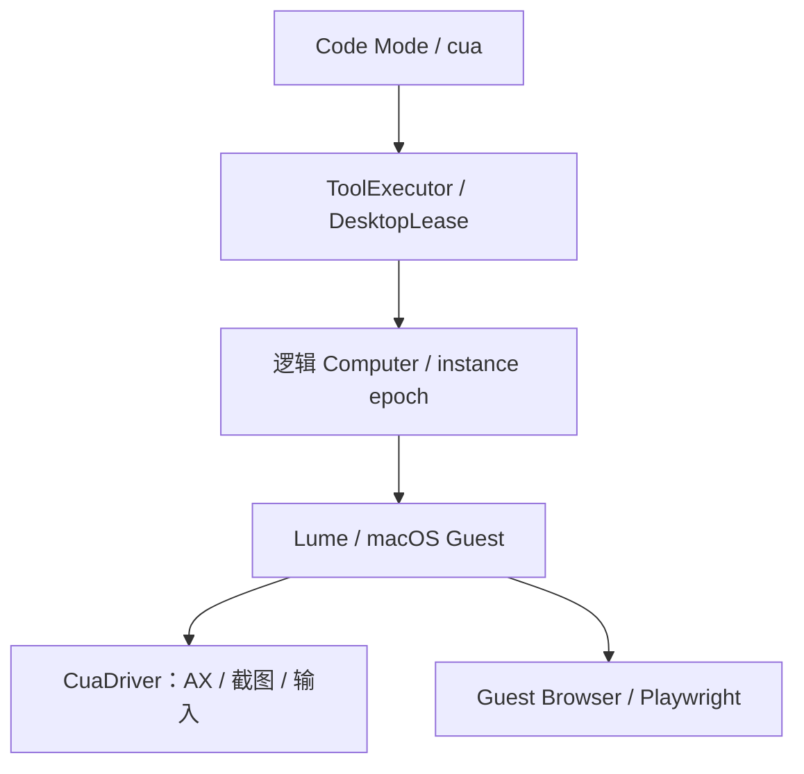

### Go 实现职责（F-040）

Computer 生命周期持久化位于 `internal/computer/sqlite`。Agent 仅提供绑定当前 Code claim 的 ExecutionHost；状态变化和事件仍与原 Host transaction 一起提交。

## 当前流程与目标差异

配置并验证基础环境 → 获取逻辑 Computer → 恢复实例 → 发现和观察 → 审批后动作 → 再观察 → 排空调用并 checkpoint/dispose。

- **F-027**：Lume 生命周期、SSH Guest、CuaDriver、AX/截图、受限 Playwright、文件传输与 epoch 已实现。 范围是 Apple Silicon macOS + 指定 Guest 环境，不包含 Linux 桌面或安装后自动提供 VM；兼容性需在真实平台复验。

## 代码与依赖

- [internal/computer/macosvm/provider.go](../../internal/computer/macosvm/provider.go)
- [internal/computer/macosvm/use.go](../../internal/computer/macosvm/use.go)
- [internal/computer/use.go](../../internal/computer/use.go)
- [internal/agent/sqlite/computer_use.go](../../internal/agent/sqlite/computer_use.go)
- [internal/agent/sqlite/computer.go](../../internal/agent/sqlite/computer.go)

## 验证与交付

验收场景、已有入口和剩余覆盖统一在 [测试方案](../test-plans/computer-use.md) 维护。实际执行结果以对应版本的 PR 或 CI 证据为准；架构说明不证明回归或 Live 验证通过。

## 协议、实现与配置约束

本功能协议在此维护。既有编号用于追溯协议，不代表所有设计目标均已实现；完成状态以需求主索引为准。

<a id="contract-9-computerinstance-与恢复"></a>

### 9. Computer、Instance 与恢复

<a id="contract-91-概念分离"></a>

#### 9.1 概念分离

- `Computer` 是逻辑上持续存在的工作环境，包含应用、文件、状态和 Artifact。
- `Instance` 是承载 Computer 的一次性运行实例，可以启动、暂停、销毁和替换。
- Computer 与 VM Instance 不是同一概念；Computer 的身份和状态应跨 Instance 存续。

<a id="contract-92-computerprovider"></a>

#### 9.2 ComputerProvider

- 使用统一的 `ComputerProvider` 接口屏蔽底层实现。
- 一期本地 macOS VM 运行时采用 `Lume`，桌面与应用控制采用运行在 Guest 内的 `Cua Driver`。
- 只复用 Lume 的虚拟机生命周期、镜像和 Guest 访问能力，以及 Cua Driver 的桌面控制能力；不采用 Cua 自带的 Agent Runtime，也不让模型直接访问其原始接口。
- Go 服务在 `computer/macosvm` 中实现适配器，通过 Lume 本地 HTTP API 管理 VM；Cua Driver 通过 Guest 登录会话提供截图、Accessibility、窗口、鼠标和键盘操作。
- Lume 与 Cua Driver 的所有操作仍统一经过 `ToolExecutor → Security → ComputerProvider`。
- 云端可替换为虚拟机、容器/Pod、远程桌面运行时或其他隔离执行环境。
- Provider 负责实例分配、启动、暂停、销毁、检查点、恢复、并发仲裁和资源回收。

<a id="contract-93-生命周期"></a>

#### 9.3 生命周期

- Agent 空闲后，Instance 可以暂停或销毁，以节省资源。
- Computer Checkpoint 分为两级：
  - `Durable Checkpoint`：保存磁盘、NVRAM、VM 配置、已安装应用、用户文件、Artifact 与恢复清单；允许停止 VM 进程、重启宿主机，未来也可以在兼容宿主机上重建 Instance。
  - `Warm Checkpoint`：额外保存内存和打开中的应用状态，只是同一宿主机上的快速唤醒优化，不属于跨 Provider、跨宿主机的可移植语义。
- 一期必须实现 Durable Checkpoint；空闲回收采用“优雅停止 VM → 持久化 Durable Checkpoint → 释放 CPU/RAM”。
- 下次使用时从 Durable Checkpoint 启动 Instance、恢复登录会话并重新连接 Cua Driver；必要时由恢复清单重新打开应用和工作文档。
- Warm Checkpoint 作为 `ComputerProvider` 的可选能力，不作为一期正确性依赖，也不承诺跨宿主机迁移。
- 生命周期策略由系统自行决定；即使允许配置，也只放在高级设置中。
- 用户不感知 Instance 的启动、暂停、迁移或恢复状态。
- 用户只看到 Agent 空闲/忙碌和持续进行中的工作。

本地 Computer 实现在同一已接受 Code Mode ToolInvocation 内执行生命周期策略：
首次 `cua.getState()` 获取逻辑 Computer，已接受嵌套调用全部结束后优雅关机、
提交 Durable Checkpoint、销毁 Instance。Computer 元数据、冻结操作和 Outbox
同处 `state.db`，使用 Run/Code claim 与 instance epoch fencing。Guest 的签名、
权限、登录及 Driver 连接和三文件原子恢复由 `computer/macosvm` 负责。
Computer Use 在相同嵌套 ToolInvocation 中提供 Surface Inventory、Handle、Action、
DesktopLease、Observation 和受控文件传输；来源局部失败进入 Inventory errors。
受控审批/资源暂停保留物理 Lease，活动 claim 崩溃仍重建 Instance 并拒绝旧 Handle。
配置、恢复和故障处理见 [Computer 运维](#) 与 [Computer Use](../features/computer-use.md)。

生产 CUA bridge 的 `ToolSpec.internal` 随 Capability Snapshot 冻结，仅供 Code
Mode 的宿主绑定使用，不投影到模型 Tool 列表；直接模型调用仍被 Code claim
校验拒绝。该可选元数据缺省为 false 且省略编码，保留既有非 Computer Run
及显式旧 Fake 的冻结 Tool 表示；已接受快照不自动改写或扩权。

<a id="contract-94-镜像与兼容性"></a>

#### 9.4 镜像与兼容性

- 使用不包含用户凭据和个人文件的基础 macOS 镜像，通过 Lume 克隆形成具体 Computer。
- VM 磁盘、NVRAM 与配置必须作为一个一致性单元管理，不能只复制磁盘文件。
- Cua Driver 使用固定签名的应用构建并预置必要权限，避免克隆或升级后因权限身份变化导致 Computer Use 失效。
- 正式实现前必须通过剪映兼容性验收：安装与启动、素材导入、时间线编辑、字幕与转场、音视频导出、Computer Use 稳定性、停止后恢复以及异常恢复全部通过。
- 若剪映在 Lume 上存在无法接受的兼容性或性能问题，Parallels 作为备选 Provider；切换不改变上层 Computer 协议。

<a id="contract-95-computer-use-分层"></a>

#### 9.5 Computer Use 分层

参考 Codex Computer Use 的设计，将 Computer 能力拆成三层：

1. `ComputerProvider`：只管理 Instance 分配、启动、停止、Checkpoint、恢复、销毁、状态和 Provider 能力，不暴露 `click`、`type` 等界面操作。
2. `ComputerUseRuntime`：作为 Code Mode 中 `cua.*` 的宿主侧桥接层，与当前 Run、Computer 自动绑定，不再建立第二套 JavaScript 解释器；模型不处理 `instance_id`、`session_id` 或底层连接信息。
3. `ComputerSurface`：统一 App、Window、Browser 和 Tab 的发现、绑定、观察与操作协议；Lume 负责生命周期，Guest 内 Cua Driver 实现 macOS App Surface，浏览器可由 CDP/Playwright Surface 实现。

执行原则：

- `cua.*` 是与 Provider 无关的稳定协议；Code Mode 和 Agent 不感知本地或云端、Pod、宿主机、VM 地址及连接方式，底层可按任务替换 macOS VM、Linux Desktop 或 Browser Computer。
- 本地使用 Lume 与 macOS Cua Driver；未来云端由对应的 `ComputerProvider` 和 Guest/Browser Driver 实现相同协议，上层代码无需改变。
- Computer Instance 被暂停、销毁或迁移后，Provider 从 Durable Checkpoint 恢复环境，`ComputerUseRuntime` 重新连接当前 Instance，并通过稳定逻辑引用重新发现 Surface。
- 不尝试迁移正在执行的 JavaScript 调用栈；运行中故障由持久化的 Run、ToolInvocation 和 Computer Checkpoint 恢复。
- Conversation 状态、Code Mode 状态和 Computer 状态彼此分离。
- JavaScript 变量和 Surface 句柄只在当前 Code Mode 调用内有效，不写入 Durable Checkpoint；Computer 恢复后通过稳定逻辑引用重新发现并绑定 Surface。
- Surface 同时支持 Accessibility State 与 Screenshot；优先使用稳定的元素引用或语义动作，无法操作时再降级到截图坐标。
- Accessibility State 默认允许增量 Diff，但每次操作后必须重新观察，不复用已经失效的元素引用。
- 一次 JavaScript 执行可以批量组织确定性操作，并在同一调用结尾获取最新状态验证结果。
- 如果目标应用存在 API、MCP 或其他结构化能力，优先使用结构化工具；Computer Use 用于必须依赖视觉判断或 GUI 操作的部分。
- JavaScript 内部的每个实际操作仍形成独立的嵌套 `ToolInvocation`，逐项经过 ToolExecutor、Security、权限、审计和资源冲突检查，不能因外层是一次代码执行而绕过管控。
- 操作系统 Screen Recording/Accessibility 权限、应用访问授权和具体高风险操作审批分别管理。

<a id="contract-96-codex-风格的-cua-最小协议"></a>

#### 9.6 Codex 风格的 CUA 最小协议

<a id="contract-961-computer-inventory-与显式绑定"></a>

##### 9.6.1 Computer Inventory 与显式绑定

CUA 根对象只负责发现当前 Computer 的运行资源和创建脚本内句柄：

```typescript
type Platform = "macos" | "linux" | "windows";

interface ComputerState {
  computerId: string;
  instanceEpoch: string;
  platform: Platform;
  apps: AppInfo[];
  windows: WindowInfo[];
  browsers: BrowserInfo[];
  errors?: InventoryError[];
}

interface Cua {
  readonly computer: {
    readonly platform: Platform;
    launchApp(input: { app: string }): Promise<void>;
  };
  readonly files: ComputerFileAPI;

  getState(): Promise<ComputerState>;
  listApps(): Promise<AppInfo[]>;
  listWindows(): Promise<WindowInfo[]>;
  listBrowsers(): Promise<BrowserInfo[]>;
  listTabs(options?: { browser?: string }): Promise<TabInfo[]>;

  getApp(selector: string | AppSelector): Promise<App>;
  getBrowser(selector?: BrowserSelector): Promise<Browser>;
  getTab(reference: string | StableTabReference, options?: { browser?: string }): Promise<Tab>;
  createBrowserTab(browserId: string, url?: string, options?: CreateTabOptions): Promise<Tab>;
}
```

- `getState()` 采用 Codex 的容错 Inventory 思路：某个 Browser 或 Driver 枚举失败时写入 `errors`，不使其他 Inventory 一并失败。
- `getApp/getBrowser/getTab` 只绑定已经存在的资源，不隐式启动应用或创建 Tab；启动与创建是显式副作用，分别使用 `launchApp()` 和 `createBrowserTab()`。
- 字符串 Selector 只是便捷写法；权威引用使用稳定的逻辑 `app_id/window_id/browser_id/tab_id`，不把 Provider 原始连接信息暴露给模型。
- `instanceEpoch` 在 Instance 重建、恢复或迁移后变化。Surface Handle 同时绑定 `computer_id + instance_epoch + surface_id + lease_id`；旧 Handle 调用返回 `STALE_SURFACE_HANDLE`，由脚本使用稳定引用重新绑定。
- JavaScript Handle 不允许通过 `store()` 持久化；只能持久化稳定 ID、URL、Bundle ID、窗口标题等可重绑定信息。

<a id="contract-962-surfaceobservation-与元素版本"></a>

##### 9.6.2 Surface、Observation 与元素版本

参考 Codex 的 `Target → App/Tab` 结构，所有可观察界面实现统一 `Surface`：

```typescript
type Vec2 = [x: number, y: number];
type Direction = "up" | "down" | "left" | "right";

interface ElementRef {
  observationRevision: string;
  index: number;
}

type ElementTarget = number | ElementRef;
type PointerTarget = ElementTarget | Vec2;

interface AXObservation {
  surfaceId: string;
  revision: string;
  baseRevision?: string;
  kind: "full" | "diff";
  state: string;
}

interface ScreenshotObservation {
  surfaceId: string;
  revision: string;
  width: number;
  height: number;
  image: ImageBlock;
}

interface CombinedObservation {
  ax: AXObservation;
  screenshot: ScreenshotObservation;
}

interface Surface {
  readonly ref: StableSurfaceReference;
  readonly capabilities: CapabilityCollection;

  documentation(): Promise<string>;
  getAXState(options?: { full?: boolean }): Promise<AXObservation>;
  getScreenshot(): Promise<ScreenshotObservation>;
  getAXStateAndScreenshot(options?: { full?: boolean }): Promise<CombinedObservation>;

  click(target: PointerTarget, options?: ClickOptions): Promise<void>;
  drag(from: Vec2, to: Vec2, options?: PointerOptions): Promise<void>;
  scroll(target: PointerTarget, direction: Direction, amount?: ScrollAmount): Promise<void>;
  setValue(target: ElementTarget, value: string): Promise<void>;
  selectText(target: ElementTarget, text: string, options?: SelectTextOptions): Promise<void>;
  performSecondaryAction(target: ElementTarget, action: string): Promise<void>;
  waitForChange(options?: { sinceRevision?: string; timeoutMs?: number; full?: boolean }): Promise<AXObservation>;
}
```

- AX State 默认返回相对上一观察的 Diff；首次观察、`full: true`、Handle 重绑定或 Diff 基线丢失时返回完整状态。
- `number` 元素索引沿用 Codex 的简洁写法，隐式绑定该 Handle 最近一次 AX Observation；`ElementRef` 是可显式传递的安全写法。Observation 更新后，旧索引和旧 `ElementRef` 必须 fail-closed，返回 `STALE_ELEMENT_REFERENCE`。
- 坐标始终相对于最近 Screenshot 的 Surface 视口；没有有效 Screenshot Revision 时拒绝坐标操作，避免恢复、缩放或窗口移动后误点。
- AX Revision 与 Screenshot Revision 分开维护；仅获取截图不会让 AX 元素引用静默指向另一棵树。
- `performSecondaryAction()` 沿用 Codex 命名，只能调用最新 AX State 明确暴露的非默认语义动作，不允许猜测任意 Action Name。
- 观察是 Read Barrier：必须排在当前 DesktopLease 已提交动作之后返回。一期所有原生桌面 Surface 共享 `conflict_key=computer:<id>:desktop`，不允许不同窗口或 App 并行操作；未来 Browser Provider 可以对经过隔离验证的 Tab 使用独立冲突键。

<a id="contract-963-appbrowser-与-tab"></a>

##### 9.6.3 App、Browser 与 Tab

```typescript
interface App extends Surface {
  paste(text: string, options?: { format?: "text" | "md" | "html" }): Promise<void>;
  pressKey(key: string, options?: { durationMs?: number }): Promise<void>;
  typeText(text: string): Promise<void>;
}

interface Browser {
  readonly browserId: string;
  readonly capabilities: CapabilityCollection;
  documentation(): Promise<string>;
}

interface Tab extends Surface {
  readonly tabId: string;
  paste(target: ElementTarget | null, text: string, options?: PasteOptions): Promise<void>;
  pressKey(target: ElementTarget | null, key: string, options?: KeyOptions): Promise<void>;
  typeText(target: ElementTarget | null, text: string): Promise<void>;
  goto?(url: string): Promise<void>;
  back?(): Promise<void>;
  forward?(): Promise<void>;
  reload?(): Promise<void>;
  close?(): Promise<void>;
}
```

- App 与 Tab 复用相同观察和指针操作协议；输入方法单独定义，因为 Browser 可能需要先聚焦具体元素，而原生 App 通常对当前焦点输入。
- 导航、关闭等方法为可选能力；Provider 不支持时不伪造实现，而是在 `documentation()` 与 Capability Inventory 中明确缺失。
- 不复制 Codex 的 `markDeliverable/markHandoff` 到 CUA 核心协议。Steward 的长期 Tab 生命周期属于 Run/Computer 的资源保留策略，而不是 UI Driver 方法。
- Agent 创建的临时 Tab 默认属于当前 Run Lease；需要跨 Run 保留时，由上层 Resource Policy 持久化稳定 Tab Reference，不能依赖 JavaScript Handle。

<a id="contract-964-等待模型"></a>

##### 9.6.4 等待模型

Code Mode 没有 `setTimeout()` 或任意网络轮询能力。一期不建立通用条件 DSL，只提供 `waitForChange()`：

```typescript
waitForChange(options?: {
  sinceRevision?: string;
  timeoutMs?: number;
  full?: boolean;
}): Promise<AXObservation>;
```

- Runtime 负责等待 Driver 事件或执行有界轮询，模型不指定 `poll_interval`，也不能用 Sleep 制造大量空转。
- 成功时返回变化后的最新 AX Observation；超时返回结构化 `WAIT_TIMEOUT`，并携带最后一次 Observation 摘要。
  Computer Use 以受 Host 限制的 1–10,000 ms deadline 执行有界轮询；详情只保留安全摘要。
- 模型在拿到新 Observation 后自行判断文本、元素或窗口条件；Browser 的 DOM Locator、URL 和导航同步由 `playwright` Capability 提供。
- 只有实际场景证明 `waitForChange()` 往返成本不可接受时，才增加声明式语义条件，避免一期维护复杂且 Provider 难以一致实现的等待 DSL。

<a id="contract-965-按需-capability"></a>

##### 9.6.5 按需 Capability

沿用 Codex 的 Capability Collection，稳定核心协议之外的能力全部延迟披露：

```typescript
interface CapabilityInfo {
  id: string;
  description: string;
}

interface CapabilityCollection {
  list(): Promise<CapabilityInfo[]>;
  get<T = unknown>(id: string): Promise<T>;
}

interface DocumentedCapability {
  documentation(): Promise<string>;
}
```

一期只实现一个标准 Capability：

| Scope | Capability | 用途 |
|---|---|---|
| Tab | `playwright` | DOM Locator、导航等待和下载/文件选择器 |

`visibility`、`viewport`、`history`、`webmcp`、`page_assets`、`clipboard`、`content` 和 `dev_logs` 保留为未来候选，不进入一期验收范围；只有出现明确产品场景时才加入。

- 模型必须先 `capabilities.list()`，再 `get(id)`；Capability Handle 可过期，导航、恢复或 Provider 变更后重新获取。
- `documentation()` 返回精确 TypeScript 声明、使用指导和安全说明；未请求的 Capability 不占用 `builtin__codemode_execute` 描述预算。
- Capability 方法仍逐次形成嵌套 `ToolInvocation`，不能把 Playwright 或 WebMCP 当成绕过 ToolExecutor 的本地对象。

<a id="contract-966-文件传输与-artifact-边界"></a>

##### 9.6.6 文件传输与 Artifact 边界

文件传输属于 ComputerUseRuntime 的稳定桥接能力，不作为 App/Tab 的通用方法，也不允许模型直接访问宿主机任意路径：

```typescript
interface ComputerFileRef {
  computerId: string;
  path: string;
  size?: number;
  mediaType?: string;
}

interface ArtifactDescriptor {
  artifactId: string;
  name: string;
  size?: number;
  mediaType?: string;
}

interface ComputerFileAPI {
  importArtifact(input: {
    artifactRef: string;
    destination?: string;
    overwrite?: boolean;
  }): Promise<ComputerFileRef>;

  exportArtifact(input: {
    path: string;
    name?: string;
    mediaType?: string;
  }): Promise<ArtifactDescriptor>;
}
```

`ArtifactRef` 在所有模型可见与跨模块协议中始终是不可解析的字符串；`ArtifactDescriptor` 只是在需要展示或审计时返回的内部元数据视图。模型不得自行拼接 `artifactId`、路径或下载 URL。

- `importArtifact()` 将 ArtifactStore 中的对象物化到当前 Computer 的受控 Transfer Root；`exportArtifact()` 将 Guest 文件校验并写回 ArtifactStore。
- 不接受宿主机绝对路径、任意 URL 或未经登记的 Guest 外部路径；底层可以通过 Lume、SSH、共享目录或云 Provider 传输，但模型侧协议不变。
- `overwrite: true`、敏感文件导入、文件上传到第三方页面和导出隐私数据分别经过 Security Policy；文件传输本身不能暗含上传授权。
- Browser 下载先落入 Computer 的受控下载目录，再由 `exportArtifact()` 生成可持久化 Artifact；Browser 上传通过 `playwright` 的 File Chooser 使用 `ComputerFileRef`，不直接暴露宿主路径。
- 大文件只在 JS 中传递引用和元数据，不把二进制或 Base64 放入 QuickJS 内存、RunTrace 或模型上下文。

<a id="contract-967-融合后的输出语义"></a>

##### 9.6.7 融合后的输出语义

- Codex 的独立 `cua_repl` 可以自动展示 `getState/getApp/getAXState` 的结果；在本方案中所有 CUA 调用只是 Code Mode 内部值，不自动进入顶层 ToolResult。
- 脚本必须显式使用 `text(observation.state)`、`image(screenshot.image)` 或 `return` 选择模型下一轮真正需要的内容。
- RunTrace 保存完整结构化 Observation、Action、Capability Call、文件引用和错误；模型上下文只接收脚本筛选后的结果。
- 这种差异保留了 Pi Code Mode“内部执行丰富、模型输入受控”的核心价值，同时复用 Codex 的 Computer Surface 交互模式。

<a id="computer-use-leases-and-observations"></a>

### Leases and observations

Bindings retain Computer ID, Instance epoch, Surface identity and the accepted
Code invocation's DesktopLease. They are not checkpoint state. `store()` rejects
Surface and Capability objects; store Bundle IDs, URLs and other semantic refs.
Instance reconstruction invalidates old bindings. A controlled approval/resource
suspension records a resume receipt and retains the physical DesktopLease.
Expired or abandoned active claims still follow the durable rebuild path. Old
Run/Code owners cannot write state, accept results or keep their transports live.

All Computer calls, including observations, acquire the same desktop conflict
key through ordinary ToolExecutor admission. They also retain the logical
`computer:<id>:desktop` key after allocation. Different Apps do not bypass the
read barrier. A mutation invalidates cached AX/pointer references before dispatch.
A lost result is `unknown`; the Host does not repeat it.

The first AX read and `full:true` return a full state. Later reads have
`kind:diff` and `baseRevision`; `state` is empty for no change and otherwise is a bounded contiguous line
patch: `@@ zeroBasedLine,removedLines,addedLines @@`, then `- ` removed lines and
`+ ` added lines. New AX observations invalidate old explicit ElementRefs.
Numeric indices always refer to the handle's latest AX state. Screenshots have
separate revisions and Artifact references. A screenshot-only read disables the AX walk and preserves native tokens; it
cannot retarget an old index to a changed tree. Browser element tokens also bind
CDP backend node identity, so replacing a node with identical text does not
reuse the old reference. Core operations retain a fixed ElementHandle while
waiting for actionability and reject a detached node instead of querying a
replacement. Explicit Playwright CSS locators remain dynamic. Coordinates require a valid screenshot and unchanged geometry.
Every action must be followed by observation before using element/pointer refs.
Observation references become actionable in the same SQLite transaction as the
Tool result and screenshot Artifact metadata. Failed output normalization leaves
the pending observation inert.

`performSecondaryAction` accepts only an advertised non-default action. The
native adapter uses Cua Driver's AX `click.action` path, not arbitrary command
execution. Native `selectText` uses bounded, exact-element keyboard selection for
one unique ASCII substring within the first 256 characters of an AX text field;
unsupported or ambiguous ranges fail closed. Browser text selection uses the
bound DOM element. Input acknowledgements preserve `verified`/`effect` facts;
`unverifiable` is not a claim of application success. Observe and read back the
application state after input, including Return/commit where the app requires it.

`waitForChange({sinceRevision,timeoutMs,full})` polls inside the Runtime, never
inside QuickJS. The deadline is 1–10,000 ms. `WAIT_TIMEOUT.details.observation`
contains the last bounded AX summary. Observe again after a timeout before
using element refs. Unchanged internal polls do not advance the delivered diff
base. It does not poll forever or retry input.

<a id="computer-use-security-and-file-transfer"></a>

### Security and file transfer

This first adapter uses a conservative policy: every input, navigation,
launch/create and file transfer requires approval for that exact frozen nested
ToolInvocation. Reads and discovery are automatic. Consent for a Code cell,
import or Parent never grants upload, overwrite, private export or Child consent.
All mutations use `never` replay; reads use `safe`. A transport failure after
possible input becomes `UNKNOWN_SIDE_EFFECT` and is never retried automatically.

```js
const file = await cua.files.importArtifact({artifactRef: inputRef});
// file is {computerId, path}; path is relative to the controlled Guest root.
const artifact = await cua.files.exportArtifact({path: file.path});
// artifact.artifactId is the opaque ArtifactRef; pass it directly to Artifact tools.
return artifact;
```

The fixed Guest Transfer Root is `/Users/<configured-guest-user>/StewardTransfer`.
Only registered `imports/<name>` and `downloads/<name>` refs are accepted. No
Host path, arbitrary URL, external Guest path or script-provided ID authorizes
access. ArtifactStore enforces the current Agent/Task/Run scope. Imports,
overwrites, exports and page uploads are separate calls and approvals.

The Guest helper opens every path component with directory-relative descriptors
and `O_NOFOLLOW`. It refuses traversal, symlinks, hard links, directories and
special files before truncation. Binary bytes remain outside QuickJS and traces.
Transfers are bounded to 8 MiB. Downloads use generated names under `downloads/`;
page-chosen filenames cannot select a destination. FileChooser uploads receive
bytes from registered ComputerFileRefs, not Host or Guest filesystem paths.
File registration is retained for the owning Run or Task across cells and
Instance replacement. Another scope cannot turn a known path into authority.
New imports are limited to 256 visible files; overwrites require an existing
scoped registration.

<a id="computer-durable-logical-computer"></a>

## Durable logical Computer

The Lume lifecycle operates behind the existing Code Mode ToolExecutor and
Security boundary. `cua.getState()` lazily obtains the configured logical
Computer. Its ID persists in `state.db`; replacement instances get increasing
epochs. The accepted Code Mode invocation owns its lifecycle plan and cleanup.
Once its accepted nested calls have drained, the Host requests Guest shutdown,
commits a durable checkpoint, and destroys the disposable instance. Claim recovery
retains the frozen idle request and checkpoint IDs until its final metadata commit.
The provider verifies the published unit before checking the source instance, so
a crash after deletion can reconcile disposal without requiring that instance.
If that invocation is cancelled, a new authorized invocation derives the old
idle request from the retained operation ledger for the exact previous Computer
and instance epoch. It verifies the published unit and reconciles disposal before
restoring the replacement. Reclaiming the new invocation derives the same link
even after supersession. The cancelled Task, Run and Code execution stay terminal;
only Computer lifecycle progress is reconciled. No schema or frozen-request
format changes; unknown effects still fail closed.

Computer Use provides live inventory, leased App/Window/Tab bindings, AX and screenshot
revisions, input, bounded waits, scoped Artifact transfers and the delayed
Playwright Capability. See [Computer Use](../features/computer-use.md) for the facade,
conservative action approvals, Guest browser provisioning and verification.
Existing explicit Core/Code Mode Computer Fakes remain separate fixtures.
Computer configuration defaults to absent.

<a id="computer-state-and-recovery"></a>

### State and recovery

Migration 021 adds the logical Computer and frozen operation ledger to the
existing `state.db`. State/version changes and their Outbox events commit with
the Run and Code execution fences. The Computer has one exclusive accepted execution owner (Code cell or native file/command invocation). Concurrent users receive a resource refusal; unrelated cells cannot
reclaim that owner's instance. Pending accepted calls retain ownership until
they drain or a later fenced owner recovers them.

The lifecycle uses these states:

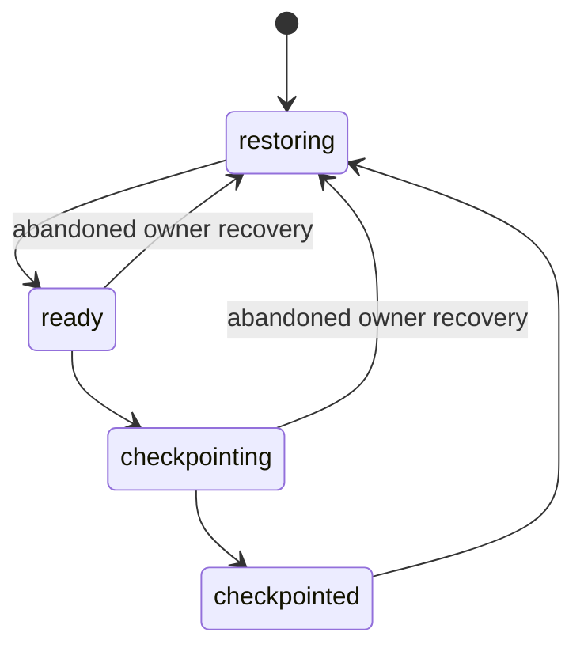

An abandoned ready instance is checkpointed before its replacement starts.
Incomplete allocation reattaches to its frozen operation. Epochs and claim
fences reject old owners at effect and completion boundaries. Registry resource
hashes freeze the configuration with the Run's Capability Snapshot; changing
configuration cannot redirect an accepted Run. Guest build, Driver executable
digest, bundle/team signature, console login and an actual Driver capture are
checked before readiness. Incompatible signatures and SSH keys fail closed.

Each checkpoint is one atomically published directory containing the three VM
files and a typed receipt with their full SHA-256 digests, compatibility snapshot
and restoration manifest. Files/directories are fsynced before publication.
Restore verifies the source and publishes a complete new instance directory;
it never installs disk, NVRAM and config one at a time into a live VM.

On APFS, byte-identical atomic COW clones avoid materializing sparse disks.
Within one provider process, a verified immutable unit can reuse its digest
while inode, size and modification time remain unchanged. A new process hashes
the complete source. Keep the private base/checkpoint directories immutable.
Disposal requires the committed checkpoint. Checkpoints and their operation
audit are retained; CPU/RAM and disposable instance directories are released.

The restoration manifest contains bundle IDs, absolute Guest document paths and
stable Artifact references. It applies when restoring a checkpoint; a fresh base
has no user documents to reopen. App/document intent is fixed for this slice.
The ArtifactStore continues to own Artifact bytes and authorization. The
manifest does not serialize JavaScript heaps, Driver sessions or surface handles.
Warm memory snapshots are optional and are not implemented.

<a id="computer-graceful-shutdown-and-uncertain-outcomes"></a>

#### Graceful shutdown and uncertain outcomes

Lume 0.6.1 HTTP `/stop` performs framework power-off. Graceful checkpointing first
requests OS shutdown through the authenticated Guest connection and proves the
native run lock has been released. An abandoned session marker is removed only
while holding that lock on the verified owned instance.

The same-process Lume cache may still report running. Only after native teardown
may the adapter reconcile it with `/stop`, accepting the exact already-not-running
400 response and then requiring `stopped`. The adapter releases its observer lock
before this HTTP request: Lume's fallback can signal a lock holder and replace
the config inode. It reacquires the current file's lock before copying and
checks the inode again before checkpoint publication.

Start/shutdown intent markers are durable before dispatch. If an earlier request
has an unprovable outcome, the adapter returns `UNKNOWN_SIDE_EFFECT` instead of
resending it. It never substitutes power-off for failed graceful shutdown.
Preserve the owned store for diagnosis; use authoritative state to resolve an
uncertain operation. Configuration/signature/integrity refusals expose safe
standard Tool errors, without raw paths, SSH diagnostics or credentials.

## Web 只读预览

私有 operator 预览读取现有 ready instance，不调用 Ensure/Restore 或发送输入。macosvm 使用 get_desktop_state 与独立 steward-web-preview Driver session，关闭 accessibility tree；不接触模型持有的 handles、AX revision、截图 revision 或持久化 UseState。Host 读取实例，截帧，再复核 ready phase/ComputerID/epoch/native identity；发生切换或取消就丢弃该帧。并发预览串行且有请求期限；不在网络操作期间持有数据库事务。仅通过已认证 Web 连接返回 PNG，private/no-store，不写 Artifact 或新增回放事实。

操作进度仅从配置 Agent 的已提交 Computer discover/bind/invoke 元数据取最近20条，保留机器状态和时间，不返回参数、结果、句柄或凭据。执行记录由只读 Inspector 查询，预览本身不伪装为 Agent 操作。此机制不建立新的 Computer 生命周期，也不稳定多用户直播或远程输入协议。


## 版本化观察方法（私有实验接入）

真实消费者是 Root／Child 的 Code Mode 私有 Computer bridge，仍经原 ToolExecutor 的 discover／bind／invoke。`computer-use` 的 `steward.computer-observation/1` 独立计算 AX 全量／增量窗口，Host 从原始快照重建完整结果；候选只收到授权的前后 AX 文本及 diff/full 条件，不收到 Native ID、handle、revision、element token、截图、凭据或任意 Driver。默认算法与原连续行差分相同，独立版本可改用 full 或包含更多上下文的完整替换，不能藏起真实变化或编写观察正文。

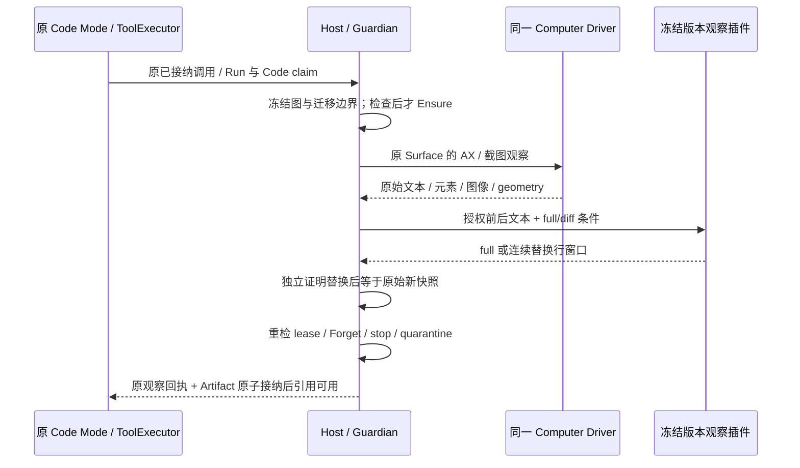

句柄与 revision 签发、元素／截图新鲜度、完整原文、Computer epoch／ExecutionID lease、具体动作审批、原动作参数、never/unknown、Artifact 授权及 checkpoint/disposal 是领域必要机制，仍由 Host 强制。差分算法属于可变表达政策，已从受管路径移出；不以安全为名要求候选采用默认最小差分。闭合的行窗口结构与原文重建是必要完整性校验，不暴露内部 UseState／Driver，也不引入通用动作计划或数据库端口。

原始 AX 每份不超过 128 KiB；前后文本封装为一个有界只读输入，经过现有分块通道处理 JSON 转义后的大数据，不为了两个文本新增 SDK 多输入机制。纯调用没有第二份 RSI effect ledger，不持有 writer；版本由原 Run 的不可变图固定，正式观察正文和 Artifact 仍随原 Tool 回执保存。原 revision 只在同一事务成功提交后生效；返回或 Artifact 提交前撤权，不能获得新证据或可操作引用。Guardian 禁止新的业务分派，不禁止原 Host 的可信资源收尾。

兼容入口仅为 `UseRuntime.projectObservation` 的 nil 方法分支和 `legacyLineDiff`：消费者是未冻结该受管服务的历史 Run，以及明确无分发包的嵌入式载体。激活后缺包／停用不能回退；历史原 Tool／Artifact 回执不重新解释。待这些保留执行与明确兼容载体均无依赖，且兼容迁移与引用清点完成后删除该分支和旧算法；不保留第二套受管默认算法。

观察、等待与说明资源属于默认 Computer 包的业务服务；下面的选区、匹配、参数及展示服务共同版本化。公开稳定化、任意 IO、候选签发权限和通用 effect executor 不在此边界内；真实 GUI／Lume 兼容须由平台 Live 验证。


### 等待配方与实际 deadline

`steward.computer-wait-recipe/1` 仅接收 Host 数值边界：默认等待不超过 10 秒，轮询间隔为 100–1000 ms。默认包返回 1000／100 ms，独立版本可更改默认时限及更慢的观察频率。Host 在 waitForChange 原调用进入 Ensure／执行前取得并校验配方，不在实际等待 deadline 内启动插件；插件不收到用户时限、revision、Surface 或 AX 文本。显式用户 timeoutMs 仍由 Host 在原 1–10000 ms 范围内直接决定实际 deadline，候选的默认值不能覆盖它。

原固定循环继续使用同一 Driver／baseline，维持 sinceRevision 校验、原上下文取消、超时后的有界观察摘要及成功后原引用提交。每次读取与提交仍受原 Run／Code／Computer lease 和 Guardian 约束；数值配方无需获取 Computer 内容权限。只保留未冻结该服务 Run 的原 1000／100 ms native 默认分支，受管路径不先计算一套 native 配方再覆盖。该兼容分支与 legacyLineDiff 使用相同的保留／清理条件。

拒绝把用户 deadline 的裁定交给候选，也不为纯等待增加第二份 effect ledger、通用调度器或超时配置语言。默认配方和轮询是业务变化轴，deadline、取消、原始事实和引用有效性是必要机制。


### 说明资源与提交授权

实际消费者是 Surface 的 documentation() 与 browser capability 的 documentation()；它们继续返回原 Tool 字符串，不改变 CUA 方法语法或授予权限。私有 `steward.computer-documentation/1` 只接收 core/browser 枚举，返回至多 16 KiB UTF-8 文本；默认资源位于功能包，候选可以独立修订说明，但不能据此声明新的 Driver、权限、重放方式或方法。Owner 的独立静态样例验证当前说明，版本切换不重写已冻结 Run 或旧 Tool 回执。


说明修订属于可变业务；读取与提交授权是必要机制。内部 DocumentationReceipt 只携带原 lease／instance，在原事务中重检 Forget、Guardian 和 Computer 归属，不进入候选协议或模型消息、不建立另一份 effect ledger、不改变 AX／截图引用。不能仅在 RPC 返回前检查授权；Stop 或 Forget 发生在返回与 Tool commit 之间时仍须拒绝。

旧默认导出已移除，`documentation_legacy.go` 仅保留 facade-v1 原文本；唯一消费者是明确未冻结说明服务的 Run／未打包载体分支。受管路径没有 native 回退。删除条件是这些保留执行和明确载体均无依赖且完成快照迁移；这份保留不是第二套新业务默认。未开放文件挂载、任意文档路径、UseState／Driver 或通用资源加载器；后续资源贡献仍由 F-070 单独完成。


### 原生选区算法与固定输入原语

实际消费者是原 `Surface.selectText(ref, text)` 的 macOS AX 文本字段／文本区路径。私有 `steward.computer-text-selection/1` 独立选择光标算法：输入只有原授权值的前 256 个 ASCII 字节、完整长度和批准的原文片段，输出 start/end 锚点、至多 256 步的带符号移动及选区扩展；不接收 Native ID、窗口、元素 token、revision、数据库或任意键盘／Driver 接口。浏览器路径和其他输入方法仍按各自原入口处理，不据此宣称全部动作已迁移。

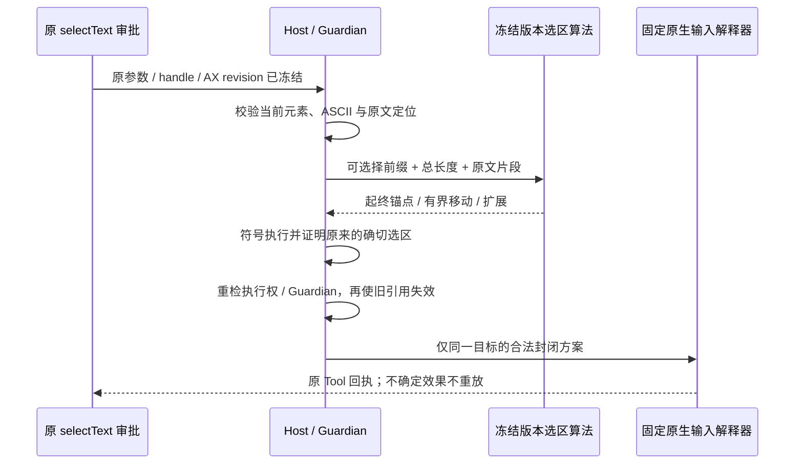

新增服务的包版本为 `1.0.1`，不覆盖先前 `1.0.0` 的不可变包；旧三服务组合的 Run 保持原 native 选区边界。默认算法维持从开头向右定位，独立实现可以从结尾向左定位或反向扩展。Host 依据完整原值复核最终选区的位置和字节，不能仅比较选中文本相等；重叠匹配仍保持原 first occurrence 语义。完整文本可以很长，只传可选择前缀，不以新插件输入限额缩小原动作支持范围。ASCII、无 CR、文本角色、唯一的非重叠计数、选择终点在前 256 字节及 256 步输入预算均保持原契约。

原抽象动作在审批前已固定；此处只允许 Host 能独立证明满足同一原文选区的实现变化，不允许换目标、注入文本、任意快捷键或替换批准动作。固定解释器仅产生 Cmd-Up/Down、Left/Right、Shift-Left/Right，并在每次输入前通过进程内 `SelectionDispatch.BeforeInput` 重检原 Computer／Code／Run lease 和 Guardian；该函数由 Host 提供，不进入候选、磁盘或 RPC。任一原语不确定后停止；若已有输入，后续 Host 检查发生暂时基础设施故障也保留 unknown，并携带原 cause，不能降为普通可重试错误。当前确切撤权仍由最终 fence／watcher 优先裁定。沿原 never/unknown Tool 规则处理。符号校验不是任意应用的实际 GUI 成功证明；原回执继续为 unverifiable，真实 Driver／应用行为仍需对应平台验收。默认算法没有据此更改为未经实际 GUI 验证的新版策略。

必要机制是精确批准意图、原文／范围／预算、身份／新鲜度、撤权及效果恢复；定位和扩展算法属于可变业务。接口保持领域私有实验级，未增设通用动作计划、任意 IO 或 SDK 重试机制。拒绝候选直接输出原生键串，也不让候选在审批后扩大动作语义。更一般的动作替换若不能独立证明等价，仍必须先冻结具体计划再批准，不能沿用此处的纯算法入口。

`selection_start`／`selection_length` 中间字段和 Driver 内旧固定步进算法、不可达 `selectText` switch 分支已删除。只有 `UseRuntime.selection` 的显式 native 分支保留 facade-v1 原算法，消费者为未冻结此服务的历史 Run／未打包载体；受管服务缺包／停用不可回退。待这些保留消费者均无依赖并完成引用清点后删除该分支。算法结果无持久副作用或第二份调用账本；已执行原 Tool 的未知效果不会因为纯算法可重算而被重发。


## 清单排序与对象匹配（私有实验接入）

实际消费者是 Code Mode `cua.getState/list*` 与 `getApp/getBrowser/getTab` 的原嵌套 Tool。默认保持 Driver 原顺序和原精确名称／URL 匹配；独立版本可以按名称排序或采用大小写不敏感匹配。原返回字段、缺失／歧义结果、windowId 优先级、显式 browser 筛选、原运行版本和已绑定引用均需保留。包从四服务 `1.0.1` 增加到六服务 `1.0.2`，不覆盖历史包。

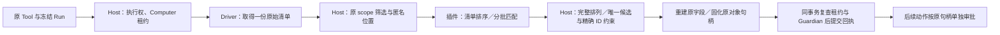

| 领域必需机制：Host 保留 | 当前可替换业务：插件持有 |
| --- | --- |
| 原方法到资源种类、selector 字段优先级和显式 browser 范围；Driver 原始身份与 Native 数据 | `steward.computer-inventory-order/1`：依据名称／URL 返回匿名位置的完整排列 |
| 清单成员、字段和值完整；位置无遗漏、重复、越界；公共输出原 512 KiB 限额 | `steward.computer-target-match/1`：依据原 selector、名称／URL 和 ID 相等事实返回匹配位置 |
| 原清单精确 ID 不得重定向；重复精确 ID 不得擅选；最终单一匹配、句柄与原对象固化 | 名称匹配算法与清单排序规则；不产生最终对象、令牌或身份 |
| 原 Run／Code／Computer epoch／lease、隐私与 Guardian，原 Tool 回执事务及原动作审批／unknown 不重放 | 无状态纯计算；没有 Driver、凭据、数据库或效果回调 |

清单排序仅接收原范围内名称／URL，返回后 Host 从原 Target 重建所有公开字段。候选不能通过删行、改名或造 ID 改变事实。对象匹配接收同一快照的批次，每批至多 512 条、通常不超过 512 KiB；长单条仍通过既有有界输入描述符传输，不重新查询可能变化的 Driver。selector 也走该描述符，避免 JSON 转义扩大内联 schema 输入。跨批结果保持原位置，两个匹配仍为歧义，不接受任意首条；一旦已歧义无需继续释放剩余标签。

原 Driver 可返回 12 MiB 清单，而纯服务输入上限为 8 MiB；不能简单拒绝大清单或只取前页。每条名称／URL 只披露至多 `max(256, 4 × selector 字节数)` 的 UTF-8 完整前缀，并携带 complete 标记。原精确匹配和 Unicode EqualFold 所需的完整字符串均在这个范围内；超长无关标签不匹配其截断前缀。此限制是当前窄数据契约，不是可配置匹配语言；需要其他全文政策时，必须另行证明必要的披露与无损兼容，不预置通用查询接口。

名称选择属于绑定前业务政策；后续审批面对已经固化的原对象。已知精确 ID 则属于身份约束：Host 仅传 IDMatch 布尔值，最终结果不得指向另一 ID，即使候选通过所有者机械验收。Native ID、PID、窗口内部标识、handle、lease 与 epoch 不交给插件；公共 selector 的原字节保持不变。`TargetReceipt` 是不序列化的进程内完成凭据；清单披露与新绑定提交时再次核对原执行和 ready 实例，新绑定还须存在于原持久状态，迟到 Forget／Stop／Quarantine 或 Idle 均拒绝接纳。createBrowserTab 仍使用原精确动作审批；效果发生后丢失接纳权，原 never-replay 账本保留 unknown，不能再次创建。

已删除受管路径内原匹配循环及无语义 inventory 代理。`targets_legacy.go:nativeTargetMatchV1` 仅服务未冻结这两项服务的历史 Run（包括旧三／四服务包）与明确无分发包载体；排序 nil 分支仅保留原 Driver 顺序。待保留执行与明确兼容载体均无依赖、引用清点完成后删除这些入口。缺包／停用／方法失败不得进入它们。原参数规范化留在 Host，因为它解释已经发布的 CUA 协议与资源范围；不在 Host 保留第二套名称策略。

接口维持仓库内部实验级，不公开 Target／UseState／Driver，不新增通用动作 DSL、插件签发身份或任意过滤器；这些属于未获实际需求支持的复杂度。拒绝把名称匹配完全固定在 Host（无法独立迭代）、让候选返回最终 ref（可伪造事实）、全量上传 Native 清单（扩大权限）及将已有绑定重新按名称解析（改变后续批准对象）。其余参数与展示政策由下面的同包服务持有；固定生命周期与身份边界见本文默认组合说明。


## 审批前固化动作参数（私有实验接入）

真实消费者是原 `launchApp`、`createBrowserTab` 与普通 Surface 的 click／scroll／drag、值／选区／次级动作、文字／粘贴／按键及 Tab 导航。插件持有参数解析、非安全性参数诊断和缺省点击／滚动选项；Host 保留原已接纳请求中的显式值、资源身份、引用有效性、边界、审批和原效果账本。默认包保持旧参数含义；独立版本可以改变省略的滚动距离等政策，不能替换调用者显式提供的文字、URL、应用／浏览器身份或数值。

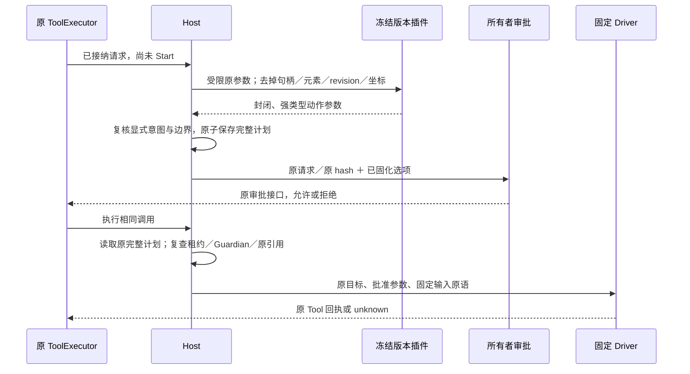

`steward.computer-action-parameters/1` 是同一 Computer 包的第七项私有服务，自 `1.0.3` 提供。输入仅为真实方法、native／tab 类型和有界参数描述符；Host 隐去参数槽中的资源引用与坐标，不发送 Native 数据、句柄或数据库。输出是封闭的 `ActionParameters`：仅当前真实操作需要的字符串、点击次数／按键、方向／距离及已知失败码；没有任意 method、目标、命令或效果回调。点击次数限定 1／2、方向限定四向、距离在原 0–10000 范围内且非零；原文字长度、显式值和多余输出字段在 Host 复核。此复杂度属于现有公开 facade、精确授权与无损兼容所需；不泛化动作语言或任意参数映射。

[schema65](../../internal/agent/sqlite/migrations/065_computer_action_plan.sql) 只保存完整选择：原 invocation／request hash、原冻结 graph、方法／surface、参数 hash 与正文。纯计算中断不创建 pending 效果记录；保存失败可重新计算并原子接纳。并发准备只允许第一个完整计划胜出，审批前后都不能替换或复活计划。之后执行仅读取原计划，不再调用该参数服务；即使实现再次运行会给出不同默认值，也不能改变本次批准内容。未开始的审批仍使用原身份、hash、期限和决定 API，已开始动作仍按原 ToolInvocation 恢复为 unknown，不能因参数可重算而重发。

审批控制投影增加可选 `action_parameters` JSON 字符串，原 arguments 与 frozen hash 保持不变。Web 沿原字段布局展示解析后的点击／滚动选项；CLI 返回完整已固化正文，终端／飞书的原审批通知补充短选项，不重复追加完整文字／URL。显示选项来自同一不可变计划；不增加第二套批准动作、执行按钮或私有内部版本信息。手机表单按钮沿共享尺寸规则达到 44px，无脚本使用原表单。Forget 单向清空计划正文，保留 hash 和关联身份用于审计；不重写历史模型请求、旧审批或已发生效果。

原生 pressKey 的 `+` 拆分也归插件：计划中的 `KeyRecipe` 必须无损拼回原批准字符串，各片段不得夹带另一分隔符，保留旧空片段等原支持范围。Host 传入不序列化的 `KeyDispatch`，固定 Driver 只能向原窗口／session 发送一个 press_key 或 hotkey，发送前再次检查执行权；结果不确定沿原 unknown 不重放。插件不能签发执行回调或任意原语，Tab 的原键名字符串仍按原浏览器协议使用。

已移除受管 UseRuntime 内的旧参数解析分支和 native Driver 内的键名拆分分支。`action_parameters_legacy.go:nativeActionParametersV1` 仅服务未冻结新参数契约的历史 Run（包括三／四／六服务包）与明确未分发载体；它保留原 facade-v1 含义，待这些执行／载体均无依赖、引用清点完成后删除。新 Run 已采用服务后，停用、缺包或计算失败不得回退；历史已经开始的动作只走原账本，不为恢复重新生成计划。迁移不回填新服务、不重写旧请求／审批，也不把一条参数服务计为完整 Computer 迁移。

开放范围仍为仓库内部实验接口；公共控制投影只暴露所有者作决定所需的原请求及解析选项。拒绝把 SDK `Call` 的 pending 行当准备锁、在批准后重算默认值、把资源引用交给参数方法、用任意 map／脚本驱动 Driver，以及静默丢弃旧执行。传输／浏览器政策属于下面的同包服务；Child 与恢复仍使用原图。真实 GUI／Lume／Linux 证明不由受控 peer 代替。


### Playwright 参数的私有实验接入

实际消费者是既有 `Playwright.locator` 的 count／textContent／click／fill／waitFor／download／upload 与 waitForURL，经同一 Code Mode／ToolExecutor 调用。`steward.computer-playwright-parameters/1` 自 `1.0.4` 提供，包含在当前默认 `1.0.7` 包中，不替换历史七服务包。它沿用审批前完整 Computer 计划：只计算公开 CSS 选择器、原填充值／URL 和超时。Host 按真实方法投影一个有界描述符，排除文件／Artifact 引用、路径、句柄、tabId、element token、坐标与导航身份；没有新增 schema、效果账本或 SDK 权限。

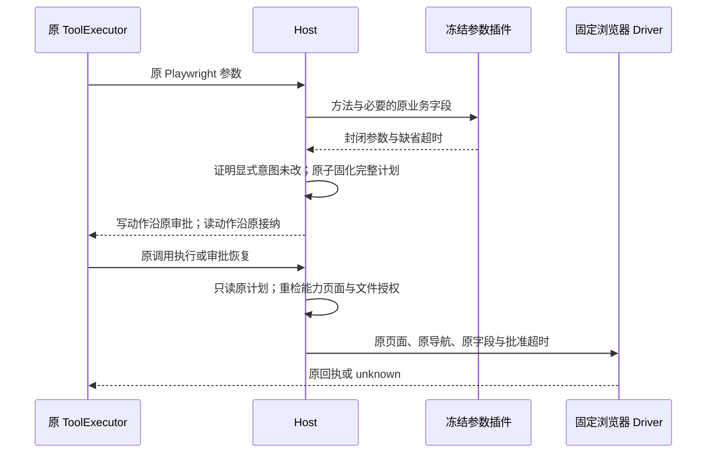

缺省超时 3000ms 属于可替换政策；独立版本可在 1–10000ms 内更改。显式 timeoutMs、选择器、填充值与 URL 必须逐值保留，不能借缺省适配重写原输入。Host 只接纳当前方法需要的封闭字段与整数边界，真实 CSS-only／URL 许可、原文档与节点身份、导航新鲜度、FileChooser 的原文件授权、原审批与 never／unknown 效果恢复是领域必要机制，仍在固定 Host／Driver。新增未知字段不会进入 Driver；业务方法不能指定目标、任意浏览器原语或传输路径。每个读动作也先固化，重试不能悄悄改动同一次等待预算。

UseRuntime 受管路径已移除原参数 map 透传，改为从原计划组装封闭字段，上传的文件注册仍从原请求单独校验。原透传只在未冻结此服务的历史 Run（包含实际 `1.0.3` 七服务包）和明确未打包载体的具名注释边界保留，待这些执行／载体清点无依赖后删除；它不是受管失败回退。固定浏览器程序的 3000ms 缺省只为历史及直接 Driver 消费者保留，受管调用始终传入原固化超时。Stop／Quarantine／Forget、完整计划失败接纳及隐私擦除复用原机制；审批页及原渠道通知显示同一固化超时，保持原 hash 和表单。

接口仍为仓库内 private／experimental，只开放实际变动轴；没有稳定公开内部 Capture／UseState、通用 options 容器、DOM 脚本、任意 RPC 或浏览器工作流 DSL。拒绝把选择器解析／目标资源权交给候选，也不在批准后再次计算。该服务仅负责 Playwright capability 的参数适配；其他同包服务及固定资源的边界须分别验证。


### 文件导出展示的私有实验接入

实际消费者是原 `cua.files.exportArtifact`，沿原 discover bridge／ToolExecutor／Artifact staging 返回文件。`steward.computer-transfer-presentation/1` 自 `1.0.5` 提供，属于当前默认 `1.0.7` 包的十一项服务之一。没有新增 schema 或效果账本。

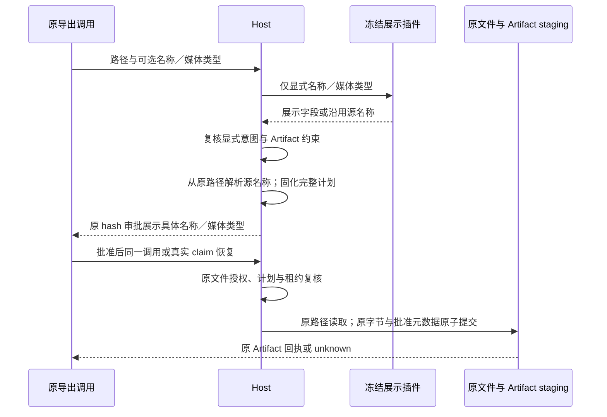

可变业务仅为缺省名称与媒体类型：默认包要求沿用源名称并返回 application/octet-stream，独立版本可为缺省名选择另一个合法字面量。显式字符串必须逐值保留。候选不接收路径、路径 basename、ArtifactRef、Computer／文件授权、原始字节或 IO 回调；`name_from_source` 只要求 Host 从原路径派生展示名称，不能签发或替换文件。Host 在原 schema65 完整计划事务前解析具体名称，所以审批与执行看到同一完整值；执行不再调用方法重算。

名称／媒体类型默认值是实际业务政策。原文件注册、跨 Run／Task 作用域、import 的新路径身份分配、overwrite 成员关系、路径规范化、字节限额、原审批／never／unknown、Artifact 原子发布和撤权是领域必要机制。Artifact 元数据合法性只由所属 `artifact.Input.Validate` 维护，staging 与计划接纳共用它；原显式非法输入仍保留原字符串，在原 staging 验证中拒绝，插件不能把非法默认值说成可信输出。它是内部的实际双消费者验证方法，不是公开的通用 schema／文件系统能力。

受管 UseRuntime 已移除原名称／MIME fallback；只保留给真实旧八服务及更早 Run、明确未打包载体的注释兼容边界，待这些执行／引用清点无依赖后删除。原 Artifact SQLite 私有重复校验函数已移除，调用者改用所属域的同一校验器。失活／缺包／方法错误不会恢复 native 展示。Owner 机械验收即使认可 `../escape` 这类候选默认名，Host 也会在审批／IO 前拒绝。默认名称变化不改原文件路径或字节，批准一次导出不能取得另一 Run 的文件授权。

接口为仓库内 private／experimental；只对现有导出展示开放，不给候选命名磁盘对象、选择 MIME sniffing 算法、修改 ArtifactRefs／存储、自动上传或改动恢复 intent。拒绝让插件读取 basename 来间接传递文件资源 token，也拒绝用第二个 pending 调用记录充当准备锁。UI 沿原审批字段展示已固化的 Name／Media type，CLI／原渠道通知保留原 hash。固定资源指纹和恢复 intent 由 Host 强制；Child 与旧引用保留原组合。

### 浏览器上传展示与固定资源（私有实验接入）

实际消费者是既有 Root／Child Code Mode 的 `pw.locator(selector).upload(file)`。自 `1.0.6` 提供的第十项 `steward.computer-browser-upload/1` 决定上传文件的缺省显示名称／MIME、原选择器与超时；上传 API 仍只有原 `file`，没有增加路径、驱动或脚本参数。当前 `1.0.7` 十一服务包随标准十九包组合分发。

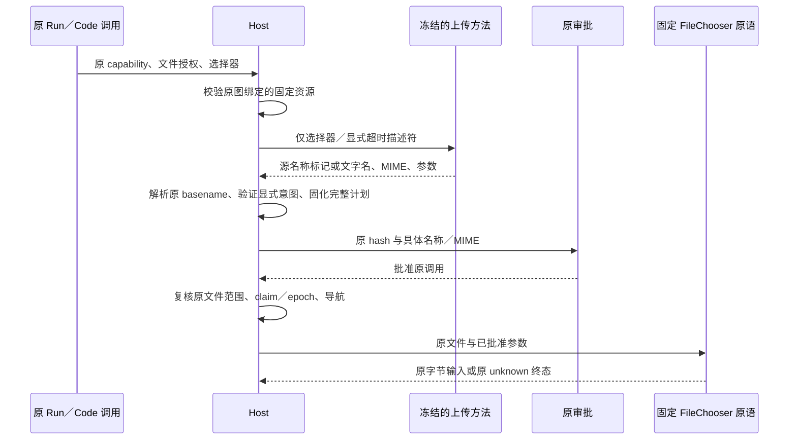

| 领域必需机制 | 可替换业务方法 |
| --- | --- |
| 原 capability／导航／文件授权、显式选择器及超时、claim／epoch／Guardian | 省略超时的默认值、名称来源或文字名、MIME 默认值 |
| Host 按原路径解析 basename，完整计划在原审批前一次提交；原 Tool effect／unknown 不重放 | 纯 Go 方法返回封闭参数，无目标、路径、ArtifactRef、字节或原 basename |
| 单一固定 FileChooser：原文档内 CSS 等待／点击、原授权字节、原输入上限与同文档检查 | 不向候选开放 page.evaluate、任意 Guest RPC、文件系统、上传回调或命名磁盘对象 |

原 `browser.mjs` 的字节参与旧 `UseResourceHash`，不能原地改写其上传分支。新固定 `browser_upload_v1.mjs` 和传输 helper 组成独立资源；私有组合配置 `browser_upload_driver` 固定内容摘要，原 Run 图保留它。消费方只接受 Host 自持的确切资源，配置不能注册程序；丢失或未知摘要在审批／Ensure 前失败。运行时同样从原图取资源，不使用活动图或共享 Provider 的可变选择。现阶段只有一个实际新原语与既有 facade-v1 程序，没有建设通用 Driver registry；未来修改已被执行引用的固定原语时，须保留实际旧版本字节和消费者。

审批前使用原 queued／waiting 接纳及其 request／父调用／claim fence；实际执行仍使用原 running builtin 校验，不能为准备阶段放宽该条件。第十项存在时优先选择它，一次纯服务调用生成完整上传参数，仍复用 schema65 的 Computer 计划，不增加 pending 调用或数据库 schema。执行只读原计划。缺失具体元数据、驱动不可用或方法失败均不能进入原生上传。

固定原语复核 helper 的确切内容摘要和固定 Playwright 版本，保留原相对路径／O_NOFOLLOW、8 MiB 输入、CSS-only 与原文档等待语义。点击完成后原文档消失，不再向新文档交付字节，结果保留 unknown；取消／传输歧义沿原 never 重放规则处理。FileChooser 名称与 Artifact 名称属于不同协议：保留原 512 字节传输路径能表达的名称（包括超过 255 UTF-8 字节的中文名），不套用 Artifact 命名上限。MIME 仍是有界合法媒体类型，名称不能成为路径或命令。

明确旧九服务 `1.0.5` 及更早的保留 Run、旧引用和未打包载体使用原上传程序与默认值；新服务的受管路径已移除该选择。旧程序还提供当前浏览器 inventory、动作与 live selection 的固定原语；历史展示分支在旧执行／引用无依赖后删除，固定原语只能在替代资源和引用迁移均验收后删除。回退兼容的第十项版本保留原 Run；移除已迁移服务会阻止新工作，不能借旧图缺服务静默恢复 native。

本接口与配置仍为仓库内 private／experimental。合成包验收不等于原生资源可用性，消费方的确切资源校验必须独立存在；真实原语与完整 CLI 分别验证，不把受控 SSH peer 当真实 Guest GUI／Lume 证明。未开放公共 Capture／UseState、通用资源 API、任意工作流或自动部署。固定资源、live selection 与默认组合的完整边界见本文末节。


## 浏览器观察投影与原文快照：私有实验接入

当前消费者是 Root／Child Code Mode 的 Tab 观察、变化等待和 capability 导航读取。需要让标签来源优先级、正文／值裁剪和展示顺序独立换版，同时保持原文字节含义、元素身份、引用接纳、截图和历史请求。`steward.computer-browser-projection/1` 是第十一项 private／experimental 服务，默认包为 `1.0.7`；Go SDK 权限与 schema65 不变。

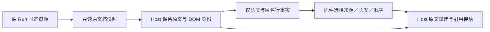

| 所属 | 具体内容 |
| --- | --- |
| 插件政策 | aria／innerText／placeholder／role 优先级，各原文前缀长度，完整匿名行排列；默认保持原优先级和原长度。 |
| Host 必需机制 | 原文档／原 Tab 身份、原 backend node 与 CSS 引用、可见性及既有支持元素范围、密码／隐藏输入排除、截图与导航新鲜度。 |
| 既有披露／资源边界 | 最多500元素、正文16384／候选标签256／值4096个 UTF-16 单元；可选择更短展示，不在本接口扩大采集范围。 |
| Host 来源证明 | 每个原索引恰好出现一次，来源字段和前缀必须属于同一原行；不接纳候选文本、索引签发或缺失值伪造。 |
| 原效果与隐私 | 原租约取消、Forget／Guardian、Tool 回执和 Artifact 原子接纳不变；纯选择不新增 pending／效果账本。 |

固定快照原语返回独立 `source.version=1` 的 UTF-16LE 证据；它不决定标签优先级或实际展示裁剪。Host 只向新服务发送各字段的单元数量，不披露未选中的候选文字、路径、原生标识、token、截图或 IO 回调。得到来源方案后，以原行重建原 `[index] role label = value` 协议；role、value 与操作引用仍属于原采集行，展示重排不重编元素索引。既有 AX full／diff 服务仍只处理已授权展示文本，与原隐私 fence 一起保留。

UTF-16LE 是领域必需的保真，不是通用二进制协议：JavaScript 孤立代理项及截断 emoji 的半个代理项不能经普通 Go JSON string 提前变为替代字符。Host 的字段引用解释器按 JavaScript JSON.stringify 拼写重建引号、控制字符、成对及孤立代理项；正文保持原外层 JSON 解码语义。它不选择第二套标签政策，也不提供通用模板／文本指令语言。

`browser_snapshot_driver` 与原上传资源字段并存于原组合配置，只接受 Host 自持的确切内容摘要。资源对象是调用内的单一 Snapshot 端口，不修改共享 Provider，不从活动图或候选数据加载程序。读取前固定文档，节点引用建立后再次比对同文档有界来源；同文档节点替换须得到新 backend identity，导航／来源变化拒绝旧快照。密码和隐藏输入按实际 input 类型额外排除，不能由 `[role=button]` 选择器绕过；旧已冻结程序保持原字节，不能用原资源摘要原地换实现。

所有实际观察入口共用 `UseRuntime.capture`，受管调用不再直接执行旧浏览器呈现。`Provider.Observe` 的原 facade-v1 浏览器分支仅服务真实十服务 `1.0.6` 及更早的保留 Run、明确未打包载体；旧程序的 inventory／动作／live selection 仍是当前受管服务调用的固定原语。历史展示分支在这些执行／载体无依赖且完成引用清点后删除；当前固定原语只能在替代资源和引用迁移均验收后删除；新服务缺包、资源或来源版本不能进入它。测试中的独立政策候选保留当前其他服务，真实历史包则保留原服务集合，避免通过删除已接纳服务伪装政策升级。

拒绝把原格式字符串解析回 DOM 来源、把未完成的4096字符观察值当完整 live selection 文本、给候选任意 JS／evaluate／RPC、共享可变 Driver 选择或通用资源 registry。当前读取上限和闭合来源字段足够支持实际展示变化，未泛化更大 DOM 采集、内容驱动标签算法或公开稳定 schema。live selection、资源准备与 Child／引用兼容的边界见下节；固定原语的真实 Host Chromium 回归不等于真实 Guest GUI／Lume 兼容证明。


## 默认组合与固定信任边界

当前真实消费者是正常启动的 Main、Task Root／Child、原审批恢复与已发布 Computer 引用。`make build`、安装与打包分发十九个独立业务包，包含 `computer-use@1.0.7` 的十一项服务；新安装使用 Host 自持的六十个 Computer 样例与其他包样例验证同一完整组合，再一次性激活。验收样例位于 `internal/rsi/builtin/computer-policy.json`，独立于候选代码；SQL 回归使用同一所有者文件，不维护第二份默认政策。

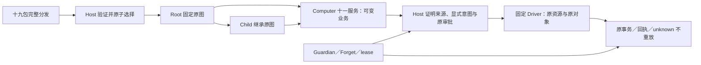

### 机制与政策的分类

| 必须保持的机制及证据 | 已开放的独立变化轴 | 不增加的推测复杂度 |
| --- | --- | --- |
| 原 AX／DOM 事实与 UTF-16 来源证明、原索引／token／导航；真实 Chromium 与来源回归 | full／diff、标签来源、裁剪、行顺序、等待默认值与说明 | 任意 JS、DOM 查询 DSL、内容与 IO 回调 |
| live selection 在原文档、原节点读取**完整当前值**，证明唯一非重叠目标并调用固定 setSelectionRange；真实浏览器回归覆盖 UTF-16、超过 8 MiB 原值与远处重复 | 原生 AX 选区的有界光标方案；动作参数及按键分解 | 为移动原文证明而新增全文流、通用搜索服务或插件输入上限 |
| `nativeTarget` 将原 PID 连到唯一原窗口，是身份校验；最终句柄必须来自原清单 | 清单排列与名称／URL 匹配 | 候选签发 Native ID、句柄或目标 |
| Manager 在原 checkpoint 持久提交后 Destroy，恢复使用原 checkpoint ID 与同一实例 fence；原生命周期回归 | 业务调用组合使用同一可信生命周期 | 让候选决定丢弃检查点或重放 unknown 的生命周期 DSL |
| Config.Validate 约束固定签名镜像／runtime／Driver tuple；共享准备的两小时存活期独立于单个 Run，凭据归 Host；恢复按原保存 manifest 的顺序执行 | 原图固定 Host 已知上传／快照资源摘要；参数、导出／上传展示政策 | 候选注册任意镜像／签名／endpoint，通用 provisioning registry，重排已保存恢复 intent |

以上固定项分别承担来源证明、精确批准意图、身份、耐久恢复和已验证资源兼容，属于领域必要复杂度；它们并未留下第二套可替换业务默认。现阶段只有一个受信任资源 tuple，没有实际独立 provisioning 消费者，不为每个常量创建服务。未来出现实际资源策略变化时，应先证明需求与兼容，再开放最小接缝；不能由候选绕过已有信任指纹。

### 选择、兼容与清理

Host 只在从未选择且未停机的安装初始化；已有选择、停用和 Guardian stop 均不自动补包、重选或复活。完整分发缺任何必需包时启动失败，不接受部分默认组合或静默 native 兜底。明确无分发目录的嵌入式载体保留具名兼容边界，系统 native 对照使用同一 host 字节的独立未打包副本。已有自定义图需显式按正常验收／激活流程升级，不自动修改所有者政策。

当前受管路径已删除旧业务选择、参数透传和重复默认；`*_legacy.go`、旧说明、旧浏览器展示／上传分支仅服务实际 `1.0.0`–`1.0.6` 历史图及明确未打包载体。删除须先清点保留执行、待审批动作和旧引用；当前仍被调用的固定浏览器原语继续按原内容摘要保留。接口仍为仓库内 private／experimental，默认分发不等于公开稳定 SDK、运行中换版、自动发布或自动自进化。

Child 的实际回归在 Root 冻结后切换新政策并退役原包，再接纳 Child，直接证明其使用原十一服务、原来源与原引用，且不收到 Parent 私有消息。实际恢复回归在 release／wake／claim 后直接执行原 capability，无额外 select／reload 或 SQL 修复。默认 `computer-plugins` 系统门禁通过正常启动组合执行全部十五个 CLI／Node／SSH 场景，并核对十九包与原固定资源；同一 host 的未打包对照保护历史行为。真实 Guest GUI／Lume／Linux 仍须对应平台 Live 验证，受控 peer 不替代该证明。
