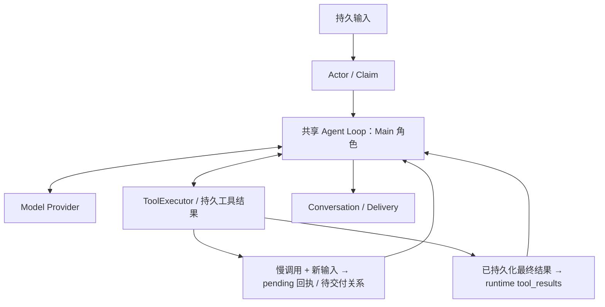

# 自然语言对话与共享循环：技术方案

[功能与需求](../features/conversation.md) · [测试方案](../test-plans/conversation.md) · [主索引](../feature-map.md)

本文的架构与流程描述当前有效实现；明确标记的待实现方案不表示已落地。实现级协议仍服从 [跨功能协议与约束](product-overview.md#contract-0-文档效力与实现规则)。

## 当前架构

Actor 协调领取与租约，唯一 Agent Loop 内核处理推理和工具交换。Conversation 保存用户可见历史，Run checkpoint 与 model_generation 保存执行边界。



## 当前流程与目标差异

接受输入并去重 → 调度唯一 Main → 组装冻结请求 → 调用模型 → 工具执行与结果交付 → 保存回复 → 交付。快工具同步返回；慢调用收到新输入后可先返回 pending 回执，最终结果通过同一 Main 的运行时消息继续推理。Main 仍有待交付结果时不提交完成终态。

- **F-003**：Actor 管理输入与执行权；共享 Loop 在 model/tools/reply/settle 阶段推进，保存模型交换和回复。 本需求不包含实时 Web 推送或高质量语义压缩，分别由 F-019、F-011 跟踪。

## 代码与依赖

- [internal/agent/actor.go](../../internal/agent/actor.go)
- [internal/agent/loop.go](../../internal/agent/loop.go)
- [internal/agent/run.go](../../internal/agent/run.go)
- [internal/agent/sqlite/generation.go](../../internal/agent/sqlite/generation.go)

## Main 工具结果交付（F-003）

需求是让当前单用户在 Main 的慢工具执行期间继续交代和查询工作，保持已有 Main/Worker、原生工具关联、冻结审批与 Durable Replay 契约。阻塞点是 Loop 在 ToolsPhase 同步等待整批结果；实现见 [responsive.go](../../internal/agent/responsive.go)，持久输入检查见 [SQLite port](../../internal/agent/sqlite/responsive.go)。

1. 工具仍经唯一 ToolExecutor 接纳并执行。默认等待 200 ms 后，如有尚未消费的新输入，则将原 exchange、调用及 step 保存到 checkpoint 的 pending_tools，与模型可见的 pending ToolResult 一起提交；它不更新 ToolInvocation 终态。
2. pending 回执带 operation_ref，使用普通 ID `<step>-<batch-index>`；恢复中的旧 pending 回执继续使用已保存的关联 ID，不暴露 Run/Invocation ID，不作为权限或控制句柄。调用—ToolResult 的原生配对完整，随后再注入用户消息；模型可先对新输入回复。
3. 原调用继续使用同一 Run claim、冻结能力与审批。最终结果只在未冻结的 model/settle 边界加入带来源的 runtime tool_results；operation_ref 关联原回执，文本、产物、图片和错误保留原语义。已接受请求和压缩帧不被后台结果改写。
4. 最终结果注入与移除 pending_tools 在一个 checkpoint 提交。故障后从原 exchange 与 ToolInvocation 重建交付：完成结果复用，未完成调用遵循 safe/query_before_retry/never，unknown 仅核实、不重发。待交付结果未清空时，Main 不得完成。
5. 有实际调用运行时保留 Main 所有权；仅有审批/资源等待时释放 claim，由原调度器唤醒。模型费用审批等待前，先让已接纳的调用保存结果，再撤销运行态写入权限；费用拒绝不取消这些已接纳的调用。新输入可唤醒使用新协议的等待 Main；等待期间没有未持久化的回复意图。退出时加入已接纳的工作，正常关闭不作为用户取消；遗忘或所有权撤销仍由原 fencing 阻止迟到写入。

接纳、交付、去重和权限属于机制。200 ms 同步窗口、50 ms 活动扫描及最多 8 批待交付调用属于宿主政策，不新增模型可见配置；数据工具继续受原共享并发与冲突键约束。仅可信的 Task Host 查询/控制事务不占数据工具执行槽，以便满载时仍可处理任务干预。容量拒绝持久化为 RESOURCE_LIMIT，不启动另一个 Main 或隐式创建 Task。

schema 32 增加私有 main_tool_protocol 记录，在创建新 Main 的事务中冻结 version=1；已有 Run 不回填。记录不可更新/删除，checkpoint 继续使用 context version 2；新字段记录交付关系，不序列化堆栈或工具进程。升级前备份，旧二进制因 schema 版本拒绝打开新库；旧 Run 和 Worker 继续使用原同步交付语义。模型工具名称、输入 schema 和 Task/Child 协议未变化。

不暴露通用 job/session、跨 Worker 消息或独立取消 API；既有 Task 是全部业务执行的显式委派边界；新 Main 的固定工具面见[统一工具方案](tools-approvals.md)。选择私有交付状态而非第二个 Main、自动升级 Task 或单纯提示词约束，保留用户输入顺序和可恢复调用身份。

## 验证与交付

验收场景、已有入口和剩余覆盖统一在 [测试方案](../test-plans/conversation.md) 维护。CLI Main 检查覆盖慢调用期间响应及 SIGKILL 恢复；真实模型的响应时延与语义质量单独验证，不由脚本模型结论替代。

## 协议、实现与配置约束

本功能协议在此维护。既有编号用于追溯协议，不代表所有设计目标均已实现；完成状态以需求主索引为准。

<a id="contract-4-conversation-与消息协议"></a>

### 4. Conversation 与消息协议

<a id="contract-41-conversationmessage"></a>

#### 4.1 ConversationMessage

以 Pi 1.2.0 的消息模型为基线，只保留必要类型：

- `UserMessage`：用户输入。
- `AssistantMessage`：Agent 面向用户的语义回复。
- `ToolMessage`：模型上下文中使用的工具结果消息。

Conversation 支持最小必要的多模态语义内容；核心 `ContentPart` 一期包含：

- `text`。
- `image`。
- `audio`。
- `video`。
- `file`。
- `tool_call`。

图片、音频、视频和文件 Part 内部统一使用 `artifact_ref` 寻址；`artifact_ref` 是资源引用机制，不替代资源的语义类型。Intelligent UI 不进入核心 Conversation/AgentMessage 内容协议，而由 Delivery 层生成和持久化渠道投影。

工具执行的完整轨迹不混入用户可见 Conversation，而是进入独立的 RunTrace/Observability 存储。

<a id="contract-64-agent-loop-协议"></a>

#### 6.4 Agent Loop 协议

- `internal/agent/loop.go` 承载可复用的无状态 Agent Loop 内核，并由 `loop_test.go` 验证。
- 一期不为了抽象提前建立独立子包，也不定义只有一个实现的 `AgentLoop` 接口。
- Main Agent Loop 与 Worker Agent Loop 复用同一内核，仅在上下文来源、工具集合、事件接收器和结束策略上不同。
- `AgentMessage` 与 `ConversationMessage` 分离：前者是 Loop 运行时协议，后者是产品持久化模型，由 Context Builder 转换。
- `AgentMessage` 使用最小运行时联合类型：

```text
SystemMessage
UserMessage
AssistantMessage
ToolResultMessage
CustomMessage
```

- Root Worker 仅在 `completed`、`failed`、`needs_input` 或 `unknown` 时，以 `CustomMessage{custom_type: "task_update", ...}` 返回 Main Agent Loop；普通运行进度、取消和等待审批不唤醒 Main Loop。Child Worker 只向直接 Parent 返回结果，不直接生成 Main Follow-up。
- `CustomMessage` 只存在于 Agent Loop 上下文和 RunTrace；Task/Run 模块保存权威状态，不将它作为普通消息写入用户 Conversation。
- `CustomMessage` 的最小字段为 `message_id`、`custom_type`、`content`、`details`、`origin` 和 `created_at`，不引入 Pi 面向 TUI 的 `display` 字段。
- `task_update.content` 保存供 Main Loop 理解的自然语言业务摘要；其 `details` 使用具名的 `TaskUpdateDetails`，模型可见字段只包含 `task_ref`、`kind: completed | failed | needs_input | unknown` 和可选 `artifact_refs`。
- `event_id`、`root_run_id`、`agent_id`、`task_id`、`task_epoch`、`sequence`、`occurred_at` 和投递次数属于持久化事件信封，不进入模型可见 `details`。Reporter 使用稳定 `event_id` 派生幂等 Request ID，重复队列投递只进入 Main Inbox 一次。
- `needs_input` 表示缺失信息会实质阻塞执行；Main 先尝试用已有上下文回答，仍无法处理时再集中询问用户。`unknown` 表示外部副作用是否发生无法确认，必须由 Main、Reconciler 或用户进一步处理。
- `cancelled` 由 Main 的 `task_manage(cancel)` 已知，不产生重复 Follow-up；审批由 Security/Approval 直接生成确定性审批请求，审批结果唤醒原 Root Run，不先触发 Main 模型推理。
- 每种 `custom_type` 在 Go 内对应具体的 `details` 结构体，只在存储和传输边界序列化为 JSON；业务代码不直接操作 `map[string]any`。
- `CustomMessage` 是内部一等消息类型，只有在 LLM Provider 边界才由按 `type` 注册的转换器映射为模型兼容消息。
- 转换后的消息必须保留可持久化的 `origin: runtime` 来源，并带明确的运行时内容边界；不得被 Conversation、Compaction、Memory 或任务锚点识别为用户原话或用户意图。
- 不将 Worker 结果提升为高权限 System Message；未知 `type` 或缺失转换器时 fail-closed，不注入模型上下文。
- 所有 `AgentMessage.content` 进入 Agent Loop 前统一规范化为 `[]ContentPart`；对外提供纯文本便捷构造函数，但 Loop 内不保留 `string` 特例。
- Worker 不直接生成面向用户的最终回复；Main Agent Loop结合人格、当前语境和投递场景决定是否以及如何通知用户。
- Root 产生关键更新时，Host 先原子持久化 Run/Task 状态、`TaskUpdate` 与 Outbox，再由 durable Reporter 以 Pi 风格的 Follow-up 提交 Main Inbox；Main 忙碌时排队，空闲时启动新的 Main Run。Root 的自然语言、图片和文件结果由 Host 包装为运行时消息，不要求模型通过 JSON Schema 或 constrained decoding 生成 `TaskUpdateMessage`。
- Agent Loop 对外事件与 Pi 保持一致：

```text
agent_start
agent_end
turn_start
turn_end
message_start
message_update
message_end
tool_execution_start
tool_execution_update
tool_execution_end
```

- 外层事件信封补充 `agent_id`、`run_id`、`task_id`、`sequence` 和 `occurred_at`，不修改 Loop 核心事件语义。
- 为支持可恢复审批，仅对 Pi 风格的 `BeforeToolCallResult` 增加最小 `suspend` 能力。

<a id="main-loop-ownership-and-persistence"></a>

### Ownership and persistence

Run creation freezes the ModelSnapshot, capability/tool schemas, and role prompt
fragments with the Run and Outbox event in one state transaction. An immutable
history boundary selects earlier semantic history from `conversation.db` on
first execution. The resulting context and each provider request are persisted
before dispatch. Steering remains separate ordered messages, injected after a
native result batch or a persisted pending receipt, or before publishing a final answer. Steering arriving during a
final generation causes another model step before that answer is published.
A recovered accepted exchange keeps its frozen context until its result is checkpointed, before newer steering is injected. Once a reply intent is committed, later input follows that reply and continues
the same active Run until it reaches its terminal boundary.

State migration v7 adds Runs, claims, capability snapshots, input and semantic
write intents, model generations, ToolInvocations, reply/delivery records, and
RunTrace. It preserves prior v1–v6 metadata and events. `conversation.db` has an
independent v1 forward migration, WAL, foreign keys, busy timeout, monotonic
per-Conversation sequences and immutable idempotent message IDs. An incompatible
future version fails startup. [Memory maintenance](../features/memory-context.md) owns the
separate Memory database and its current migrations.

| Run state | Legal next states in this slice |
| --- | --- |
| `queued` | `running` on Claim |
| `running` | `running` on Checkpoint/controlled release, `waiting`, `completed`, `failed` |
| `waiting` | `running` on an eligible wake/Claim |
| `completed`, `failed` | Terminal; another request creates another Run |

The Main foundation reserves the baseline's cancelled state.
[The Task slice](../features/tasks.md) now supplies create/search/append; controlled user
pause/cancel uses the controlled [Task stop path](../features/tasks.md). Waiting reasons use the baseline enum. Resource waits
are recoverable; user-input waits become eligible when new steering arrives.
Approval wakes and resource waits use the durable Tool path in `docs/features/tools-approvals.md`; other external-event integrations arrive with their respective slices.

Claims use an opaque token, monotonic epoch and five-second lease, renewed once
per second. All Run, generation-acceptance and Tool mutations verify ownership;
Checkpoints and terminal transitions additionally use Run version CAS. Takeover
rejects old claims even when a slow response arrives afterward. SQLite busy/locked
transactions receive at most three attempts with bounded exponential backoff;
other write failures stop at a recoverable boundary. SQLite's configured busy
timeout also applies. Model errors and Tool business errors are not retried.

The Bridge's Host observer commits generation results, usage and the completion
Outbox event together under the existing auth/cancellation acceptance gate,
before publishing completion. Recovery reuses completed generations. An
incomplete model call may run again with the frozen request; no partial response
becomes a semantic message. Profile switches affect only new Runs, including
after restart. Credentials remain outside snapshots/context/results.

Main replies commit in this order:

1. Save an immutable reply intent with stable message/delivery IDs in `state.db`.
2. Idempotently append the ordered intents to `conversation.db`.
3. Enqueue DeliveryRequest and its Delivery Outbox in state.db.
4. Advance the reply Checkpoint after both durable writes.
5. Complete the Run, or process newly accepted steering.

There is no cross-database transaction. Restart fills missing writes using the
saved IDs. The `settle` Checkpoint prevents another generation if the process
dies between reply commit and Run completion. Any executor may flush immutable
semantic intents, but only the current claim may create them or advance a Run.
The M3 [Delivery Outbox](channels.md) drains requests into the durable terminal
inbox, independently of model readiness. Reading semantic history alone does not
imply a message was accepted by the channel.

SIGINT/SIGTERM stops admission to the current executor and waits for its current
model/Tool step to reach a durable boundary. Model calls have a 195-second Host
deadline. The Node Bridge enforces a 180-second generation budget and separate
header and stream inactivity limits. The executor
releases the claim while retaining the nonterminal Run state, without cancelling business work. Run `chat work` again to
continue. SIGKILL leaves the lease to expire; a newly started `chat work` waits
and reclaims automatically. No broker is needed for this bounded CLI drain:
state is authoritative, and Outbox notifications remain available to the relay.

## Prompt 与工作状态装配

初始上下文统一由 [agent/context.go](../../internal/agent/context.go) 根据 Main/Root/Child 位置和冻结 Tool specs 生成。共享安全与证据原则、角色职责、执行状态、能力操作规则分区保存；项目指令按需读取，Skill 目录按需搜索；没有把个人助手改成 coding agent，也没有给 Main 增加 Child 创建能力。

新 Main 在 Agent 内把 `main_role`、`safety`、`execution` 和按冻结能力选择的指导拼成一条 system message。Host 保留有类型的分段快照，Provider 只映射完整文本；新请求不在 Bridge 中合并。

Main 的原始 Conversation 仍保存用户语义历史。新 Main 额外交接最近 Main 的工作状态、获准读取的摘要原文和顶层工具回执；未知效果是独立 Host 事实。来源在 [sqlite/handoff.go](../../internal/agent/sqlite/handoff.go) 选择，接受 Forget 前的执行内容被排除。

超预算时共享 Loop 可执行工具关闭的总结轮次。该轮只更新工作状态并推进 step，不进入 reply 阶段、不对用户流式输出、不产生 Worker 最终结果，也不直接进入 Curator。模型、费用、权限、取消和重放继续使用现有链路。协议与兼容说明见 [上下文方案](memory-context.md#当前上下文装配与业务接续)。

## 当前设计取舍与兼容约束

Actor 与智能循环分工，Main、Root 和 Child 共用同一内核。上下文摘要使用同一 Loop 内关闭工具的模型步骤，不建立另一条推理管线；旧 Run 保留冻结请求，新 checkpoint 使用 context version 2。摘要的真实语义质量需单独验证。

持续响应保留唯一 Main 与统一 ToolExecutor，将慢调用的持久执行和结果交付分开。输入到来时可提交 pending 回执，最终结果以低权限运行时证据接续。私有 checkpoint 交付关系避免引入第二 Main 或隐式 Task；schema 32 只为新 Main 冻结协议，旧 Run 不升级，unknown 不重试。200 ms 同步窗口与 50 ms 扫描是默认政策，不是模型 SLA。

## 单条系统上下文

`agent.InitialContext` 为每个角色拼成一条 system message。Main 使用简短角色、`<tools>` 和 `<rules>`，优先 UI 表达结构化内容，简短回答、确认与澄清使用文字；安全约束合入规则，不再追加共享执行与能力段。内部仍保留 main_role、safety、execution 三段冻结元数据。Root Worker 与 Child Worker 同样按角色、`<tools>`、`<rules>` 表达；内部段顺序为 worker_role、capabilities、safety、execution。Root 的角色段冻结独立的 Child 角色文本，阶段进度要求归入执行规则；Child 只继承 Parent 冻结的 Child 角色、安全与共享执行规则，不带 Root 身份、阶段进度或父级运行时环境。Worker 的 cwd 与本地可读项目文档入口由运行时在首次模型请求前独立提供，详见编码设计。MCP 服务目录不预载到 system；Server 名称、描述与完整工具目录保留在角色冻结能力中，通过 Code Mode 按需检索。Skill 不预载目录；Agent 通过 skill_list 搜索，再按名称使用 skill_view 读取。版本、来源与目录摘要留在 Host 冻结元数据中。Host 在消息的 `system_sections` 中保留分段快照供 Child 继承与审阅，Provider 投影不携带该字段。新 Bridge 不拼接多条 system；拆分输入明确拒绝。旧多段执行须在升级前结束或取消后创建新 Run，不重写历史消息或已接受请求。Prompt 文案更新仅影响新建 Run，不修改工具权限、调度或交付协议。最终回复无需 JSON 围栏；UI 由 Main 专用工具与 Skill 产生。

Main 沟通／工作方法已接入独立版本化 `conversation` 包并进入标准分发。Host 保留身份、安全 Section、输入与冻结上下文、Task／交付事实；Root／Child 不消费 Main 方法服务。独立换版、已排队版本保留、方法回执后 ContextReady 失败恢复与工具续轮前缀见[Main 插件边界](../designs/plugins-evolution.md#已提取的-main-对话边界)及[插件验收](../test-plans/plugins-evolution.md)。`make test-prompts` 包含相应上下文回归。
