# MCP 与真实外部能力：技术方案

[功能与需求](../features/integrations.md) · [测试方案](../test-plans/integrations.md) · [主索引](../feature-map.md)

本文的架构与流程描述当前有效实现；明确标记的待实现方案不表示已落地。实现级协议仍服从 [跨功能协议与约束](product-overview.md#contract-0-文档效力与实现规则)。

## 当前架构

MCP 适配器先发现允许工具，生成冻结 ToolSpec；调用由原 Run 固定的方法插件编排，Host 重新核对服务端声明并经受限子进程执行。真实服务扩展仍必须进入同一 Registry/Executor。

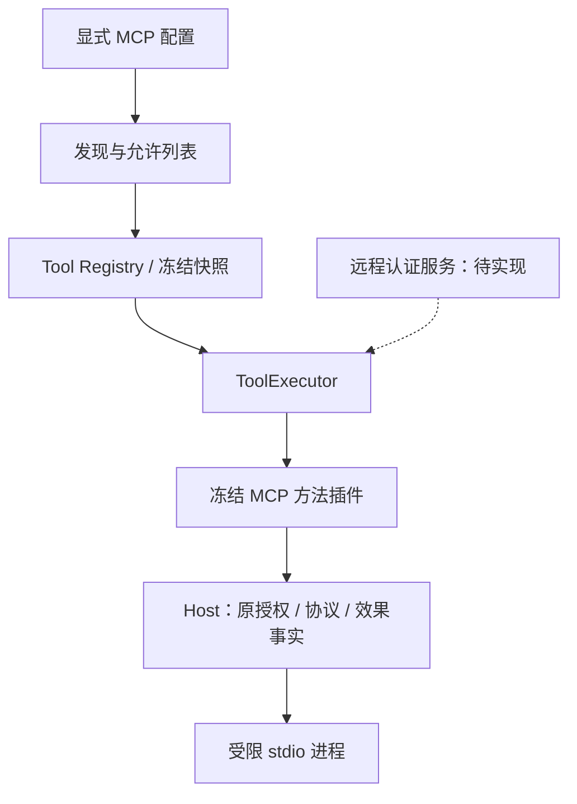

## 当前流程与目标差异

配置 → 发现并冻结工具 → Agent 选择工具 → 审批/执行 → 结果规范化。新增远程服务需先设计认证、边界和未知结果处理，再接相同执行路径。

- **F-024**：启动服务器、tools/list、tools/call、schema 指纹与工具允许列表已实现。 当前子进程受限、无继承凭据/网络；这不是通用远程认证 MCP 客户端。
- **F-025**：GitHub 精确 PR 监听提供 SecretStore PAT 认证读取及失效诊断/替换后恢复；Agent 的远程服务工具、OAuth 和写动作生命周期仍未实现。

## 代码与依赖

- [internal/tool/mcp/client.go](../../internal/tool/mcp/client.go)
- [internal/computer/sandbox/sandbox_linux.go](../../internal/computer/sandbox/sandbox_linux.go)
- [internal/app/runtime.go](../../internal/app/runtime.go)

### MCP 托管方法与目录政策

实际消费者是 Main／Root／Child 经 CodeMode 接纳的原 MCP 工具。现有受限本地 stdio 产品契约不变：确切允许列表、原工具 schema／描述／配置指纹、只读 safe 与外部效果 never、确切参数审批、原进程及取消回收继续由 Host 强制。分页方法与目录展示政策已迁入独立托管包，实际业务、生命周期与兼容清理已验收；当前标准二十三包的源码／预构建安装与首启／冷重启门禁已验收；契约仍保持仓库私有实验级。

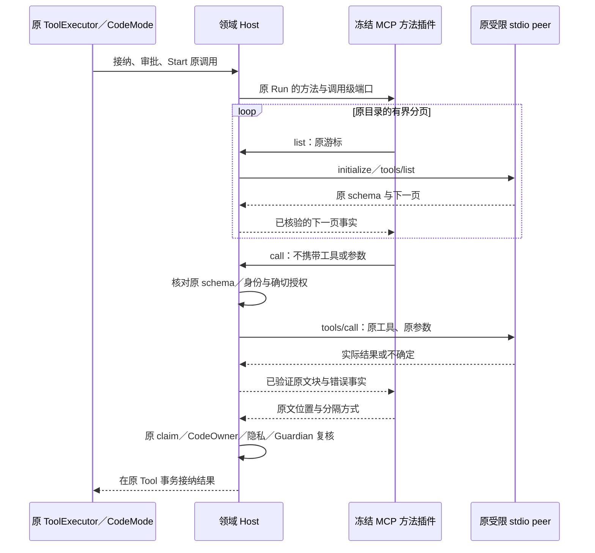

`internal/plugin/mcpbridge` 持有分页再发现的编排和原文展示方案；私有 `steward.mcp-source/1` 端口只允许推进当前调用的 list／call。候选看不到 Host 命令、目录、凭据、Run token 或已批准参数，也不能改选工具、指定另一个服务器或自行判断效果确定性。Host 校验原目录身份与分页界限，仅向原 peer 发一次原调用；缺失／null／非文本／不完整响应在实际派发后保留不确定。候选只返回原文块位置和有限分隔符，Host 重新从实际来源重建，拒绝越界、重复、断开 UTF-8 或伪造文本；错误状态由实际响应决定；已验证的 peer 错误不能被候选崩溃抹成成功或不确定，错误正文不再交给仅需错误事实的方法。

`tool.InvocationContextStore` 是仓库内部的接纳后绑定机制，MCP 是当前实际消费者。它在原 Start 之后给 Execute 和 Invoke 同时绑定领域闭包，保留原 Outcome.Ambiguous，不将 MCP 改造成会丢失确定性的 builtin。正常 CodeMode 的嵌套工具继承实际 CodeOwner fence；调用 ID 只用于关联，不能代替授权。插件服务复用 DriveService，不新增效果账本；每次来源释放及完成事务复核当前配置与原冻结工具资源身份，目录描述更新不重绑执行。完成事务另核对原图，防止方法返回到发布之间的隔离、撤销或 Forget 释放正文。已派发的 never 效果若在最终接纳前被撤销，仍有执行权的 Host 在原 Tool 事务记录 unknown；丢失 claim 的旧执行不能自行写入，由原恢复流程接管。

启动时在初始选择前捕获原允许目录，保留原配置 JSON 形状及资源指纹，不能借元数据更新重写历史快照。调用方法按持久的 Run 服务清单和原 graph 选择；停用／缺少载体明确不可用，旧 Run 不追溯 opt in。`invoke_legacy.go` 只保留 pre-service Run、已有二十一包选择和显式未打包载体的原解释，实际消费者消失后删除；受管错误不回此路径。重复的响应解析已合并为 Host 原文事实验证，没有两份默认解析器。

`steward.mcp-namespace/1` 独立持有目录的空白处理、首行和默认 512 rune 展示政策。MCP 适配器只捕获所有者显式描述或原 server instructions，保存在不序列化的 `Definition.NamespaceSource`；原 ToolSpec、公开 SDK 和配置资源哈希不增加字段。纯服务返回原 UTF-8 字节窗口及省略标记，Host 从确切来源重建，按现有 CodeMode 输出预算约束，不接纳候选凭空生成的正文。原始来源不自动进入快照或模型请求，只有当前已验证政策选择的原文窗口进入冻结目录。

新 Main／Root 的目录投影按确切 graph、来源摘要、所有者和 privacy epoch 缓存在进程内，结果仍由原 capability snapshot 持久化；Child 原样继承父快照。缓存缺失时，私有 MCP preparation 信号先回滚创建事务，在事务外执行纯服务，再重新检查当前图／来源和原接纳隐私 epoch 后重试；源配置移除、替换、Forget 或隔离不能重建旧私密请求。沿用既有有界重试，不引入第二条持久请求／状态管线。旧 Run 不查询当前缓存；停用或缺载体的新快照清除可选目录贡献，实际工具方法仍明确不可用，不恢复 native 展示政策。

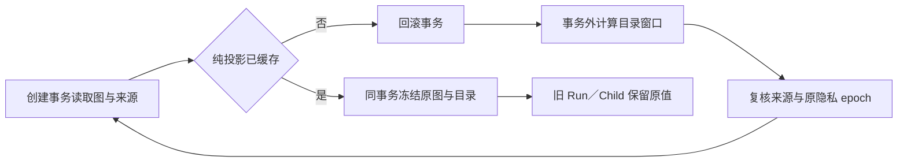

`metadata_legacy.go` 仅保留 pre-namespace-service、已有二十一包选择和显式未打包载体所需的原目录解释；`Definitions` 仍为这些直接消费者构造兼容基线，新托管快照在冻结前清除并替换该基线。实际消费者消失后删除。默认受管目录从原始来源经冻结插件求值，不把旧摘要作为失败兜底。没有新增迁移表或插件共享状态。

MCP 没有权威结果查询接口，unknown 必须保持未知；共享 Host 对账器在检查原工具有无 Query 后，只验证该查询目标自身的冻结身份，不因其他托管功能的资源投影差异阻断全局恢复。这个固定机制不调用候选方法、不派发新效果、不授予查询能力，完整约束见[工具恢复方案](tools-approvals.md)。

默认装配只在从未选版且未停止的安装中进行，MCP 方法与目录由 Host 自持固定分页、真实错误、Unicode 和默认截断预期验证；候选不生成自己的验收答案。已有二十一包或其他显式组合不会自动加入 MCP；移除 MCP 只影响新选择，保留其他功能的版本，已迁移边界不恢复 native。标准分发二十三包须完整，缺少 MCP 包明确失败；实际业务已验收；当前二十三包的首启／冷重启、完整软件及适用系统门禁已验收。Linux ARM64 已验证正常模型桥接经 CodeMode、托管方法和生产 bubblewrap 到实际 stdio peer；这不等于完整 Linux 产品、真实 Guest 或远程供应商验收。

当前三项复杂度属于领域必需：接纳后绑定用于原调用的授权／恢复，调用级端口用于受限 IO 和确定性，事务外纯投影与隐私复核用于一致地冻结新能力。公共插件 SDK、新 MCP 传输、任意 RPC／exec、常驻进程池、通用效果协调及远程认证均未开放或稳定化。协议和 DTO 保持 private／experimental。已拒绝仅给原生 invoke 加 manifest 的代理方案，也拒绝为套用 builtin 而改变 Outcome 语义；真实 Child 保留原方法／目录、退役后继承与父级私密消息隔离。默认组合、协议负例及完整产品回归按所属测试方案持续维护。

### Connected Apps 工具方法与指引（私有实验）

当前消费者是原 Code Mode／ToolExecutor 中显式连接的账户工具。实验包 `connected-apps` 提供 `steward.apps-method/1` 与 `steward.apps-guidance/1`；原二十三包工具边界分发已验收；目录、账户、Logo 和界面方法另有独立包，现已接入标准30组合，完整组合门禁仍待验收，不能据此将 F-071 标为插件迁移完成。

默认装配使用七个独立所有者用例，覆盖 search／execute、账户／公开模式、既有 cursor、60000／60001 展示边界及文字配方。验证只获得一次性合成资源，没有实际账户、凭据或 HTTP 权限；安装不连接账户。分发缺失工具包明确失败。已有二十二包及其他明确选择保持原图，不自动启用方法／指引；首轮和冷恢复都通过同一 App／Registry／Code Mode／ToolExecutor 接纳。只有工具功能被移除时，原生账户检查／断开和目录继续可用；这些剩余业务随后按独立迭代轴迁移。

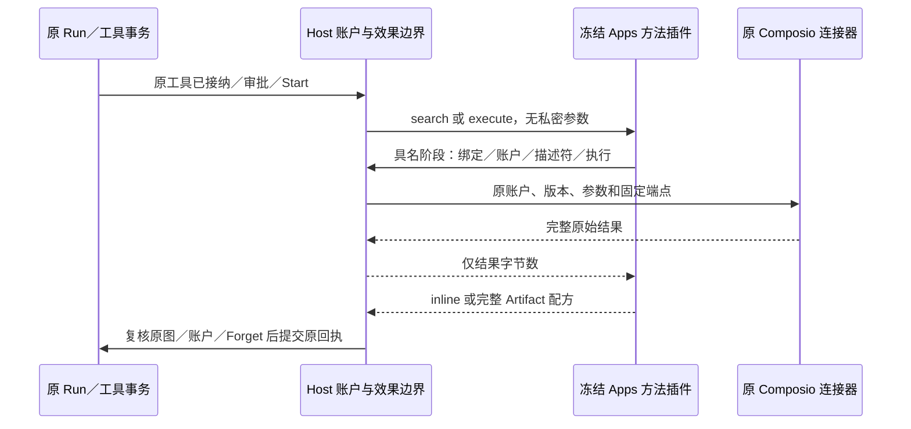

可变业务是调用阶段编排、初始分页数量、原结果的 inline／Artifact 配方，以及工具和账户 namespace 指引。Host 保留确切账户、工具名／Schema、版本与 descriptor_hash、审批参数、凭据、当前绑定身份、原响应和效果确定性。候选既不能改变查询、游标、端点或批准的参数，也不读取它们；`steward.apps-source/1` 只承接本次原调用的具名阶段。账户／描述符检查不可跳过，单次 POST 不可重复；公开应用仍需明确启用、仅可用 no_auth 描述符，原 high／external_effect／never 不变。POST 后候选失败、隔离或撤权保持原 unknown，不新增可重发的效果账本。

首个搜索页默认 8 项由方法包选择；Host 按 v3.1 协议接受 1–1000 项。续页保留原不透明 cursor 并省略新 limit；协议文档说明 cursor 编码页及数量，省略新数量以维持原分页是本地适配选择，实际服务兼容仍需真实项目验证。单页固定 HTTP／JSON driver 复用原凭据、45 秒期限、响应上限及遮盖；结果不通过插件 RPC 传输，因此不缩小原完整 JSON／Artifact 能力。完整产品上限与 Code Mode 传输限制仍分别成立。

指引是空输入的纯服务，返回 namespace／search／execute 各一对前后文字。Host 在冻结能力的原事务中插入当前账户显示名与别名，候选不获取账户身份或标签。缓存只保存不可变图的纯配方；MCP 与 Apps 的两个实际消费者在同次回滚后、SQL writer 外准备，并用同一原始隐私票据重试，保持原三次事务预算。Forget 不会将旧输入变成新 epoch。停用或缺少可选指引时清空新贡献，不恢复 native；必需方法不可用时明确失败。原 Run／Child 的指引和方法保持原图，按 Run 恢复描述只针对相同名称、provider 和资源的 Apps 工具，不放宽通用 Registry 的执行属性校验。

原重复参数解码、结果 JSON 构造及 adapter 内的 60000 字节展示判断已移除；账户／描述符与过滤事实共享同一实现。原 `Service.SearchTools`／`Execute` 和结果配方已统一隔离在 `method_legacy.go`，客户端旧八项请求在 `search_legacy.go`，旧文字在 `guidance_legacy.go`；仅服务 pre-service 冻结 Run／Child、已有二十二包等明确旧组合及当前 direct／unbundled 消费者。`Definitions` 构造它们的兼容基线，新受管快照冻结前替换该文字。无这些具名消费者并完成兼容迁移后删除，不作为受管错误退路。

事务原子性、调用级封闭端口、当前账户与隐私复核属于真实恢复／授权要求；方法与文字是可替换政策。DTO 均为仓库私有实验，不稳定成公共 connector ABI；没有开放内部账户模型、任意 HTTP、模板语言、私密输入、通用 KV 或第二调度器。拒绝仅转发 native 的插件、把分页／文字配方留在 Host，以及给每个内部函数增加独立进程。后续拆分按目录、账户管理与工具使用的实际独立迭代轴验证。

### F-042 · 可靠的环境事件监听

当前消费者是显式配置一个 GitHub.com PR 的本地操作员；入口为 `github` CLI 与生产 `WithEvents` 生命周期。新增 `internal/observer/github` 私有适配器，使用固定 GitHub.com GET 路径，拒绝所有 HTTP redirect，分页由本地确切端点与页码构建，不跟随外部 Link 或响应 URL。凭据由 SecretStore 每轮重新解析；错误只保存安全代码。`/user` 身份用于排除自身评论/评审；PR 响应核对仓库全名、编号及 head，并在首次成功时固定不可变 repository ID。

领域必需机制为可靠持久化、版本去重、短事务、停止/隐私 fencing 与健康；当前政策为一个确切 PR、只读 PAT、定期重扫和有限历史。两者分开，均只在仓库内部使用，不稳定通用 Source 插件协议、外部 schema 或新的 Task 生命周期。监听不会调用 `AcceptInbound/Submit`，以免把第三方文本变成用户话语或越过 F-045 的主动启用边界。

每轮流程：SQLite 注册/读取 watch 并接受版本/隐私 epoch 票据 → 在事务外读取完整的评论、review 和当前 head check-runs → 单短事务重检票据、enabled、隐私 epoch、repository ID → 插入新观察及现有 EventOutbox 唤醒 → 更新 head 与成功时间。完整扫描失败只保存故障状态，不保存部分事件或推进成功边界。同类持续故障只在安全代码变化时写健康唤醒，恢复再写一次；内部唤醒不直接创建工作或用户通知。并发 poll、stop/resume 与 Forget 会使旧票据失效。运行时 shutdown 取消并等待 watcher 退出后关闭数据库。

Migration 033 在 `state.db` 增加 `github_watch/github_observation`；不修改既有 Run、工具或冻结能力快照。watch 身份固定为仓库名/PR，repository ID 进一步防止名称复用。来源 ID、类型、来源时间、规范化字段及完整源正文摘要构成版本 hash，唯一键 `(scope,event_key)` 使重复扫描/重启不产生重复观察。review 的 submitted_at 不是编辑时间，因此完整源正文摘要仍参与私有 event_key，即使修改发生在 16 KiB 展示边界之外也产生新版本；原始长正文和该摘要字段不另行持久化或展示。历史观察保持不可变；Forget 后只查询当前 epoch，显式 resume 不会将旧版本重新发布。所有查询只读，不触发扫描或修改健康。

选择全量有界重扫而非时间高水位：评审/CI 端点的修改和乱序不能由单个时间游标完整表示，重扫能补回 GitHub 仍保留的版本；代价是 API 读取量。每页 4 MiB、每类 20 页、总事件正文 8 MiB，超限整体失败，不伪装完整接收。正文截断保留来源链接，接收不宣称 GitHub 的历史审计或外部 exactly-once。旧 head 的 CI、删除和中间变更不受保证；不扩展 webhook 服务器、OAuth、通用工作流或自动 Task 接续。

<a id="github-managed-method"></a>

### 精确 PR 方法的独立版本边界

`github-pr-followup` 已有私有实验实现；实际消费者为 `Service.Poll/Run`、观察接纳后的原 Main 恢复和所有者绑定目标预览。已纳入标准30包和8条独立 owner 用例；保留原28包的全部封存内容与版本。当前完整分发、真实旧引用与整体验收仍在进行，不能把定向回归等同完整迁移。

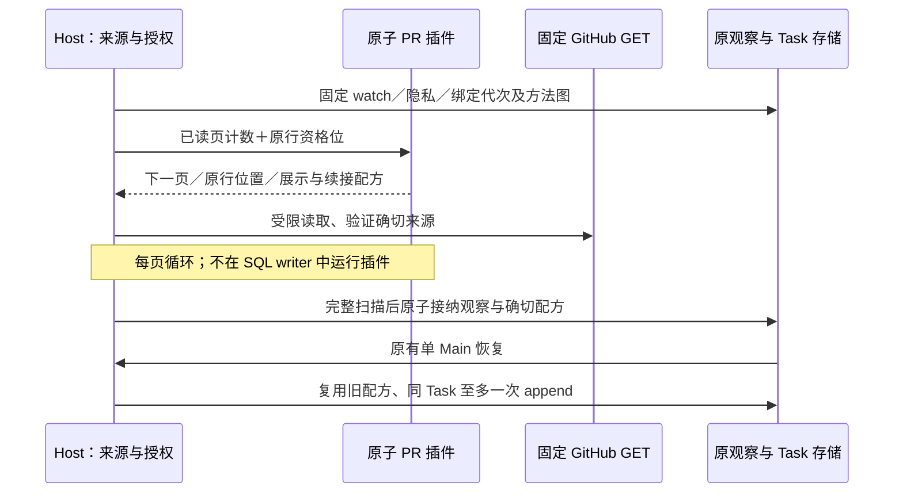

插件持有真实扫描次序、分页推进、资格行的选择、正文显示字节数、零配置轮询间隔以及 Main 的目标／来源预览配方。只接收三类源的页号／条数、资格位和显式轮询秒数，不接收正文、来源 ID／URL、凭据、Task 或存储对象。Host 保留固定 origin／GET／redirect 拒绝、原身份与已发布第三方事件资格、页与总扫描资源边界、完整扫描验证、原行投影及 UTF-8 字节裁剪机制。显式轮询间隔不能被候选改写；改变缺省间隔仍在原5–3600秒界内。逐页纯调用与 HTTP 分开，保留原每次 HTTP 20秒及整个扫描90秒上限，不把多次网络等待塞入一个30秒插件进程。

event_key 的 V1 身份投影继续绑定原16 KiB规范化正文及完整源正文摘要，显示配方换版不会制造新来源版本。相同键保留首次接纳的原正文与配方，不回写历史观察。schema68 新增可空且受原不可变 trigger 保护的 `source_method_json`，并记录 watch 实际接纳的 `selected_interval_seconds`，只读健康查询以最后接纳的间隔判断过期，不从 GET 执行当前方法：新受管观察保存确切图和完整续接配方，旧行明确为 native；不改旧 Main、冻结请求或工具回执。Main 在原短事务中使用已接纳配方，不再调用当前方法、不新建效果账本。第三方授权边界仍由 Host 固定；可变方法文字单独标为不可信，不能授权新 Task、扩大范围、重复 append 或重试 unknown。

新安装的 `github poll` 在取凭据／HTTP 前经现有 Host 验证选择完整30包，无需模型配置、Skills 或执行 runtime 准备；已有选版、停用与 stop 原样保留。status／binding／events 和监听 stop／resume 仍独立可用，只读打开不初始化执行或协调其他 scope。`builtin/github-cases.json` 的8条字面期望覆盖首步、资格位、三类源推进、满页／历史上限及显式间隔；候选不能提供自身 oracle。实际政策共239条，保留原256条上限。

首个方案在读凭据与身份请求前验证；完整扫描前的所有原行和后续配方都按原8 MiB总量计价，包括 JSON 转义后的新增方法元数据。最后一步返回后再次裁决原来源图的 Guardian；stop／隔离不接受任何观察，真实存储故障保留原错误类别，不能误报撤权或回 native。

每轮票据在初始事务内固定方法图；版本切换、回退和停用不会改变在途扫描或已接纳输入。停用后新 poll 在读取凭据／HTTP 前不可用，不复活 native；已接纳配方可沿原因果继续。Guardian 的全局 stop／原来源图隔离，以及原 watch、绑定、Task 和 Forget 裁决仍优先，即使新 Main 的其他功能采用了另一张图。所有者绑定预览先释放 SQL reader，再执行当前纯方法，并在返回前重检确切绑定版本与隐私。

清理边界：原扫描主体与重复的来源读取已被共享固定 driver 和具名 `client_legacy.go` 取代；该解释器仅供实际 pre-opt-in 选择、在途 native 票据及直接嵌入。`github_preview_legacy.go` 仅供 native 来源及 pre-opt-in 绑定视图；相应消费者／引用消失后删除，受管失败不会调用它们。固定身份投影属于持续使用的来源版本格式，不是第二份默认业务实现。契约保持仓库私有实验级，不开放通用 Source、工作流、规则 DSL、任意 URL、凭据或 Task 操作；自动候选构建、部署及 F-072 仍未接通。

### 明确 Task 关联与 Main 接续

本机所有者可 CAS 绑定确切 watch scope、已有 Task 和当前 Task epoch；关联冻结 privacy epoch、授权 generation 及当前观察序号作为接收起点。`github_task_binding` 是此单一 GitHub 适配器的私有授权/消费位置，不是通用 Source/工作流协议。只处理绑定之后的新观察，不以话题相似、自由文本 TaskRef 或 PR 内容自行关联。

`main_inbox` 的既有 event_id 强引用 task_update，因此不将外部观察伪装成 Worker 结果。私有 `github_task_followup` 记录观察→现有 Main 的不可变因果，复用 createMain、Actor、ToolInvocation、EventOutbox 和恢复扫描；每次只接纳一个来源版本，观察与因果唯一键防止重启/乱序重复。消息使用已有 RuntimeContext 的 JSON 框、Origin=runtime，明确是第三方证据而非新用户命令/审批；不写 main_input 或用户 Conversation。

交给 Main 的原目标与来源正文默认各最多 4 KiB，截断明确标记为 preview；native 来源保持原配方，受管来源按接纳时固定的有界配方解释。完整 Task/观察继续保存在原存储，不改写版本身份。信息不足时沿已有授权读取原 Task 或询问所有者，不凭缺失细节继续。这样单个长评审不能制造无法压缩的受保护上下文。

只有因果 Main 受此附加裁决：同一 Task 至多一个新 append，来源/hash 已接纳的重复仍按 Task 原规则复用回执；新 Task、另一 Task、Automation/Memory 控制及直接副作用被拒绝。原 Task Worker 继续原工具、审批和 unknown 裁决。成功 append 在同一事务记录 continued_epoch 并推进 binding 期望代次，使合法接续不会撤销自己，其他动作不能借此重新授权。

执行 runtime 准备必须在发现 Tool/依赖、公开可执行 Actor 或运行任何恢复前，以可信 owner 配置调用 ConfigureGitHub，包括配置为空；Store 当前 exact scope 私有且默认拒绝。OpenControl 的 status/evidence/model 等只读打开不调用持久配置协调，不改变既有 binding/generation；显式 owner bind 在 CAS/Task/watch 校验通过后与其他 scope 撤销同事务提交，read-only 操作不替代执行启动。单事务禁用其他 scope 的绑定、增加 generation 并撤销旧 Main；配置重加不恢复绑定，须显式 bind。恢复查询只接纳当前确切 scope；调度选择、可执行等待、claim 与 append 都核对当前 scope，旧进程跳过其他 scope 的 Main，普通 Worker 仍可前进。停止中的原 join 边界不变。既有 claim/模型接受/Host 工具写入继续用 DB generation、Task epoch/status 与隐私 fence 拒绝迟到结果，不增加新的 claim 授权层。只有具有该私有因果行的 Main 增加这些条件，普通 Main/Worker 仍采用原权限与运行语义。unbind、watch stop、Task pause/cancel/manual complete、配置移除/切换、明确 CREDENTIAL_REJECTED 或 REPOSITORY_IDENTITY_CHANGED 原子撤销旧因果 Main；私有终止原因仍由同一个 stop recovery 排空，Run 终态不可逆。Forget 继续使用现有屏障。新用户输入将外部 Main 标为 superseded，并用既有后继 Main 接纳输入，避免真实用户消息因旧观察授权失效而遗失。

内部 Task explicit_end_epoch 区分人工 complete 和 once Root 自然完成，未增加 Task 状态或修改模型工具 schema。自然完成的原绑定可继续；人工结束的当前代次不能自动恢复，只有显式用户 append 后的新代次才可重新绑定。新迁移保留原 Run/模型/能力快照与历史回执，不回填自动关联；此前没有任何 GitHub Task 绑定。

轮询健康与已接纳因果的授权分开：仅 healthy 且无 failure_code 的 watch 可新 promotion；已 assigned 的原始观察不因 UNAVAILABLE、INVALID_RESPONSE、CREDENTIAL_MISSING、ACCESS_DENIED_OR_RATE_LIMITED、SOURCE_UNAVAILABLE 或 SOURCE_MOVED 丢失。CREDENTIAL_MISSING 合并了 SecretStore 暂不可读等原因；403/429 同码也不能断言明确撤权；404/3xx 只证明当前来源不可读/移动，不跟随 redirect、不改变原 exact scope。选择保留先前完整接纳的证据，避免网络抖动永久吞掉已推进唯一键/序号的观察；明确凭据拒绝和仓库身份变化采取保守 hard revoke，健康恢复也不自动重新绑定。该策略不保证当前来源仍可用，也不授予新的外部动作权限。

真实消费者只有可信 App 启动与此 GitHub 适配器，当前 scope、绑定 generation、健康/授权区别和不可变因果为领域必需；通用 Source、热配置平台、通用 claim 框架与新的错误分类没有证据，不暴露或稳定化。配置撤销持久保留代次，轮询故障保留已接纳工作，两者复用现有短事务与 fence，是比新增第二调度/授权管线更窄的可逆设计。

F-020 继续负责原消息/话题路由；GitHub 因果 Main 通过已有 github_task_followup.task_id 复用 taskReplyOrigin，与原 Task Worker 一起回原绑定/消息。显式通知偏好、撤权与未知投递裁决不变；来源接收和 Task 控制不决定新通知目的地。剩余范围为其他真实服务、外部关联类型、源平台历史保留及真实模型范围判断质量。

## 验证与交付

验收场景、已有入口和剩余覆盖统一在 [测试方案](../test-plans/integrations.md) 维护。实际执行结果以对应版本的 PR 或 CI 证据为准；架构说明不证明回归或 Live 验证通过。

## 协议、实现与配置约束

本功能协议在此维护。既有编号用于追溯协议，不代表所有设计目标均已实现；完成状态以需求主索引为准。

<a id="capabilities-mcp-skills-and-controlled-coding"></a>

## MCP, Skills and controlled coding

External MCP and curated Skill content enter the existing registry and ToolExecutor.
File/command tools and empty Skill discovery are built in by default (see [execution](coding.md)).
Main retains its explicit control, memory, evidence and delivery surface, Skill
list/view, and MCP tools configured by the Host as read_only or external_effect.
Focused lookups and explicit single-step changes may run directly; multi-step,
long-running, batch and native workspace/Computer execution go to Tasks. Root derives execution
capabilities independently from the full registry and still lacks Task control and
user delivery. Neither role receives Skill management. Tool search and Code Mode
discovery share the frozen registry; no second execution loop, approval pipeline
or model credential channel is introduced.

Use `config.example.yaml` for configuration. Paths are operator configuration;
frozen ToolSpecs represent their scopes with hashes. A `resource_hash` binds
each new ToolSpec to its configured scope. Descriptions and hashes are part of
frozen `tools_json`; Skill resources also determine `skill_set_hash`.
The model invokes tools through Code Mode. Skill names and descriptions enter
context only through skill_list search; bodies enter only through skill_view.
Skill versions remain in the Host's frozen resource metadata.

<a id="capabilities-mcp-transport"></a>

### MCP 工具暴露

MCP 工具统一经 Code Mode 调用，不提供服务器或单工具暴露模式。配置示例：

```yaml
mcp:
  - name: local_catalog
    command: /absolute/path/to/server
    directory: /absolute/private/provider
    description: Find and update catalog records
    tools: {lookup: read_only, send_message: external_effect}
```

`tools` 是权限允许列表；只允许这里配置的工具进入冻结目录。旧 `exposure` / `tool_exposure` 字段应删除，严格配置校验拒绝这些字段。Main 和 Worker 都在各自的 Code Mode 中发现、描述和组合调用，不向模型声明单个 MCP Schema。执行与恢复契约见[统一工具方案](tools-approvals.md#mcp-渐进暴露与动态声明)。

单服务器允许列表和发现目录各至多 4096 个工具，保留 1 MiB 帧、16 页、单 Schema 64 KiB 及既有超时限制；500 个工具的目录可注册而不全量进入模型请求。这些是 MCP 发现上限，不能覆盖现有 CodeMode 运行时每次最多 1024 个工具及 1 MiB 执行消息的独立边界；允许列表较大时仍受实际运行时约束，不能把 4096 项发现成功说成全量 CodeMode 可执行。服务器默认描述优先取配置 `description`，否则只取初始化 instructions 首行，最多 512 个字符；这些只是路由数据，不是授权或指令。

### MCP transport

Configure an absolute executable, argument vector, dedicated provider directory,
server name and tool allowlist. No shell, inherited credentials, proxy settings,
user HOME or network access is available to the server. Its executable, system
runtime files and configured provider directory are the only file-read scopes;
only that directory is writable. Put interpreted server code/dependencies there
if using a system interpreter. The provider directory must not overlap domain
data, Skills, the coding checkout or another provider directory. Scope checks
resolve aliases through existing ancestors even before new data directories
exist. The command must be self-contained or use
the exposed system runtime; arbitrary host package paths are unavailable.

The adapter implements MCP `2025-03-26` newline JSON-RPC stdio initialization,
initialized notification, bounded paginated `tools/list`, and `tools/call` text
results. Each operation owns a short-lived initialized session; every call
rediscovers its advertised tool and rejects schema/description drift before
dispatch. Unknown allowlist entries, duplicate/invalid names, oversized frames,
unsupported schemas, server requests, malformed replies and unsupported content
fail closed. Notifications are bounded; they never update a running catalog.
See the [MCP transport specification](https://modelcontextprotocol.io/specification/2025-03-26/basic/transports)
and [tools specification](https://modelcontextprotocol.io/specification/2025-03-26/server/tools).

The operator must classify each exposed tool as `read_only` or `external_effect`.
Provider annotations cannot grant permissions. Reads use `safe`; effects use
`high` risk and `never` replay because standard MCP has no authoritative receipt
query/idempotency contract. Every effect requires its own frozen approval.
Transport loss or a malformed result after dispatch is `unknown`; no retry or
claimed success follows. A call result must be an object with a non-null content
array, text entries with explicit string text, and a boolean `isError` when
present. Empty content arrays and explicit empty text are valid.
Raw provider errors are discarded. Cancellation terminates and collects the
session's process group. The executor supplies timeout, audit, conflict, quota,
result ordering and Artifact spillover semantics. A server-wide conflict key
serializes calls to the same configured provider across Runs.

HTTP/SSE, authenticated external MCP connections and production website access
are not implemented. The local stdio adapter exercises real structured protocol
calls against deterministic external-system Fakes without opening host network
or credential access. Future Guest-connected adapters must retain the same
registry, frozen policy and invocation lifecycle.

## 个人 Connector 待实现方案

当前工程范围是已有外部资料读取、按需连接与精确事件接续。词汇和接口现状见[集成说明](../features/integrations.md#术语与登记边界)。外围候选保留原 ID，在确立用户入口、授权范围和可观察结果后才纳入设计。

### F-069 · Web Access 的最小组合方案

**具体要求与现有消费者**：Main／Task Worker 需要批量和固定源搜索、公开文档提取、问答、摘要及可重读证据。用户要求自主实现；已有 Go 搜索／读取、模型控制面、SecretStore、Code Mode 和 Artifact 是实际依赖与下游契约。服务适配按公开协议自建；不安装外部 agent SDK、复制插件源码或建立另一套 agent 运行时。

**机制与政策**：产品定义统一见[术语与登记边界](../features/integrations.md#术语与登记边界)：Plugin 是能力扩展包，Connector 是外部服务集成能力，Connection 绑定具体账户／实例，Skill 提供工作方法，Tool 暴露具体操作。工程上，`internal/plugin/webaccess` 实现内置 Web Access 插件，持有工具声明、冻结来源顺序、批处理、问答／摘要／来源核查配方及证据预览；`internal/connector/*` 实现各搜索服务的协议适配，复用平台提供的连接参数和 SecretStore。消费方定义的私有 `Host` 仅提供辅助模型调用与作用域内证据读取，不暴露数据库、事务或模型选择器。SQLite 实现 Host，负责 accepted invocation、冻结身份比对、模型 admission／预算／请求哈希、fencing、作用域读取和原子提交；App 仅装配。

| 模块 | 必要职责 | 不持有的职责 |
| --- | --- | --- |
| `internal/connector/exa`、`searxng`、`tavily` | 各服务公开协议；具名连接参数与 SecretStore 引用；有界响应和安全错误 | 工具目录、来源顺序、摘要、状态库或插件生命周期 |
| `internal/connector/internal/searchhttp` | SearXNG／Tavily 已有共同 JSON 结果传输、凭据解析与脱敏 | 通用 connector SDK、任意服务注册 |
| `internal/webcontent` | 公开 DNS 固定／重定向复验、有界下载、本地 HTML／PDF／图片处理 | 服务账户、研究目标或模型调用 |
| `internal/plugin/webaccess` | 组合这些机制和当前研究配方；生成待持久化证据／媒体 | 连接授权、预算裁决、数据库与原子发布 |
| 当前 LLM adapter／平台连接 | 原生搜索协议、账户认证／撤权及冻结模型；配置中的服务实例绑定 | 外部搜索服务选择政策 |

`source_order` 和兼容的 `exa_fallback` 是当前插件政策；原生能力来自当前账户实际协议，不凭模型名猜测，也不切换冻结模型。SearXNG／Tavily 的内部 `Connection` 只表示已配置实例／凭据引用，并非新建账户生命周期或持久化格式。统一连接管理仍归 F-025。

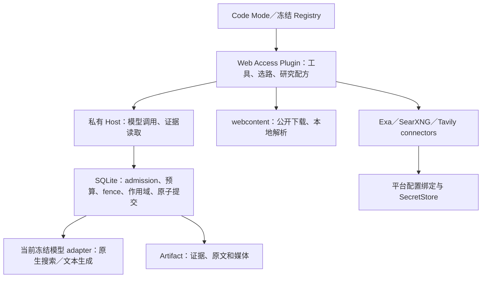

**必要复杂度**：具名源顺序与允许目的地防止静默扩大查询披露；结构化 HTTP／模型错误决定是否切换；DNS 连接固定和重定向复验防止 SSRF。解析进程的独立 HOME、禁用 fetch、有限输入／输出与进程组回收来自文档安全和取消需求。辅助模型交换复用 frozen Snapshot、负 step、预算与账户 observer；每个 invocation／call key 记录请求哈希，重入不重新发送或套用不同证据。工具 namespace 显式带 description，以满足真实账户 Responses 契约；SIWC hosted search 不发送不支持的 max_tool_calls。

**证据与媒体契约**：Steward 自有版本化 `Document` 保存来源、原文、claim 和片段；分页为 UTF-8 字节坐标，case-insensitive 查找保留大小写转换后的原文字节映射。fuzzy 只提供按序词组匹配，不推断语义。片段分别记录内容哈希和来源全文哈希；有片段／来源不等于支持或反驳。媒体通过内部 AttachmentOutput 与证据和终态同事务提交，配额或终态失败回滚全部元数据。它是已有媒体消费者需要的机制，不新增公共存储协议。

### 参考行为与自主实现边界

参考工具能力与公开服务协议，connector 实现和命名均归 Steward。仅使用通用本地解析库：Readability、Defuddle、LinkeDOM、Turndown、unpdf；它们不持有账户、网络搜索或 agent 调度。搜索、来源优先级、失败分类、参数验证、证据结构、持久化、查找与摘要提示均由本项目实现；没有插件配置透传或内部模型直接公开。

**开放范围与稳定性**：这些模块、Host 和解析进程协议保持 private／experimental；可在仓库内理解与复用，未承诺公共 SDK、通用 connector 平台或永久插件兼容。本次仅移动职责，工具名／Schema／输出字段、配置序列化、资源身份算法及 Document v1 不变，无数据迁移；已完成结果继续从既有记录重放。源顺序、解析源码及依赖锁进入资源身份；升级拒绝不匹配旧 Run，旧 web_fetch 的字节续读工具仍保留。拒绝把包移动当成公共安装协议；没有为预测未来供应商设计抽象注册系统或泛型配置 DSL。

**取舍与未泛化部分**：当前只有 native／Exa／SearXNG／Tavily 四条真实变化轴，不复制无实际凭据／消费者的供应商目录。原生域名条件与本地来源筛选分开，日期只报告服务实际保证；Exa 不支持的过滤直接拒绝。独立第三方全文外送、任意宿主文件、其他助手凭据、浏览器 profile、仓库 clone 和视频均未开放。摘要只用当前模型，summary-review 保持未批准草稿；没有伪造人类审核。已实现范围与缺口见功能说明，各服务 Live 不互相替代。

### 目标调用与数据边界

以下为外部系统 connector 的待实现路径，不表示已存在这些 adapter 或工具；一般执行工具、导入器和模型供应商不因经过相同 Executor 就变为业务 connector：

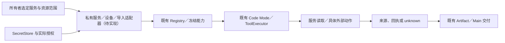

历史资料导入先预览来源、范围与缺失项，再经现有隐私／Artifact／召回路径保存；长期记忆仍按 F-009 形成。具体持久化字段、格式版本、去重及撤销单位在相应 feature 实施前定义，不在需求登记时引入通用资源表或迁移。敏感资料的外部处理范围必须可理解、可约束，认证可用不代表模型可读取整个账户；书签和历史使用也不构成现在的授权。

如增加事件监听，应以真实主动任务为消费者，单独定义来源版本、补读范围、去重、接收健康、明确关联与停止语义；不能把 F-042 的 GitHub 有界重扫原样套用到 Gmail 或 Calendar。Gmail 推送、日历同步等按各自官方生命周期实现，不把“支持 webhook”视为可靠事件接收已完成。第三方内容只能提供证据，不授予动作、创建新 Task 或恢复用户已停止的工作。

### 开放范围、稳定性与取舍

- **私有**：凭据维护、供应商字段、设备／浏览器 helper、来源文件布局及适配错误映射留在各适配器；不直接暴露内部 Main/Task/Run 或 SQLite 模型。
- **实验性**：各新 connector 在真实账户／平台验证前保持独立可关闭；特别是 Codex/Pi 导入格式、宿主 Chrome、本机 helper 与健康数据桥接，不承诺外部格式稳定或所有平台兼容。
- **已有契约**：沿用 Registry、Code Mode、ToolInvocation、审批、Artifact、交付和隐私语义；新增模型可见工具范围在实施时逐项评审和冻结，不因列入需求清单获得稳定公共 API。

首个实际服务可选窄原生 API 或官方 MCP，不为单个高德接入先建设全功能 OAuth MCP 平台；反过来也不以“已有 MCP”省略远程认证／网络隔离。原生 API 的回执、精确权限和增量同步通常需要服务专属语义，MCP 传输不抹平这些差异。通用远程 MCP 如成为真实复用需求，仍由 F-025 独立设计。

历史导入而非账户全量抓取，牺牲自动新鲜度以减少隐藏授权与私有协议耦合；来源更新后可显式重导入。SSH／浏览器可解决低频工作，但专用服务适配器能提高结构化结果和回执可信度，二者按实际任务组合，不把广域 shell 或网页点击当作所有 connector 的统一业务契约。

当前不扩展个人微信全聊天、支付／交易、自动购票、招聘系统批量资料或对全账户的持续采集；样本中的咨询、点餐、面试写作和财务研究并不证明这些授权或稳定接口需求。地域服务、费用、数据源与调用方式不确定的项目保持候选状态；不为了凑目录数量先稳定接口。

验证要求见[分项验收计划](../test-plans/integrations.md#个人-connector-验收计划)。实施时同步本页当前架构、功能用法和主索引；需求登记不改变旧配置、数据、Run 快照或外部服务状态。

<a id="f-070--独立插件生命周期待实现"></a>

### F-070 · 独立插件生命周期（基础已实现）

当前内置能力使用 Registry 冻结工具；独立 Go 协议、CLI 安装与版本托管基础已实现，现有业务尚未整体迁入。F-070 已扩展为按完整功能原子独立无损迭代，当前机制与后续迁移方案统一见 [插件与自进化设计](plugins-evolution.md)。连接认证／撤销继续复用 F-025，不在插件内复制账户状态机；安装不授予连接或动作权限，卸载不隐式断开共享连接，旧 Run 不被新插件状态扩权。SDK 仍为实验版；市场及通用工作流引擎不在当前范围；内部模块拆分不视为生命周期实现。


## F-071 · Composio 托管应用通道

`internal/connector/composio` 是 Steward 自建的 Go REST v3.1 客户端，生产目标固定为 `https://backend.composio.dev/api/v3.1`。`internal/connectedapps` 持有目录与显式账户绑定，`internal/plugin/connectedapps` 将每个活动绑定映射为搜索工具与执行工具；`internal/app` 只装配 Store、SecretStore、控制页与 Registry。没有引入 Composio Agent SDK、托管 MCP runtime 或第二条执行管线。协议依据为官方 [应用目录](https://docs.composio.dev/reference/api-reference/toolkits/getToolkits)、[托管连接链接](https://docs.composio.dev/reference/api-reference/tool-router/postToolRouterSessionBySessionIdLink)、[版本化工具](https://docs.composio.dev/reference/api-reference/tools/getToolsByToolSlug) 与[上游撤权](https://docs.composio.dev/reference/api-reference/connected-accounts/postConnectedAccountsByNanoidRevoke)。

Migration 046 在既有 `state.db` 中增加 CAS 版本化的 `connected_apps` 配置，保存项目凭据引用、安装独有 user ID、认证配置 ID 覆盖表、账户 ID、应用、别名、状态及撤权确认。项目 API key 逐请求从 SecretStore 解析；未保存项目引用且默认环境凭据存在时，`Service.State` 只读补全 `env:COMPOSIO_API_KEY`，不写 CAS 状态、不联网或创建绑定，首次显式 Connect 才随绑定保存引用。已有显式引用始终优先，缺失／失效时不切换项目；账户响应仅投影身份／状态字段，不保存 provider data／state 或授权链接。项目引用在有未断开连接时不可切换。网络调用位于事务外；错误只使用安全代码，拒绝重定向并限制响应大小。

目录 GET 是只读的分页请求；无项目时的内置列表只提供推荐，不能连接或代表项目可用性。Connect 是受 Web 身份、渠道及同源检查保护的显式 POST。普通应用创建限定 toolkit 的 session 和 hosted link，禁用 instant、workbench、proxy 和批量执行，允许显式多账户别名；只接受 Composio HTTPS 授权地址。Check 仅激活本流程记录的确切 account ID，核对 user ID、toolkit、禁用标记和 ACTIVE；已禁用账户投影为 expired 并刷新工具声明，身份不匹配则拒绝改变本地绑定。免认证应用需显式启用为 public 绑定，只可执行 `no_auth` 工具；不猜测或导入项目中的其他账户。

每个活动绑定有独立 `mcp__apps__b__<binding>__search_tools`／`execute` 命名空间，这是现有业务工具的兼容命名，实际传输为 REST；前缀不能由合法的 MCP server／tool 名组成，刷新时不会移除用户自己配置的 `apps_*` server。搜索返回工具 schema、确切版本和规范化描述指纹；schema 不直接塞入本地有限的参数验证器，执行参数采用有界 JSON 对象字符串，外层契约仍严格验证，供应商再验证具体业务参数。每次执行在本地绑定、远端账户、确切版本及描述指纹全部匹配后才 POST，固定 user/account，不能由模型覆盖凭据、账户、端点或选择 instant fallback。业务工具全部按 high／external_effect／never 暴露，不信任供应商的只读标注来放宽权限；目录搜索本身是 read_only。长结果完整保存为 Artifact。

Registry 的受锁分组替换只更新新建能力快照；原有已选 Registry 保留冻结声明，新增账户不扩权旧 Run。运行时装配与账户刷新用同一把装配锁，避免初始化期间丢失刚完成的连接。执行闭包每次重检持久状态；断开先提交本地关闭，再更新 Registry、尝试 upstream revoke 和 broker DELETE，未确认原服务撤权与本地禁止继续使用分别展示。迟到的 Check 不能重新激活已断开的 ID；重连必须新建绑定。服务进程中的生命周期变更与 dispatch 互斥，不同账户的 dispatch 可并行，Disconnect 不宣称撤回此前已经发出的操作。

所有模型调用继续走既有角色裁剪、Code Mode、ToolInvocation、审批及 durable replay。供应商 POST 无自动重试；网络错误、5xx、不完整／超限成功响应为 ambiguous，沿用 unknown 恢复。正常终态重放不再次访问服务。原生 Web Access、Tavily、GitHub 监听的连接及冻结契约不迁移到本通道。尚无真实项目，协议 peer 不能证明 OAuth scope、每个 toolkit 的端到端业务语义或生产稳定性。


### 部署设置与 Apps 交互

常规部署只需为 Steward 进程设置 `COMPOSIO_API_KEY`；自定义引用和可选的 app→auth-config ID 映射由部署者通过 Resources → App connection service（`/settings/services/apps`）保存。Apps 只显示应用目录、账户和连接操作，服务不可用时在对应连接操作旁提供按需帮助。认证配置在后台通过受限 GET 投影读取，不接收 OAuth client secret 等字段，校验 toolkit／ENABLED／Tool Router 标记，自动选取最新可用自定义配置；部署者的覆盖必须验证成功。权限不足的 scoped key 可以继续使用托管认证，不隐式修改项目配置或扩大 OAuth scope。

Connect 首次无需别名，额外账户要求具名；链接及十分钟有效期保留在进程内存，重复点击或 Continue 复用原链接，不续期。页面在点击时预留授权标签页，弹窗被拦截时提供链接。浏览器每五秒以受同源、身份保护的 POST 检查 pending 账户，最多十分钟；GET 不改变账户状态。不变的检查结果不写入 CAS 版本，避免另一窗口的轮询不断作废部署设置表单。授权页地址不写入 state.db、浏览器存储或导航查询。

原生表单仍可连接、打开授权页、刷新状态和重连；脚本只增强交互，失败不自动重试创建链接。JSON 返回的账户区域由原生模板转义，包含本地连接 ID／状态及单调 revision，不含项目引用或 provider credentials。客户端同时用状态版本和操作代次拒绝迟到轮询，断开后的旧 ACTIVE 响应不能复活显示。重连是显式控制动作，先关闭非活动的旧绑定，再按原别名创建新绑定；已经工作的账户拒绝被替换，其他账户不受影响。


Apps 目录与图标：发现页采用固定精选、用途分组、每组最多六项的紧凑双列预览；“查看全部”通过私有 `collection` 查询打开完整编辑分组，名称排序并包含该组的精选应用。首页精选去重，全部编辑条目仍可从完整分组访问。`view=all`、搜索、上游分类与游标继续通过现有 Service.View 读取实时目录，不把首个字母序分页当作精选来源。首页仅读取已有账户状态，使用原有内置编辑名单及同源品牌图片；配置项目后的 Connect 仍实时读取 toolkit 元数据并执行原验证，浏览条目不表示项目支持。编辑发现的分组规则与公开数据归独立私有实验，实际读取边界见下述说明；不扩展账户授权或连接服务；没有新增热度统计、个性化算法或可配置分类框架。保留首页稳定位置，代价是编辑分组不覆盖供应商的全部目录，后者由“全部应用”和搜索提供。详情由 `/api/apps/detail?app=…` 提供服务器转义的 HTML，增强为原生 dialog；无脚本时 `/settings/apps?app=…` 展示同一账户控件。隐藏账户库存包含全部可管理绑定，轮询与显式动作沿用 revision／generation fence，再投影到详情及侧栏；已确认关闭的记录保留在数据库，不占用“已连接”列表。每个应用只有一个侧栏入口，多账户仍独立管理。Settings 的 Apps 入口使用四宫格图标，Resources 保留服务器图标。

Composio Toolkit 元数据保留 `meta.logo`。推荐条目的官方 SVG 随包分发，来源 URL 与原始／打包 SHA-256 见 `web/app-icons.json`，商标说明进入 `/licenses.txt`。`/apps/logo/<slug>` 位于既有身份／渠道边界内；内置资源无需外网，新目录条目由服务器匿名读取官方 `logos.composio.dev`／`assets.composio.dev` HTTPS 来源，不携带项目 key、Cookie 或授权头，不跟随重定向。图标请求有 8 秒超时、512 KiB 上限、24 小时／128 项内存缓存；SVG 仅保留矢量、渐变、蒙版与局部引用，移除脚本、事件、外链及嵌入页面，PNG/JPEG 有像素上限。浏览器只访问同源图片，载入失败才回退首字母。HTTP 200 的 Composio 通用占位图不视为品牌核验；预置目录使用正式 toolkit 标识，项目支持仍须实时验证。


Apps 复用全局组件契约：分类原生 select 由共享 Base UI 适配器增强；图标按钮、复合搜索框与原生详情 dialog 的皮肤归 `components/ui/controls.css`，页面 CSS 仅维护目录、侧栏和账户布局。断开使用 Settings 共享确认对话框，默认聚焦取消，原生表单仍显式提交。普通按钮使用统一 8px 圆角，详情容器使用 12px 圆角，窄屏操作区域至少 44px。


Apps 不展示服务初始化入口或部署提示；服务统一从 Resources 管理。类别改变后提交只读 GET 筛选，搜索保留当前类别；无 JavaScript 时使用原生筛选按钮。服务未就绪时，详情中的 Connect 禁用并提供按需帮助，不引入项目配置入口。

Web Access 的读取／检索执行机制与新 Run 的入口政策分离：生产组合将 fetch_content、get_search_content、source_check、artifact_search 标为 Hidden；Main／Worker 快照排除 Hidden，已冻结快照经 Registry.Select 仍验证原权限并选择原执行器。保留 web_search 和 web_fetch，证据读取组合既有 artifact_manage；不新增统一网络工具、别名或公共扩展协议。web_search v2 仅调整提示说明，PreviousSpecs 显式允许 v1，避免为收敛新入口破坏旧 Run 恢复。执行器暂为私有历史兼容，不继续推广为稳定 builtin。

<a id="web-access-托管迁移进行中"></a>

### Web Access 托管迁移

当前消费者是原 Main／Root／Child 的 Web 工具与旧证据引用；下游保持查询／过滤／显式 provider、原模型、预算、Artifact 和 never／safe 恢复协议。`web-access` 包的私有 `steward.web-search/1` 已接入真实 Task／ToolExecutor：隔离包持有缺省结果数、缺省来源优先级、可允许范围内的回退与来源筛选；Host 只提供原请求下的一次来源操作。源码入口为 `internal/plugin/webaccess/rsi.go` 与 `internal/agent/sqlite/plugin_web.go`，分块／验证机制见[调用级资源端口](steward-rsi-plugins.md#调用级资源端口实验接入)。标准分发已装配 Web 与 Extract；现有 Web 功能已验收；原二十三包的适用完整软件／系统门禁已验收，其他业务的全量迁移继续按清单推进。

| 归属 | 当前职责与证据 |
| --- | --- |
| 可变政策：插件 | 默认结果数和来源优先级、停止或继续的业务选择、原来源位置／标题前缀选择；独立二进制能改变新工作默认值，旧 Run 保持原图。 |
| 必需机制：Host | 从原 accepted invocation 取查询／过滤，不接受插件提供另一条查询、端点或凭据；显式数量、显式 owner 顺序、原配置授权和模型快照保持原值。 |
| 必需机制：来源证明 | 来源 URL 必须来自原返回行并满足显式域名约束，标题只能取原前缀；时间、原文、usage、attempts、untrusted／费用未知事实由 Host 重建。 |
| 必需机制：效果／隐私 | 认证、预算、取消、无效响应不能被插件改成自动换源；一次原 source 不重复提交，已发生来源调用后不能接纳的结果进入原 unknown；Forget／Guardian／claim 在返回和字节释放前复查。 |

没有冻结默认来源优先级为内核语义：只有显式 owner 顺序必须保持；无显式顺序时，候选可在已授权集合内换优先级。Exa 的 auto fallback 仍须已尝试原 Native，显式 provider 继续按原授权语义处理。来源域名的逐项成员证明不是 Host 的第二套排序／筛选实现。

原进程内查询循环已提取为隔离包业务；连接／凭据和单次来源操作集中在同一 Host 适配。`search_legacy.go` 只保留 `web-access-v2` 的 pre-service Run／明确未打包载体以及当前具名迁移边界，受管失败不能进入它。删除条件是这些保留执行／引用与载体均无依赖且迁移清点完成；不能因今后修改插件默认算法而改写历史 native 解释。

证据阅读的第二个私有服务 `steward.web-content-read/1` 已接原 `get_search_content` 工具。`read_policy.go` 在独立进程中选择默认阅读长度、查找和上下文窗口，返回位置证明；`plugin_web_read.go` 只从原 Artifact 字节生成正文、总字节数、游标与 `has_more`。显式 offset／limit、UTF‑8 原字节边界和已发布 V1 的 exact／case-insensitive／有序 fuzzy 含义保持不变；Host 复核首个原文匹配／不存在证明，不将 8000／400 默认配方冻结为内核语义。重复使用同一 V1 语义函数避免维护第二份匹配算法；改变既有匹配含义需要新的明确契约，不能只改候选的证据声明。


原文件授权涵盖完整证据文档，插件只能读取本次已授权的同一文档。使用两个固定的 12 MiB 原字节分片，经 `steward.web-evidence/1` 返回 base64／总长度，覆盖原 24 MiB 文件上限及编码开销；不因纯服务输入上限而裁短内容，也不重新编码文档以改变旧 JSON 的重复字段／未知字段解释。没有通用文件路径、Artifact ID、跨文档读取或网络端口。私有副本不写插件状态；每次释放字节与结果接纳均重查授权／claim，读取没有费用或外部副作用，原 safe Tool 负责重领／重试，不新建 opaque RSI 调用账本。

成功结果附带不可由插件生成的进程内 `webReadReceipt`。原 Tool 完成事务重新核对 accepted 参数、Artifact 授权、原发布图和 Guardian 状态，再写原回执；即使当前 Run 在停用后没有活动图，原引用也不能在提交前逃过原图隔离。没有另加插件回执表或可恢复的第二账本。该检查是结果授权机制，窗口／查找政策仍在插件中。

引用解释器由不可变的原 Artifact `put_key`、原成功 Web Tool 发布者和该 Run 的冻结服务／图共同决定，无需另加数据库表。包升级、回退、退休或停用后，已发布引用继续使用其原图；当前授权、Forget、Guardian 全局停止和原图隔离仍优先。前服务发布的引用保留历史 V1；任意导入的 JSON 不冒充 Web 发布者，使用读取 Run 的冻结版本。缺少已承诺的服务／图则失败，不回到 native。真实 Tool 测试覆盖 8000→6000 独立换版、原排队 Run、原引用、退休／停用、完整 24 MiB、错误位置、迟到 Forget 和真正 release→恢复扫描→claim。

`content_legacy.go` 集中保留原 8000／400 阅读配方及直接未打包消费者，公共文档选择／匹配语义只有一份；托管路径不保留另一套默认窗口实现。删除条件是 pre-service Run、这些 Run 发布的引用以及明确未打包载体均不再依赖该解释，且相应清点／兼容迁移已接纳。

第三个私有服务 `steward.web-research/1` 已实际持有批量研究、正文选择、逐页问答、摘要草稿、核查摘录和研究预览。`research_policy.go` 在独立进程中执行这些业务，向 Host 的三个调用级端口请求原 query 位置、原显式 URL／已返回来源位置及原问答位置；不返回新查询、URL、模型、凭据或 Tool 身份。调用搜索端口复用同一原图的单次搜索服务，目前有一层进程调度成本，避免在 Host 重建选路算法；后续优化须由实际测量支持，不能以性能名义恢复 Host 默认业务路径。

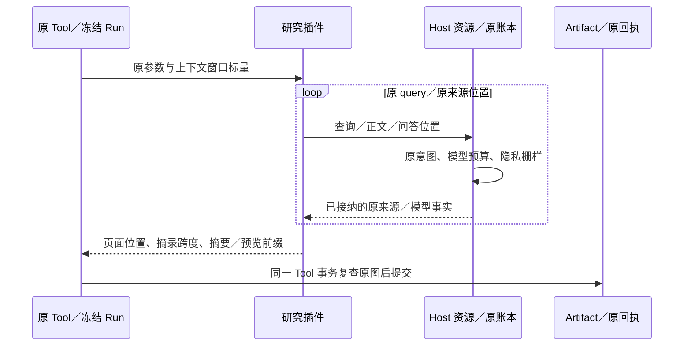

插件选择读取哪些已授权来源、原文摘录范围、摘要组合和预览前缀；Host 只按确切原位置／UTF‑8 字节范围重建 Document V1、原 URL／时间／用量、摘录双哈希、原图像附件、费用／不可信标记及真实引用。显式八 URL、工具承诺的最多五个衍生来源和八 query 保持原协议范围；不能用候选计划偷偷发起新的公网访问。`summary-review` 的待审事实取自原请求；核查状态只能是原协议的 `unclear`／`missing-evidence`，不能自授真伪裁定。原全文保存在原 24 MiB Document 上限内，模型／预览输出不经纯服务结果上限传输；实际八页超过 20 MiB 的证据验收覆盖该路径。

问答端口不开放通用模型选择器：Host 按原工具、原 workflow／mode、已读取的原页位置和原 key 决定 `page_answer`／`summary`，继续使用原 Snapshot、价格、审批、请求哈希及 model_generation 回执。候选只持有原请求／已授权证据，并编排无工具的 system／user 方法文本。仅原已完成回执的确切模型正文能成为结果事实；pending 回执即使供应方已经返回正文，仍进入原 Tool unknown，不能发布或重领后再发模型。预算阻断先生成原审批回执／通知，模型调用为零；工具公开错误标签仍由原固定通用 normalizer 决定，不靠扩大错误白名单改变兼容行为。

原生托管搜索的方法文本也由同包搜索服务提供，Host 仍固定原 user query、structured WebSearch 请求、账户与模型。新研究 Run 缺少 instructions 直接拒绝；只有真实 pre-research 快照和明确 native／未打包消费者允许 `LegacySearchMessagesV2`。不把缺省业务方法当作托管失败兜底。

成功研究结果附带 Host 独立生成的进程内 `webPublicationReceipt`；原 Tool 完成事务在落盘引用前核对原 invocation、冻结图、原资源配置与 Guardian。Forget／隔离可在方法返回后或最终提交前到达，不能留下已接纳的私密 Artifact／模型输出。计划无效且已经发生搜索或模型调用时，沿用原 never Tool 的 unknown／不重发规则；纯正文读取失败不凭 generic broker 的保守标记虚构收费副作用。没有另加 RSI effect／publication 账本或数据库表。

原研究循环、方法文本和 `Document.Assess` 已集中移到 `research_legacy.go`，仅服务 pre-research Run、相应引用、明确未打包载体及已有十九包选择的具名历史边界；新的托管分发不调用该循环。删除条件是这些确切历史消费者均无依赖并完成兼容清点。完整 V1 文档／固定事实定义保留在共享声明中，没有同时维护两套默认业务实现。

第四个私有服务 `steward.web-fetch/1` 已接原 `web_fetch`：Host 的单次页面端口只能读取 accepted invocation 的原 URL，插件返回确切原文预览前缀位置；Host 保留原完整 plain-text Artifact、时间、标题、总字节数与续读游标。原 4096 默认由包独立改为 1024，旧三服务 Run／已排队 Run 保持原选择；退休／回退／停用及迟到 Forget／隔离仍受原 Tool 事务控制。研究与 fetch 两个实际消费者共用具名的 `webPublicationReceipt`，没有增设通用效果接口或第二账本。页面 GET 沿用原 safe 恢复，不把 broker 的保守 Unknown 当作发生了模型费用。

第五个私有服务 `steward.web-source-format/1` 持有 SearXNG／Tavily／Exa 的结果行选择、标题／摘要软裁剪及文本上限。连接器现只返回 `searchfacts.Result` 的已遮盖原字段，不再提前做 20 行、1024 标题、2048 摘要与 20000 文本裁剪。HTTP／RPC 帧、原 endpoint／query／filters、凭据、硬响应上限、URL 资格与 Exa V1 字段配对仍由单次原操作保持；这是来源事实身份，不是另一份排名／表达策略。Exa 的 Title／URL 配对保留已有 V1 语义，未开放任意文字片段作为另一 URL 的标题。原 native 模型的正文继续是原已接纳事实，不由此服务重写。


凭据遮盖先于插件输入，覆盖 raw／QueryEscape／PathEscape，含凭据 URL 不进入来源池；一次替换不递归修改遮盖标记。只释放现有结果字段，不把整个 HTTP 响应、认证头、MCP session 或内部配置给插件。字段因遮盖／JSON 转义而超过普通帧时，通过原 `input.read` 的摘要校验／分片输入传送；实际超过 1 MiB 的已遮盖字段回归验证不收窄原 256 KiB HTTP 响应能力，纯输入 8 MiB 上限覆盖其最坏编码开销。

Host 只核对行位置／字段前缀／UTF‑8 和固定 V1 记录编码，不再硬编码新 Run 的 1024 标题上限或 20 行排名。实际独立包能把标题改到 2048、摘要改到 4096、从原第 25 行反向选择，并把 Exa 20000→30000 文本预算换版；旧快照继续原值。格式包崩溃、缺失、超时或输出非法不伪装成供应商失败／换源；已经调用原来源后不能接纳的结果进入原 never Tool unknown，不能重发来源。纯格式计算不生成 rsi_call。

旧显示配方集中保留在 `search_legacy.go:LegacyFormatSourceV2`；旧 fetch 预览集中保留在 `fetch_legacy.go`。消费者是缺少相应冻结契约的旧 Run、明确未打包载体及已有十九包选择的具名历史边界；清点无依赖后才能删除。原 connector Search／searchhttp.Do 显示接口和共用内联软裁剪已删除，当前受管路径没有第二套默认规范化。

第六个私有服务 `steward.web-html/1` 将简单 HTML 的子树选择、空白规范化、实体解析和标题配方放入 Web Access 隔离包。真实消费者是 `web_fetch` 和未配置 Node 提取器的正文 HTML 路径；后者不是替换已经配置的 Readability／PDF 提取器。Host 以调用级 `WithHTMLParser` 绑定原 Run 的图，只传原页面字节，不传 URL、配置、凭据或路径。原 2 MiB fetch／8 MiB content 输入以原始 descriptor 传送；独立进程通过具名 `steward.web-html-output/1` 返回派生标题／正文，普通返回值仅含摘要与长度。底座只接纳有限 UTF‑8 字节、同次输出摘要／长度和当前权限，不在 Host 再执行一份 DOM 业务算法；结果仍为不可信网页派生内容，摘要一致性不证明提取语义正确，候选须由独立 owner 行为验证裁定。

HTML 的受管配方位于 `internal/plugin/webhtml/html.go`，原 fetch 中的内联实现已删除；`html_legacy.go:parseHTMLLegacyV1` 保留确切旧配方，仅服务缺少 parser 冻结标记的历史 Run、明确未打包载体和已有十九包选择的历史边界。没有受管错误后 native fallback。没有这些确切消费者时删除该入口；这不是新 Run 的第二个默认入口；历史解释器不反向依赖插件包，保持连接／内容机制的原依赖方向。新包实际将 nav 子树选择独立换版，旧五服务 Run、已排队六服务 Run、回退／退休／停用和迟到撤权均保持原边界。这个窄 decoder seam 是两个现有消费方需要的资源隔离机制，不开放任意脚本、进程或网络解析接口。

第七个私有服务 `steward.web-image/1` 持有实际图片转换：尺寸配方、白底合成、重采样、JPEG 质量、输出编码和说明文字均在隔离包中执行。现有 content／includeContent／source_check 的图片路径绑定原 Run 的 decoder，只释放原始图片 descriptor 与检测到的实际 codec；不释放原 URL、配置、凭据或路径。Host 仅先验原 8 MiB／32M 像素硬分配界限，接纳同次输出摘要，校验实际 PNG／JPEG 编码、整幅图像解码、声明尺寸与当前权限。没有把 2000 像素、质量 85 或旧说明文本固定为内核规则。

输出图片通过调用级 `steward.web-image-output/1` 分块传回，普通结果只有摘要／错误；完整 8 MiB 输入和超过 2 MiB 的编码输出不受普通返回值限制。原图片附件仍由原 Tool 完成事务与完整证据文档一起提交，研究服务不收到编码图片数据，也不能选择另一个引用；Host 依据已经验证的真实输出类型保存 PNG／JPEG 的 MIME 与文件名，不再一律标为 JPEG。原页面 URL、响应 MIME、来源时间与不可信属性保持原观察值；编码后的附件 MIME 单独表达实际输出格式。图像有效性／摘要校验不证明候选的提取语义，仍需 owner 行为验证。

真实换版将 2000→1200、质量 85→70、说明文字和 JPEG→PNG 独立改变；旧六服务 native Run、排队 Run、退休包仍引用的在途 Run、回退和停用保留原选择。Child 在激活新包并退休父包后仍继承父图与原图片算法，不继承父级私密消息。已发生实际图片读取／转换后 release、恢复扫描与新 claim 保持原 never Tool 的 unknown 回执，不因升级而重发来源；纯转换被拒绝时保持不可用，不虚构模型费用。

原转换实现从 `webcontent/image.go` 移至明确的 `image_legacy.go:resizeImageLegacyV1`；`NormalizeImage` 仅留给 pre-image-service Run、未打包载体／已有十九包选择的历史边界和原字节兼容 fixture。原 fetch 内联图片说明已移出，受管路径没有第二套缩放／编码配方，也不会在错误时调用旧转换器；无这些确切消费者后删除兼容入口。图片 codec 注册和字节／像素检查由内容机制持有，不反向导入插件策略；拒绝通用进程／图像算子平台或给候选原文件系统访问。

Node 资源底座已有私有实验实现：`internal/webcontent/parserresource` 把原绝对解释器的确切字节与完整解析模块分别摘要化，按 revision 原子封存；不同模块版本硬链接复用同一不可变解释器，读取时验证真实字节、元数据和路径。当前 Node 制品约 122 MiB，单独使用有界 Host 资源库，不放宽原插件单文件 32 MiB／整包 64 MiB 限制。完整 HTML／PDF 依赖经 Go `parserbundle`／`plugin parser-bundle` 打为约 4 MiB 的模块，并携带实际依赖的完整 license／notice；不把整个安装目录或任意源码父目录授予候选。可变方法源码归 `internal/plugin/webextract/extract.mjs`。

纯解析进程仅接原 URL／媒体类型／8 MiB 页面字节，使用封存解释器和模块，保留原 20 秒期限与 8 MiB 输出界限；无环境凭据、外部文件、网络或 fork 能力。RSI Go 进程和该解释器两个真实消费者共用 `sandbox.PureCommand` 的内核隔离规则，原平台重复 profile 已删除；CPU／文件／FD 上限在独立 launcher 内设置，不作用于 Host。Linux 保留原 2 GiB 地址空间界限，未为解释器放宽；Darwin 仍无可声称的硬 RSS 上限，沿用[平台隔离限制](steward-rsi-plugins.md#隔离与生命周期)。原 Run／Child 已通过冻结资源路径接入；Linux ARM64 已通过真实解释器、原地址空间限制及生产 bubblewrap／seccomp 的默认业务链路验证；该范围不代表完整 Linux 产品或真实 Guest 平台验收，不能以交叉编译或裸解释器执行替代。

`web-extract` 是同属 F-069 的独立托管组件，负责 HTML／PDF 方法，和现有 `web-access` 的搜索／研究／证据服务分开换版。`extract.mjs` 是包内校验过的固定资源；绑定 config 的 `runtime_revision` 与 `source_identity` 固定原解释器及所有者配置来源。Run／Child 继续继承原不可变 graph，不另建解析执行账本。Host 在纯 `compute.web-extract` 回调中只使用原 descriptor 字节及原 URL／媒体类型，拒绝候选换源；候选没有命令／路径选择或网络能力。结果以同次 computed descriptor 传回，纯服务只返回摘要和确切标题／正文字节数，保留原 8 MiB 输入和大于 2 MiB 的结果。

独立验证与生产使用同一实际候选模块计算。验证不仅对比候选自报计划，还复核其 computed 字节／元数据，要求真实计算发生；修改 URL、伪造结果证明或替换为错误算法都不能靠固定模拟回复通过。验证环境同时绑定原解释器资源身份和候选包摘要；原 OCR 计算仍保留原接口及 2 MiB 限制，没有开放通用 exec／JS evaluate。

新提取 Run 的工具资源身份采用 `web-access-v3`：原 JSON 配置继续管端点、凭据引用和显式方法来源，算法／解释器字节由原 graph 管理。替换当前安装文件不能重写原执行；配置授权改变仍拒绝旧执行。冻结 Registry 只为带有原提取服务标记的 Run 解释这个身份，旧 Run 不追溯 opt in，仍使用原 `web-access-v2` 比较。原工具完成事务复核自己的 graph、配置和 Guardian，Forget／隔离在解析之后也不能提交私密正文／Artifact；原 never 工具恢复不重发。

旧外部脚本执行已从普通 fetch 代码移到 `extract_legacy.go`，只服务缺少提取标记的 pre-service Run、未打包载体／已有十九包选择的历史边界。`runtime/javascript/src/web-extract.mjs` 原字节保持不动，路径和字节参与这些历史资源身份；无确切消费者后删除这两个入口。没有受管失败后的 native fallback。当前 companion 已加入标准分发；独立换版／退役／恢复、配置边界和首启／冷重启具有实际回归入口，默认组合及适用完整产品门禁已验收。

Node、HTML／图片和内容分派均已接入独立托管入口；固定源码的完整软件、适用 prompt／memory／system 与默认分发已验收。外部供应商 Live、搜索质量及自动演化闭环仍分别验收，不属于现有功能迁移完成的推论。接口限于 private／experimental；拒绝任意网络脚本、返回新凭据或用目录／manifest 代替真实业务迁移。


### 内容类型与模式分派的私有实验接入

真实消费者是 `webcontent.fetch` 与 `fetchContent` 的原网络响应解码。两者分别保留简单 HTML／文本工具的 2 MiB 响应契约和正文／媒体的 8 MiB 契约；原公开地址／重定向检查、URL、响应 MIME、时间、不可信属性、原始字节与 Tool 完成事务继续归 Host。消费者定义的 `RouteRequest` 仅包含操作类别、响应 MIME、显式 mode 和原文档方法可用标记，不公开 Page、URL、正文、配置、凭据、Run 或进程选择。

`web-access` 的第八个服务 `steward.web-content-route/1` 运行 `route_policy.go`，选择既有 text／HTML／document／image 解码方法或拒绝格式。默认方法选择属于可迭代政策：HTML 有原文档方法时采用该方法，缺省走简单 HTML；raw 保留原字节，图片不用于 raw／answer，PDF 需要原提取资源。Host 只验证方法与实际媒体／显式意图兼容、UTF-8、字节／像素分配界限和非空事实；它不重算默认方法选择。原 `web_fetch` 的三种可接收格式属于既有工具公开承诺，网络适配仍在读取正文前拒绝其他格式；候选不能借方法选择扩宽该工具。

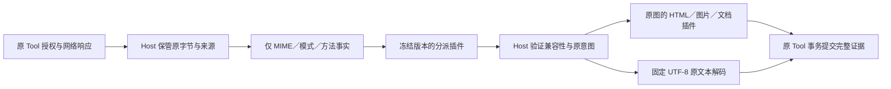

`plugin_web_route.go` 通过原 Run 的服务标记选择原冻结版本，在方法前后复核 accepted invocation、配置、claim／Forget 和 Guardian；纯调用没有外部端口、生产输入 descriptor 或第二本执行账。原 `DecodePage` 只根据已验证的封闭 codec 选择执行现有方法。采用新分派后，HTML／图片／document 必须已绑定原图中的受管 decoder；缺失或失败不能回到 native。原 never 工具在分派返回处丢失 claim 后，恢复仍保留 unknown，不补读来源或重新执行。

旧内联分派已从两个 fetch 方法删除；`route_legacy.go:routeLegacyV1` 仅服务实际七服务及更早快照、native Run 和明确未打包载体／已有十九包选择的历史边界。无保留执行／引用或具名载体依赖后删除；它不参与新受管选择，也不充当错误兜底。新 DTO／服务仅为仓库私有实验，不稳定化通用解析器、任意 codec 注册、网络／脚本执行 API 或公开 Page 模型；拒绝在 Host 保留第二份默认分派政策。取舍是保留原工具与 codec 的窄兼容性检查，允许候选在已经绑定的方法间独立选择。


### 所有者模块封存与既有资源身份

模块封存有两个当前消费者：原 HTML／PDF 方法的构建／依赖闭包，以及所有者自定义绝对脚本的移入准备。`internal/webcontent/parserbundle` 使用与原生产器相同的 esbuild 0.28.2 Go API，不运行源脚本；只允许原提取脚本信任范围与明确依赖树中的源文件，限制 4096 文件／128 MiB 总源内容、16 MiB 单文件和最终模块，并响应取消。Node builtin 保留为解释器资源；可选 canvas 探测保持缺失，其他未封存外部导入拒绝。实际导入依赖的完整 license／notice 随模块保留，源内容和 notice 通过目录句柄读取，符号链接替换不能越界，特殊文件不会阻塞读取。

`steward plugin parser-bundle SOURCE MODULE DEPENDENCIES` 是所有者离线构建入口，先完成有界封存再原子替换输出；失败保留原模块。它和 `plugin seal` 一样，在读取配置和打开用户状态库前执行，不新增模型工具、SDK 文件／网络权限、任意编译选项或用户构建插件。构建库不是候选的 OS 隔离边界；演化候选的真实运行与独立验证仍走原受限解释器。

旧 Node 生产脚本已删除，两个实际方法／资源夹具共同使用 Go 封存实现；不保留转发脚本或两套默认生产器。采用 Go 依赖而不改 `runtime/javascript/package-lock.json`：该锁文件的原字节参与旧 `web-access-v2` 冻结身份，增加运行期 npm 编译依赖会使既有身份漂移。原 `runtime/javascript/src/web-extract.mjs` 与锁文件继续服务具名历史消费者，未无条件删除。Go 依赖的上游许可证由原原生打包链保留。

此机制保持私有／实验级；默认组合已完成真实装配、冷重启及适用完整验收。封存与默认分发不等于自动生成、评测及演化部署闭环。


### 标准分发与首启资源捕获

实际消费者为源码安装、预构建安装与正常 Main 启动。`build-plugins.sh` 生成 Web 和 Extract 的完整包；Extract 使用 Go 离线封存器生成带许可的模块。源码安装先装原 runtime 的固定依赖，再交由同一生产器封包；不新增运行期 npm 编译器或修改原锁文件。只要存在分发目录，二十三包须完整，缺包明确失败；完全未打包的嵌入载体仍有具名兼容边界。

仅从未选择过的安装执行首启捕获、Host 自持验收与原子激活；已有组合、停用与独立停机不会被重启改写。默认 HTML／PDF 期望由 Host 自持的固定原文和原算法结果定义；显式自定义脚本先独立封存原源码／依赖，并在组装候选前取得原方法的验收结果。自定义模块获得基于原模块摘要的独立 `-owner.<sha256>` 版本，不能复用默认版本身份；原封存 Go wrapper 只从自身已校验 manifest 报告版本，不增加 SDK 选版、环境覆盖或任意加载入口。

`web-parser-v1:unavailable` 明确冻结未配置／缺失解释器的状态；非法自定义源码另保留 `WEB_EXTRACTION_FAILED`。简单 HTML／文本／图片仍由原受管服务处理，PDF 保持明确不可用；已配置但失败的文档方法不得改走简单 HTML。资源后续修复须经所有者的常规验证／选择，重启不自动重捕获或替换旧图。

新 binding 的 `source_identity` 仅固定解析 command／script 的来源，使用 `web-parser-source-v1`；搜索端点、凭据引用和来源顺序并非纯解析器权限。原 Tool 的 `web-access-v3` 继续冻结并复查完整配置，因此授权端点变更可供新 Run 使用同一解析器，旧 Run 仍被拒绝。旧实验图中的完整 ScopeIdentity 保持原精确比较，不重解释其授权。

以上是仓库私有实验组合机制，未稳定化公开编译／解析平台，也不授予候选修改验收、凭据、网络、原文或原 Artifact 事务的权力。取舍是保留确切旧 Run／引用和已有十九包安装的解释器，而清除受管路径的旧默认选择和测试专用版本补丁；不以自动重选改善可用性而破坏冻结资源。

完整默认组合的首启验收复用 Host 的四个顶层用例有界调度，原生 OCR 包保留原顺序串行屏障；初始状态、用例覆盖、环境检查与授权激活不变，不以常驻候选或缓存裁定替代真实执行。系统夹具单独约束冷启动就绪，具体窗口见[默认分发验收](../test-plans/integrations.md#默认分发与冷重启验收)；生产执行期限、算法与验收政策分开维护。


### Apps 标准组合与所有者验收

当前标准30包将 `apps-directory`、`apps-accounts`、`apps-logos`、`apps-interface` 纳入原工具方法与工具发现所在的同一组合。四包分别提供6／7／1／5个私有服务；界面包同时封存 card／sidebar／markup 三个明确声明的 JSON 资源。构建显式复制这三个文件再封包，重复构建不产生嵌套目录；分发缺少任一包即拒绝，已有选择、停用和 stop 不因当前分发更新而重选。

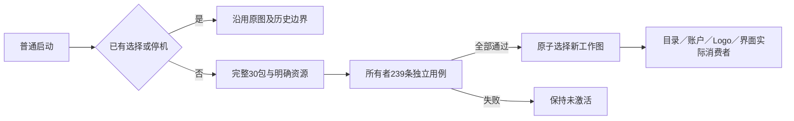

`builtin/apps-cases.json` 独立持有四包的96条原始 oracle／显式字面期望，加上原135条及 GitHub 独立8条共239条，保持 Host 原256条上限。期望不读取已安装候选文件、不执行候选算法生成；它是所有者验收证据，不能成为运行时目录或界面的第二份默认实现。所有者初次验证不获得真实账户、凭据或网络。候选的无害资源重排也须经过独立期望裁定，不能仅凭封存／握手成功激活。

实际旧23与归档24图的执行、原包和已完成请求在更新后保留；同内容的24包不因组合增加而改版，改内容仍服从原版本唯一性。保留旧选择的 native 页面／直接嵌入，以及带确切旧图的受管引用，继续原解释。已采用插件后移除相应服务会使新请求不可用；只有仍含该服务的旧版本图才是功能回退，不能把移除当作 native 恢复。原未版本化 URL 仍按原协议读取当前界面，不追造不存在的历史图身份。最终组合验收、其他模板／文案／CSS／客户端及引用感知回收仍在范围内，不把默认装配或部分资源迁移算作 F-071 整体完成。公开范围维持仓库内实验级；没有增加权限、通用挂载、任意 HTML／CSS／JS 或公共市场承诺。

### Apps 公共编辑数据的私有实验

实际消费者是离线目录、应用详情、发现页卡片与已连接侧栏的名称／用途补充。`apps-directory` 独立包持有原有 65 项编辑数据，私有实验服务 `steward.apps-editorial/1` 接收现有所有者目录查询的 search／category（非查询读取为空对象），返回公开 slug、名称、描述、分类 ID／名称和有序筛选引用；无 request 权限，不接收账户、项目引用、正文、凭据或内部 State。查询按原 200／100 字节界限固定，不改写后转给外部服务。同包还生成首页精选、完整分组与预览的有序 slug 方案，自持分组归属、名称排序、去重和六项预览配方。同包拥有原离线查询的大小写／空白匹配、分类筛选及类别顺序；Host 只按返回 slug 投影原条目。目录列表来源、首屏数量与失败处理也已移入同包。详情来源取舍也已移入同包。实时分类选择也已迁入独立纯方法。卡片与排序、账户工作流、图标方法及三份界面资源分别由下述所属服务承担，并已加入标准30包；其他模板片段／文案／CSS／客户端与通用资源回收仍单列，当前接入不代表 Apps 整体已完成。

Host 在单次 SQL 快照中读取当前所有者图和该服务曾获激活的持久边界；通过原 `ReadService` 的前后 Guardian 检查和封闭 schema 得到数据，不创建生产 Run／重复效果账本。Host 对目录条目和分组引用做结构／ID／UTF-8 检查，拒绝悬空引用、重复筛选条目／类别及重复集合 ID，不重算筛选、精选、分组或六项上限。Web 每次请求读取一次，详情、目录与卡片共用该快照，换版不会令同次请求混用两份编辑数据；`Directory` 冻结确切 search／category，拒绝把已接受的筛选结果复用于另一查询，详情只复用同一份完整元数据。编辑数据不授予项目可用性或账户权限；独立连接管理继续使用原账户事实与原 POST 验证。

一旦激活过服务，停止、隔离、缺失、停用或无效返回均不能恢复旧名单；空列表是有效的候选选择。没有编辑数据时，独立的账户状态／管理入口仍可使用其真实事实。旧安装（包括二十三包）、未激活该服务的组合与明确 direct／unbundled Service 仍解释原数据，不能在重启时偷偷选择新服务。`catalog_legacy.go`／`descriptions_legacy.go` 保留旧数据。显式旧读取和随包发布的编辑服务复用 [v1 发现和筛选配方](../../internal/plugin/appsdirectory/v1/policy.go)。Web 只投影候选的已验证 slug 顺序。待具名旧安装和组合迁移后删除旧数据与原生入口。

原生数据在组装候选前单独捕获为所有者期望，验证不依赖候选生成答案。编辑数据与发现页期望已在迁移前从原生页面及真实离线 Service 查询独立捕获，包含完整 65 项分组、首页预览与十组查询／类别结果。实际 App／HTTP 回归覆盖原名单、独立改名／用途／精选顺序／查询匹配、完整分组、请求快照、冷重启、停止、回退、退役、隔离和停用后的原生数据不复活；无项目与账户被创建。选择状态与兼容数据保留属于生命周期所需复杂度；通用目录 DSL、个性化、任意网络抓取和公开稳定 API 均不引入。代价是保留明确旧安装解释器；当前接缝保持 private／experimental，标准30包已包含该包，不据此宣称目录／Apps 整体完成。


### 目录列表来源与原请求配方的私有实验

实际消费者是 `Service.View` 的离线／实时列表和 `/settings/apps?view=all`、搜索、分类及续页；详情取舍另见下述同包实验。相同私有编辑服务现在接收 search／category、`live_configured` 与 `has_cursor`：后两项只是 Host 从原状态／请求取得的事实，不包含引用、密钥、账户、实际游标或供应商响应。空对象仍用于纯元数据读取。插件拥有 editorial／live 选择、首屏数量及 live 失败后的 unavailable／editorial 配方；默认保留配置后实时读取、首屏 40 和失败不可用。候选不能改写原查询、分类、游标、项目授权或网络端点。

实时端口固定为原 native、非 deprecated、字母序的目录来源，继续使用原 REST v3.1、45 秒期限、8 MiB 响应、密钥遮盖与拒绝重定向；未开放通用 HTTP、来源类型、任意排序或重试 DSL。[原接口](https://docs.composio.dev/reference/api-reference/toolkits/getToolkits) 规定最多 1000 项，游标携带原页大小。托管 `CatalogPage` 只允许首屏 1–1000、续页 0 且省略新 limit，直接转发原不透明游标；换版或回退不能用当前首屏数重解释旧游标。默认 40 属于插件配方，当前字母序原生来源属于该窄端口的现有语义，未稳定化通用目录客户端。

Host 独立验证来源、凭据配置事实、数量与失败枚举；即使候选放宽自己的 manifest schema，运行期也不能越过这些检查。`DirectorySelection` 是仓库内部消费值：公开目录旁的私有 managed 标记来自原 Host 迁移边界，根本不在候选 JSON 中；它只用于区分原请求解释器。该复杂度用于确切历史兼容，不是新公开 SDK 模型或第二条受管默认流程。上下文仍固定完整查询和两项事实，错误后不能把新图／native 作为替补。editorial 失败配方只使用同次已经接纳的数据，不追加模型、网络请求或生产 Run。

原内联 KeyRef 来源判断和 40 项默认已从普通 View／client 实现删除。`CatalogLegacyV1` 集中在 `catalog_legacy.go`，仅服务确切 pre-service／direct／unbundled 目录组合，以及尚未迁移的所有者项目验证；保留原续页也带 40 的请求解释。候选不能选择该标记，托管错误也不能进入它。两类消费者都迁移后删除；无额外转发 alias。管理目录隔离／停用后的新列表不调用原实时 API，独立项目设置仍通过原授权路径工作；详情取舍另行接入同包，账户操作／视图仍须在所属余项中继续迁移。

实际 App 回归以真实 SQLite、SecretStore、独立隔离包、原所有者身份／渠道和合成外部 HTTP 验证原查询／范围、40→20、升级及回退后的两种原游标、冷启动、显式离线优先和不同错误配方。刻意允许 legacy 来源／1001 数量的候选 schema 仍无法让潜伏分支执行 HTTP 或旧解释器。策略和现有受控端口保持 private／experimental；原政策与期望分别持有，不以候选自报结果、编译或 manifest 代替调用证据。


### 详情来源取舍的私有实验

实际消费者是 `Service.Detail`、原生应用详情及增强 dialog；输入仍只含当前读取的目录查询和配置存在／游标存在事实，不发送原账户 ID、名称、状态、项目引用或密钥。`Lookup` 由同一插件提供实时优先、本地首选（editorial／connection）与实时失败后的 local／unavailable 配方；默认保留原 live-first、editorial-before-connected、出错本地回退。方法是私有实验，不引入通用优先级 DSL 或按未来场景预测的上下文模型。

Host 保管原 slug、当前状态、确切连接事实、固定 Toolkit GET 及响应；返回的实时 slug 必须匹配请求，候选只能取舍已有来源，不能制造另一个账户或查询。`detailSelection` 与同次页面共用已经接受的目录贡献，忽略筛选结果但复核配置存在事实，不能把另一个来源授权接到旧快照。Host 独立检查 lookup 的实时许可与两个封闭枚举，即使候选放宽 schema 也不能选择未支持解释器。原账户名是展示事实，不授权 Connect、Check、工具执行或绕过审批。

普通 Detail 中的实时优先／本地次序已删除，原配方集中到 `detail_legacy.go:detailLegacyV1`，仅服务明确 pre-service／direct／unbundled 组合，具名消费者迁移后删除。迁移前从真实旧 Service／SQLite／HTTP peer 独立捕获 11 个成功、错误、匹配及有无编辑／账户事实的结果，随后由实际隔离默认包逐项复核；没有让候选生成自己的答案。新版本可以在不接收账户名称的情况下选择本地 connection-first，真实 App 的显式 Connect 形成原持久记录，再经页面与直接读取验证名字来自该记录、没有实时 GET；回退与冷重启保留原实时优先。

贡献停止、隔离、停用或无效时，已有账户的原事实／管理仍可展示；不恢复旧编辑名单，也不对无关应用进行 native Toolkit 查询。该分离保护独立账户功能，不能据此宣称账户工作流／视图已迁移。源 slug、凭据、响应、事实匹配与独立控制属于所需机制；实时／本地次序与失败配方属于插件政策。保留原有账户事实而明确拒绝未绑定详情，是停用后的取舍；普通版本默认行为由原生夹具和浏览器回归共同保护。


### 实时分类原引用选择的私有实验

真实消费者是实时 `Service.View` 分类选项：原方法在上游顺序中保留首个非空 ID，并在请求的分类缺失时追加原请求值。迁移前从真实旧 Service／SQLite／HTTP 独立捕获六组原结果，覆盖重复标签、空 ID、已选存在／缺失与空数据。该政策现在由同包 `steward.apps-category-options/1` 持有，Host 不重新执行首个去重或自动回退。

Host 只把可作为选项的原非空分类按精确 ID 相等性赋匿名正整数；原 ID、名称和供应商正文不进入候选。空 ID 是既有“全部分类”哨兵，不属于可选择选项。每个事实以固定 LE32 编码，通过现有调用级 `input.read` 传入；输入只含数量、是否请求分类及匿名相等键。候选返回原位置的 LSB-first 位图和是否追加原请求值，Host 按选中原位置投影原完整 ID／名称。默认保留首次，独立版本可保留最后一次，从而改变原标签／相对顺序；没有为未来发明任意排序 DSL 或把内部账户模型当合同。

位图大小与事实数绑定，不受原字符串大小或 JSON 转义膨胀影响。原 8 MiB 上游响应中的每个非空分类至少有自己的 JSON 对象，4 字节身份记录可完整放入现有 8 MiB 输入界限；仍保留显式输入上界，不能静默截断。现有 256 KiB 分块和完整摘要检查保持不变；输出每个位置只有一位，最坏也在普通结果帧内。Host 独立拒绝长度／尾位越界、同 ID 重复引用、伪造／重复追加，原用户分类只由 Host 保管并在被选择时按原值追加。

`EditorialReader` 现在同时返回绑定方法：元数据读取时捕获的原 graph 被闭包保留，网络返回后的分类调用必须使用这个原版本，不能追随当前 active graph。该私有类型仅在仓库 Host 装配／所属域之间流动，不在候选 JSON 或公开 SDK 中；没有另建 Run、效果账本、数据缓存或泛化依赖框架。方法只获得 `input.read` 对当前匿名事实的能力，元数据调用没有输入 descriptor，不能读取该次未授权的数据。停止／隔离、缺方法或异常位图使整个实时目录结果失败且清除已读部分，不恢复旧分类算法或换到新图。

普通 View 的原分类算法已删除，`category_options_legacy.go` 只保存具名 pre-directory／direct／unbundled 消费者的确切首选／已选解释，消费者迁移后删除；它不是受管失败兜底。真实 App 验证默认与最后选取、网络期间换版仍用旧方法、7 万余条跨分块完整输入、3 MiB 原标签保留、坏位图与网络后隔离不释放半份结果。账户连接工作流、视图资源及账户展示仍为明确余项，不据此完成整个目录功能。


### 卡片摘要原引用的私有实验

真实消费者是 Apps 的主页、分组、全部／实时目录、详情和账户列表副本。原卡片中的编辑描述优先、供应商描述次之、兜底文案与 150／147 rune 截断现在属于同包 `steward.apps-card-captions/1`。迁移前独立捕获八组旧 Web 输出，覆盖空内容、优先级、150／151 rune、Unicode／组合字符、空格和 HTML 特殊字符。只移动截断数字会让业务算法继续留在 Host，因此服务返回具体来源、原 rune 前缀终点与候选文案，由 Host 验证并投影；选择与截断算法均在插件中。

Host 仅提供两种原描述的 rune 数，不提供原正文、slug、账户名称或状态。候选只能引用当前项的 editorial／provider 原前缀，或提供 literal；不能读取别项／账户、改写原始字段或扩大连接权利。Host 独立校验来源、非负且不越界的前缀、UTF-8 文案、结果数量和原子发布。每批至多 64 项，文案至多 4096 字节，仅用于保持普通 IPC 帧有界；超量项目完整分批，不截断原列表或原文。原描述可以远大于普通服务帧，因为它从未进入候选输入／结果。该合同是仓库私有实验，未建立字符串 DSL、通用转换框架、公开稳定 SDK 或新的数据权限。

选择状态显式区分 unavailable／legacy／managed，只有具名原生装配可产生 legacy；空值或错误快照不能触发旧摘要。分类、摘要、公共排序和私有原行服务已有实际绑定消费者，因此 `DirectoryMethods` 收拢这些具体 Host 回调；它与 metadata 选择时捕获的 graph 绑定，不属于候选 JSON。没有泛化未来方法槽位。页面的摘要投影全部成功才替换展示字段；停止、隔离、缺方法或坏结果不调用旧算法。账号动作已完成后，其可选摘要失败只保留缺省空字段，不改变原接纳结果或诱发效果重试；已停用目录的独立账户事实视图同样不恢复默认摘要。账户连接工作流、模板与 logo 资源仍是未迁移业务，不能把它们当作固定内核或据此完成整个目录。

普通 `cardFor` 的描述选择／截断实现及其不再使用的 metadata 参数已删除；`captions_legacy.go` 仅保留实际 pre-directory／native 和具名 direct／unbundled 组合的原解释，消费者迁移后删除。原捕获 helper 已删除，不保留第二套默认实现。该私有服务已接入标准30、完整组合仍待验收；独立换版把摘要上限改为 120／117，实际 HTTP 显示变化，冷启动／回退与冻结请求保留各自版本；故意越界的候选在页面释放前被独立拒绝。


### 卡片名称与首字母的私有实验

真实消费者是所有 Apps 卡片及两个仍原生的排序方法；原方法在排序前把空名称回退为 slug，再把第一个 rune 转成大写。迁移前独立捕获九组旧 Web 标签和三组排序输出，覆盖空名称／空字段、大小写同名与 slug tie、Unicode、emoji、组合字符、空格与 ß。只在最后替换显示名称会破坏排序依赖，因此名称引用必须在原排序之前投影。

当前需求只有原名存在／不存在两个状态。公共编辑贡献的 `labels` 对这两个状态分别给出 `{name_source, upper_initial}`；name_source 只能引用当前原 name 或 slug。两份具体选择归插件所有，独立版本可改为显示原 slug 并保留其 glyph 大小写。Host 仅按原名存在性取一个已接纳方案，执行原字段引用、首 rune 与所选 Unicode 大写原语，不拥有 name→slug 的默认映射。这样不新增纯 RPC、原名输入、字符串 DSL 或排序框架；3 MiB 原名称也不经过普通服务帧。合同仍是仓库私有实验，没有公开稳定性承诺。目录包已接入标准30、完整组合仍待验收；必需 labels 字段是未发布实验合同的修订，不据此宣称实际旧 schema 的持久实验图已经完成兼容迁移。标准分发前须清点任何实际保留图，明确升级或不可用语义，不能靠候选省略字段切回旧解释。

标签方案属于同一次冻结 metadata，详情、账户副本、分组与列表都使用同一份。Host 在原目录 IO 前独立校验完整方案及封闭来源，即使候选放宽自身 schema 也不能引用账户或其他字段。目录不可用或空选择不产生旧标签：独立账户控制仍可显示原有事实，但不恢复默认 slug／大写配方。原 `cardFor` 的回退与大写算法已删除；`labels_legacy.go` 只向明确 pre-directory／native／direct／unbundled 组合提供原两份政策表，具名消费者迁移后删除。捕获 helper 已删除，原数据不向候选扩散。

账号卡片的名称方案在构造时投影，其专属排序服务消费实际显示名称。公共目录排序服务使用同份冻结方案确定原名称键，UI 随后投影相同原字段；默认九组标签及原排序依赖保持一致。发现分组仍消费插件给出的精确 slug 顺序，不用另一份排序覆盖它。账户资格／状态与管理排序也已接入下述原行服务；账户工作流、页面和资源仍未迁移；标签与当前页排序控制不完成整个目录或默认分发。


### 当前页目录排序的私有实验

实际消费者是 Apps 实时／全部目录当前返回页，旧 `groupApps` 在 Host 中按投影后的名称转小写排序，同名再比较原 slug。`steward.apps-catalogue-order/1` 现在持有实际比较／排序实现，并使用同次 metadata 的两种名称存在状态方案；独立版本可改成反序。发现页／集合的顺序已经由编辑贡献提供，不再额外排序；账户侧栏／已连接列表排序由后述私有账户服务独立处理。来源端仍固定原 native／非弃用／字母序查询、首屏／游标、密钥与网络授权；插件只调整原返回页的展示顺序，不重写供应商分页或声称跨页全局排序。

输入只包含当前公共目录的原 name／slug，两份已接纳标签方案、原数量与内部输出偏移；没有账户记录、别名、状态、描述、logo、供应商原文或密钥。Host 从原 source DTO 做最小投影，使用已有调用级 `input.read`，字段合同是独立的私有 wire facts，不暴露内部 Toolkit 模型。真实排序在候选内完成，Host 不计算小写键、排名或替代比较算法。两个真实方法之外只增加这个具体冻结回调，不建立通用排序／字符串 DSL、跨插件框架或新的 Run／效果账本。

不能把原 8 MiB 响应限额误当作解码后字符串限额：原客户端在限额检查后遮盖密钥，一字节 key 可把 1 MiB 变为 10 MiB；JSON 解码也可把约 3 MiB 非法 UTF-8 变为 9 MiB RuneError。迁移前经原客户端捕获的完整结果必须继续成立。该输入的私有紧凑 UTF-8 编码以 FE 结束字段、FD 表示原字面 `[redacted]`、FF 表示 RuneError；这三个字节不会出现在合法解码 UTF-8 中。其他码点原样传输，包括 NUL／反斜线，不再 JSON 转义。每行两份终止符小于原最小对象／分隔符开销；两个单字节 token 分别抵消已有遮盖／规范化的扩张。候选精确恢复已遮盖的原字段，不能恢复密钥。原 8 MiB 输入界限、256 KiB 分块及整体摘要检查保持不变；显式拒绝损坏字段／数量，不静默截断。直接的非 JSON 非法 UTF-8 fixture 不被悄悄改成另一种 slug 比较语义。

普通结果帧也不能容纳任意完整索引数组。候选按内部 16,384 索引窗口返回结果，Host 用原数量请求准确下一偏移；这个窗口不限制供应商页或原项目数。每窗数量必须等于剩余期望数量，每个索引必须落在原行范围，跨窗也不得重复；全部原位置恰好覆盖后才发布排列。空列表也必须经过实际受管方法，缺方法／非法选择不能落回 native。原 label 方案、完整输入 bytes／digest 和 graph 在整个逻辑请求内冻结；隔离／停止／后续页错误丢弃已接纳的前窗，不释放半份列表，也不重新取源或选择新图。

三组原排序与 50,003 行完整索引期望在实现候选前捕获；两种扩张输入也来自原客户端。完整 65 项期望另从固定的原生源码执行捕获，与候选隔离，包含精确测试 terminal 校验。真实 App 验证四个输出窗口、原始完整名称 hash、换版／冷启动／回退与冻结旧方案、潜伏重复／越界／短页／跨窗重放及第一窗后隔离；实际 HTTP 对坏排列不发布原行。只保留具名 `order_legacy.go` 的 pre-directory／default23／direct 原解释及清单协议接入前／捕获历史 profile 的账户排序，消费者迁移后删除；`groupApps` 的旧公共排序调用已删除，不能覆盖插件结果。新服务维持仓库私有契约并已接入标准30；旧图兼容、真实供应商、剩余视图资源、Linux 与整功能验收仍按所属门禁完成。


### 卡片账户状态原行选择的私有实验

原 `cardFor` 逐行汇总 Managed／Connected／Pending，并把最后一条 active 的原 Public 值用于 PublicActive。真实消费者是当前公共目录／详情／侧栏卡片；账户清单资格与代表行现复用同一原行选择，私有名称排序由后述专属纯读服务处理。迁移前捕获十四组原状态／清单／排序结果，包含公共／私有 active 的先后次序、pending、未知状态、确认／未确认撤权、重复名称及 Toolkit、空值与 Unicode。新 `steward.apps-card-states/1` 在候选内逐行选择原引用，独立版本可改为选第一条 active，Host 不保留“最后一条”的默认政策。

Host 按当前状态的原 Toolkit 相等性绑定每个应用的原行范围，并提供 active／pending／disconnected、撤权确认、public 的精确事实 bit。名称、别名、账户／连接 ID、Toolkit 值、密钥和状态修订号不进入候选。结果只引用这一原行范围：active／pending 引用必须分别满足原精确状态，PublicActive 始终取被引用原行的 Public 值，不能由候选伪造布尔事实。Managed 引用表示一个原记录存在，是否把已撤权记录作为可管理项展示属于政策；不授予连接或工具执行权限。无匹配行只能产生空事实；重复卡片／空范围可共用已检验结果，但缺方法、空选择和受管错误不执行旧算法。

原状态 JSON 没有功能级 8 MiB／行数上限，不能为 RPC 静默限制连接数。每个匹配原行压成一个事实 byte，按 65,536 行窗口完整处理，候选只携带三个原行引用作为下一窗种子；这不是持久状态写或新账本。Host 每窗校验范围／真实状态，整个逻辑结果成功才投影；任意后窗失败不能释放前窗或部分 Toolkit 结果。真实 65,539 行用例覆盖窗口与重复卡片，不向候选发送其私有正文。

该纯读使用原 metadata 时捕获的 graph，同时通过现有 `rsistore.Store.Fence` 在同一 SQL 事务中检查 connected_apps 修订号。原 Host Fence 先执行并保留，私有输入读取和输出接纳都受原图／原状态约束；不另造通用权限框架。修订号作为 Host 内部参数，不能由候选声明。输入前过期、读取途中改变、隔离／停止均中止，不重选新图、恢复旧状态或转成 unknown 效果。移走测试载体后仍能观察原修订冲突，证明过期事实在进程启动前拒绝；第一真实窗口后修改状态也不能释放旧结果。

普通 Web 卡片中的状态循环已删除，状态和摘要共享卡片引用遍历；状态集合整体成功后才投影，公共页面失败时不发布局部内容。已接纳的账号动作不因可选展示错误变成失败／重试。具名 `card_states_legacy.go` 仅保留 pre-directory／default23／direct 原解释，以及目录不可用时独立、仍未迁移的账户事实控制；它不在受管状态方法失败后调用。连接／检查／撤权工作流、模板与资源仍是明确余项，不能把这些旧业务归为固定内核。该服务已接入标准30，旧图／默认完整组合／Linux 与全功能迁移仍分别验收。


### 账户清单资格与代表行的私有实验

当前消费者是 Apps 首页、目录、详情和已连接页的同一账户侧栏，以及动作完成后的可选侧栏更新。原业务跳过已确认撤权的 disconnected 行，每个 Toolkit 采用第一条合格原行的名称。直接复用 `steward.apps-card-states/1` 的 Managed 引用执行此算法，不新增服务或配置开关；独立版本可改为最后合格行。每个应用仍只有一个原 Toolkit 身份，因此 Host 只做精确相等分组和原引用证明，不删掉候选可见的任何原行，也不预先计算资格或排序名次。

`Inventory` 返回仅供当前请求的 `InventoryProjection`：原行索引与同次完整接纳的状态。Web 先按原源位置投影被引用行的原 Toolkit／Name，再由下述私有名称服务接纳完整排列；所有页面卡片用同一结果映射状态，不再次调用候选。没有原账户行的卡片只能取得空事实。首页侧栏原比较器仅比较折叠名称；已连接页与侧栏共享切片，另按原名称／slug tie-break 排序，必须分别保留，不能用 map 遍历顺序改变同名顺序。

65,539 行仍通过原窗口和同图／同状态修订围栏处理，账户名称／标识仍留在 Host，候选不能写状态或授权。任意组／后窗失败丢弃整份清单与状态；冻结请求不追随新版本，隔离和无效原引用不恢复旧资格算法。已接纳账户动作的可选清单展示失败不诱发效果重试。

普通 `managedApps` 资格／seen 循环、重复状态查询入口和无调用方参数已删除。`inventory_legacy.go` 仅供具名 pre-directory／default23／direct 装配以及尚未采用清单协议或符合捕获原始 profile 的具名历史账户消费者；它不接收受管 Inventory 方法的失败。当前账户消费者已通过托管清单服务接入，待历史消费者退役且不再需要原解释时删除兼容代码。账户连接工作流、模板／logo 资源、默认分发／旧实验图兼容及 Linux 全功能验收仍未完成；协议仍为仓库私有实验。


### 私有账户名称排序的私有实验

首页／目录／详情侧栏按原展示名称折叠排序；已连接页按同一名称再用原 slug 打破同名顺序，并与侧栏共享结果。这两个真实页面语义由 `steward.apps-inventory-order/1` 的 connected 标记区分；候选内持有完整排序和比较器，独立版本可反序。Host 只先投影同次 Inventory 引用的原名称／slug 与冻结 label 方案，随后校验完整原索引排列，不能预计算排序名次、重排插件结果或把比较器藏在内核。普通 Web 中的名称排序及 `sortAccountApps` 已删除。

输入为专属的原展示字段，不复用公共目录数据契约；别名、连接／账户 ID、凭据、状态模型与状态修订号均不发送。长度前缀保留原 Go 字符串 bytes，不引入 JSON 转义扩张、归一化或任意原字段上限。原账户状态无功能级字节／行数上限，迁移前捕获的 13 MiB 展示名称与单个 3 MiB 名称须继续支持。Host 显式调用纯读 `ReadServiceStream`；每次仅授予这一份不可变输入，通过原 input.read 帧、完整 digest 和原图／账户修订围栏读取。每次输出按 16,384 个原索引分窗，全部行恰好覆盖、无越界／重复／短页后才发布；空清单同样执行受管方法。

新增可信机制仅为原事实跨进程的完整受控传输，不承担名称选择、排序、账户工作流或资源服务。`ReadInputTo` 支持逐块消费，普通 `ReadInput`、常规纯读、候选验证及效果调用仍保留原 8 MiB 限制。流式入口由 Host 明确选择，读取预算由原输入大小推导为一次完整遍历，候选不能扩大范围或次数。每块及结果接纳都检查原 Fence；中途撤权、旧状态、后窗错误或隔离丢弃全部结果。它没有新 Run／效果账本、资源回调、任意文件路径或数据库访问接口；契约及机制仍为实验范围。

`inventory_order_legacy.go` 只保留 pre-directory／default23／direct 的原解释及清单协议接入前或符合捕获原始 profile 的历史账户控制。受管排序失败不会调用它；这些消费者迁移并不再需要原解释后删除。账户连接／检查／撤权工作流、模板／logo 资源、默认组合／旧实验图及 Linux 完整验收仍未完成。


### 账户连接意图的独立私有实验

账户控制是独立于公共目录的真实消费者：目录停用后仍能连接或管理账户。`apps-accounts` 因此拥有独立的 `steward.apps-connect-intent/1`，不借公共目录是否存在来决定账户策略。当前迁移的原子职责是默认别名、重复别名冲突和等待授权复用；候选持有原选择算法，独立版本可改变缺省标签和首／末等待项。认证配置另由下述专属流程处理；托管链接创建、状态检查、重连与撤权剩余流程仍是待迁移的业务，不能因已有前置选择器就算作整个账户工作流或固定内核。

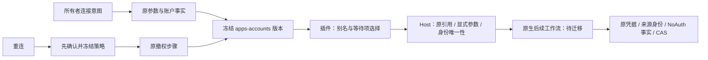

Host 只按原 Toolkit 精确相等性限定连接行，并发送原 Alias 与 active／pending／disconnected／public 的事实 bits；私有名称、连接／账户 ID、Toolkit、凭据、授权链接和状态修订号不进入候选。原历史别名没有功能级字节上限，使用既有显式不可变纯读流，不缩小为普通 8 MiB 输入。原图和账户修订围栏在启动前、每块和接纳时检查；复用已有私有读取机制，没有新 Run、效果账本、资源／数据库端口或状态写权限。

结果只能是原范围内的 pending 行引用、有效的新别名或具名冲突。Host 保留显式 alias 原值、原行 pending 事实、连接身份／命名空间唯一性、原授权缓存与已接纳期限的十分钟上界；生成默认名称、选择首末等待项等政策留在插件。空原 ID 与未选中分别表示，不能因空字符串误创建新连接。未知／越界／非 pending 引用、改写显式别名、伪造新别名覆盖已有连接都拒绝，受管失败不恢复 native。

原逻辑输入在一次所有者动作中选择一次版本。重连在原撤权前确认策略可用，并把同一选择保留到后续连接；撤权后的事实按新原修订读取，不额外重选活动图。普通停用会拒绝新的连接意图；所有者原生断开仍可关闭已有授权，不能被候选阻止。这里只验收前置策略与必要的版本绑定，后续账户政策须按各自真实消费者单独证明，不能由连接意图推导整个生命周期完整性。

随包发布的连接服务、显式 pre-service／default23／direct 消费者和已冻结原生重连共用 [v1 连接意图](../../internal/plugin/appsaccounts/v1/policy.go)。历史消费者退役后删除其原生分支。历史激活记录形成独立的持久 opt-in，停用、隔离或新图缺方法不会退回旧算法。契约为仓库私有实验，不承诺公共账户模型、通用工作流 DSL、稳定接口或默认整包分发。


### 认证配置选择与来源流程的私有实验

`apps-accounts` 的 `steward.apps-auth-config/1` 拥有显式／已保存／自动来源取舍、候选过滤、created／原 ID 比较、分页继续、401／403 受限凭据回退及明确无托管认证时的提示。默认保留最新配置、同日最大原 ID、每页 200 条／最多 20 页；独立版本可用最早配置及较小页大小。真实消费者是连接时的认证选择和 App settings 保存前的显式配置校验，二者都使用实际受管算法，不能保留设置验证的隐式 native 旁路。

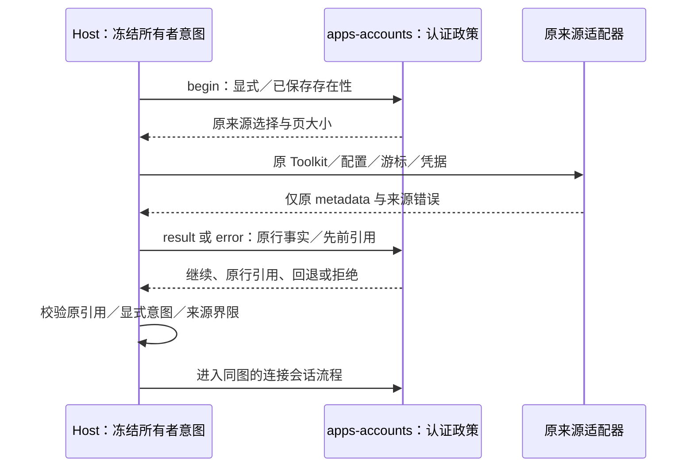

Host 解释一组封闭的领域命令，不提供任意网络／工作流 DSL。候选不能声明 URL、Toolkit、凭据、配置字符串或游标；Host 从原意图／原设置／原返回行取值，保持原查询过滤条件、来源身份、有效且启用／router 的配置、自动来源的非 managed 约束，以及显式配置的确切 ID／Toolkit 归属。source 字段仅选择已授权的显式／已保存／自动来源，不能覆盖显式所有者参数。Host 不计算排序或替候选挑选配置；下一页只带被候选选择、且由 Host 验证的原 metadata，前页选择和当前页一起再由候选比较。

原最多 20 次列表来源读取和单页至多 200 的请求界限不放大；重放游标、跨阶段重取、超限或伪造引用拒绝，失败不释放半份配置、创建会话或自动重试。401／403 仅在原自动模式允许返回不可读取的空选择；后页拒绝也会丢弃之前选择。明确空 hosted 能力与“字段未提供／能力未知”仍分别处理。状态／来源变化与隔离在原图／账户修订围栏内拒绝后续计算和会话创建。

原来源响应在 8 MiB 限额之后才遮盖密钥和解码，不能把这个限额误当成解码后 metadata 长度上限。迁移前捕获的 10 MiB created 字符串仍按完整原 hash 处理；使用既有受控纯读流，不调整普通 SDK 输入限制。只有原 ID、created 和原身份／资格事实进入候选；OAuth credentials、原响应正文、密钥和查询游标留在原适配器。接口为仓库私有实验，未稳定公共认证配置模型。

连接意图、认证配置、会话流程、账户检查、远端清理与重连的持久 opt-in 和活动图在同一 SQL 快照读取。一次连接、重连或批量设置验证保留同一具体政策选择，不能在来源 IO／分页期间重选活动版本。六个 opt-in 分开记录：确切的 pre-auth-service／default23／direct 与已冻结旧请求可保留原解释；一旦 auth 服务 opt-in，缺方法／隔离／停用不恢复原算法。普通 `AuthConfig`／`FindAuthConfig` 入口、无生产消费者的 ID 包装函数，以及连接中的保存配置回退／hosted 判断已删除；`auth_config_legacy.go` 只保留上述具名消费者，消费者消失后删除。

账户检查的状态映射另由同图受管服务提供；远端撤权／删除编排也由独立方法提供；完整重连编排另由同图独立方法提供，设置行／草稿投影按独立方法迁移；其余页面／资源与完整分发仍待迁移；原身份、凭据、授权缓存、事务／CAS、未知效果不自动重放和所有者撤权继续由 Host 接纳。认证配置流程完成不代表整个账户功能、默认分发或 Linux 验收完成。


### 创建连接与授权会话的私有实验

实际消费者是显式所有者 Connect，以及重连关闭旧绑定后的新连接。`apps-accounts` 的 `steward.apps-session-flow/1` 拥有 Toolkit 读取、公开应用分支、认证配置选择、会话／链接创建和 pending 接纳的阶段编排。默认授权缓存期限为 600 秒，独立版本可缩短期限；Host 不把当前默认当成可无限扩大的授权。

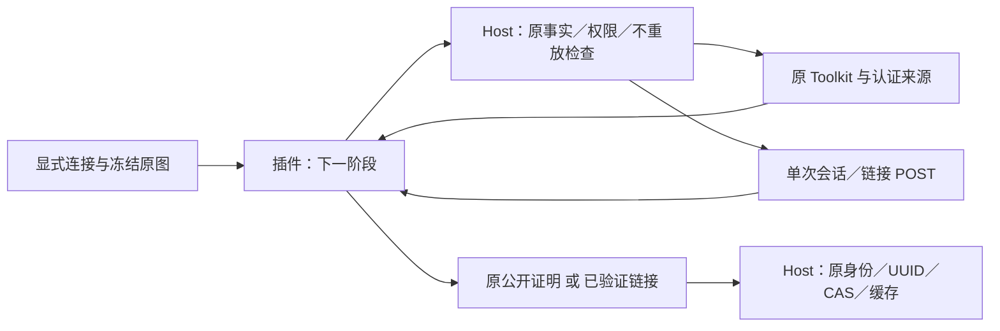

输入只有具名阶段与原 Toolkit 的 no_auth 事实，输出只有封闭命令和可缩短的缓存期限。凭据、所有者／Toolkit／auth-config／session／account ID、别名、原名称及授权 URL 都不进入此方法。连接意图和认证配置保持同次已捕获的政策选择，不在阶段间重选图；接纳前沿用原私有读取围栏与账户修订校验。

阶段依赖属于权限与一次性效果边界：无原 no_auth 证明不能创建公开绑定；无已完成的原认证选择不能创建会话；链接只能用于本次实际返回的会话；pending 只能引用本次已验证的链接。每项来源／效果在一个所有者动作中最多执行一次，失败立即返回，POST 结果不确定或之后候选／状态失效也不自动重放。Host 不替候选决定公开或私有分支、下一命令或期限；只解释闭合的权限依赖。原协议封包禁用 instant、workbench、proxy、批量执行和额外连接管理，因为显式连接并未授权这些能力，不能作为可调业务开关交给候选。

原 URL allowlist、来源超时／响应限额／重定向禁令、有效原 ID、原 BindingHash 与 SQLite CAS 继续由原适配器和所有者存储执行。写入与缓存共用一个接纳实现；缓存保存实际接纳的期限，Continue 根据已接纳租期读取，冷重启仍因缓存缺失提示过期，不隐式重建链接。旧缓存无期限字段时只解释为原十分钟。所有者本地撤权继续独立可用，账户检查的状态映射另由同图独立方法实现；完整重连按其独立边界验证，页面／资源与完整分发未据此迁移。

普通 `Service.connect` 和 `Client.Connect` 中的创建编排已删除。`session_flow_legacy.go`／`session_legacy.go:ConnectLegacyV1` 仅服务 default23／direct／确切 pre-session-service 图和已冻结旧动作；真实装配及保留消费者消失后删除。会话服务有独立持久 opt-in：已启用后，即使切回缺少方法的旧图，新连接也拒绝；已接纳缓存可继续读取，重连不能先关闭旧绑定再发现政策不可用。保留的旧 handler／manifest 只证明当前协议／SDK 下的原服务形状，不声称覆盖旧完整编译器或发行版。

接口仍为仓库私有实验。领域所需复杂度是原事实、线性效果、租期与 CAS；不提供通用工作流 DSL、任意网络、全量账户对象、候选写库、另一套 Run／效果账本或公共稳定服务模型。纯读阶段往返会增加进程调用次数，这是在已有受控服务机制内获得可替换业务与隔离的代价；暂不引入新的常驻 runtime 或批量权限机制。目录资源／页面、默认装配、保留图完整验收及 Linux 仍待完成。


### 账户状态检查的私有实验

`apps-accounts` 的 `steward.apps-account-check/1` 拥有账户检查的原状态映射及公开应用刷新决策。实际消费者是所有者的 Check：原映射保留 ACTIVE→active、INITIALIZING／INITIATED→pending、禁用或其他状态→expired；独立版本可将 INITIATED 更保守地标为 expired，而不更改连接意图、认证配置或会话创建。

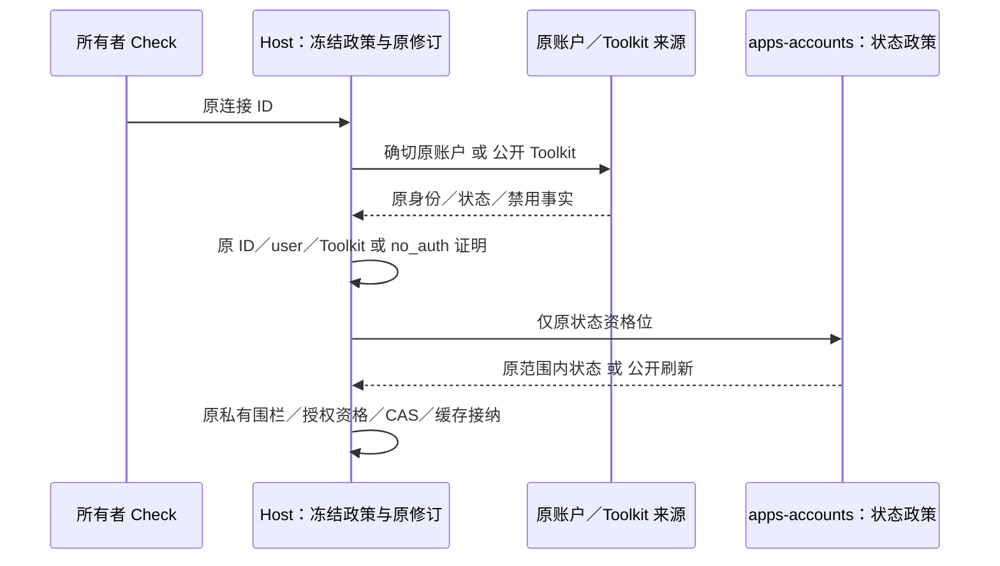

Host 必须取得原连接所指来源，并核对原 account ID／user／Toolkit；公开绑定必须重新证明原 Toolkit 的 no_auth。插件只读取这些证明后的 public／disabled／ACTIVE／INITIALIZING／INITIATED 位，不接收来源状态字符串、原响应、私有名称、账户身份或凭据。候选不能激活禁用／不匹配／非 ACTIVE 的账户，不能凭空声明 pending 或把公开证明当作私有绑定；可以保守地过期原状态。Host 的资格位和接纳检查是既有权限不变量，状态分派实现留在候选。

来源响应仍经过原限额之后的遮盖与解码；原始一字节密钥扩展出的 10 MiB 状态字符串不被新纯输入限额截断，而由原适配器完整解码，再仅投影资格位。因此不引入状态字符串服务、任意 metadata 字典或 SDK 限额调整。

图与六项独立 opt-in 在同次 SQL 快照读取，并用具体 `AccountPolicies` 绑定到一个逻辑所有者动作。原仅面向 connect 的选择类型／读取入口已按真实的连接、设置与 Check 消费者更名，旧名称和代理不保留；没有稳定为公共插件账户模型。Check 在来源 IO 前捕获政策，来源返回后在原图／状态围栏中验证；来源变更、候选隔离或失效不写状态、不刷新 namespace，也不重取来源。原状态无变化时只刷新、变化时用原 CAS 保存、离开 pending 才删除缓存的接纳语义保留。再次检查恢复 pending 也不能重建已丢弃的授权链接。

随包发布的检查服务与 pre-check-service／default23／direct 和已冻结旧动作共用 v1 账户状态配方。Host 继续按实际账户和版本验证状态。历史消费者退役后删除其原生分支。独立 Check opt-in 后，旧三方法图缺少 Check 时新检查拒绝且不读取来源；仍存在的原连接意图／认证／会话方法可以独立工作。旧 handler／manifest hash 回归只证明原契约形状，不宣称覆盖整个旧发行版／编译器。所有者本地撤权仍独立于状态候选；远端清理按下节独立边界验证；完整重连按下节单独验证；页面／资源、默认／保留图分发和 Linux 继续登记缺口。

所需复杂度来自原身份、来源资格、版本／私有修订和 CAS／缓存；不公开完整账户实体、不增加可预测的未来状态协议、通用工作流、另一套效果账本或新的候选写库权限。


### 远端撤权与删除的私有实验

实际消费者是所有者 Disconnect，以及 Reconnect 关闭旧绑定的步骤。原本的远端账户读取／令牌撤权／broker 删除编排已进入 `apps-accounts` 的 `steward.apps-account-close/1`；默认仍在撤权尝试后删除 broker 记录，独立版本可以在确切撤权已证明时保留记录。公开绑定没有外部授权，仍由 Host 直接记录本地关闭事实；其确认不依赖候选。

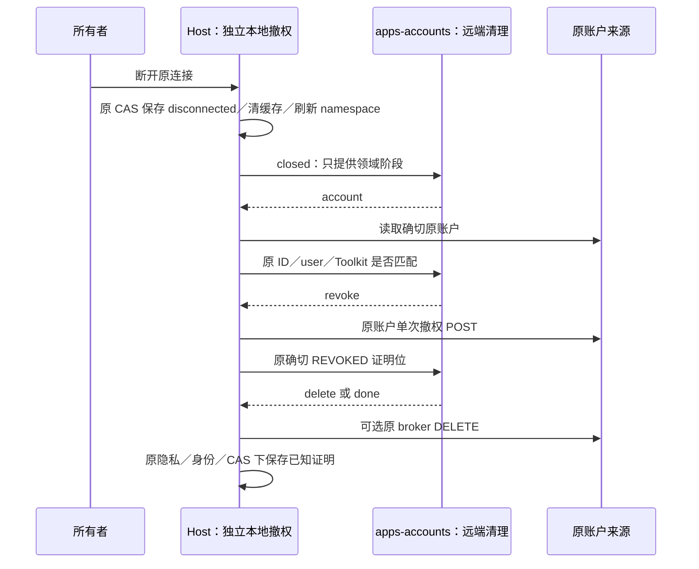

候选输出只有 account／revoke／delete／done，不能输出 confirmed，也不能访问 account／user／Toolkit ID、凭据、URL、完整账户或来源错误正文。Host 只解释原身份范围内的线性效果：账户读取至多一次；来源身份不匹配或读取失败不能撤权；broker 删除必须在本次撤权尝试之后，每项效果至多一次。删库成功不能作为令牌撤权证明。候选拥有真实顺序／结束政策，Host 不代为选择删除或保留的配方。

本地控制是不可替换的所有者机制：先持久关闭、删除授权缓存并刷新工具 namespace，随后才开始不可靠的远端动作。候选不可用、隔离、停用或返回非法命令都不能阻止这一关闭。回调失败仍保留原继续撤权／保存证明的语义，原第一次保存失败则不会触发远端请求。原响应已确切证明撤权后，候选失败／隔离不会抹掉该权威事实；保存仍必须通过原所有者／隐私围栏与 CAS，若状态已变则冲突且不写入别的修订。未确认的 POST、最后保存失败及已关闭绑定都不自动重试或重放。

独立的 `AccountCloseReader` 使用同一持久服务边界查询：在 cleanup 尚未 opt-in 的确切 pre-service／default23／direct 消费者中，不相关业务的图失败不应抑制原所有者远端清理。opt-in 后缺方法则只执行本地关闭，保留远端未确认，不恢复 native。完整重连使用同次 `AccountPolicies` 图／六项边界快照中的具体 cleanup 政策，不另选版本；新重连若缺必要 cleanup／创建政策，先拒绝再关闭旧 pending。此独立读取入口是实际所有者控制的需要，不是通用降级框架。

原绑定 ID、BindingHash、命名空间身份、凭据引用、同源授权和来源协议仍由 Host 持有。原适配器只提供单次账户读取、撤权证明和删除的协议原语；`Client.Disconnect` 与 `Service.disconnect` 的普通远端编排已删除。`account_close_legacy.go`／`close_legacy.go:DisconnectLegacyV1` 只服务确切 pre-close／default23／direct 及已冻结旧动作，消费者消失后删除；不能供受管失败使用。保留的原四方法 handler／manifest hash 只证明当前协议／SDK 下的旧契约形状，不代表历史完整发行版或编译器。

当前接口仓库私有、实验级，不公开整个账户模型、任意网络、可预测的未来撤权政策或候选写库。领域所需复杂度是独立本地控制、原身份／来源证明、单次效果与 CAS；未另建通用工作流 DSL、Run 或效果账本。完整 Reconnect 编排另见下节；页面／资源、默认／保留图分发及 Linux 仍待各自迁移验收。


### 完整重连编排的私有实验

`apps-accounts` 的 `steward.apps-reconnect/1` 拥有完整的关闭旧绑定／创建新连接编排，以及原权限范围内的准入取舍。实际消费者是所有者 Reconnect；固定原契约仍拒绝缺失、active 或 disconnected 的目标，默认接受其余历史状态，独立版本可以保守地仅接受 pending。Host 不用单个 allow 标记继续运行普通旧工作流。

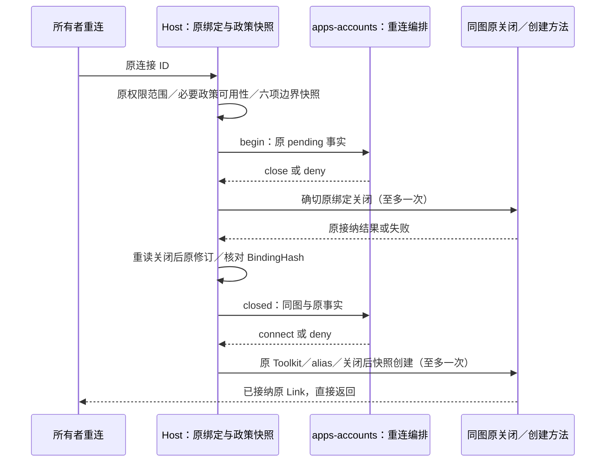

输入只含 begin／closed 阶段和原 pending 位；候选不能看到或改写连接 ID、Toolkit、alias、user、凭据、账户或授权地址。Host 保留原合法目标范围、关闭／新建的线性效果权限和确切身份：禁止提前创建、重复关闭、跨原绑定或改写参数。一次逻辑重连把现有六项政策与图冻结在同一 `AccountPolicies`；新建使用关闭后重新验证的原权限快照，不能因再次加载状态而吸收已变更的 user／凭据／绑定。私有状态或原围栏失效时，不创建下一连接。

关闭或新会话的部分效果失败仍按原结果结束，不回滚已关闭授权、不隐式重试或重放。第一次本地写入失败无外部请求，关闭后的保存／回调失败不进入创建；新 pending 保存失败也不能重复 session／link。已经关闭的原目标再次重连仍拒绝。新连接接纳后直接返回原 Link／缓存，不再用另一个候选回合决定是否释放它；之后的候选隔离不能把已接纳链接变成丢失结果。

普通 `Service.Reconnect` 的 close→connect 配方已删除；只保留权限、可用性、锁与具体政策分派。`reconnect_legacy.go` 仅承接确切 pre-reconnect／default23／direct 与已冻结旧动作，消费者消失后删除；不存在受管失败的原生退路。原五方法 handler／manifest 的 hash 回归证明冷原解释、首次 opt-in 跨 IO 的旧选择及持久边界；不声称历史完整发行版／编译器。新服务一旦启用，即使切回缺方法的旧图，新重连也在关闭旧绑定前拒绝；原独立 Connect／Continue／Disconnect 仍按其各自服务工作。

接口仍为仓库私有实验；真实的普通创建与重连消费者共用 `connectFromState` 以及原参数校验，不复制另一个会话／认证工作流。不公开整个 State、通用工作流 DSL、任意命令、候选写库或新 Run／效果账本。原身份、锁、冻结选择、私有围栏和 CAS 是领域所需机制；准入配方及关闭／创建顺序在插件。页面／资源、默认／保留图整包及 Linux 仍待独立迁移验收。


### App settings 行投影的私有实验

真实消费者是 App connection service 的 GET、字段草稿 POST 和显式保存响应。`apps-accounts` 的 `steward.apps-settings/1` 拥有已保存配置行的原 App 字节排序、完整草稿行投影、移除后的空行与新增空行位置；独立版本可倒序保存行并把新增空行放在首位。普通 Web 排序／append／切片移除配方已删除，Host 没有保留另一个默认投影算法。

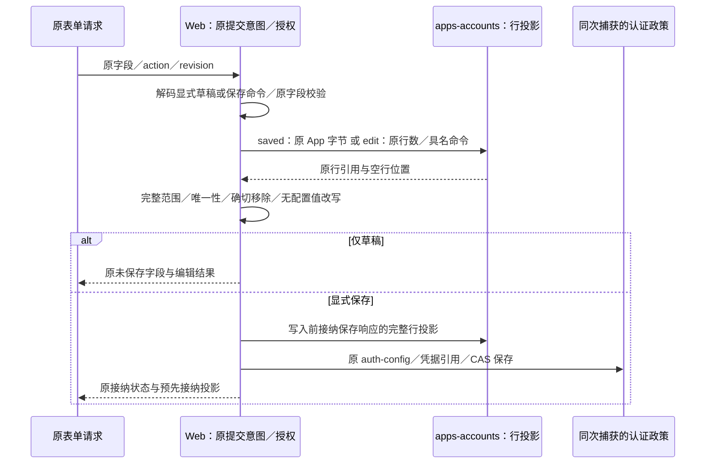

原私有 POST action codec 仍定义所有者提交的命令，而不是让候选决定能否保存：字段 add／remove 是未保存编辑；已有 bare numeric／正号／前导零 remove 别名继续解码为确切行。原 128 行边界的 add 落入保存分支、非法字段／revision 仍可编辑的行为由改动前对照保留；不是借迁移修改产品语义。Host 保留 HTTP／同源／所有者权限、字段数量、原 ID／重复检查、空字段到显式配置映射、serialized POST 限额、原配置和凭据引用及 CAS。候选既不能把草稿升级为写库，也不能生成配置 ID、凭据值或删掉未指定行。

排序只输入原 App 字节，编辑只输入已解码命令、原行数和确切移除引用；不发送配置 ID、key_ref、完整 State 或秘密。候选计算完整引用及空行的组合；Host 只验证命令授权范围、源引用唯一性／完整性和空行数量，不计算排序或替候选排列草稿。输出按 16384 行窗口原子接纳，任一后页重复／越界／丢行都不释放部分私有页面。已接受的历史配置图不因常规编辑 128 行上限而被截断；原 16387 行／3 MiB 名称和单个 9 MiB 名称的完整呈现 hash 保持，通过既有受控纯输入流传送，普通 SDK 8 MiB 入口不放大。

`SettingsReader` 是实际独立页面消费者的读取入口；editor／auth 的持久边界与活动图同次 SQL 快照捕获。保存使用该请求具体的 auth 政策和原图，不在来源 IO 时重选。草稿显示的用户 revision 不充当私有读取授权，围栏检查原已保存修订。保存响应投影在效果前接纳，保存后只核对／读取原权威状态；来源期间切图或写库后隔离不能把已接纳配置隐藏成未提交结果。

`settings_legacy.go` 只保留确切 pre-settings／default23／direct 与已冻结请求的原投影，消费者消失后删除；一旦服务 opt-in，旧六方法图、隔离／停用或无方法不得恢复 native。旧 handler／manifest hash 回归证明当前协议／SDK 的冷原解释与首次启用跨请求边界，不声明整个历史发行版／编译器。缺编辑器不禁用独立所有者关闭。

接口为仓库私有实验，未公开 Settings 页面结构、通用表单协议或稳定账户模型。原线协议命令意义、权限／事实／CAS 和完整源引用校验属于必要机制；排序、引用组合与空行放置属于插件。原共享控件、字体、布局、显式保存及原生无脚本路线保持不变，不新增页面皮肤。模板、Apps 前端生命周期、logo 业务／资源、默认／保留图整包及 Linux 仍分别迁移验收。


## Apps logo：版本化字节与公共来源的私有接入

真实消费者是 Apps 卡片／详情／已连接侧栏的图片引用及受认证的 `/apps/logo/slug`。独立 `apps-logos` 包的 `steward.apps-logo/1` 持有原 65 份 SVG 字节和随包优先／已登记 provider／不可用、缓存复用及期限政策；资源嵌入其封存 executable，原图保留原包即可重建原随包资源。原 Web 资产树删除，兼容 Host 与新包共享唯一 artwork 源码，不复制两个默认资产集合。

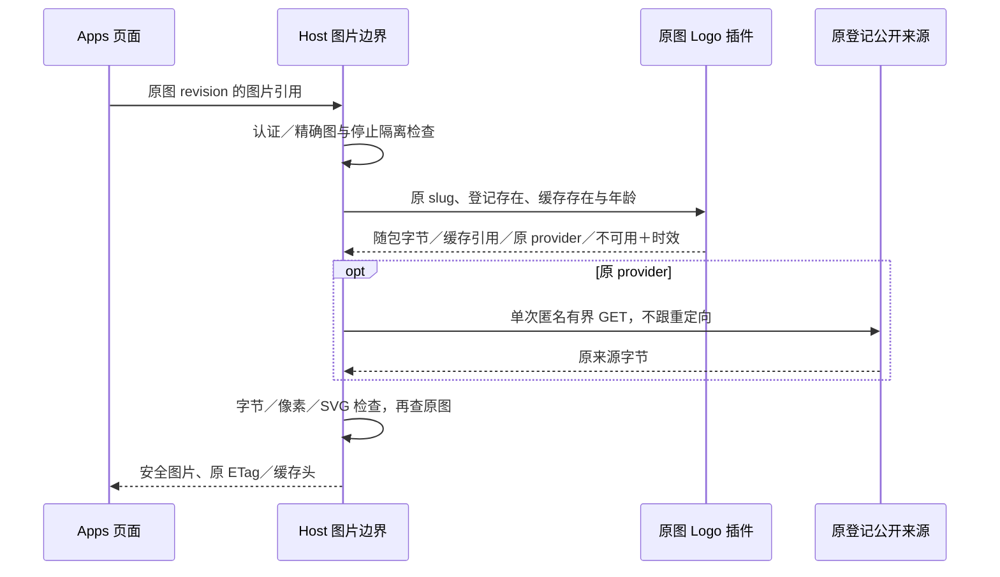

不变机制包括确切原来源绑定、白名单 URL 校验、匿名 GET／超时／不重定向、512 KiB 与 4194304 像素／安全 SVG、128 缓存／4096 来源的物理上限、原已验证缓存引用与当前隔离／停止检查；这些是原 HTTP、浏览器安全及资源边界。候选没有 URL、HTTP 凭据、完整 Toolkit／State、路径、数据库、通用 KV 或任意资源回调；只能使用本请求原公开 slug 的登记来源，不能发明缓存或在来源消失时释放另一图的数据。来源登记保留同一图已观察到的非空元数据事实；缺省官方 URL 仍经过同一固定来源边界。

公共读图与每服务持久 opt-in 由原 SQL selector 捕获；实际 `ServeWeb` 注入所属 `AppLogoReader`，不从 manifest 自行授予 native。页面在元数据 IO 前捕获图片选择，所有卡片投影结束后注册该图的原元数据和引用；显式账户操作在效果前同样捕获一次，由请求私有 context 固定。JSON accounts／sidebar 片段完整投影该原图的引用与来源登记，原生表单的后续 loadApps 复用同一个捕获值，不在效果后再次读取活动选择；图标不可用不把已接受关闭改成失败。目录／账户不可用不能偷偷选择另一图。新图片引用携带 revision，Host 用原已激活图解释并逐次检查停止／隔离；缓存和来源按图隔离，换版不混入旧图字节。GET 不创建 Run、`rsi_call` 或持久投影。已完成的来源读取在结果释放／写缓存前再查图；隔离后连旧缓存也拒绝。HTTP 返回精确图片字节 hash 的 ETag，时效仅允许原 24 小时上限以内，独立版本可以缩短。

当前原 `/logo/slug` 是可变入口，新引用的随包内容可冷恢复；远端登记仍遵循原内存寿命，不假称远端内容永久不变或历史未登记 URL 可冷恢复。取消在候选派发前阻止后续原来源尝试，HTTP 终态与不缓存保持原样，这是明确的取消收紧。没有借图片读取增设 GET 写库、额外 signing key、公开域模型、通用资源挂载／GC 或前端任意执行；这些对一个实际 logo 消费者仍属未验证泛化。

`app_logos_legacy.go` 仅保留确切 pre-logo／default23／direct 与首次 opt-in 前捕获的原请求；消费者不再需要时删除。缺新服务的原账户图仍可服务其独立设置，不能恢复旧 logo 配方。旧 SVG 路径已移除，原 provenance／第三方源码与通知保留；未新增外部代理 SDK。完整模板、Apps JavaScript、通用资源贡献和默认／旧默认分发／Linux 门禁仍分别迁移，F-071 不据此完成。


## Apps 界面：同一冻结规则的两个消费者

真实消费者是服务端账户／详情／卡片／连接服务原生模板，以及 Apps 浏览器控制器。`apps-interface` 的私有 `steward.apps-interface/1` 在隔离进程中编译当前实际事实轴：五种状态类与公开／确认／选择范围／有效链接，卡片事实与别名需求，设置反馈标记，原错误类别及浏览器交互。输出是有限规则表、原文标签、首个 active 的归约表、弹窗动作及有界轮询／请求期限；不是公开 State 模型、通用组件 AST 或任意浏览器代码。

```mermaid
flowchart LR
 C[独立界面包：实际规则编译] --> P[固定原图的公共规则]
 P --> S[服务端：原事实＋共享控件]
 P --> B[浏览器：原 DOM 引用＋固定原语]
 S --> A[原生表单／JSON]
 B --> A
 A --> H[Host：原权限／参数／单次效果]
 H --> R[同一原图呈现；不可用返回可信回执]
```

历史 `/1` 规则请求是 `{}`，当前 `/2` 只接收当前界面语言，不读取私有账户状态；不授予 input、资源调用、状态写入或演化权限。原账户 ID／别名／名称、设置字段、链接及源版本留在 Host，编译表只含当前公开语义。Host 做状态编码、原引用绑定和控件物化，候选实际计算可见性、标签、控件组合与顺序、卡片显示、反馈与轮询策略。原共享布局、字体、控件皮肤与 escaping 保留，JSON 嵌入属性时继续转义；候选不能注入 HTML、JavaScript、URL、字段值或动作参数。

新增可信机制只服务这些真实消费者：验证完整表形状和原披露范围、必要撤权不确定提示、有效链接来源、所有者关闭可达性与固定动作词汇；物化原参数和 canonical 动作文字，保持原生表单与同源／CSRF。浏览器仍强制原连接 ID、授权域／期限、只在当前 pending 范围自动刷新、每行在途限制、请求代际／修订围栏、页面退出取消及不持久保存 OAuth 链接；自动刷新间隔不快于原 5 秒、窗口不超过原 10 分钟，请求期限不扩大。没有新增 Run／pending 账本或通用 KV。

所属 SQL selector 在一次原查询内捕获持久 opt-in 与当前图；明确旧引用选择已激活原图。请求在元数据 IO／效果前编译一次并放入 Web 私有 context，JSON 片段、原生后续 loadApps 和设置保存共用它，不在效果后读取另一份业务版本。浏览器由原页面的 profile／revision 驱动，异步动作和详情查询带回原引用；新图只供新的选择，旧图可以冷重建。当前停止／隔离仍拒绝新编译；自动检查遇不可用立即停机并清理旧投影。

业务展示不可用不能把已接受关闭／已证明 pending 链接改成失败：固定 Host 回执只说明确切已接受事实，JSON 保留原链接／ID／修订，原生回执复用宿主导航和控件并仅显示批准来源的授权链接；不读取候选或调用新的连接流程。无法确认的失败不推测私有 cause 或宣称效果未发生。这个很小的接纳／恢复出口属于可信机制，不能变成第二套原生 Apps 业务实现。

代价是每个新 owner 请求读取一次公共编译结果及有限表的显式版本；没有预测通用 UI 平台。表只表示实际状态轴；新轴和新 UI 原语尚不作为稳定公共 API 承诺。已拒绝同源任意候选脚本／模板、整份内部领域模型外送、效果后重选和只改文件位置的代理迁移。静态模板布局与完整界面资源贡献／挂载仍有未迁移部分，不能把固定物化器之名用于隐瞒这些剩余业务。

`apps_interface_legacy.go` 与 `app-interface-legacy.ts` 只保留 pre-interface／default23／direct 及捕获旧请求的确切规则；消费者退出后删除。托管错误得到显式不可用，没有两套默认解释。原普通 appError、模板条件与浏览器常量／首个 active／控件默认算法已从托管路径删除；动作词汇、原作用域和必要不确定回执仍是独立保护。模板布局／资源组合、默认／旧默认／Linux 与全部原业务清单继续单独迁移。

## Apps 区块组合：有限的真实消费者

`steward.apps-composition/1` 是同一原子界面包的额外私有服务，不引入新的公开 UI 协议。五个真实消费者分别是页面的六个区块、目录的五个区块、详情的五个区块、账户行的两个区块和连接服务页的三个区块。另有 28 项原页面标题、导航／空态与服务帮助文案以具名字段随组合版本返回，历史 `/1` 将原文交给既有翻译，当前 `/2` 的最终文本只经过 escaping；候选标签不能变成 HTML 或改写原输入值。规范动作／字段名称、原关闭确认与必须的隐私／撤权披露仍由原共享／可信原语表达。包实际计算这些区块的顺序，Host 只将封闭名称派发到现有原生控件片段；未知／重复／缺失区块拒绝，不能隐藏原关闭控件、必要披露、页面主体或设置提交入口。候选不持有内部账户事实、任意模板／组件名称、DOM、JS、网络或凭据。

```mermaid
flowchart LR
 S[同一 SQL：当前图＋两个持久迁移标记] --> I[原图界面规则]
 S --> C[原图区块组合]
 I --> F[请求局部冻结解释]
 C --> F
 F --> P[既有共享控件＋原字段／动作]
 P --> W[原生页／JSON／浏览器详情]
 F --> E[保存；期间允许切换活动图]
 E --> R[仍用原组合返回已接受结果]
```

组合契约只表达当前实际区块，不开放递归节点、布局语言或新的组件主题；完整排列保证既有可达性，不由 Host 选择区块顺序。原生片段仍绑定原字段与动作，使用现有模板 escaping、共享皮肤和表单权威。独立实验版本可把连接服务的返回链接移到表单之后；默认仍保持原布局。产品排版规则继续归 `design.md`，没有借可扩展性改写视觉要求。

界面与组合的 durable opt-in、当前图在同一次 SQL 读内捕获；两次纯编译都使用该原图，请求内缓存整个解释，不增加 Run、效果账本或 GET 投影写入。原生、JSON 与连接服务保存不在效果后重选；候选坏组合不能把已接受关闭改成失败。历史 `/1` 组合输入是 `{}`，当前 `/2` 只接收当前界面语言，输出仍只含现有区块词汇和有界的最终展示标签。额外纯调用和封闭分发表是这些真实消费者所需复杂度；通用 AST、任意同源脚本和外送领域模型仍被拒绝。

旧 profile-only 页面在首次组合 opt-in 前可保留具名旧顺序；明确的已激活旧图引用也保留原解释。首次 opt-in 后，当前旧图缺组合服务明确不可用，不能因重新激活旧图恢复默认；坏服务、隔离与停用也不进入旧顺序。`apps_composition_legacy.go` 只为这些确切旧页面／直接消费者／捕获请求保留；消费者退休后删除。旧源文件的模板顺序已从普通入口移除，原模板拆成复用的有限原生片段，账户片段仅接收原已缩小范围的行及原 view。

开放范围是仓库内实验接缝，公共 Go SDK 不变。代价是当前只独立演进既有区块顺序和上述展示文案；片段内部静态标记／文案、侧栏单项组合、完整资源挂载与回收仍未迁出，不以“固定物化器”把这些剩余业务永久列为内核。旧源码 fixture 只证明该确切私有 profile-only Handler／manifest 在当前 SDK 上的兼容，不代表完整旧发行版。

## Apps 最终文案：实际语言输入与明确版本解释

具体缺口是 `/1` 的英文值仍经宿主／浏览器全局词典翻译，新中文不能只随包升级。当前两个真实语言消费者需要独立变化，因此 `steward.apps-interface/2` 和 `steward.apps-composition/2` 接收封闭 `{locale: en | zh-CN}`，沿用原输出 DTO，直接返回最终文本。翻译政策与当前实际词条归包内；没有新增公开翻译字典、语言框架、第三种语言或领域 State。输入没有账户、来源、凭据或私有正文。

```mermaid
sequenceDiagram
 participant W as 原请求：图引用＋语言
 participant H as Host
 participant P as 原图／2 界面包
 participant V as SSR／JSON／浏览器
 W->>H: 所有者请求；原语言偏好
 H->>H: 同次 SQL 捕获迁移边界与图
 H->>H: 一次检验图／包，确定实际契约版本
 H->>P: 同一图与同一语言：规则＋组合
 P-->>H: 最终文案与有限规则／区块
 H->>H: 验证原范围／动作／完整性，固定整个解释
 H->>V: 按所选／2 标记最终文本并转义
 V->>V: 原值展示；不再经全局词典改写
```

宿主在一次已检验图／包遍历中选择实际声明的两个版本；目录缺字节／损坏、重复提供者和运行失败不被误判为“缺少新版”。已声明 `/2` 通过后才使用它；其运行／schema／领域校验错误直接不可用，即使同图另有健康 `/1` 也不重试。实际只声明 `/1` 的旧图仍使用明确的旧版本适配，保持原 Host 翻译语义；这与当前旧 profile-only 图在 composition opt-in 后缺完整服务的拒绝边界不同。持久 opt-in 同时识别 `/1` 与 `/2`，新版独占服务也不能在停用后恢复 native；只有组合服务曾接管、规则服务缺失时也明确不可用，不能把残缺的已托管组合恢复为整套原生界面。

私有 Web reader 显式接收本次语言；规则与组合使用同一原图／语言，效果前只捕获一次。合同来源标志由 Host 所选版本产生，候选不能自行设置。服务端动态标签、错误／保存反馈、标签页标题与 JSON 错误只对 `/2` 跳过全局翻译；浏览器仅对原页面 Host 标记的 `/2` profile 使用最终文本。固定回执、规范动作／字段与必要隐私／撤权提示仍由共享语言机制表达。所有最终文本继续是普通字符串，保留模板转义、JSON 编码与 textContent；没有模板／HTML／JS 权力。

这个区分是实际语义需求：中文 UI 中的包可以刻意保留英文品牌词 `Workspace`，宿主不能再次改成它自己的“工作空间”。独立实验同时提供未进入宿主词典的新中文授权反馈；既有完整账户浏览器流程与无脚本表单继续使用原协议。领域效果、审批、链接身份／期限、未知不重发和已接受回执不由翻译改变。

新生产包只声明 `/2` 并删除普通 `/1` 编译包装；英文基础值与包内翻译仍是当前实际实现。`/1` 常量／Host 解释器只为实际已激活旧图、旧引用、在途解释和明确 native／default23 边界保留；这些消费者退休后删除。共享宿主词典仍服务其他页面、受保护控件及这些旧消费者，不能无条件删掉共享键；当前旧源码 fixture 只证明该确切 Handler／manifest 在当前 SDK 上的解释，不代表完整旧 Host 发行版和全部历史资源已冻结。新的 `/2` 文案随其包／图引用保留。

开放范围继续是仓库内实验契约，不改变公共 Go SDK；额外复杂度来自两个实际语言与真实旧版本。已拒绝每次改包都补宿主 JSON、隐藏 context 中的语言、任意语言／翻译 map、失败后向旧版重试以及只验证握手。静态原生片段、侧栏单项、通用资源贡献／挂载／回收和默认／旧默认／Linux 仍分别迁移，整个 F-071 与原全量功能目标仍未完成。

## Apps 卡片资源：现有组件的有限组合

真实消费者是 Apps 发现页／分组／实时列表中的单张卡片。`apps-interface` 的私有 `steward.apps-card-view/1` 读取本包声明的 `view:apps-card` 文件，返回真实文件摘要与 11 步有限程序。Host 绑定同图服务提供者、manifest 资源与封存文件摘要，校验完整基数、父级作用域及闭合后，才用原始行渲染。资源可独立改变图标／名称组及原控件的组合顺序；不接受候选 HTML、JS、CSS、URL、属性、表达式或重复查询，也不向插件传账户、凭据或私有行。

不变量是原行身份、Go 模板转义、受保护表单参数／动作、共享控件、来源与撤权围栏；当前默认顺序归资源。普通卡片内联拼装已移除，原生渲染原子只承担现有控件及绑定，不再决定默认组合。具名 `appCardProgramLegacyV1` 仅服务 native/default23、直接模板调用、实际 pre-card 图和已捕获／保留引用；这些消费者退出后删除，不用于已迁移当前图的缺失／失败兜底。

SQL 在同一次读取冻结规则、区块组合与卡片资源的三项历史激活边界和当前图。卡片单独激活不会恢复整个原生界面；当前缺失／非法卡片在流式输出前明确不可用，明确 pre-card 引用保持旧解释。可选卡片错误不阻断不消费卡片的账户详情、服务设置及已接纳关闭；包损坏／隔离仍服从原图完整性和撤权。请求持有原解释，不在效果后重新选择资源。

此接缝保持仓库内实验级，复用原 manifest.resources，不扩展公共 Go SDK。额外复杂度来自实际独立的组件顺序与旧版本；已拒绝任意模板执行、通用递归 UI AST、原生代理及第二套默认实现。原始 512 个卡片场景是候选前捕获的 oracle；程序字面预期则在契约设计后从保留模板人工推导，不能称为早于 schema。旧 pre-card 源码只用当前 SDK 重编译验证，不能声称完整旧发行版覆盖。

卡片内部标记与侧栏的当前接入边界见下节；其他原生片段、功能文案与语言、Apps CSS、通用资源挂载／引用回收、默认组合及 Linux 仍待分别迁移；此项不完成 F-071 或全量目标。

## Apps 侧栏资源：原账户行的有限组合

真实消费者是 Apps 页的已连接侧栏，以及账户动作接纳后的 `sidebar_html`／原生整页响应。同一 `apps-interface` 包声明 `view:apps-sidebar` 文件，私有 `steward.apps-sidebar-view/1` 实际读取并返回文件摘要和五步程序：入口开始、图标／名称／pending 标记的完整排列、入口结束。Host 核对原图服务提供者、声明资源与封存摘要，绑定原行、工具包、链接、Logo 来源及 pending 事实并使用原生模板转义；候选不接触账户正文、凭据、URL 或效果。包可独立改变入口组合顺序。

卡片和侧栏现在是真实的两个资源消费者，因此共享本包有限文件读取和 Host 的声明资源身份查询；未开放通用组件语言、任意 HTML／CSS／JS、查询／循环或领域 State。基数、父级／闭合、原行与参数及撤权属于必需机制；具体排列归资源。旧普通侧栏内联拼装在同批删除，`appSidebarProgramLegacyV1` 只服务 native/default23、直接调用、明确 pre-sidebar 图和捕获／保留引用，实际消费者退出后删除，不能成为当前失败兜底。

SQL 在同一次读取捕获四项持久迁移边界与原图；仅侧栏激活不恢复整个原生 UI。当前侧栏缺失／非法且整页确有侧栏行时，在写响应前拒绝；不消费侧栏的详情 API、连接服务及空侧栏不受该可选组件错误阻断。效果前取得的解释同时供 JSON 和原生后续响应使用。效果已接纳而侧栏不可用时，返回已有的受保护接纳回执和原授权链接，不重新选图、不重发效果、不混入旧默认 HTML。包隔离／损坏及当前撤权仍服从原图围栏。

开放范围继续是仓库内实验级，公共 Go SDK 不变。旧三服务包按真实 pre-sidebar 的 Handler、卡片编译器／契约和 manifest 源码与未改动的原区块／语言源重编译；只证明当前 SDK 的旧源码消费者，不代表完整旧发行版。34 个原始侧栏输出在候选前捕获；程序字面预期在 schema 设计后从保留模板推导，二者不混称。

侧栏 pending 的当前文案绑定与内部标记已由下节资源持有，具名旧消费者保留原字典解释；其他原生片段、内容／语言、Apps CSS、通用挂载／引用回收、默认／旧默认组合与 Linux 仍有独立剩余，不据此完成 F-071 或全量迁移。

## Apps 标记资源：受限模板与本地显示绑定

卡片与已连接侧栏的 16 个原子标记已由实际封存的 `view:apps-view-markup` 文件持有，私有 `steward.apps-view-markup/1` 首先定义卡片／侧栏源；当前 `/2` 继续返回该文件的完整原始 JSON 与摘要。Host 再核对 Source 本身的摘要和声明文件摘要，才解析其中两组模板；两个真实消费者直接执行所选资源，不调用旧标记作为新默认或验证 oracle。原生文件只留在具名 legacy 路径，服务实际 native/default23、直接调用、pre-markup 图及已捕获／保留引用，消费者退出后删除。

Host 只给模板本地的平面显示字段、原始链接／工具包身份、既有布尔事实和受信原语片段，不给 `appsView`、State、账户身份、凭据、领域方法或数据库。纯编译进程仍只接收空输入，读取本包资源，不接触实际行。新标记契约的 pending 文案绑定已有规则服务的 pending 状态文本；旧标记引用仍按原宿主字典解释，不能因改换绑定而重算历史。

语法只允许既有 16 个定义、静态文本、单个允许字段及原布尔条件；拒绝反射链、函数、变量、管道、循环、with、include／template 调用和未知字段。原 `/1` 资源最多 4KiB；当前含图形源的 `/2` 文件最多 8KiB，各组模板仍受 4KiB、512 个 AST 节点及四层条件约束。Host 在效果／响应前，用编译进程不可见的新随机探针遍历全部原布尔和原语有无组合，检查最终 DOM 的作用域、原生表单 action／toolkit／graph 参数、链接、控件、pending 事实、必需内容及原语片段身份。主动内容、事件、任意 CSS、外部 URL、越界 DOM hooks／ID 和隐藏必需控件被拒绝。显示值只做受限替换并由 `html/template` 转义；没有给原始行正文增加新长度限制，也不为检查而缓存整页。

必要复杂度来自真实的标记换版、私有数据隔离、原动作及既有脚本／无脚本契约。标记可在这些约束下改变实际被动结构，例如沿用共享 `app-copy` 角色的 span／div；不开放通用 UI AST 或公共模板语言。SQL 在同一次读取固定五项持久迁移边界和原图。当前标记缺失／非法时，实际卡片／非空侧栏明确不可用，`/1` 不消费此标记的详情 API／服务设置仍可用；`/2` 详情标题实际消费图形，图形缺失时详情也明确不可用；已接纳效果继续返回既有独立回执和原链接，不重做效果、不晚选模板。

开放范围仍是仓库内实验级，公共 Go SDK 不变。原 512 个卡片、34 个侧栏、512 模板／32 错误和 224 页面等捕获输出提供独立语义对照。原始资源 fixture 是设计后从保存的原标记手动投影到平面字段，用来核对原始资源身份；它本身不是 UI 质量验收。故意封存的坏资源可以通过这种 wire 身份 fixture，仍须被 Host 的独立渲染约束拒绝。安全字段／动作校验不等于自动认证任意自然语言或界面质量，候选的独立产品评测与 Guardian 门禁仍不能由候选改写。

其余 Apps 片段、内容／语言及 CSS、通用挂载／引用回收、默认／旧默认组合和 Linux 仍待分别迁移；未将这些业务留存称为固定内核，也不据此完成整个 F-071 或原全量目标。

## Apps 图形资源：实际 SVG 与 Logo 标记

现有卡片的加号／省略号、卡片与侧栏 Logo、详情标题 Logo 都由同一封存文件的 `/2` 图形源持有，而不是注册资源后继续调用原生图形。实际包只提供 `/2`；`/1` 编译器源码移入精确历史 fixture，解释器只供真实旧版本／回退／保留引用。新版本可以改变被动 SVG 几何与静态版本标记，继续使用已有控件皮肤。默认源与候选前捕获的 28 个原始图形输出逐字节对照。

图形本地数据仅有原首字母、原 Logo URL 与是否有图；不将内部行或凭据传出。Logo 校验保持原图片／首字母、属性和 URL 绑定；装饰 SVG 只接受有界 svg/path/circle、有限尺寸／坐标／路径与 currentColor/none，拒绝事件、外部引用／图片、paint URL、CSS、ID／DOM hooks、NaN／无穷数。模板继续使用闭合字段与随机探针，不能调用函数、循环或内部 State。安全约束不替代产品质量评测。

同一次 SQL 快照保存 markup 家族最高历史版本 0/1/2。Host 优先解释图中实际声明的 `/2`，错误不重试同图健康 `/1`；实际仅声明 `/1` 的回退继续按原图形语义工作。已经使用 `/2` 后，当前缺失贡献不恢复旧图形；明确的 pre-markup 历史引用保持旧解释。效果前快照覆盖 JSON 与原生后续响应，已接纳动作的独立回执／原授权链接保持可用。

同批移除 apps.html 的三个普通图形定义，保留具名旧 Apps 图形供 native/default23、直接调用、`/1` 与历史引用。调用审计发现 Models 列表／详情也消费原省略号，因此将其保留为唯一的 `icon-more-v1`：Models 与旧 Apps 共用精确旧字节，当前 `/2` Apps 不代理它。Models 的该共享图形仍待其自身迁移，不能将它归为纯历史或宣称全局图形完成。每项旧源在其真实消费者退出后删除。

隐藏 `interface_revision` 表单字段继续由 Host 投影：实际使用方是 quick-connect、详情／账户动作与服务设置，字段只有固定 type/name 和已冻结图身份，没有独立业务或样式变化轴。候选只接收不透明的受信片段，不能伪造图身份；不为每个函数建立插件。其他原生片段、语言、CSS、资源回收与组合默认验收继续单独跟踪。开放范围为仓库内实验级，不扩大公共 Go SDK。


### Apps 账户行封存展示

账户列表的原始 SSR、详情内账户区及效果后的 `accounts_html` 共用同一 Apps 界面包的 `steward.apps-view-markup/3`。它只扩展现有封存 markup 资源，保留同一包、资源名称、原图选择与生命周期；没有新进程、端点、数据库表或公共 renderer SDK。

插件持有账户内容、动作容器与按钮的被动模板。Host 只提供本次已授权的有限展示字段，并绑定原连接身份／interface_revision、授权链接和必要撤权提示；整个 Connection／State、方法、凭据及执行权均不进入模板契约。实际账户状态和可用动作仍来自同图已有 profile，模板不能增添动作、改写表单目标、丢失或复制身份输入、隐藏控件、插入脚本／事件或外部请求。复用既有被动模板解析和 DOM 核验，不引入表达式或工作流语言。

原 `/1`、`/2` 图仍使用具名 `apps-account-legacy-v1.html`；当前模板入口只负责选择已接纳贡献，不能在 `/3` 缺失或损坏后恢复旧展示。被替代的普通账户模板已移除，身份／授权／必要撤权提示的共享绑定只保留一份；历史图和引用退役后删除 legacy 文件。旧 `/2` 包的测试使用固定迁移前源码和清单，不由当前候选重新生成。

实际独立换版、原引用、精确回退、真实关闭账户响应及停用冷恢复已有回归。真实浏览器已覆盖默认／独立版本的桌面、手机、亮暗主题，以及非法贡献下已接纳授权链接的保留；该浏览器使用既有后端 fixture，不能替代完整默认组合验收。当前账户行／六项普通文案子项已完成标准32与六种保留组合的实际分发、race、浏览器及固定源码全量验收。普通文字归属与必需事实披露边界见下节；不能因普通文字邻近身份与授权机制而认定为固定内核。账户行展示不等于整个 Apps 页面／CSS／客户端资源或 F-071 已完成迁移。

### Apps 账户文案归属

本轮将原账户的重新连接、刷新状态、断开、确认标题／说明与授权按钮六项普通文字移入同一 `apps-interface` 包的私有 `steward.apps-composition/3`，复用原 locale 输入和组合调用，不新建插件、进程、端点、配置或生命周期。该结果保留既有 Composition 字段，只增加有界、强类型的 AccountCopy；它不携带账户、凭据、URL、动作参数或内部 State。当前私有实现为 1.11，独立验证变体为 1.12。

插件提供最终显示文字；Host 不二次翻译。按钮仍由原可用动作集合驱动，并绑定原 action、连接身份和 interface_revision；原确认控件、取消语义、授权链接／期限与必需撤权披露继续由 Host 控制。所有文字通过原模板转义，缺失确认／授权文字或超长结果拒绝接纳，当前声明 `/3` 的执行或解析失败不能降级至 `/2`。关闭且上游撤权未确认时，原 profile 约束强制要求警告，原 Host 绑定固定显示这两个事实；候选不能提供或替换警告文字，模板不能删除／复制必需警告槽。此限制来自实际复现：仅校验文字非空和长度的候选能把未确认披露改成“全部已撤销”。该权威事实披露属于既有隐私／恢复边界，不据此把普通展示政策移回 Host。独立 Owner 的普通文案检查不替代这条内核保证。

原 `/1`、`/2` 组合及其冻结引用继续使用具名 `apps_account_copy_legacy_v2.go`。当前普通按钮文案分支已移除；旧 producer 只在固定历史测试源码中构建，原模板的 legacy helper 仅服务于明确旧版本。待这些图、在途动作和引用退役后删除；共享语言字典仍被 Models 等真实消费者使用，不能按 Apps 迁移一并删除。

真实 App 已验证 `/2` 到 `/3`、1.11 到 1.12 的实际按钮文字变化、原引用、回退、纯读取不写账户、旧页面实际关闭响应保留原解释、停用和首次冷读取。Host 回归覆盖原中英文显示一致、最终文字不二次翻译、HTML／属性转义、原身份／动作／链接保留，以及拒绝缺失必要文字。Owner 使用从原 Host 文字独立记录的预期，不读取候选输出建立 oracle。实际浏览器已覆盖1.11／1.12的原控件、桌面／手机和亮暗主题、取消／Escape不提交及原身份／版本的真实关闭；专项 race 已通过。当前六字段实现与账户模板已合并完成真实调用、原图／引用、升级回退／停用、标准32与六种保留组合分发、必需披露不可改写、完整浏览器及固定源码 `make test lint` 验收。旧普通实现仅保留上述具名历史消费者；其余连接／设置模板、CSS、客户端和资源回收仍在迁移清单中，不据此完成整个 Apps 或 F-071。


### Apps 首次连接与新增账户视图

原生详情页和已认证的详情 HTML 共用原首次连接／服务不可用控件与新增账户表单。当前私有实现以同一 Apps 界面包的 `steward.apps-view-markup/4` 扩展已有封存 markup 资源：只增加一个被动表单程序和现有中英文三项文字，不增加插件、进程、端点、生命周期、配置、公共 SDK 或通用表单语言。程序与文字一起随资源身份固定，旧账户／卡片／侧栏／图形解释不变。

插件持有真实 form／details／label／button 组合与 Connect、Account label、Connect account 普通文字。Host 只绑定原选中 toolkit、原图引用和既有 profile 的显示判断；原 action／toolkit／interface_revision 隐藏字段是不可改写的身份槽，共享帮助组件沿用原控件。模板不能移除或复制身份槽、添加凭据输入、改写提交目标／方法或别名 name／pattern／maxlength64／required。只复用已有被动模板解析与 DOM 核验，并为两个实际布尔字段开放原有 if 机制，不开放 State、方法、循环、脚本或外部请求。

`apps.html` 的两个普通主体已切换实际托管分发；原内容仅保留为具名 `apps-connect-legacy-v3.html`，服务于明确的 markup1/2/3 原图和引用，待其退役后删除。当前声明 `/4` 的资源缺失／损坏必须不可用，不能恢复旧默认。已验收1.11／独立1.12的旧 `/3` 包由固定原 producer／资源构建，不从新候选生成历史结果。

当前32种实际原展示组合、中英文与原控件字节对照及真实 App 的1.13／独立1.14、原图引用、回退、旧页面关闭响应和停用首次冷读取专项已通过；原身份／别名约束不变。浏览器首次／新增账户真实提交、必填别名拦截及坏贡献下已接纳链接保留已通过；完整当前分发及最终分项验收已通过；不能据此完成整个连接功能或 Apps。

### Apps 连接服务设置视图

现有设置页的完整表单与重复配置行进入同一 Apps 界面包的私有 markup `/5` 封存资源，沿用原进程、资源身份和生命周期。插件持有表单／行标记与六项普通文字；Host 只重复既有有界 SettingsRow 投影、绑定原图／状态修订号、原共享帮助和显示字段，不开放 State、凭据、方法或候选循环。POST 目标、字段、editor、必填引用、行长度和原增删／保存动作保留原语义；草稿、验证及显式保存仍走既有处理链。

当前 `app-service-project` 已切换实际托管渲染；旧主体仅在具名 `apps-settings-legacy-v4.html` 服务实际 markup1–4 图和引用，待其消费者退役后删除。旧1.13／1.14 producer 与资源固定在 pre-settings-v9，不能从新候选生成旧解释。当前贡献缺失或控件校验失败明确不可用，不静默降级。

这是私有实验迁移，未稳定公共接口。原输出及控件负例已有专项；实际新版本草稿／保存、独立换版、回退／停用冷引用及浏览器已通过专项；完整当前分发和最终分项验收已通过。未引入通用表单语言或新的基础设施。

### Apps 目录导航与筛选视图

现有视图切换、返回入口、分类 GET 表单和分页控件一起进入同一 Apps 界面包的私有 markup `/6` 封存资源。复用原资源、进程与生命周期，沿用既有组合文案，不新增文字协议。Host 只绑定原视图／查询事实并遍历既有分类投影；插件拥有真实导航／表单／选项标记，不能改写目标路径、参数集合、查询值、当前视图或选中分类，也不能删除无脚本筛选按钮。分页以原参数和值校验，显示字节仍与原模板逐项对照，不重写原转义方式。

当前四个普通主体已切换托管分发；原内容仅在 `apps-directory-controls-legacy-v5.html` 服务明确 markup1–5 图和引用，待其退役后删除。已验收1.15／1.16的真实 producer 与原资源固定在 pre-directory-controls-v10，不从新候选重建旧解释。当前资源无效须明确不可用，不静默恢复旧默认。只开放实际原字段与条件，不开放内部 State、方法、脚本、候选循环或通用导航框架；契约保持私有实验。

96种原导航／筛选场景及23种异常贡献已有专项；真实新版本业务调用、独立导航顺序、旧引用／回退／停用首次冷读取与浏览器已通过专项；标准32与六种保留组合、固定源码全量检查及原默认清理已完成验收。其余页面／分组／详情容器、CSS、客户端和资源回收不计入此子项。

### Apps 页面整体视图

页面、详情、侧栏、账户容器、分组与连接服务页的剩余服务端标记共同进入 Apps 界面包的私有 `/7` 资源；不为每个模板建立插件或单独发布。复用原 `views/markup.json`、隔离进程、冻结图与生命周期。整份资源仍限制为 16KiB，页面定义组限制为 8KiB；其余原定义组保留原限制。

Host 将原查询、显示值和已有授权子视图绑定为明确的平面字段，只遍历原有类型化行及既有组合顺序；不暴露内部 State、方法、凭据、任意模板调用或候选循环。原搜索 GET 目标与参数、账户身份／状态、页面协议与版本、子视图唯一性及必要控件由独立随机探针和 DOM 校验接纳。普通容器顺序与被动图形归插件，图形沿用既有约束；未建立公开页面 SDK 或通用导航框架。

被替代的普通主体已收拢到 `apps-pages-legacy-v6.html`，仅供 native 及明确 markup1–6 图／引用；pre-pages-v11 保存已验收1.17的原 producer、manifest、资源与页面对照，1.18从该原始版本派生，不从新默认重建。待这些历史消费者退役后删除。当前 `/7` 缺失或非法时明确不可用，不能恢复旧默认。整页输出与真实换版／回退／旧引用／停用冷恢复已有专项；真实浏览器专项通过，标准32与六种保留组合实际分发、固定源码 make test lint 及最终页面证据核验已通过。CSS、浏览器业务实现和资源回收仍在迁移范围内。

整页贡献不可用时，已成功的账户动作仍返回原可信接纳回执和授权链接，包括无脚本的 continue 响应；不把展示加载失败转成操作失败，也不重放创建。此行为复用既有 Host 接纳回执机制，不向插件下放效果接纳权。


### Apps 客户端业务实现迁移边界

现有消费者是 `web/src/main.tsx` 加载的 `app-connections.ts` 与 `style.css` 引入的 `apps.css`。当前托管 profile 已拥有规则表和文字，但消费它们的浏览器程序、Apps 样式仍随主前端构建，因此不能据此认定客户端已可独立升级。迁移继续使用既有 `steward.apps-interface` 包，不拆出新的客户端插件或公共 SDK。

包内 `view/browser-worker.js` 已抽出实际列表／详情投影、轮询期限、状态提示、动作结果提示、详情打开及别名恢复决策。输入仅为既有展示规则、公开应用 slug、状态／布尔事实和本次页面的位置索引，不包含账户 ID、表单正文、授权地址、凭据或效果句柄。输出是展示决策，不是账户动作。该程序及同目录样式由私有 `steward.apps-interface/3` 在同一次本地化 profile 读取中返回，随同一包封存；源码默认1.21经真实插件进程、Host读取及受保护 `/api/apps/browser` 路由加载。当前源码标准包已为1.21；主页面代码已按 Host 的 browser_view 标志接通投影、轮询和动作决策调用，默认包已切换至1.21，候选页面已实际加载同图样式；源文件归属调整和专项测试不构成功能迁移验收。

Host 继续绑定原账户身份、界面版本与用户原始提交，接纳账户效果和 unknown 回执，限制授权地址并只在页面内存保存链接，拒绝过期响应及重复副作用；共享确认控件和无脚本表单保持原协议。普通投影、交互顺序、重试展示政策和 Apps 样式不因这些约束而归入固定内核。原客户端实现仅在新的实际分发接通并验证后退出当前路径，具名历史解释器的消费者与退役条件届时一并记录。

隔离执行沿用已有 UI 的无同源权限沙箱／Worker 模式；不会把候选程序直接导入具备已登录页面权限的主 bundle，也不将整个账户工作流搬入纯展示组件。现有 Cards／Table 的具体消息协议不承载账户动作，不能仅靠替换组件名复用。后续接入保持 Apps 私有，只有本次真实消费者所需的展示投影，暂不公开通用命令总线、DOM API、网络访问、账户状态模型或稳定协议。

完成标准是实际页面消费封存程序与样式、原控件和无脚本行为一致、独立候选确实改变业务决策及展示、原引用／升级回退／停用和冷恢复成立，并同批删除替代实现；必需撤权事实与已接纳授权链接不得被候选失效吞掉。仅通过 Node 测试不能证明浏览器隔离或上述生命周期。


客户端程序的私有路由只接收单个明确 `interface_revision`，不读取账户或执行动作。`/3` 的 profile、Worker 与样式来自同一个提供者、同一次受 Guardian 前后检查的读取；原 `/1`、`/2` 明确对应具名旧客户端解释器。图中有 `/3` 就只读取和解码 `/3`，执行、schema 或源检查失败不重试健康 `/2`。选择旧包必须走其明确旧协议图和 Owner 验证，支持原有旧包与首次安装的旧包；这不是当前程序失败后的自动回落。既有单次 SQL 家族快照将 `/3` 计入已激活边界，停用／缺失 profile 不恢复原生默认，明确历史引用仍按原图读取。

固定 relay 以无同源权限、无网络／表单／存储能力的 iframe 创建 Worker，用一次性的 MessageChannel 传递展示消息。父页面验证窗口来源和不透明 origin，执行请求序号、32个在途上限、初始化／单次期限与销毁机制；候选不在父页面或 relay 的 DOM 上执行。路由直接作为文档打开时仅返回纯文字。样式经被动校验后，由同一个受保护路由的 `format=css` 读取，页面与无脚本页面都通过绑定原图的 stylesheet 链接加载；不接纳候选 URL。后续真实控件消费者还须验证每个投影与其确切输入和版本绑定，不能把消息通道误当为候选动作能力。


列表／详情的实际前端消费者已接入同一 Worker：只传原应用 slug、状态布尔和位置，接纳前要求每个详情包含且仅包含原作用域的全部账户索引，各一次；候选可以调整原行顺序，不能删行、重复或跨应用替换。应用投影前另检查最新页面投影序号与停止状态；详情读取保留原代次，账户响应保留原版本和用户动作代次。被替代的原始投影算法移入具名 `legacyAppProjection`，只供标准1.19及明确 pre-browser 页面／图使用；正式切换后不允许当前托管程序失败进入该解释器，旧消费者退役后删除。

账户动作成功且已收到正式响应后，浏览器投影失败必须复用原 `acceptedWithoutPresentation` 机制保留授权链接与已接纳提示，停止轮询和交互，不重发动作；用户动作结束后的再同步失败也沿用已收到的正式响应。该保护不把插件输出当成账户效果。轮询、动作提示／详情打开、别名恢复与分类自动提交的主页面决策已接入同一 Worker；标准默认1.21及完整客户端／样式子项已通过验收；目录不可用时独立账户管理的清单／状态／排序仍须迁移，不能据此认定整个 Apps 完成。


轮询计划一次传送当前待处理项的展示事实，回复按原位置接纳，Worker 不接收连接 ID；Host 只在同一页面代次／版本、原 pending 行且没有定时／在途请求时，使用捕获的原连接调用固定 check。既有 deadline 不得延长或重置，间隔及新窗口仍受原资源上限约束；选择是否检查、较窄期限、间隔和提示由包决定。批量调用保留超过32个账户的计划能力，不为每个账户占一个消息通道请求。轮询结果、动作结果与别名错误用各自的私有类型接纳；未知错误不能由候选发明为 alias_required，详情打开也须保留原授权／页面边界。

分类自动提交由 Worker 初始化时的布尔决策控制，Host 仍使用原共享 select／GET 表单。原投影、轮询与提示算法集中保留在 `app-interface-legacy.ts`，实际消费者是标准1.19和明确 pre-browser 图／页面；当前声明新程序的失败不进入这些算法。适配层只保留原 DOM／焦点机制、参数绑定、弹窗的用户激活预约、URL与到期校验、请求和回执接纳，不从候选获取新动作或网络地址。

任何展示决策失败时，已经从原 SSR／正式响应验证、仍未过期且对应原 pending 行的页面内存授权链接继续可见；过期或已非 pending 的链接不恢复。正式响应后的动作提示失败不再次导航已经打开的授权地址。该行为属于原效果回执恢复，不重发账户动作，也不把较早的链接称为本次未知动作已成功。


这里复用显式协议版本和已有持久家族边界，不新增时间戳／首次激活 epoch 判断、版本白名单、状态表、公共 SDK 或通用兼容框架。按“包曾在首次客户端激活之前运行”判断历史资格会拒绝首次安装的合法旧包，因此未采用；包的版本标签也不能代替实际声明的协议。此前实验的独立 browser-view 服务及附加读取器已删除，没有保留两套当前 source 分发。新候选保持原五项服务数量，只将本地化 profile `/2` 明确升级为携带客户端的 `/3`；原 `/2` 的本地化数据语义保持不变。源码标准包已为1.21，标准32及保留组合分发已通过，全量测试与清理后的完整 lint 已通过。


### Apps 样式的同包读取

`/3` 的 CSS 已由原 layout 在 Apps 页面／侧栏实际引用，身份仍是同一冻结 interface_revision；链接使用 `/api/apps/browser?interface_revision=…&format=css`，不从候选取得路径。该只读路由严格拒绝额外／重复格式参数，返回原包的准确 CSS 和私有 no-store 响应，不读账户或接纳效果。原 `web/src/apps.css` 与全局 import 已删除；共享字体、主题、控件和其他页面样式仍用原公共前端资源。原样式只在 `legacy-ui/apps-v2/apps.css` 保留，固定 URI `/apps/legacy-v2.css` 服务明确 `/1`／`/2`、native/direct 和标准1.19消费者，待这些消费者退役后删除，不用于新 `/3` 失效回退。

Host 只接纳实际59个 Apps DOM 槽的既有属性能力和原 media／container 宽度条件。元数据是选择器／属性名，不是默认布局值；默认值及实际 stylesheet 字节全部归包。被动子集拒绝外部资源、私有身份选择器、全局覆盖、主动内容、隐藏账户／披露容器、透明文字、越界尺寸、负向覆盖和重要性覆写；原 Logo 回退和普通说明截断仅留在原相应槽位。该检查保护原权威披露和共享控件，不能成为把普通布局配方搬回 Host 的理由。它是仓库内实验级的实际能力边界，不开放通用 CSS／主题 SDK；新选择器或属性在有真实消费者时再单独扩展。

真实封存1.21／独立1.23已验证原样式、间距变化、回退、原引用、首次冷读取与停用后的双版本准确字节。实际原控件消费者验证16px／24px的独立渲染、桌面／手机和明暗主题、Inter及原按钮尺寸、无横向溢出、无脚本仍加载同图样式并保留原表单版本。源码标准包已为1.21，标准32包和六种保留组合实际分发已通过，全量测试与清理后的完整 lint 已通过，不能据此完成整个 Apps 或 F-070。


### Apps 客户端与样式的完成边界

当前标准1.21通过同一 `/3` producer 托管客户端决策和被动样式。普通默认代码中的旧 `/2` producer 入口已删除；双协议负例使用捕获的原始 `/2` 源码，不能依赖当前实现重建历史。历史解释器与样式仅服务明确 `/1`／`/2`、native/direct 及其保留引用，删除条件不变。

该子项已完成真实调用、独立换版／回退／停用、首次冷读取、默认及保留组合、原控件和视觉验收。全量流程最初在 lint 发现未使用的旧入口，清理后已复验实际封存包／历史引用与完整 lint；不将首次命令记为一次全绿。

Apps 整体仍按功能边界验收：目录元数据不可用时的账户清单／状态／排序已接入现有 `apps-accounts` 包的私有服务；原两个 Web 原生入口已删除；本项标准32与六种保留组合、全部浏览器组、Go／Node／基础设施、修复后的完整 lint 及104张页面基线对照已通过。整体 Apps 范围仍须逐项核对，不用清单子项代替。目录停用不能使账户管理失效，也不能把这条业务路径归为固定内核或新增通用回收框架。Logo 的资源选择、缓存复用和期限已由所属包持有；有界存储、内容校验与撤权检查继续属于 Host 机制。

### 独立账户清单的托管迁移边界

实际消费者是目录元数据不可用时的账户页面和已接纳账户动作响应；已由 `projectAccountInventory` 读取同次托管投影，原两个普通原生入口已删除。目录是否启用不能决定账户管理是否可用。迁移复用 `apps-accounts` 的私有纯投影服务，不新增插件、持久表或通用策略路由。

候选只接收显示名称、公开 toolkit slug、状态事实与原行位置；不接收账户／连接 ID、别名、凭据、授权链接或内部 State。名称采用有长度的原始字节编码，避免 JSON 扩张或改写原显示数据。候选选择代表行、活动／等待证明和排序；Host 仍须绑定同一图与状态修订、验证完整有界窗口及原行／toolkit／状态证明，依据原活动行确定公开事实。审批、效果、隐私和独立关闭继续使用现有机制。返回窗口与完整数量是现有大清单所需，不开放通用查询语言或稳定公共契约。

已有候选前捕获的原始行为对照；纯服务候选完成不等于迁移。真实 Host／页面派发、目录移除、原状态围栏、首次冷读取与隔离拒绝已接通；独立版本升级／回退／停用、原始 profile 兼容及原大名称边界已完成专项；实际标准32与六种保留组合、全部浏览器组、Go／Node／基础设施检查、修复后的完整 lint 及104张页面视觉对照已完成，本项业务迁移已验收。首次全量检查暴露四份历史测试构造器依赖已删除的本地化入口，已改用原始捕获源码；后续 lint 发现一处测试状态码字面量，已改用标准常量并复验。保留两次失败及补跑证据，不称原命令一次全绿。历史 pre-directory／default23／direct 消费者继续保留具名解释器，待无旧图／引用消费者时删除。


### 账户动作接纳后清单不可用

`appAction` 在原 Connect／Continue 等动作明确成功后，后续页面清单加载失败也必须复用已有 `acceptedAppReceipt`，包含原授权链接、连接身份、期限及可读取的原修订；JSON 与无脚本表单遵循同一接纳事实。这里复用的是 Host 已有的效果回执恢复机制，不能把展示失效改写成动作失败或诱发重复创建链接。候选没有裁定效果成败的权力。

真实回归在原 pending 状态和授权链接已提交、原 Service 返回后隔离展示图；成功分支保留 JSON／原生授权链接，显式 Continue 不重复调用供应商。上游链接结果不确定时仍保持原错误响应，不生成成功回执或成功账户，不曝光原始错误，也不自动重放。


### 原始账户1.0图的清单解释边界

真实历史消费者是 pre-inventory 默认账户1.0，以及仓库已保留的 pre-auth／pre-session／pre-check／pre-close／pre-reconnect／pre-settings 六种原始契约快照的已选图和保留引用，包括升级后首次安装的原包。这些包没有清单服务，直接把所有缺失服务当作原生会掩盖当前候选错误；只依据版本标签也不能识别原始契约。因此 Host 保留上述七份实际捕获的 manifest profile，要求协议、版本、服务及其完整 schema、配置／状态、权限和其余声明一致；比较复用现有规范 JSON。已由 Catalog 校验的封存载体文件哈希因平台而异，不属于这份历史协议身份。

仅在所选图没有声明 Inventory、且明确符合其中一份原始 profile 时，才选择具名历史解释器；这是执行前的历史协议分支，不是受管 RPC 失败后的回退。其他旧标签／七服务组合或缺失当前服务仍不可用。旧图和原状态修订在历史事实计算前后均检查，停机、撤权、隐私和状态变化不能被历史解释绕过。

该机制维持仓库私有实验，仅解决这些具名原始消费者的历史 profile；没有新增表、激活时间／epoch 分类器、版本名单或公共兼容框架。按首次激活时间判定旧包会误拒升级后首次安装的原包，故未采用；缺少服务即原生和单看版本标签也均被拒绝。原始图／引用消费者退役后，删除 Host profile、历史解释接缝及已无消费者的原算法；不能把这段兼容代码称作新的固定业务内核。

多 PR 共用既有认证与托管扫描；Host 启动时在一笔事务中对照本次配置的完整范围清单撤销被移除的绑定。Actor 认领、恢复与证据精读同时检查显式允许的范围、原 Task、代次、状态和隐私屏障。Coding 的 PR 报告需要 Task 唯一绑定，在多个匹配时拒绝歧义。旧的单 PR 配置可原样运行。
