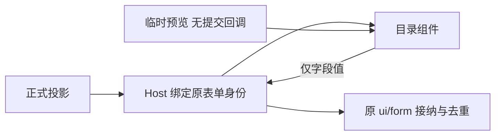
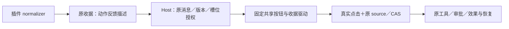

# Intelligent UI：技术方案

[功能与需求](../features/intelligent-ui.md) · [测试方案](../test-plans/intelligent-ui.md) · [主索引](../feature-map.md)

## 当前架构

具体需求是保持 OpenIntelligentUI 原生组件与设计系统作为基础，按同一生成式契约扩展 HTML/SVG、计算器、模拟与交互控件。当前消费者为 Main 的展示工具、Web 会话、非 Web 文字交付和重启重放。审批、冻结快照与消息来源去重继续使用既有领域机制。

上游固定为 `CopilotKit/OpenIntelligentUI@8391a94c1c3939c679e40ddd7bfc08a9ef690e70`。复用 DataTable、BarChart、PieChart、PlanCard、MeetingTimePicker、ExportOverlay 与设计系统源码；只适配本地导入、资源边界、减少动态效果偏好、导出脚本字符串转义，真实的选择接纳/恢复，以及 Steward 的展示样式。时间选择成功文案为 Time Selected，不把一次选择误称为外部日历预约。

没有引入上游 Python Agent、CopilotKit 服务端或第二套任务状态机。Steward 的持久执行与交付是机制；具体组件选择、紧凑布局和按需加载是当前策略。Web 适配器为私有实现；本次不稳定化通用跨产品 UI 框架。

## 插件迁移（私有实验）

历史 Host 读者和随包发布的 [隔离服务](../../internal/plugin/intelligentui/plugin.go) 各自编译同一份 [v1 文档协议](../../internal/delivery/uidocv1/document.go)。它只包含既有组件字节结构、目录规则、模型声明和空脚本规范化，复用 `encoding/json` 与工具校验器。插件仍按冻结图执行自己的文字组合、投影和表单策略，Host 仍独立绑定身份、接纳回执和执行授权。未来插件可选用新协议实现，已封存的旧执行体和历史 Host 读者继续使用原版本。现有 [私有契约](../../internal/plugin/intelligentui/contract/contract.go) 仍通过 `input.read` 读取不可变文档，保留工具的 64 KiB 参数上限。

候选 1.1 的私有定义服务提供原展示 Schema、简明模型声明、工具说明及两份声明资源的摘要。沙箱脚本与样式在封存包内；Web 读取适配从原组件的冻结图定位同一包，把服务声明的名称／摘要与该包清单及实际字节核对，不能直接信任候选自报摘要，也不能从当前活动版本替换旧组件资源。定义服务不授予 Main 权限、原件读取或动作能力；真实托管页面的换版／回退及主循环规范化调用仍需完整集成验证。

工具声明复用现有 capability 创建前的事务外投影与隐私重试栅栏：只缓存按图固定的纯定义，创建快照时冻结 Schema、模型声明、说明和原包摘要。托管服务撤下后，新快照移除该工具，不恢复原生默认声明；已有 Run 的 Registry 从原 capability 恢复这些特性元数据，权限、重放、曝光和执行分发仍由 Host 校验。定义与规范化服务必须属于同一包、同一实例，Schema 继续通过现有 Registry 编译检查。本次未新增通用元数据框架或公共注册协议。

候选 1.3 开始通过已有 `skill` 清单资源封存 `skill/intelligent_ui/` 的方法文档、参考与模板。接纳后的 Skill view 先沿原 Run 图找到 UI 包，再按声明路径、封存摘要、同一文件描述符及 claim／隐私／Guardian 栅栏读取；不调用当前注册表的原生 UI reader，也不新增资源服务协议。Skill Library 仍负责路径选择，Host 不拥有方法正文。索引摘要从同一封存入口的 frontmatter 读取，复用原解析规则，仅为既有保留名称提供内部入口；不放宽用户目录命名。摘要与包身份经现有事务外投影冻结到 capability，旧 Run 的 Skill list 继续使用原索引；停用后新索引移除 UI 条目。声明、文字与正文／摘要的独立换版仍不能替代整个 renderer／默认发行验收。

历史 UI 包 1.0／1.1／1.1.1／1.2 未携带 Skill 资源，原 Run 可继续使用原嵌入 reader；只有这些具名历史版本允许此边界，较新包缺失文件必须失败。原 `internal/skill/builtin/intelligent_ui` 暂为默认30与上述历史消费者保留，删除条件是默认托管接入且没有历史消费者再需要它；不得作为新包的静默后备。新所有者正文位于 `internal/plugin/intelligentui/skill/intelligent_ui`，当前尚未完成旧正文清理；默认三十一包的构建／发现已加入候选分支，仍需真实发行与历史兼容验收。

插件内部模型也仅保留实际使用的文档字段与组件 `name/props`；删除复制而来的审批、消息、表单、原件、接纳状态以及顶层旧式可执行字段，避免把内部 Delivery 模型继续当作插件数据契约。

候选 1.5 将原生／扩展组件的文字摘要策略移入 normalizer，并在原 `rsi_call` 回执中保存逐组件文字。Host 只将已接纳文字绑定到原组件和正式表单／引用身份，不重新运行当前摘要策略。读取回执时同时读取其原图服务实例的包版本；只有具名 1.0–1.4 历史包继续使用旧摘要解释，新包缺少或错配逐组件结果直接失败。此为内部展示投影，不增加公开 SDK，也不允许候选提供审批／消息／表单身份。实时预览解析已由候选1.7的私有 `steward.ui-preview/1` 处理，原生 HTML／React renderer 的剩余策略仍须继续迁移，不能将摘要或预览提取等同于完整 renderer 插件化。

Host 严格解码托管文档的既有展示信封，仅接受标题、段落、替换引用、文字替代与组件 `name/props`；不直接解码任意内部 Delivery Component。插件不能返回审批 ID、消息 ID、表单 ID、接纳状态、原件引用或已有组件引用等 Host 字段，也不能构造审批卡片类型。表单／消息身份只在接纳投影时由 Host 绑定；嵌套 props 仍依其原展示／动作协议校验，不授予任意执行权。

Main 权限、replace 目标归属、原始引用、接纳事务、隐私／撤权、表单与动作的显式接纳仍属 Host。候选 renderer 脚本须留在现有 opaque sandbox；不能加载到已登录的 Host origin。实现、Skill 配方与 renderer 资源最终须随功能包一起版本化，已发布组件须保留其原实现／资源身份。

沙箱运行库源码已归入 `internal/plugin/intelligentui/view/widget-runtime.js`，原路径删除；兼容 Web 构建直接编译这一份源码，显式保留原严格模式，并以生成资产逐字节校验维持当前消费者。这里只完成源码归属，不等于 renderer 已随包封存、按原图读取或独立换版。

托管交付、组件投影与气泡分组读取原 Run 图中规范化服务实例的持久回执，使用当次已接纳的 `Readable`，不调用当前插件或 Host 的原生文字组合策略。回执与存储文档须匹配，缺失或错配不得退回原生解释；仅迁移前 Run 使用原生历史解释器。状态与动作入口也使用同一原图回执及原有 Main／已发布／账户授权；迁移前交互仍用原解析器拒绝旧式可执行 HTML。托管包只能交付既有组件信封，Host 拒绝顶层旧式 HTML／CSS／JavaScript 及空组件信封，不能靠回执声明赋予旧格式交互权。此处仍复用既有组件结构，不开放新公共组件协议。

历史原生 renderer 的两份资源固定在 [legacy-ui/v1](../../internal/interaction/web/legacy-ui/v1/README.md)，与迁移前默认30发行逐字节相同；Host 不再嵌入当前 `assets/widget.*` 作为原生后备。当前生成资源只供包构建，改变新 renderer 不会重生成旧资源。此保留仅覆盖原 Run 托管边界为假的历史引用与显式无包嵌入方，消费者退休后须连同读取分支一起删除。

资源读取复用 `ui_widget.run_id → rsi_run` 的不可变关系，不新增重复版本列。`WidgetSource`／`WidgetView` 仅是 Host 内部读取数据，不是 HTTP 或公开 SDK。资源服务与规范化服务必须来自同一绑定；实际文件通过该包的声明角色、封存摘要及同一文件描述符重新校验，读取后再检查原组件归属和 Guardian。托管资源缺失、错配或失败不加载原生嵌入字节；原生路径只由历史 Run 的服务边界选择。

实际展示工具已增加按 Run 边界调用的候选分支：事务外完成规范化与定义调用，复用既有 `rsi_call` 持久回执；提交时复核原参数、claim、隐私与 Guardian。已 staging 的恢复复用原文档，已发布资源读取原定义回执，不现场执行插件。该分支已验证真实托管 Main／Code Mode、Skill／预览独立换版及默认三十一包展示／交互；当前1.9.0默认三十一包的真实浏览器展示／表单／状态／动作及 SIGKILL 恢复亦已验证；这些定向系统场景不替代完整软件／发行门禁。原生 renderer 及其他未迁移业务仍有真实默认消费者；原生答案解释器仅服务未绑定 `steward.ui-form/1` 的历史 Run 和原 form-v2 协议。托管接入当次删除被替代的当前实现，只保留具名历史消费者需要的兼容解释器与资源。已拒绝原生代理、通用 view DSL、在 Host origin 执行候选脚本，以及把文档解析提取等同于整个 F-021 迁移完成。

预览的真实消费者是模型 JSON 前缀、Code Mode staging 和已接受 staging 的恢复。Loop 仅调用 Store 的内部投影口，SQLite 按原 Run 的 `steward.ui-preview/1` 边界调用只读服务，不在写事务中启动进程，也不写入持久调用或执行 Trace。迁移前 Run 保留原解析器；托管口失败不恢复原生解析。Host 独立限制非执行信封、条目数与公开文字，拒绝动作及身份字段，移除脚本字段与未发布图片引用；顺序、会话和取消仍由 Host 持有。预览会话私下保留原 Run 身份，HTML 外壳从该 Run 的封存预览包读取 `ui-sandbox-styles`，而不是读取当前构建资源或活动选择。读取不执行插件，并复核账户、Main、隐私 epoch、图和实际文件摘要；旧 Run 尚无预览服务时沿其原规范化包定位。托管样式缺失明确失败，原生历史会话才使用固定资源快照。Run 身份不进入预览 JSON，Host 继续持有 nonce 授权的非执行 DOM updater。

模型流现只提交有界的最新前缀快照，单一后台任务按首次出现的调用顺序投影，同一调用的新快照替换待处理旧快照。生成结束／取消会取消并等待任务退出，再进入后续阶段，丢弃尚未投影的过时草稿；最终内容由 staging 的规范产物承接。该调度仅为隔离服务的延迟与生命周期所需，不新增执行队列或持久任务。阻塞投影器测试已覆盖不阻塞模型提交、跨调用保留最新前缀及取消后无迟到事件；真实流式浏览器性能仍须验收。

## 原生展示的剩余边界

**可执行视图的导航隐私边界尚未闭合。** 当前 opaque iframe／CSP 能限制 fetch、资源和提交，但真实浏览器中候选脚本仍可通过自身 location 导航发出带合成数据的请求。不能把 connect-src none 或既有功能／生命周期通过等同于完整无网络隔离；Cards 的这一隐私验收重新打开，所有允许候选 DOM 脚本的视图还需同类检查。没有实际用户数据参与该复现。

实际消费者是 `projections.tsx` 的原生组件目录、跨组件 `InteractionGroup`、CAS 视图状态与 `/ui/form` 提交。表格排序／过滤、图表联动、布局和前端目录的剩余业务实现仍在 React Host 中，须继续迁入封存 renderer 资源；不能把目录移动或增加清单当作完成。候选脚本继续在 opaque iframe 中执行，状态只能操作该宿主绑定的组件／交互组，动作和表单仍经现有显式接纳路径。

无脚本 HTML 的非交互分支已只转义渲染冻结组件文字：1.8 独立测试包改变文字后，旧／新／回退执行的 HTML 实际使用对应回执，脚本字样仍为转义文本。固定转义器与携带 Host 消息／表单身份、既有提交地址的控件属于实际安全机制，保留在 Host；候选不提供 Host origin 的可执行 HTML。托管表单的答案措辞现由1.9.0候选产生，恢复读取同事务接纳事实；旧解释器只服务具名历史边界，不能借“安全控件”名义恢复当前业务分支。

最小开放面为现有展示协议、原 Run 的封存资源与已有受控状态／动作桥；不稳定化新公开前端 SDK。当前必须保留排序／过滤／联动、原状态版本、原件引用和原表单身份，逐项接通真实浏览器后再删除被替代的默认分支。共享字体、布局、全局控件与第三方署名仍遵守设计契约。

## 工具与组件契约

模型输入为 `title`、完整 `fallback` 与 `components:[{name,props}]`。上游原生名称与参数如下：

| name | props |
| --- | --- |
| Table | title、columns、rows、source |
| barChart / pieChart | title、description、data:[{label,value}] |
| plan_visualization | approach、technology、key_elements |
| scheduleTime | reasonForScheduling、meetingDuration、timeSlots、可选 title |
| generateSandboxedUi | initialHeight → placeholderMessages → css → html → jsFunctions → jsExpressions |

Table 保留上游 12 列、200 行和来源要求；图表限制 200 点、有限数值，饼图拒绝负值与非空零总和。候选时间必须显式提供且不得重复。Host 另外限制字符串、工具输入大小、组件总数和可回答组件数量。这些是资源与交付所需约束，不是另一套展示语言。直接 UI 调用与 Code Mode 同为 64 KiB 的参数上限，匹配工具校验与 Bridge；其他普通工具仍保留 16 KiB。生成式六字段虽允许较大 HTML/脚本，完整 JSON 仍须处于同一有界信封，不能靠切换调用方式绕过。

执行和 Code Mode 使用完整逐组件 oneOf Schema，组件名决定 props 的实际字段和类型。高频直接声明则提供简明参数类型签名及包络，避免全部目录常驻导致 8K 模型的普通 Main 对话超预算；复杂视觉按需读取 Skill 的展示决策、设计与配方。InputSchema 仍是完整执行校验；可选 ModelInputSchema 仅是冻结的模型展示元数据，与曝光范围一样在 Registry.Select 中沿用原快照，不改变权限或执行参数。老快照省略此字段时按原 InputSchema 声明，工具续轮不读取活目录替换旧声明。这是当前 UI 消费者所需的私有表示分离，不开放新的工具调用 API 或动态路由框架。旧 markdown/table/progress/form 与顶层 html/css/javascript 输入明确拒绝。普通对话仍按 Markdown 展示，这不构成 UI 工具输入。

内建 Skill 合并到冻结目录后，读取工具沿用普通目录的描述，即使没有配置本地目录也不能声明为空。此修正只影响新执行的能力元数据，不预载方法正文，不改变历史冻结声明、读取授权或展示协议。

## 同轮修正与常见绘图能力

具体需求来自真实同题输出：费用题修正绘图代码后两份组件同时交付，增长比较缺少廉价的共轴表达，三维生成存在主题和中心坐标误用。消费者仍为 Main、Web 渲染、非 Web fallback 与持久回放；展示选择与是否读取方法由 Agent 决定，不增加预览自检工具或前置分类器。

`show` 的可选 `replace` 接受前一次成功回执的精确 `ui_ref`。目标必须属于同一 Main Run、尚未绑定回复且没有其他有效修正占用；不可用目标返回 NOT_FOUND。新产物保存完整文档与替换关系，旧产物和调用参数不变；成功回执派生有效叶节点，只有这些节点绑定到回复。并发修正不能从同一目标分叉，重放复用同一 invocation；原生一答多图仍通过省略 replace 表达。这里的版本归属和保留证据是正确性所需，不引入草稿 CRUD、迁移或历史消息编辑接口。

`steward.lineChart` 保留原单序列 data，增加互斥的 `labels` 与 `series:[{name,values}]` 以及可选共同 `unit`；最多 6 个唯一名称序列、200 个标签，各序列数值数目与标签一致。React 使用同一 Y 轴、图例、提示和带单位的 CSV；非 Web 替代包含每个序列值。没有引入公式 DSL、自动推导指标或新的上游组件语义。

沙箱内的 THREE.SVGRenderer 在没有显式背景/clear color 时跟随宿主主题。私有 `StewardSVG.resize(renderer,camera,element)` 使用容器实测尺寸并更新透视相机；`project(vector,camera,renderer)` 返回 SVGRenderer 中心 viewBox 中的标签坐标，不修改原向量。此实验性接缝只服务已有几何消费者，场景、坐标约定、内容选择仍归生成内容；不开放宿主 DOM、网络或工具权力。Agent 通过 show 的明确 skill_view 入口按需读取这些契约，不将全部方法预载到 system。

## 持久化与交付

`ui_widget` 保持按工具 invocation 唯一保存不可变输入。成功产物在 Main 回复准备事务中绑定确切消息，Delivery 冻结投影，GET 不创建产物。Web 仅在冻结内容与绑定工具产物精确匹配时，按产物顺序分泡，再显示单独最终文字；原快照不被改写。

scheduleTime 的候选选择通过既有 `/ui/form` 接纳边界转成普通用户意图。身份由确切消息、组件位置与冻结参数生成，客户端只能选择候选下标或拒绝；字段、越界选择、身份漂移及已接受答案的变更均拒绝。并发重试与丢失回执复用同一来源，刷新/重启从已接纳内容恢复，不制造审批或外部预约。无脚本页面提供同一候选选择的固定宿主表单。

Web 更新保留同一投影的 React 根和子组件，变化的响应元数据原位重渲染；原生选择完成不销毁邻近沙箱、重置其局部控件或覆盖宿主草稿。

## 扩展协议与沙箱

generateSandboxedUi 保留上游六字段及 classic-script 函数/表达式语义。宿主产生完成态 `type:open-generative-ui` activity，content 使用 initialHeight、generating、css/cssComplete、html/htmlComplete、jsFunctions/jsFunctionsComplete、jsExpressions/jsExpressionsComplete；HTML 在 activity 中为片段数组。正式 activity 仍在工具与回复提交后交付；生成过程另有可撤销的受控预览，见下节。不承诺跨调用 DOM 增量修改。

沙箱注入上游 THEME_CSS、SVG_CLASSES_CSS 与 FORM_STYLES_CSS，并复用宿主的字体与语义主题令牌。原生组件采用紧凑标题、中性表面与暖色图表，移除演示用装饰和重复外层卡片；共享控件皮肤限定在沙箱根类，不另建组件协议。Inter 字体从已有本地资源内嵌为 data 字体，CSP 仅额外允许 font-src data:，不开放字体网络访问。主题显式跟随宿主，生成 CSS 只补具体布局。ResizeObserver 报告实际 body 高度，宿主检查有限数值并限制在 50–4000px，避免过去 1000px 截断引起的嵌套滚动。跟随最新消息时，高度变化继续保持底部；正在操作组件时不抢滚动。展开仍属于宿主，可用 Escape 退出。正常渲染不显示 Text version 入口；失败时显示一次完整文字替代，无脚本渠道保留既有替代。宿主提问操作行使用可换行的 flex 布局与明确 gap，沙箱模板按共享 actions 组排列按钮。

宿主在生成 CSS/HTML 之前安装 `Websandbox.connection.remote.sendPrompt({text})` 与 `openLink({url})` 适配器。只接受确切 iframe Window、opaque origin、固定协议和有界参数。sendPrompt 提出可编辑草稿，用户显式发送；已有草稿和不确定发送的来源不被覆盖。openLink 只提出无凭据 HTTPS 链接，用户在宿主打开。沙箱不能直接访问工具、宿主存储或审批；状态和已声明动作由下述宿主边界处理。

CSP sandbox 与 iframe allow-scripts 保持 opaque origin；禁止父 DOM、宿主存储、外部网络、子框架、表单动作与媒体权限，初始化先禁用 Worker/WebRTC 构造器。直接导航仅返回文字替代。D3 7.9.0、Three.js 0.181.2（含 SVGRenderer）和 Natural Earth 4.1.0 / world-atlas 2.0.2（1:110m）地理数据通过独立构建产物作为可信脚本注入最终沙箱，不进入 Host 主包；不增加模型输入字段或允许 CDN/importmap。构建时收集所有传递依赖的许可证，保留上游归属。原生图表依赖继续固定打包。GEO.countries 提供 GeoJSON、GEO.source 提供可见署名，topojson-client 3.1.0 只负责本地格式转换；离线粗略底图不代表当前边界、道路或实况。每个最终沙箱加载本地库的成本用于换取自由图形组合；无脚本预览不加载库。旧自定义 HTML 与旧组件只保留历史文字替代，不执行历史代码；不删除或重写数据库记录。

展示选择是 Main 的当前策略：比较、趋势、机制、空间关系和参数场景主动考虑视觉，按问题匹配原生组件或生成式图解，简单事实仍用文字。上游由 Runtime 注入多个带类型的渲染工具并由 Jev 逐轮选择；Steward 保留单一 typed show 包装与已有 Main，不加入额外路由模型。两者复用组件/六字段/完成态接口，不等同于复用全部 Agent 或流式执行实现。选择保留现有执行/持久化而不整体引入 CopilotKit/LangGraph，以免产生双重调度、内存检查点或第二个模型入口。流式预览位于冻结最终交付之外，不新增持久协议。

## 阅读与关系图底座

具体证据是同题中文回答出现未渲染的 `**调用与回传：**`，流式文本每次整体替换 DOM，以及异步 iframe 增高后重新用像素距离判断跟随、从而丢失读者意图。消费者仍为普通 Chat Markdown、公开图文正文、直接预览和正式沙箱；不改动模型执行、工具授权或持久化契约。

| 参考实现 | 采用的机制 | 当前边界 |
| --- | --- | --- |
| [Streamdown 的分块解析](https://github.com/vercel/streamdown/blob/072ce7ead33a5e932c85b6e8f06cf83cc0f64191/packages/streamdown/lib/parse-blocks.tsx)、[remend](https://github.com/vercel/streamdown/tree/072ce7ead33a5e932c85b6e8f06cf83cc0f64191/packages/remend) | 未完成 Markdown 的临时显示修复；保留已完成 DOM 节点 | 使用独立解析包，不引入其 Agent SDK；不把补全后的字符串保存到消息 |
| [CJK-friendly](https://github.com/tats-u/markdown-cjk-friendly/tree/main/packages/marked-cjk-friendly) | 正确处理中文标点旁的强调，保留代码与转义语义 | 仍由现有安全渲染器处理链接、图片与 HTML |
| [assistant-ui 的消息身份](https://github.com/assistant-ui/assistant-ui/blob/f9dbafab250c8ac315bfc010a30dfff62320a423/packages/core/src/utils/getMessagePartKeys.ts)、[滚动意图](https://github.com/assistant-ui/assistant-ui/blob/f9dbafab250c8ac315bfc010a30dfff62320a423/packages/store/src/utils/thread-viewport-auto-scroll.ts) | 稳定节点与明确用户上滚优先 | 在 Steward 文档滚动面自主实现，不复制运行时或改变消息来源 |
| [use-stick-to-bottom](https://github.com/stackblitz-labs/use-stick-to-bottom/blob/8d6a19a0ca6ab632830588073e6a29312a06a088/src/useStickToBottom.ts) | 保存跟随意图，由 ResizeObserver 响应内容异步增高 | 不加入弹簧动画或第二个滚动容器；上滚、选择文字和控件交互优先 |
| [Dagre](https://github.com/dagrejs/dagre) | 有向图的分层布局、节点中心及边的折点 | 本地 `dagre` 只在沙箱可用；Agent 提供真实节点和关系，配方按宽度重排并换行标签 |
| [A2UI](https://github.com/a2ui-project/a2ui)、[Tambo](https://github.com/tambo-ai/tambo) | 参考受控组件、稳定身份与生成／交互状态分离 | 保持现有 show／不可变历史，不引入跨产品表面协议、可变历史或第二套 Agent 调度 |

机制归 Web 私有实现；Dagre 全局是随本地库固定版本提供的实验性沙箱能力，未承诺跨产品布局 API。内容选择、是否分镜、是否采用计算器或图解依然由 Agent 决定。只增加三个有真实消费者的解析／布局依赖，保留许可证；不建立通用场景编辑器、自动审美评分或强制讲解工作流。

临时 Markdown 在清理之后沿共享 DOM 更新器协调节点；保留未变文字的身份、选择和阅读位置。正式 Markdown 不执行格式补全，原始消息、模型请求和冻结回放不变。只有在正式内容中增强 Mermaid，不对流式半成品反复执行图形渲染。

公开正文与标题的预览限长按 Unicode 字符计数，与执行 catalog 一致；字节总量仍受快照资源上限限制。恢复暂存展示时一并读取私有接纳排序键，后续并行区块即使逆序完成，也不能改变讲解顺序；该键不进入浏览器或模型协议。

尺寸变化时，浏览器可能将 ResizeObserver 通知延后到下一帧。沙箱只将无异常对象且消息精确匹配的这类浏览器通知视为可继续布局；实际脚本异常（包括使用同样消息的 Error）和未处理拒绝仍触发原失败替代。该区分不扩大生成代码权限。

Chat 的跟随状态由用户滚动意图持有，不能在内容增高后被“距离底部变远”重置。异步内容大小变化由一个文档级观察者处理；向上滚动、选择文本或操作组件时不自动追尾，即便还在底部阈值附近。点击 Latest messages 或主动回到底部后继续跟随。Widget 只报告尺寸，不再自行抢滚动。

## 图文顺序与连续呈现

需求来自同题生成过程：文字草稿和 UI 预览分区，沙箱随 revision 重新导航，最终固定先图后文。消费者为 Main、Web 答复、非 Web 替代和历史重放。现有 show 增加可选 text（最多 8192 字符），明确发布紧邻此视觉之前的 Markdown；省略仍保留原行为。它是每份展示的正文，不是捕获工具前临时文字的新规则，不新增展示工具或分镜 DSL。显式图文区块按冻结模型轮次、父调用接纳序号及嵌套接纳顺序排列，并行执行完成先后不改变表达顺序，末尾保留最终回复。

当任一展示带 text，PrepareReply 把每份正文与 fallback 合成有序的 Conversation 文本段，最后附上最终文字；Web 只在冻结投影与绑定文档逐项匹配后拆成正文／视觉交替的气泡。未带 text 的旧调用、历史投影和旧请求仍沿原布局，组件引用和已提交表单身份不随正文插入改变。GET 不改写历史或持久状态。选择解释几段、何时展示及使用何种形式仍由 Agent 决定。

渲染机制先解决连续性：只有完整 CSS 才展示生成中的 HTML；同一预览 iframe 与带 id 的节点跨增量保留；直接调用沿模型轮次与 provider call 的联合身份衔接参数流与暂存，Code Mode 沿 invocation 身份，失败调用明确撤下对应临时图。宿主从原授权 GET 读取清理后的快照，再发送给框内唯一的宿主更新器。iframe 保持 opaque origin；CSP 仅授权随机 nonce 对应的宿主脚本，无外网、存储桥或工具，生成脚本和事件处理器不会进入预览。更新器只接受 parent 的匹配身份、单调 revision 与有界快照，修改已清理的 DOM。该私有机制不开放给模型，不提前执行未完成的函数或表达式。

正式沙箱保持既有完整校验／持久交付边界。正式内容安装与恢复期间保留最后安全预览，正式实例 ready 或进入失败替代后一次切换，避免先撤预览后留下空白。预览 iframe 更新与正式交互实例分离；没有跨调用局部编辑、场景状态机或历史补丁 API。逐步几何、动效和讲解节奏仍由生成内容表达；不强制所有问题分步或动画。

## 流式预览与正式交付

历史入口和随包发布的预览服务共享 v1 JSON 前缀解析。解析只产出有界显示草稿。两个入口各自校验组件，托管服务仍按冻结图运行，只有 Host 能接纳交付或动作授权。[前缀解析](../../internal/delivery/uipreview/prefix.go)

新展示输入只将 `generateSandboxedUi.props.jsExpressions` 的精确空字符串规范化为 `[]`，随后仍经过完整 catalog 校验。该兼容仅用于无表达式的静态内容，不转换非空代码字符串、null、对象或其他字段。ToolInvocation 的原始参数与请求哈希不变；独立 UI 产物及 staging 预览使用同一规范文档，正式投影、沙箱与重启恢复均读取该文档。其他校验失败继续返回经统一工具层清理的 INVALID_ARGUMENT，不回传输入值；Skill 明确各空字段类型。历史冻结请求、交付投影和失败调用不重写，不新增 schema 或公共组件协议。

具体需求是让 Web 用户在模型生成 UI 时看到逐步到达的内容，覆盖 Main 直接调用与 Code Mode 嵌套调用。消费者仅为当前已授权的 Web 会话；非 Web 渠道、历史消息、审批和持久重放仍使用原有正式产物。预览是私有、可丢弃的适配器状态，不是工具完成回执、表单身份或稳定公共协议。

直接调用时，Provider 为工具参数增量附带调用身份；Bridge 在客户端通过内部 RPC 参数显式启用 `ui_preview` 时，才将 `builtin__intelligent_ui_show` 的参数按大小/时间合并为 `ui_delta`（旧 v1 客户端不接收新事件；旧服务端可继续使用暂存后的预览；该选项不进入冻结 GenerationRequest），其他工具参数、Code Mode 源码、推理与 Worker 内容不进入浏览器。Loop 对 JSON 前缀做有界解析，仅采用完整的数组项；当前组件对象及 HTML/CSS 字符串可逐步展开。表格行、图表点和卡片仍由原 catalog 校验；缺失的标题、来源等元数据暂为空，不补造数据。表单/时间选择仅在完整参数通过校验后显示；所有预览控件均 inert，不可聚焦、提交、导出或触发动作。可选公开 text 随同一快照显示，生成中的 CSS 字符串必须完整后才绘制。

Code Mode 不解析或提前执行流式 JavaScript。既有沙箱实际调用 UI 工具、宿主验证并完成 staging 事务后，context 中的进程内观察者通知同一个预览通道，无需等待 Code Mode 返回或最后的文字回复。该通知不改变 ToolInvocation 终态提交顺序。恢复等待中的 Main 时，在当前 claim 下只读重新投影已成功且未绑定回复的 UI 产物，不重新执行工具。staging 成功而工具结果提交失败时，预览可撤销，恢复仍沿用原幂等产物。

Web 复用 `/api/conversation/stream`，新增 `ui-preview` 快照事件。会话与绑定校验、定期撤权检查及写超时与文字流相同。关联键由宿主匿名化，浏览器收不到 Run/Invocation ID 或原始参数。当前预览最多16份，含未广播私有视图资源的序列化合计至多2 MiB；单份 JSON 前缀至多128 KiB，正式工具接纳仍限64 KiB。大小、合并频率和默认高度是当前资源策略，不稳定化为模型输入或跨渠道契约。慢客户端直接读取最新快照，重连可重建当前预览，不积压事件队列。

原生组件复用已有 React catalog 和主题。生成式 HTML/SVG 从同源只读 `/ui/preview` 读取当前匿名会话的内存快照；默认返回预览外壳，format=json 返回已清理的最新显示快照。服务端用已有 HTML 解析器仅保留展示节点，清理脚本、事件属性、导航、嵌入内容和保留的宿主节点身份。外壳只执行随机 nonce 授权的 Steward 更新器；iframe 和 CSP 均只允许该脚本能力，保留 opaque origin，禁止生成代码、外部网络、表单与 base 变更。快照经 parent postMessage 更新原 DOM；不放宽 Host CSP，也不使用继承宿主样式限制的 srcdoc。直接页面导航只得到文字标题，预览结束后的地址返回 404。JS 函数/表达式、动作声明及正式提交身份不会进入预览。正式交付后仍由现有沙箱安装 Websandbox、恢复状态并执行通过校验的完整脚本，既有宿主确认与审批保持不变。

取消、失去执行权、失败、等待或退出执行时撤下预览；迟到事件不能复活已结束的会话。临时参数预览在生成结束时撤下，由实际 staging 的内容接续。`DeliverReply` 成功后发送提交关联键，前端等权威历史中的对应正式消息出现再移除预览，避免重复气泡。浏览历史且暂缓加载最新消息时撤下已提交预览，沿用原新消息提示。断线、隐藏页面与撤权清空本地临时视图；最终交付和已保存交互状态继续可恢复。所有预览增量与生命周期事件均不写 RunTrace、Checkpoint、Conversation、Delivery 或 Outbox。

保留完整 JSON 校验、执行 fencing、资源边界与禁用交互属于正确性所需复杂性；拒绝第二套执行器、部分 JavaScript 执行、任意工具参数透传、持久化每个 token 和通用跨产品 UI patch 协议。当前只开放已有组件契约与受控展示观察点，不稳定化解析器、DOM 差量或预览存储格式。

## 交互状态与 Steward 扩展

具体消费者为原生表格/图表/表单、卡片轮播和生成式沙箱。它们需要刷新恢复、向 Main 提供当前选择，以及使用现有工具结果更新视图。展示产物不可变、输入快照不可变、执行与审批继续归 Run/ToolInvocation 是不变量；组件目录、过滤规则、最近八份上下文与展示模式是当前私有策略。冻结的 `ui_state` 明确说明内容来自已保存组件，可能属于旧话题，不表示活动页面或当前请求主题；不从更新时间推断用户焦点。此说明只进入新接纳的输入快照，历史快照保持原文。

保留六个上游名称和原始 props，新增五个显式前缀名称：`steward.lineChart`、`steward.scatterChart`、`steward.form`、`steward.cards`、`steward.action`。它们沿用 name/props 容器，不声称是上游原生组件。折线/散点图使用有界数据；表单字段为 text、textarea、number、date、email、select、multiselect、boolean；卡片图片只接受当前授权 Artifact，链接仅 HTTPS。完整逐字段校验在 UI 工具边界，类型/候选/范围也在回答接纳时复查。

`ui_view_state` 保存组件私有 JSON 和独立的小型模型上下文，按确切产物引用和组件位置授权，使用版本 CAS。状态至多 16 KiB、模型上下文至多 4 KiB，限制深度与节点数。保存不会生成 Run 或改写冻结投影。标准输入和 output 按稳定键自动恢复；自定义绘制状态使用 getState/setState。客户端将同一组件写入串行化，保存冲突保留本地值并显示错误，不覆盖其他窗口。新用户消息接纳前采集当前控件、排空待保存数据；接纳事务把最多八份、总计 16 KiB 的当前上下文冻结进 `main_ui_context`，作为该输入的 scoped evidence 进入既有 AgentMessage。后续更改不影响已经接纳的生成，历史记录与 system 规则不被重写。

`steward.action` 冻结动作 ID、用户标签、工具名、默认参数及可选绑定。绑定只通过 JSON Pointer 读取同一产物内其他组件的已保存状态，在接纳事务中填入指定参数；不支持表达式、任意引用或客户端传入工具参数。解析后的参数再次按该 Main 的冻结工具 Schema 校验，并随请求不可变保存，重试不重新绑定后来的状态。宿主按钮接纳普通用户意图，验证当前 Main 工具目录与精确参数，关联 `ui_action_request`；既有 Actor、模型、ToolExecutor、审批、取消和重放继续执行。API 只回传该输入步骤范围内、工具名与规范化参数匹配的真实持久结果；没有执行时返回明确失败，不能把 Main 的普通文字当成工具结果。丢失 HTTP 回执复用同一来源，刷新继续查询既有请求。轮询读到的持久回执优先于迟到的 POST 成功或错误；网络确认不能覆盖已知结果、误示重试或回退到 pending。生成代码的 callTool 只提出同一产物内已声明动作，由宿主按钮确认发起；iframe 消息无法伪造用户点击或审批。该请求机制不承诺模型必然执行所提工具，也不暴露通用工具 RPC、任意参数或执行权。

动画造成的 DOM 几何变化不反复保存相同的控件/输出/自定义状态；显式状态和输出变化仍经原 CAS 保存。原生柱状图按类别数量与名称长度选择横向排列，较大数值刻度使用紧凑格式，提示保留原值；折线采用直接连接，避免无证据平滑。

表格支持数值排序、筛选和选择；同一产物内表格/图表共享分类选择与查询，图表可按范围探索。表单草稿自动保存，已接纳回答从现有渠道来源账本恢复；无脚本页面复用同一 typed Answer 校验和原生提交。卡片采用横向轮播和选择。宿主菜单集中筛选、重置、CSV、SVG、PNG 及适用的 HTML 快照导出；CSV 处理公式前缀，图形在本地导出，不加载远程库。HTML 导出为当前展示快照。

展示容器保留同一 DOM/React 根，提供 inline、fullscreen、原生 dialog 和悬浮视图；模式变化不重新挂载 iframe。浮层复用共享菜单，表单复用共享 Select/控件皮肤；关闭和 Escape 恢复焦点，移动端保持触控尺寸。页面只保留内容、控件和必要状态，不展示功能介绍、实现说明、权限教程或重复文字版本。

迁移 45 新增独立状态、输入上下文和动作请求表，不修改现有消息、交付或调用记录；旧二进制不能打开升级后的库。这里的复杂性用于并发、来源归属、恢复和真实工具结果关联；拒绝直接从 iframe 调用提供商、按组件复制执行器，或把任意 JS/组件内部状态稳定化为公共 API。当前扩展与桥接均为 Steward 私有契约，后续组件只按真实复用需求提炼。

## 升级与完成判定

旧 `steward-result` 文本协议不再解析，普通文字不会产生组件。不热改旧快照，不为旧多段 Prompt 提供恢复分支；升级前结束或取消旧执行，使用新 Run。保留历史数据，不重写已接受请求或不可变投影。新 schema 数据库不能由旧二进制打开。

UI 是用户交付而非 Task 完成证明。进度只是已知事实摘要；表单和 Widget 提问均不批准外部动作。非 Web 渠道和无脚本页面保留语义替代。真实模型的工具选择、审美和数据解释质量需独立评测。

## 代码与依赖

- [UI 工具和契约](../../internal/delivery/ui/widget.go)
- [持久化与消息绑定](../../internal/agent/sqlite/ui_widgets.go)
- [Web Sandbox](../../internal/interaction/web/widgets.go)
- [React Widget](../../web/src/widgets.tsx)
- [内建 Skill](../../internal/skill/builtin/intelligent_ui/SKILL.md)
- [系统回归](../../tests/system/verify_intelligent_ui.py)

#### 4.2 统一的渠道无关输出

Main 的语义文字、UI 工具的展示产物与完整文字替代通过同一 Conversation/Delivery 生命周期交付。Web 提供原生组件与隔离交互，飞书与 TUI 保留可读替代；具体外部动作继续使用原审批管线。

## 组件呈现与全局控件

OpenIntelligentUI 名称/参数和持久交互契约保持；Field/Input/Card、图表容器和提示框采用 shadcn/ui 的使用子集，控件映射现有字体与语义主题。全局 Base UI Select/Combobox/Menu/Button 同时服务设置、任务、开发者页面与会话组件。原生表格补齐数字对齐和选中/悬停，图表使用轻量网格、无轴线刻度和紧凑提示框；表单的日期/数字字段仅在组件内部空间足够时并排。页面导航、内容列、字体字号和气泡不由组件库接管。

沙箱保留现有权限与协议，共享控件样式对齐宿主；不会把无权限生成代码变成宿主 React 组件或开放网络库加载。

### 超宽内容

沙箱根滚动视口允许横向溢出；自身声明 overflow:auto 的生成区域保留内部滚动。宿主隐藏这些区域的常驻滚动条，只给实际溢出且尚无交互焦点的区域补键盘焦点。尺寸、内容和主题变化重新判断溢出，不重建 iframe。原生表格和卡片列表同样隐藏滚动条。保留浏览器滚动机制，不引入拖拽状态机、不拦截纵向滚轮，也不修改 OpenIntelligentUI 的内容协议。

### 数值横轴

同题费用曲线曾把 0、1000、10000 视为等距分类，从而扭曲线性费用的斜率。现有 steward.lineChart 扩展增加可选 xValues，只用于多序列表示，保持标签、数值和实际坐标逐项对应；省略时保留原分类轴与历史渲染。Host 与前端同时验证长度、有限范围及严格递增，绘图使用 Recharts 数值轴，CSV 与 fallback 保留坐标。该字段是现有私有扩展中的独立轴语义，不新建图表协议或展示工具。拒绝从标签字符串自动推断数值／日期类型，也不强制计算器或数据采样策略。

### 表单策略迁移中的独立基线

实验包 1.9.0 增加私有 `steward.ui-form/1` 纯策略：接收组件名称、展示属性和答案文本，返回文本片段、恢复值或错误码；不接收 Run、消息、Form、审批身份，也不产生入站消息。31 个预先捕获的原生 Answer/Restore 样本覆盖字段约束、文本规范化、预约选择及恢复冲突，摘要记录在插件 testdata 的 provenance 文件中。Owner 验证加入独立固定的预约样本。

应用提交／恢复已接通托管路径：`Runs.AcceptWebForm` 从原 Run 图选择与文档规范化相同的实例／包，在写事务外读取纯答案策略；Host 仅把有界文本片段变为普通入站内容。候选输入不携带消息／表单／Run 身份，不授予审批、工具、状态或外部效果能力。RPC 只支持产生答案；恢复直接读取已接纳事实，不另设现场执行的 restore RPC。

schema70 的私有 `ui_form_answer` 随既有 `main_input` 在同一事务中写入冻结图、输入摘要和答案／恢复值，失败接纳不留下 pending 或占住问题。它属于 Host，是因为去重、接纳身份及原结果持久性不能交给可替换策略；真实消费者仅为入站接纳、重复请求和已提交展示，不开放通用计划缓存。相同输入（含 CRLF/LF 规范化）不再调用候选；不同输入仍由冻结候选校验，既有 source ledger 决定冲突。恢复必须匹配实际已接纳文本，停用或执行设施缺失时不重算。接受结果随原始入站审计保留，不进入 Recall，也不能被候选写改。

当前显式用户提交使用开始时的隐私 epoch，而非旧展示 Run 的 epoch；候选读取输入及最终接纳均复核同一 ticket，期间 Forget 或 Guardian 停止会拒绝接纳。保留既有投影的隐私检查，不以缓存重建被撤销展示。

原生 `Answer/Restore` 的命名组件分支只服务原图未绑定本表单服务的历史 Run；原 form-v2 仍是独立未迁移边界。删除条件是这些消费者不再需要原解释。当前托管 Run 无原生答案回落。表单独立1.10换版、回退和停用后恢复，以及当前1.9默认三十一包浏览器场景已验证。原native30/schema69归档副本经当前 Store 升到schema70后，原记录逐项不变、两张已接纳表单与11个原 widget 引用可读；随后当前Host的真实HTTP与原交互浏览器亦验证这11个冻结资源引用、旧表单与状态在SIGKILL后恢复；保留原已离线模型端点，读取验证不要求推理就绪，也未改变原30包选择。其余 renderer、完整发行门禁与清理仍未完成，不标记整个功能迁移完成。拒绝第二套事务／pending 生命周期、通用表单框架和公共前端协议；该插件 seam 仍为仓库私有实验。

表单提交入口现通过私有 `WebFormBinding` 读取原投影，再由既有 WebBubbles 验证已接纳片段／顺序、绑定组件位置，最后核对已发布 Main 的消息、组件和冻结 Run 图。三个内容相同的表单分布在两个 widget 的真实执行回归证明它们保留不同身份；未知表单和非 assistant 输入被拒绝。匹配失败不保留中途赋予的引用，已跨表单迁移边界的展示也不能因丢失绑定而回落原生。该入口现在由托管接纳路径消费；原生解释器保留范围见上述历史边界。

构建只读取插件自有 `view/widget-runtime.js`；已删除无消费者的旧 `web/src/widget-runtime.js`，生成资产检查确认删除后字节不变。历史 native 资源仍在明确版本的 `legacy-ui/v1`，其实际旧归档消费者已验证，不能与无引用旧源文件混同清除。

### Renderer 的表单接纳前置拆分

当前实际消费者有正式 `projections.tsx` 和无交互的临时 preview。目录原来直接读取消息／表单身份并 fetch `/ui/form`；该 HTTP 代码已删除，正式投影中的私有 `BoundNativeAnswer` 绑定原身份、同源凭据和接纳回执，仅向目录提供 `SubmitFields` 字段值回调。preview 不提供回调，禁用／已提交组件也不能调用它。预约选择解释、字段校验和原十秒取消仍是组件策略，错误文案、地址和提交方式保持原义。

这是一条由两个真实消费者确定的仓库私有回调，不是公开插件协议；`NativeProjection` 仍是当前宿主内部展示类型，不能直接作为外部契约。身份／凭据／接纳属于必需机制，字段与预约含义属于业务策略。尚未建立封存原生 renderer 的资源加载和受控状态／动作路径，因此此拆分不算 renderer 迁移完成。拒绝通用 HTTP 代理、通用 view DSL、配置化路由和在 Host origin 执行候选脚本；此回调也不授权未来 iframe 自动提交用户输入，后续隔离资源仍须沿现有显式 Host 接纳边界。

### Renderer 的状态／动作 HTTP 归属（前置拆分）

真实消费者是原生组件、跨组件 InteractionGroup、生成式 iframe 的 Host 包装器及其可见动作按钮。`host-api.ts` 只实现四个固定适配：读取／保存原视图状态，发起／读取原动作；`SavedView` 和 `ActionReceipt` 类型由现有消费者定义。状态合并、每引用串行写入、版本推进和现有一百五十毫秒保存仍在原状态逻辑中；动作仍先 flush，再使用原 source_id 进入普通 Main，候选建议仍须由原 Host 按钮确认。旧模块中的重复 fetch 实现已删除。

此处没有可配置路由、通用 HTTP 代理、全局可切换 provider 或新的 RPC。HTTP 是既有接纳机制的适配；联动、筛选和组件如何描述状态仍是待迁入 renderer 的业务策略。它们当前仍编译在 Host client，未证明独立版本与插拔，不能把本次拆分记为状态／renderer 迁移完成。下一步的封存资源必须隔离候选代码，不得因适配函数集中而把 Host 网络能力传入候选。

### Plan 视图的私有垂直切片（未接通）

首个实际目标是目录中的 `plan_visualization`：正式目录与临时 preview 都以 complete 状态消费它，没有持久状态或动作权限。先在真实 Chrome 中捕获现有 React effect 执行后的 DOM（默认折叠，点击可展开），再实现插件内私有 `renderPlanView`：沿用原参数约束，返回固定模板转义后的 HTML 和原 Plan CSS。四项独立样本覆盖普通、空标题、危险字样及中文／补充平面字符；无消息、表单、Run、审批或引用身份进入该函数。

默认 UI1.11 已声明并注册私有 Plan 服务，正式与 preview 均使用同版本 producer，首次标准三十一包启动无需实验激活。此前1.9封存包不重封，旧 Run 仍按冻结服务集合保留原生边界。已验证原视图同事务接纳、按原 Run／组件读取、opaque frame 与原生详情、同版本 preview、响应式与明暗排版、独立升级／回退／停用；整个 UI 的其余有状态 renderer 仍未完成迁移。

选择这个切片是为一个真实组件建立最小视图链路；拒绝以它推演通用 view DSL、通用 iframe SDK、任意 HTTP 或新状态框架。后续有状态组件的联动、CAS、显式动作和表单接纳仍是原目标，不能以无状态视图的验证代替。

Plan 的生成路径使用私有 `steward.ui-plan-view/1` 和 immutable `ui-plan` 输入，只传 accepted 文档中 Plan 的原 ordinal 与 props，不传整个内部文档、replace 引用或 Host 身份。服务实例／包必须与原 normalizer 相同，读取在写事务之外；候选只能读取这份有界事实，无状态写入或效果通道。派生事实的 JSON 转义可能扩大原64KiB工具输入，因此本输入单独按768KiB编码上界限制，不放大模型工具额度。

schema71 的 `ui_plan_view_snapshot` 与 ui_widget 同事务接纳纯视图输出，原图与原组件严格绑定，恢复复用原结果。它是 Host 的最小接纳事实，业务模板／样式仍在插件；不借用会留下 pending／unknown 的 opaque 效果调用，也不新增第二套任务或重试状态机。失败接纳不保留视图；回执失败后即使执行设施消失，staged 恢复也不调用当前候选。读取只允许已发布 Main 的原组件，并复用原 normalizer 回执的可见性边界，Forget 后不能用新增快照重新暴露被撤销 UI。

普通包的服务握手仍必须与声明严格一致：默认1.11同时声明／注册 Plan，不再依赖测试 overlay 或可选激活开关。初始 Owner 加入独立原 Plan 样例，共249 case；其 HTML／CSS 来自在 producer 之前捕获的原组件，不使用候选生成期待值。历史1.9分发未声明该服务，初始 Owner 继续沿用其原覆盖；这仅支持明确的旧包边界，不允许新 managed Run 缺少视图时回退。

Plan 的只读 HTTP 入口现为 `/ui/plan`：App 从已发布的原组件读取快照，验证 Plan／normalizer／definition 属于原图的同一实例与包，只读原封存 Styles 资源，并在 I/O 后复核来源与 Guardian；不执行候选。Web 使用 nonce 唯一授权的固定高度／主题脚本，候选 HTML 复用只读清理器，允许原生 details／summary，禁用脚本、输入及网络／导航能力；CSS 不能闭合宿主 style 标签。直接页面导航仅返回清理后的文字，资源缺失不加载 native renderer。入口沿用会话、渠道绑定与 no-store。

Host 仅为具备原 Plan 服务的已接纳组件绑定 `view_ref`，按原快照位置生成并纳入气泡一致性校验；普通对话只生成 Markdown，不能声明视图引用。React 的固定只读控制器仅接受原 iframe opaque origin 的有限高度通知，向其发送公开主题 token；没有状态、动作或用户输入 RPC。视图失败或10秒内无高度通知时显示原文字，不退回旧 PlanCard。历史无服务图仍保留明确的原生路径。

当前真实 Chrome 使用实际 React 控制器和受保护 HTTP 壳（领域视图是 fixture），验证 opaque origin、父页／存储隔离、伪造高度拒绝、原生详情点击／键盘、高度通知、四种窗口宽度与明暗主题，以及404后的文字替代；不是完整 App／原 Run 到 iframe 的端到端证明。正式投影的引用绑定已接通并有 Store 恢复回归；独立 Plan 版本及默认1.11分发均已验证；preview 链接已接通原版本路径；iframe／宿主 viewport 已有独立原 CSS 对照，并已补充下述完整 App 几何验收，默认1.11已启用服务。Web 固定渠道身份由 `interaction` 定义，Web 保留原常量别名；SQLite 接纳不再反向依赖 Web 适配器。

Plan 的紧凑布局断点由插件随只读视图输出 `compact_max_width`（当前760px），Host 接纳时限制为1至4096；它是默认1.11使用的仓库私有字段。插件 CSS 使用 `data-host-compact`，Host 固定控制器只转发公开窗口宽度，固定脚本按已接纳断点设置该属性。窗口 resize 与主题变化均更新环境，不产生业务调用；不把760写入 Host，也不引入通用媒体查询解释器。原 iframe 宽度由聊天栏决定，不能作为原组件响应式条件的替代。

Plan 预览复用原 Run 的 Preview 与 PlanViews 纯服务，要求同实例／同包；先由原 Preview 处理流式缺省值，再把仅含 Plan 位置和 props 的事实交给原 producer。候选 I/O 后重验 claim／隐私 epoch 与 Guardian。接受结果只放在 `ui.Preview` 的私有 `PlanViews`，不写入持久事实或效果日志；SSE 仅增加 Host 生成的 `plan_view` 标记，不发送 HTML／CSS。会话总量限制同时计算私有 recipe，不能借隐藏字段绕过512KB限制。

`/ui/plan-preview` 只按当前 session／item／component／revision 读取私有结果，读取原 Run Styles 后再次校验会话；提交、丢弃、新 revision 或撤权均不能由 GET 重建。固定控制器复用正式 Plan 的隔离壳，但预览正文 inert；历史未声明 Plan 服务的图仍使用既有预览路径。暂不新增 Preview 服务版本、通用渲染 DSL 或可执行 channel；默认1.11、完整 App 与独立换版已有针对性验证，历史兼容与全量发行检查仍需完成。

固定环境消息同时同步明暗主题与浏览器 `color-scheme`，避免 opaque iframe 与父页配色模式不同而在暗色圆角处绘制白色画布；不修改保留包的 CSS。真实控制器浏览器回归检查 computed 配色模式，并复核正式／预览的桌面、手机和明暗截图。

当前有 Plan 的预览前缀需要先后两次纯服务读取，换取复用既有协议和原 producer；未引入额外缓存或流式状态机。完整 App 验收记录此处的单次观察上界，现有功能正确性检查不构成性能证明。

完整 App 验证由 `tests/system/verify_ui_plan_plugins.py` 接入现有 Intelligent UI 系统门禁：使用默认三十一包，由初始 Owner／Guardian 直接激活1.11，再由生产模型桥接发送未完成组件前缀。预览与正式展示均读取原 Run 的 Plan；前置 Table 保证 Plan 位于 ordinal1，SIGKILL 后不重新选择版本、不重算视图，原引用与快照保持。桌面／手机、明暗主题均对照独立原 DOM／CSS 的 computed 字体、字号、行高、最小高度与实际 summary 高度。该对照修正了隔离壳原1.5行高及未使用 Host 字体 token 的偏差，现沿用原1.6和 `--font-ui`；旧二进制会被同一断言拒绝。完整 App 路径、默认1.11与后续1.12独立版本均已有验证，但不代表其余 renderer 完成。

Plan 的版本验收实际构建 UI1.12，仅将 owning template 的 `Plan:` 改为 `Plan v112:`，其余政策保持；不是更换 manifest 标签。SQLite race 检查升级前待执行1.11、回退前待执行1.12、回退后的新1.11 Run，逐个核对原包、预览与持久快照。停用后移除执行设施，再立即读取各原图快照，字节不变且无 ui-plan 效果调用。真实 App 则通过 Owner 升级／回退／停用，在新动作之后先读取原引用，验证1.11／1.12发布后的各自模板、原 Run 样式及冷启动不会重启插件；不进行修复选择。验收使用独立临时根，默认1.11已切换；历史1.9及更早 Run 的原生 Plan 路径仍按明确边界保留。

旧 PlanCard 已移出当前组件目录，唯一保留实现为 `web/src/intelligent-ui/legacy/plan-card-v1.tsx`；消费者是未冻结 Plan 服务的历史 Run／旧 preview，沿用原 `.native-plan` 兼容 CSS。新版正常分发不使用该实现，缺少接纳视图时也不回退。待所有这些在途 Run、已发布引用和受支持归档不再需要后，一并移除旧组件、catalog 分支及兼容 CSS。旧源路径已删除，不保留第二份默认实现；原捕获 provenance 的路径记录的是捕获当时的位置。

历史兼容另使用保留的真实1.9／schema70二进制发布 Plan，再直接更换为1.11分发／schema71 Host：保持原 Owner 选择、原组件记录与引用，不运行 setup／重选或业务修复；原 Plan 继续由 legacy renderer 展示，新的 `/ui/plan` 对该旧引用拒绝读取，也不会补造 managed 快照。此消费者证明了旧实现目前仍需保留。

### Cards 默认接入

默认 UI1.13 已声明／注册私有 `steward.ui-cards-view/1`，Main 正式发布和流式预览直接使用原冻结包的 HTML／CSS／runtime，不再经过实验 handler overlay。真实消费者包括原组件 ordinal、Table 选择联动、CAS 翻页状态、模型可见当前项、授权 Artifact 图片、HTTPS 链接和共享展示模式。初始 Owner 冻结独立原 DOM、已审阅 runtime／CSS 与逐项上下文，共250 case；原 DOM 来自 producer 编写前的 App／Chrome。普通包握手与 manifest 六个服务严格一致，旧包是否声明 Plan／Cards 分别按实际 manifest 检查。

`schema72` 的独立 `ui_cards_view_snapshot` 与原 widget 在同一事务接纳，纯 producer 在 writer 外执行。Host 校验 Cards／Normalize／Definition 同实例同包，按原 Main／账号、成功工具回执、已发布消息、冻结图及原 ordinal 读取。恢复直接使用已接纳快照，缺失或损坏拒绝；旧图未声明 Cards 时保留显式 NULL 边界，不回填旧 Run。该快照和下述资源授权属于已有发布／恢复消费者的可信机制，接口继续仓库私有，不新增公开 renderer SDK 或通用状态口。

App 读取原封存 Styles 后重查快照、隐私及 Guardian，不执行候选。`/ui/cards` 保留鉴权／渠道／no-store；窄标签清理移除脚本、事件、表单及资源／导航地址，只有固定环境驱动、可信手势驱动和已接纳 runtime 获 nonce。script／style 结束标记分别转义。CSP 保留 opaque allow-scripts，禁连接、表单及嵌套 frame，只允许 data／blob 图片；样式与紧凑断点由 owning producer 持有，并对照独立原 CSS 验证实际字体、选中／禁用态、响应式及明暗主题。

`FrozenCardsView` 只消费 Host 原投影 `view_ref`。控制器复用 CAS／flush、原 InteractionGroup 和 AnswerSurface；iframe 只提议 index／原 item 位置，model_context 取原快照冻结描述，不能选择状态引用、Group、工具或普通输入。图片和链接经下述原组件授权口。历史 NULL 只进入命名 `LegacyCardCarousel`；当前 managed 失败显示原文字，不借旧组件兜底。

默认31包的真实 App 已验证流式草稿、正式 ordinal1、PNG／链接、CAS／联动、SIGKILL、独立1.14模板换版／回退／停用，以及 Open 后删除／Forget。Plan 以同一默认1.13和独立1.14复验，旧1.11原生 Cards 经该默认构建保留原 DOM／状态版本／图片／链接且无补造快照。原始隔离 fixture 的 handler 暴露 overlay 和过渡 bundle helper 已清理；独立换版才保留真实实现变化 overlay。Cards 的默认派发、独立生命周期、历史兼容、清理及全量 `make test lint` 已验收；导航隐私边界新发现缺口，Cards 迁移完成状态重新打开，不能仅凭这些功能门禁判为完整隔离。Table、图表等其余 renderer 与全量 F-070 迁移也未完成。

手机端末项可能无法左对齐；Cards runtime 按实际可达的 clamped scroll positions 判断最近项，同位置时保留当前项，并在容器尺寸变化后按当前项重新对齐，避免恢复或末项滚动后错误保存第一页。该修复只属于 owning renderer，不改 CAS 或 Agent Loop。恢复回归同时检查原服务器 version、index／model_context、原引用界面与跨 Table 选择，禁止用附加选择／写入修复 fixture。

Cards 图片的唯一新入口是 `/ui/cards-image?ref=原组件&item=原位置`，拒绝 Artifact／URL 参数及非规范位置。Store 从已发布原 Run 的 Cards 快照和原组件事实解析 image_ref；App 复用原封存资源读取与 Artifact owner driver，打开文件后再次检查原 grant、原图和 Guardian，失败立即关闭，不以新选择解释旧引用。HTTP 仅返回 PNG／JPEG／WebP／GIF，保留鉴权／渠道／no-store。传输沿用 Artifact 流，不在 Go 中复制整张图片；Host 浏览器取 Blob 后结构化传给 opaque frame，不给 iframe 认证 HTTP、资源引用或任意 fetch 能力。每个原 item／frame 最多派发一次，视图失败／卸载取消未完成请求；plugin 自持可视区域预取与图片布局，Blob URL 解码后释放。文件 Open 之后、流交给调用方之前再次检查 Artifact 墓碑、有效期、版本／内容摘要／MIME，并重查原 UI／图权限；拒绝时关闭流。Owner 仍可检查删除墓碑元数据，删除图片不撤销同组件的独立链接。真实 Delete 与已接纳 Forget 通过现有 Artifact 接口在 Open 后确定性触发，已验证没有流交给调用方；Forget 后原视图与链接也拒绝。每个新读取都要重新授权，已发送像素不能被追溯撤销。未增加泛化资源代理、缩略图服务、持久缓存或新 effect。

图片增加了数据来源边界：能够读像素的 browser runtime 不能任意写回模型上下文。Cards Go producer 在发布时仅根据原 props 生成逐项 title／visible_item，与 HTML／CSS／runtime 一并冻结；描述政策仍归独立版本插件，Host 不硬编码拼接文案。`/ui/cards?format=context` 只提供原快照描述，不返回 HTML／runtime；React Host 启动时仅读取一次，校验与原 items 数量一致，再按合法 index 选择已冻结描述。iframe 自报 model_context 被忽略，额外 state 字段被拒绝，缺少描述拒绝展示，不能复活旧的不受控通道。该机制不新增逐次状态 RPC、通用 KV 或任意模型数据授权；拒绝在 Host 内重写业务文案，也拒绝把图片文本／字节当作自由表单上下文。

此私有实验协议在首次默认激活前补齐 contexts；之前的 managed Cards 仅存在于已销毁的测试临时根，没有受支持部署或在途消费者，不为其增加兼容回填。原1.11及更早已部署图未声明 Cards 服务，继续其明确的 native 历史边界；旧冻结请求、原始组件事实不回写。

### Cards 原始链接授权

私有 `/ui/cards-link` 只接收原始组件 `ref` 与条目 `item`，从已发布组件读取原始地址，并复查原冻结包、组件可读性与图权限后跳转；仅允许无用户信息的 HTTPS 地址。请求不能传入目标 URL。Host 保留这一原始引用／隐私授权机制；插件仍负责链接的展示。固定 Host 脚本在净化 markup 之后、插件 runtime 之前同步运行，绑定原链接节点与条目序号，把私有 MessagePort 只交给父宿主；仅 `isTrusted` 的鼠标点击或 Enter 发送意图。React 通过 layout effect 提前监听，仅接纳该 iframe 的首个端口，拒绝后续端口、普通 open-link 消息及非活跃用户手势；宿主打开固定原引用路由，服务端再次授权后跳转，使用 noopener／noreferrer。端口不随 iframe load 重连，避免插件重建文档后替换可信启动方；组件卸载关闭端口。该机制属于内部实验级、只服务 Cards 声明链接，不开放通用弹窗或 URL 权限。实际 React／HTTP 浏览器回归已验证鼠标、键盘一键打开及合成点击／伪造端口拒绝；默认1.13真实 App 已验证正式链接及版本生命周期，Owner／Guardian 仍独立裁定资源权限。

### Cards 流式预览 producer

预览沿原 Run 冻结图调用同包 Cards 纯服务，复查与 preview service 的包／实例一致及执行 claim／隐私 fence。流式 JSON 前缀经原预览策略和 inert 校验后，原组件 ordinal 保持不变；图片引用先剥离。返回的 HTML／CSS／响应式阈值只在进程内暂存，runtime、模型上下文及正式引用均不授予；事件仅广播 `cards_view` 标记，私有字节也纳入2 MiB 私有会话预算。不创建 widget、视图快照或效果调用。Cards 私有 `/ui/cards-preview` 与实际 `createUIPreview` 已接通；按 session／item／原 ordinal／revision 读取当前草稿，复查原 Run 样式授权后再次检查会话。与 Plan 复用固定只读壳及高度／主题控制器，只保留一个固定 Host script、inert body 和无网络 CSP；不装载 Cards runtime 或手势端口。React 仅按 `cards_view` 标记选择托管视图，原历史草稿不回填标记。浏览器已验证实际预览显示、版本更换 iframe、旧版本读取拒绝、discard 卸载且不能 GET 重建，以及桌面／移动明暗主题。真实 App／生产 bridge／SQLite 已使用显式实验1.13候选验证未闭合 JSON 草稿、原 ordinal1 正式交付、真实 Artifact PNG Blob 解码、原始 HTTPS 点击、CAS／Table 联动及 SIGKILL 后原引用／快照字节不变；候选版本独立注册，不能覆盖已安装的1.11。显式候选又以1.14修改 owning Cards 标题模板，真实 App 验证新草稿／交付使用新模板，升级后旧引用、回退后两版引用、停用冷启动后两版引用继续使用各自原始模板／图片／CAS／Table 选择，所有快照字节不变；停用后未做 setup／select 或状态修复。在途执行另验证升级前待执行 Run 保留旧预览与持久模板、回退前待执行 Run 保留新模板；真实 Child／grandchild 在升级后接纳，仍保留父图与服务清单并解析原 Cards 包，不产生 Main-only UI 发布。pre-Cards native 归档已以真实保留载体完成当前默认 Host 及旧实现清理后的最终构建验证，App 在真实文件 Open 完成、返回流之前的删除／Forget 已验证，默认1.13已直接接通 Cards；该原子视图的全量门禁已完成。

Cards 的图片预取由 owning runtime 的 IntersectionObserver 决定；原始 markup 保留 `loading="lazy"`，仅在原组件授权 Blob 实际到达时转为 eager，避免浏览器在旧消息／原翻页恢复后再次推迟像素加载。Blob URL 仍在 load／error 后释放，未增加额外请求或权限。真实两版本回退场景在不改变原 index／CAS 版本的前提下证明图片自然尺寸恢复。已删除链接中介未连接时期的临时点击拦截，可信 Host 驱动负责原链接真实手势。

Cards 图片交付的 Artifact／UI／冻结图授权属于 Host 固定机制，实际消费者为 `OpenWebCardsImage`。使用现有 typed Artifact descriptor 和原组件授权口复查已打开文件，不增加新公开协议、共享状态或插件执行路径；图片预取与展示政策仍由 owning runtime 持有。App 撤权回归从真实已发布根的关闭快照分别复制独立数据根，使用真实 Artifact／Memory 存储和现有控制口；control-only fixture 显式装配真实 Memory writer，并强制确认控制接受成功。测试不编辑隐私行、不重选图、不恢复被删事实；不是对默认 Memory 配置可用性的声明。

### Cards 的历史 native 消费者

真实保留的 UI1.11／schema71 载体发布 Cards／PNG 后，直接替换为当前 schema72 Host。第一个依赖行为即读取原生 Cards；不做 setup、图选择或状态修复。原 `.native-carousel` DOM、非空 index／模型上下文、CAS版本、Table 选择、图片像素与 HTTPS 属性保持，ui_widget／ui_view_state／rsi_run 行未改写，没有模型重生成或补造 Cards 快照；托管视图／上下文／图片／链接路由对该旧引用均拒绝。该专项限定桌面旧行为，保留载体哈希由测试固定，并非发布新旧二进制。现有必跑 React／HTTP 浏览器测试还覆盖可信投影缺少 view_ref 时沿历史原生分支读取同版本状态；不能据此对损坏的 managed receipt 兜底。

旧 renderer 已从 `extensions.tsx` 删除，唯一实现改名为 [LegacyCardCarousel](../../web/src/intelligent-ui/legacy/card-carousel-v1.tsx)，catalog 显式导入该历史实现；原通用导出和只服务它的 ResultCard import 已清理。当前仅为原图未声明 Cards 的1.11及更早已发布／在途 Run 和 preview 保留该命名历史边界；消费者不再需要旧实现且受支持引用／在途执行已退役时才可删除。移动后的新构建已重跑实际1.11归档并保持原 DOM／非空状态版本／图片／链接；默认1.13构建已再次完成真实旧载体复验；该原子视图的全量门禁已完成。

### Cards 的 iframe 键盘退出

真实 Esc 在 iframe 内不会冒泡到父 AnswerSurface。固定 [手势驱动](../../internal/interaction/web/view/cards-gestures.js) 在 owning runtime 之前绑定 window capture，保留私有 MessagePort，将真实 Esc 交给本引用控制器；控制器只把本卡片的受控 DisplayMode 设为 inline，继续使用共享 AnswerSurface 的菜单、关闭按钮和焦点机制。它不写 index／CAS／模型上下文，也不接受插件选择目标表面或任意显示模式。全屏、对话框和 PiP 均须支持框内焦点下 Esc 与关闭按钮。

同一端口还中介原声明链接的真实点击／Enter；普通 escape 消息、合成键盘事件和后发伪造端口均不接纳。原生键值 getter／preventDefault 在插件脚本前绑定，按 listener 的固定事件类型处理，避免运行时篡改键值 getter 或事件 type 后误判手势。该能力是现有 Host UI 手势边界的内部扩展，未增加公开插件 hook 或普通输入／业务效果能力。

### Table 私有 producer 与 Worker（默认接线，验收中）

实际迁移消费者是原 `DataTable` 的排序、数值列、共享查询／选择、CSV 当前行和 CAS 排序描述。独立原 React／Chrome 基线包含 en-US／zh-CN／sv-SE 的不同排序、完整 DOM／数值／ARIA、原 CSV 和真实 App 非空状态的 SIGKILL 恢复。当前纯 producer 已生成转义 HTML、owning CSS／Worker 和有限排序描述；Host 发布／读取接线及受保护 `/ui/table` 已加入，**源码默认 UI1.15 已注册第七个纯服务，并通过真实 Store／插件进程的派发、回滚与恢复测试；完整 App 生命周期已通过，历史载体最终门禁与本轮全量检查仍在验收，不算迁移完成**。旧 `DataTable` 已移出默认组件目录，只有具名历史实现服务未声明 Table 的原图，不是 managed 故障兜底。

候选代码只进入 opaque Blob Worker，不能进入 DOM realm、读取父窗口或自行导航。固定 [DOM driver](../../internal/interaction/web/view/table-driver.js) 只接纳有限原行／列位置、布尔显示数组、排序值和有界界面文字；队列／命令序号、未请求输出拒绝、启动／响应超时和终止归 Host。排序、过滤、数值列、选择投影、当前导出行、区域与空态中英文文案归 [owning Worker](../../internal/plugin/intelligentui/view/table-worker.js)。图形仍来自 owning HTML 的 inert sort-icon 模板，Host 只克隆原有控件图形，不开放通用 DOM／HTML patch／URL／父窗口或下载字节接口。旧的 Table DOM runtime 已删除；此私有协议首次激活前没有受支持旧消费者，不增加兼容执行分支。

排序保留原 JavaScript `localeCompare` 的 numeric／base 语义和 `Number`／空白判断；不改用 Go 字典序或浮点解析。父 Host 明确传入实际浏览器 locale，避免 opaque frame 的 locale 与父页面不同；UI language 独立控制区域与空态文字，不改变排序或持久状态。Go 从原始 props 冻结每个合法 sort／direction 的 typed 描述，Worker 不提供模型文本。HTML 解析会规范化 CRLF／NUL，因此 producer 将原文本编码在 data-table-facts；固定驱动解码、移除传输属性并用原字符串恢复文本节点，再把文本事实交给 Worker。完整 DOM 与原始 textContent 分别比较，不能重新解析两份 HTML 后忽略文本变化。

prepare 在 writer 外按原图调用同包纯服务；schema73 的 `ui_table_view_snapshot` 与 widget 同事务保存。已暂存恢复只读原快照，未声明服务保留 SQL NULL，不补造 view_ref；缺失／损坏 managed 快照报错。原 Main／账号、成功工具、已发布消息、normalizer 隐私回执、原 graph 和同包样式继续决定读取资格，资源 I/O 后再次复查。新快照是原子发布／恢复消费者的权威事实机制，不承担排序政策；catalog、共享系统 fixture 版本和历史 schema 清理同步更新。冻结描述的原文本不改写，后续 UI state 仍由现有 ModelContext 校验接纳。

`/ui/table` 使用既有鉴权／渠道／no-store，严格接受原 ref 与有限格式／主题参数；context 格式只返回冻结描述。HTML 清理移除导航、资源、表单和脚本，只保留一个 nonce 固定脚本；Worker 源码以安全 JSON 作为 Blob 数据传入，不作为 DOM script 执行。CSP 允许 blob Worker，拒绝网络、资源、嵌套 frame 和表单；直接文档导航只返回文字。真实 HTTP 浏览器回归使用实际 owning Worker，验证导航／fetch／XHR／importScripts／WebSocket 及恶意资源到临时目标零请求，非法投影／未请求导出／死循环被拒绝并终止 Worker，Host 保持响应。

私有 `format=export&rows=…` 后端只接收唯一、规范的原行位置（空集合必须显式传 `rows=`）；从原接纳文档取标题／列／行，按原冻结包授权资源后重读数据与图并再次检查版本。候选不能提交文件内容或目标地址。此通路返回原始事实，CSV 的 BOM／公式前缀转义继续由现有前端导出工具负责。固定驱动在 Worker 恢复期间保留最新共享筛选，在该筛选应用前不发恢复完成通知。

React 控制器已经按原 `view_ref` 接入投影；同一原 Table schema 与历史组件共享，但 managed 故障仅显示原语义文字。排序／方向写入状态时只匹配原冻结描述；原行位置才可映射到共享选择。下载按钮单次请求关联导出行，由 Host 重新授权原始数据，再调用既有 CSV／文件名工具；未请求导出不触发下载。启动并行加载原状态与冻结描述，任一失败不恢复默认；固定驱动在恢复及最新共享筛选应用完成前禁用表头／单元格按钮，防止已展示却吞掉首次点击；控制器通过原 InteractionGroup 的私有 typed 读取等待其原状态加载，不能用尚未恢复的 React 默认查询覆盖另一组件位置的共享选择；捕获参与既有 flush／CAS；卸载取消请求并终止 Worker。主题与真实父 locale 只改变环境，不写模型状态。

真实 React／HTTP／CAS／Worker 的领域 fixture 回归覆盖原排序、共享筛选、CSV 字节、首次重载 DOM／版本、可信 Escape、无请求／撤权导出拒绝和四种桌面／手机明暗计算样式。Table 只读预览已加入按原 Run 同包纯服务读取及会话内私有结果的接线（默认 UI1.15 已注册）；未发表的 Worker 字节计入帧预算，但不进入 SSE JSON。原生合法文本经 HTML 转义／原文编码后会扩张，私有资源与原组件合计上限为2 MiB；保留原128 KiB前缀、64 KiB工具接纳与每视图512 KiB HTML等独立边界，不通过降低原输入容量规避迁移。`/ui/table-preview` 严格匹配 key／item／原组件位置／revision，按原 Run 授权样式后重查会话；提交、丢弃或新 revision 使旧 URL 失效，GET 不重建结果。固定驱动的只读标志由 Host 冻结，保留原文本恢复／数值列和环境显示，但不接受 restore／group／capture／export、按钮交互或选择；父桥只允许高度／失败通知，正文 inert，候选仍在 opaque Worker 中。实际 createUIPreview／React／HTTP／Worker 的领域 fixture 已验证原数据／四种计算样式、命令与点击拒绝、无已发布状态／动作／下载授权、旧 revision 及丢弃后拒绝。

真实 Store／插件进程另外验证原子快照故障回滚、收据故障后移除候选仍恢复原快照、原 Table ordinal／导出数据及 Forget、流式纯预览与无交付授权。独立1.16改变 owning caption 显示事实，验证升级／回退前待执行 Run 的原预览与快照、停用后原引用，以及升级后真实接纳 Child／grandchild 保留父图与服务清单；没有把纯服务当效果预留。完整 App 已使用默认31包／251条 Owner 用例与生产模型桥验证流式 ordinal1、原数据 CSV、刻意延迟共享状态读取后的 SIGKILL 恢复、独立1.16真实显示事实、升级／回退／停用后的双版本原引用与不变快照。停用后在数据副本执行真实所有者 Forget，立即拒绝原视图与导出，且未重新选择版本。真实 UI1.11／UI1.13 保留载体已在当前 Host 上复验：非空排序／查询／选择、DOM、CAS 与 CSV 不变，未补造 Table 快照，也没有重新选择版本或请求模型；本轮全量门禁仍须完成。原实现必须在这些业务链路验收后清理，仅为确切历史图保留具名兼容消费者；不因 Worker 原型或新增快照宣称整项完成，不扩大为预测式前端框架或公共 SDK。

### Table 的历史 native 消费者

旧组件目录中的 `data-table.tsx` 已删除，唯一原实现移为 [LegacyDataTable](../../web/src/intelligent-ui/legacy/table-v1.tsx)。其消费者仅为原图未声明 Table 服务的 UI1.13 及更早已发布引用／在途 Run／草稿；catalog 显式导入历史实现，当前托管投影只使用 `FrozenTableView`。共享 Table schema 保留原参数校验，未复制两套 schema；托管快照缺失或损坏不能走历史 renderer。上述受支持引用与在途消费者退役后才可删除；当前合成历史服务图只证明 NULL／无新快照边界；真实 UI1.11／UI1.13 保留载体也已完成上述原 DOM／非空状态／CSV 的兼容复验。

### 候选 DOM 脚本与导航隐私

本机 Chrome157 的合成回归确认，`sandbox allow-scripts` 加 `connect-src none`／`frame-src none` 仍允许当前 iframe 自身 location 导航，目标临时服务能收到查询中的合成表格文本。事后 onload 销毁或仅检查 fetch 拒绝不能阻止已经发出的请求。当前 Cards 直接执行 owning JS 的功能／生命周期证据继续保留，但不再作为导航隔离证明；该缺口须在最终迁移前修复并验证所有同类可执行视图。

Table 的源码默认1.15已接通服务，完整迁移验收尚未完成；当前已经把可变策略放入 **opaque Blob Worker**，并接入固定 Host DOM 驱动与受保护 HTTP。原 owning 排序／过滤、三种 locale、原始文本／DOM 与中英文空态，以及导航零请求、非法输出和超时终止已有实际浏览器回归。该范围仍不证明默认服务派发、完整 App／CAS／CSV／版本生命周期或全部浏览器；也不修复仍直接执行候选 DOM 脚本的 Cards 与其他视图。

本次只实现实际 Table 消费者的 typed 行／列位置、排序状态与显示投影；不开放通用 DOM、URL、父窗口或 arbitrary download 接口。原 HTML／CSS、原字符串和可替换排序政策继续归包；Host 只保留原组件身份、原事实、受控 DOM 接纳、授权和生命周期。待该最窄机制验证后，再修复 Cards 的相同能力缺口；不以缺口为由搬回业务政策或建立预测式前端框架。

### Cards Worker 的迁移边界

现有 Cards 的消费者是正式已发布引用、原 Run／Child 与只读预览。修复只迁出原有翻页、滚动定位、选中和图片预取策略，不新增 renderer SDK。新包的私有实验结果只声明明确的 `worker` 字段；Host 仅为旧快照解码保留互斥的历史 `runtime` 字段；原服务和冻结图保留，原快照不改写。当前候选只产生 Worker，Host 的具名 Cards driver 只接纳相关命令的有界索引／状态／滚动投影，不向候选交付 DOM、父窗口、引用或图片字节。原链接真实手势、原图图片授权、状态身份和采集关联仍属于可信机制。

历史 UI 1.13–1.16 的 `runtime` 只经已审阅的确切摘要进入 [归档解释器](../../internal/interaction/web/legacy-ui/cards-v1/README.md)，不执行 DOM 脚本；未知历史源码和新包的旧式结果失败。其保留理由与删除条件随归档记录；归档策略不随新 producer 换版。拒绝靠 CSP 自导航限制、魔法源码标记或通用视图 DSL 替代隔离；新的 `worker` 是私有实验表示，不承诺旧 Host 可安装新包。正式接线与真实 UI 1.17／独立 1.18 的换版、回退、停用、冷恢复及撤权已验证；历史 Runtime 快照的浏览器兼容已通过，本轮安全隔离／生命周期的固定源码全量门禁已通过，换行／NUL 原文与选中匹配已修复，UI1.19／独立1.20的真实生命周期与本轮固定源码全量验收已通过。

Cards Worker 的隔离、原引用生命周期和历史 Runtime 读取已通过固定源码全量验收；原文传输和 group 选择失配已由 owning 文本编码／固定还原器修复并验收，历史快照不改写。这一问题不授权执行候选 DOM 脚本或改写旧接受记录。

### Cards 展示文本的无损传输

UI 1.19 的 owning producer 为标题、正文和链接标签输出 UTF-8 base64 的私有 `data-card-text` 属性；不携带 URL、image_ref、身份或动作权限。固定 Host 还原器只向既有文本节点写入 textContent，限制节点数、标签与载荷长度，全部验证后才应用，不解释 HTML 或执行候选代码。正式视图在 Worker 初始化前还原，预览复用唯一的原宿主 nonce 更新器，保持 inert。没有该属性的旧快照沿原读取方式保留；不回写历史内容。独立版本修改展示文字时同步修改自身编码，Host 不以原 props 覆盖候选展示。该表示仍为私有实验格式，不新增服务或插件生命周期。原文／选择浏览器、真实 App 独立版本生命周期、撤权与本轮跨模块验收均已通过；其他 renderer 继续单独迁移。

### 图表功能迁移中的冻结边界

四种现有图表复用同一 UI 包生命周期。owning Worker 持有 query、局部 zoom、范围、选择和可见行政策；同包纯贡献冻结标题／说明／单位和 CSV 列布局。现有 Recharts／共享控件只按有界投影绘制，保留原字体、几何和本地 SVG／PNG 导出，不自建绘图库、通用图表 DSL 或新的插件生命周期。该接缝为私有实验，不承诺公共 renderer SDK。

Host 保留原组件／Run／图／claim／隐私和 CAS 身份，在 writer 外准备，在产物事务内接纳不可变 chart snapshot。schema79 只增加空快照表，不回填或改写历史记录。CSV 的最多八列对应既有 label／value／x／y／显式 X／六个 series 来源；Worker 只提出原行位置，Host 从原组件绑定单元格，不接纳候选文件字节。包授权 I/O 后再次核验原事实和图，Forget／撤权拒绝释放；复用既有 CSV 公式转义。

预览按原 Run 的同包方法准备，Worker／视图字节只进入现有有界私有会话，不广播代码、不建立持久快照或交付身份。原会话 key／item／组件位置／revision 和资源读取后围栏决定可读性，GET 不重建结果；丢弃和新 revision 使旧 URL 失效。固定只读桥接自动初始化展示，拒绝输入、状态、捕获和导出命令；父控制器不读取或保存 UI 状态、不申请下载。

没有 chart 方法的原图／预览才使用具名 `LegacyChartExplorer`，随这些历史消费者退役删除；托管失败只显示原文字。正式渲染、原值 CSV、私有预览及首次范围恢复已接通并有真实 React／HTTP 回归；默认 UI1.21 已注册 chart 服务及四组独立 Owner 用例；独立1.22通过实际 owning Worker 改变五项柱图方向规则，验证在途 Run、Child／孙级继承、回退与停用后的原快照读取。真实默认 App 的换版／回退／停用／冷恢复／Forget及锁定 UI1.19历史载体已通过专项；固定源码 `make test lint` 已通过；修正两个 Python 浏览器启动器环境变量后，真实 App 生命周期及 UI1.19 历史载体专项再次通过。图表原子迁移已验收，其余 renderer 仍逐项推进。

### 原生表单展示迁移的最小边界

实际消费者是已交付 `steward.form` 的原字段、草稿恢复与浏览器提交，以及同 Run 的只读预览。现有 `steward.ui-form/1` 已持有答案解释和恢复；`extensions.tsx` 仍持有字段展示、初值及交互策略，不能将答案策略迁移当作整个表单迁移完成。当前准备的私有 `steward.ui-form-view/1` 仅为同 UI 包的纯视图贡献，输出原 ordinal、标题、提交文案、有限字段描述与默认值；不是新插件、公共 renderer SDK 或通用表单框架。

共享原生控件、字段输入与 CAS／flush 是固定 driver；原 message／form／Run 身份、`/ui/form` 路由、授权、提交和普通 Main input 的原子事务仍由 Host 接纳。静态字段描述没有可执行源码需求，因此不新增 Worker、DOM 脚本或视图执行环境。字段默认值、顺序与展示属于 owning policy；原消息身份、引用和用户提交事实不属于它。只在实际消费接通后删除被替代默认实现，历史 form-v2 引用按原图保留并注明退役条件。

目前已有 producer／私有强类型表示、原 Run 同包纯调用及 schema80 的原子不可变快照；实际 Actor 的收据故障恢复、首次原引用读取、快照失败回滚和 Forget 已通过定向回归。Host 绑定原字段名／类型／约束及选项值身份；标签、顺序、提交文案和合法初值归 owning policy。App 已按原图与 normalizer／definition／answer 同包读取并在包 I/O 后复核原事实；`/ui/form-view` 仅输出纯 JSON 展示数据，无表单或消息身份。正式控件消费已接通，沿用原共享控件、CAS／flush 与 Host 绑定提交；原初值策略只留在具名 `LegacyInputForm`，服务缺失的原图消费者随其引用与草稿退役删除。托管读取失败只显示文字。实际 React／HTTP／CAS 的非空草稿首次恢复、绑定身份提交、原控件几何／字体及四种主题尺寸已通过，真实 Actor 提交事务／重试／停用恢复和 race 已通过。同 Run 静态只读预览的纯准备／预算／浏览器回归已通过；默认 UI1.23 已声明此服务及四组独立 Owner，独立1.24的 Run／Child／孙级换版／回退／停用定向验证已通过；真实默认 App 生命周期／旧载体／SSR 与固定源码全量门禁已通过，表单原子迁移已验收；`scheduleTime` 和其余原生视图分别验收。F-021 整体仍未完成，不扩大 UI 包生命周期。拒绝为每个字段类型建立插件、为静态描述引入 Worker，以及因换版修改旧草稿或表单身份。

表单预览直接在原有有界预览事件中携带 `form_view` 标记与按原 ordinal 的纯 `form_views` 数据；字段描述和默认值均属本次用户可见展示，不含代码、URL、持久引用或提交身份。现有帧 JSON 预算自然计入这些字节，超限保留旧 revision。前端将原控件绘制抽为无状态 `FormDrawing`：正式控制器提供 CAS／提交机制，预览只提供静态值、禁用输入和 preventDefault，无状态 hook、读端点、Worker 或提交 callback。继承原事件的 revision／丢弃，不新增预览生命周期或历史读取路由。默认 UI1.23 manifest 与四组独立 Owner 已接通，标准32包组合为315例；真实默认 App 与固定源码全量门禁已通过；handler 或 manifest 单独存在不作为完成证据。

无 JavaScript 的正式表单复用同一份已接纳的 owning 展示；Store 通过原消息／图授权及投影身份核验后绑定私有 `Component.FormView`，不改变组件 JSON 或冻结身份。App 仅在内部 Web envelope 携带按原 FormID 索引的 `form_displays`；Web 用于既有转义 HTML 渲染，生成客户端 Spec 前移除。原字段／message／form 身份及提交路由不变，已接纳答案覆盖 owning 初值；托管视图缺失只保留语义文字。此 seam 仅内部实验实现，不新增端点、生命周期、公共协议或草稿格式。

### 时间选择器展示迁移边界

实际需求是将 `scheduleTime` 的展示策略从 [MeetingTimePicker](../../web/src/intelligent-ui/legacy/meeting-time-picker-v1.tsx) 迁入现有 UI 插件；消费者是 Web 正式视图、流式只读预览和无 JavaScript 表单。答案解释已由同包 `steward.ui-form/1` 承担；下游必须保留原 slot 序号／decline、FormID／message、既有提交事务、已接纳选择及旧引用。首个纯 producer 已提取真实标题、时段、时长和状态／失败文案；没有默认演示日期，不能仅凭 producer 测试将迁移标记完成。

不增加新服务、插件进程、数据库表或读取端点：已复用现有 normalizer 结果与 durable 收据承载正式展示，现有纯预览结果承载临时展示，均受原 Run 图、同包版本和原隐私检查约束。输入／输出为内部实验级强类型 `MeetingView`；不开放 renderer SDK、任意 HTML／代码或模型可选身份。Host 保留原选择身份／事实绑定、授权、原子接纳和恢复；React 仅保留共享控件与交互机制。展示文案／时段排列属于 owning policy，原日期／时间和提交 slot 绑定仍须核验。

已有 normalizer 收据的持久恢复属于领域必要复杂度；额外的纯调用／快照表／独立生命周期没有独立消费者，因此不引入。历史原生实现只服务尚无新展示结果的明确旧包版本，不能以数据缺失替代版本判断。实际接通、双版本升级／回退／停用、旧载体、首次恢复和 Forget 验证后，同步删除当前默认旧策略，仅保留具名历史消费者及退役条件。

当前 UI1.25 normalizer 的私有 `meeting_views` 与原文档、组件文字同收据保存；原图 1.x／minor0–24 的缺失展示属于明确历史边界，新版本缺失／重复槽位／外来日期时间拒绝接纳。只读 preview 在既有 JSON 内携带同类型数据，不新增纯调用。`MeetingManaged` 由 Host 版本边界产生，私有展示指针不进入 FormID 哈希；App 在原投影验证后按原 FormID 携带纯展示 map，主视图、气泡和 SSR 复用。当前共享绘制与交互 driver 已接通；唯一旧 React 实现改名移至 `LegacyMeetingTimePicker`，原组件目录文件已删除，SSR 原解释移入 `legacy_meeting.go`，两者仅服务明确旧图和引用，消费者退役后删除。展示故障不能回到 legacy。

### 工具动作反馈展示的私有迁移

现有消费者是 `steward.action` 的 Main 普通工具动作、由组件提出但等待真实用户点击的动作，以及已发布引用的状态恢复。动作 label／tool／arguments／bindings 已属于 owning normalizer 的原文档；剩余反馈文案与成功图标策略原来在 `extensions.tsx`。本轮只将这部分策略纳入同 UI 包的版本，不增加包、服务、Worker、数据库表、端点或独立生命周期。

私有实验 DTO `ActionView` 只携带原 component ordinal、六种既有反馈文案和成功图标策略，不含 tool／args、source／message／凭据、URL、代码或执行权。按钮 label 继续来自原 normalized props，不复制第二份请求事实。原 Run 的 normalizer 收据同时冻结展示；Host 校验完整原槽位和有界 UTF-8 文本，再按同一原引用进入投影。UI1.27 前的明确旧包保留具名 `LegacyToolActionButton` 展示常量；新版本缺失／损坏描述只显示语义文字，不回退旧常量。其消费者退役后删除历史文件。

可信机制保持原 trusted gesture、状态 CAS、source 幂等、真实收据优先于迟到 HTTP ack、权限／审批、原绑定参数接纳、unknown 的原 source 与非重放、隐私及恢复。它们属于原效果接纳／恢复边界，不由展示数据配置；反馈文本和成功图标属于可替换业务策略。原默认 `ToolActionButton` 已移除，只保留复用同一固定 driver 的历史策略；没有两套默认实现。SSR 仍保留原语义文字，动作不在 preview 中启用。

拒绝为反馈新增动态规则引擎、回调 SDK、可执行 Worker 或专用纯服务；原收据和两个已存在的原生展示消费者足以表达需要的变化。未将该内部 DTO 稳定为公共协议，也未开放动作重试身份、执行目标或效果参数。独立换版、完整 App、旧载体与当前完整源码的常规检查、真实专项及综合视觉验收均已通过，动作反馈原子迁移已验收；整个 Intelligent UI 与全量插件化仍有独立余项。
