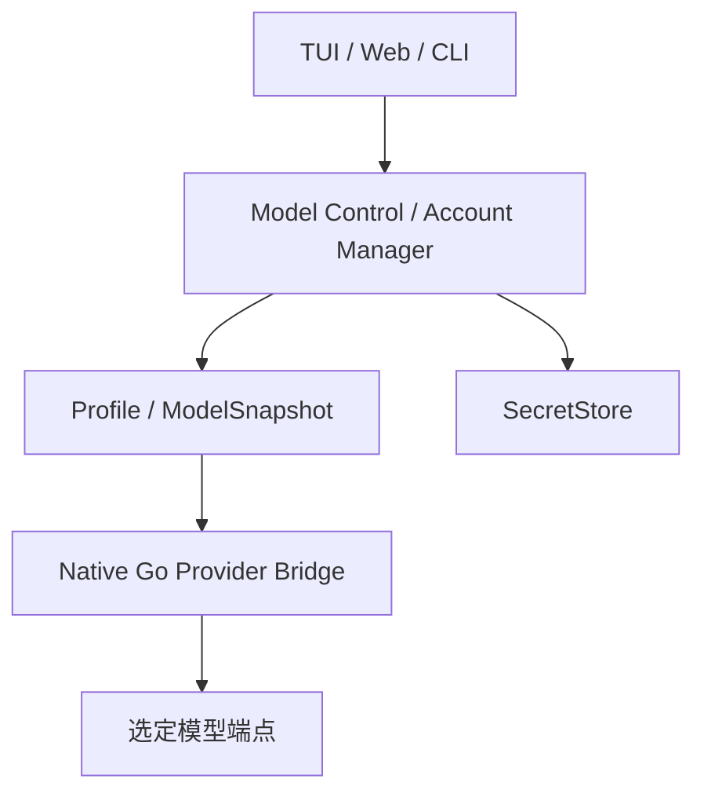
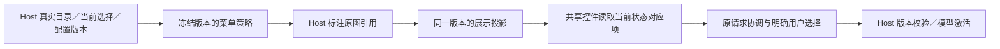

# 模型连接与账户：技术方案

[功能与需求](../features/model-connections.md) · [测试方案](../test-plans/model-connections.md) · [主索引](../feature-map.md)

本文的架构与流程描述当前有效实现；明确标记的待实现方案不表示已落地。实现级协议仍服从 [跨功能协议与约束](product-overview.md#contract-0-文档效力与实现规则)。

## 当前架构

Go Control 管理配置、Probe 和选择；账户 Manager 访问 SecretStore；独立 Go Bridge 负责供应商协议转换。每个 Run 保存冻结的 ModelSnapshot，后续配置变化仅影响新 Run。



## 当前流程与目标差异

新增连接或登录 → 能力测试 → 显式选择 → 新建 Run 冻结快照 → Bridge 发起推理。失败回到可修复设置，不自动切换账户或模型。

- **F-001**：CLI/TUI/Web 有连接、Test、Select 入口，Run 冻结模型快照。 无活动模型时保持 setup_required；不隐式选取收费或 Fake 模型。
- **F-002**：同一账户生命周期默认使用数据根下的私有文件。Memory、API Key、渠道与基础设施凭据使用相同的文件机制；不提供系统钥匙串后端。平台与 Live 验证边界见功能和测试方案。

## 代码与依赖

Web 显式登录完成后，若已有当前模型且属于刚连接的账户，复用 Control 的认证目录激活与运行时等待路径恢复它；无当前模型时才沿用首项选择。账户重授权仍先使旧模型就绪状态失效，不能仅凭登录成功将全部关联模型标为 ready。激活携带读取时的模型、账户和配置版本，遇到并发编辑或切换失败且不以新版本重试。其他账户或 API 连接的当前选择保持不变。此协调逻辑为 Web 私有流程，不扩展 Manager、HTTP 或冻结 Run 协议；页面读取与启动不触发恢复。

- [cmd/steward/models.go](../../cmd/steward/models.go)
- [internal/llm/control.go](../../internal/llm/control.go)
- [internal/llm/account/manager.go](../../internal/llm/account/manager.go)
- [私有文件 SecretStore](../../internal/llm/secret/files.go) 与 [账户引用适配](../../internal/llm/secret/account_files.go)
- [provider-bridge/bridge.mjs](../../provider-bridge/bridge.mjs)

## 验证与交付

验收场景、已有入口和剩余覆盖统一在 [测试方案](../test-plans/model-connections.md) 维护。实际执行结果以对应版本的 PR 或 CI 证据为准；架构说明不证明回归或 Live 验证通过。

## 协议、实现与配置约束

本功能协议在此维护。既有编号用于追溯协议，不代表所有设计目标均已实现；完成状态以需求主索引为准。

<a id="contract-5-模型与-agent-决策"></a>

### 5. 模型与 Agent 决策

- 一个 Agent 在任一时刻只有一个活动主模型配置；Main、Root Worker 与 Child 默认使用同一配置，不做按任务动态模型路由。
- 首次启动必须由用户完成模型连接、认证、模型选择和能力验证；在产生有效的 Active Model Profile 前，不启动 Agent Actor，也不接受 Conversation/Task。
- 用户可以在设置/TUI 中显式新增连接、重新登录、测试和切换活动模型，但这属于用户控制面，不暴露为模型可调用 Tool。
- 模型切换只影响之后创建的 Run。每个 Run 在创建时冻结 `ModelSnapshot`；Root 的所有 Child 继承同一个 Snapshot，进行中的 Run 不热切换模型。
- 是否使用工具、创建 Task、启动 Worker、召回历史或继续当前 Run，由 Agent 自行决策。
- 模型输出不直接产生外部副作用，所有副作用必须经过 Tooling 与 Security 层。

<a id="contract-51-首次启动设置流程"></a>

#### 5.1 首次启动设置流程

TUI 首次启动展示 Setup Wizard。Web 首次设置时保留 Chat 和 Settings 导航，禁止发送，Set up Steward 进入 Models。该页按 Accounts 和 API connections 管理连接，模型选择归 Chat 输入区。目录 GET 不写配置；显式选择时才物化账户模型并沿 Control 的目录激活或 SelectWithProbe 路径提交模型／账户／配置版本。旧模型详情链接打开 Models 中对应连接。页面加载、轮询和启动检查只读配置与账户元数据；连接、主动目录加载、验证及实际执行时按需访问凭据。两条模型连接路径为：

```text
Choose model connection
  1. Local / OpenAI-compatible endpoint
  2. OpenAI — Sign in with ChatGPT
```

Web 的连接方式下拉在当前页切换服务端渲染的表单，无脚本时通过 GET 切换。显式点击 ChatGPT 登录时，浏览器尝试打开与工作台隔离的授权窗口，使用现有登录提交和状态接口获取授权地址。自动打开后，工作台用一行状态等待回调并提供取消操作。弹窗失败时，原生表单和等待页链接继续支持手动授权。两种入口共用以下步骤：

1. 选择连接类型并完成 URL 配置或账号登录。
2. 获取模型目录；目录不可发现时允许手动填写模型 ID。
3. 选择一个模型，并只展示该模型确认支持的 reasoning effort、输入模态和上下文设置。
4. 执行 Connection Test 与 Agent Capability Probe。
5. 测试通过后原子保存 ModelProfile、AuthConnection 引用和 Agent Active Model，并进入正常 TUI。

Setup Wizard 可以安全取消；取消后应用的 `AppReadiness` 保持 `setup_required`，只允许重新进入设置、查看诊断或退出。`AppReadiness` 与运行期仅有 `idle/busy` 的 `AgentStatus` 分离。不得为了“先进入界面”偷偷启用 Fake、无凭据 Provider 或默认收费模型。

`AppReadiness = setup_required | ready | degraded`：`ready` 才开放 Agent Ingress；Active Profile 后续失效时进入 `degraded`，允许查看历史、修复连接和切换 Profile，但不接受新的 Agent 工作。

初次设置完成后，`model list/add/login/logout/select/test` 可以作为 TUI 命令或 Settings API 存在，但不是 `builtin__model_*` Agent Tool。模型不能自行切换到更贵、不同隐私边界或不同账号的 Provider。

<a id="contract-52-统一-modelprofile"></a>

#### 5.2 统一 ModelProfile

```typescript
type ProviderKind = "openai_compatible" | "openai_account";
type AuthKind = "api_key" | "chatgpt_oauth";
type ModelProfileStatus =
  | "unverified"
  | "ready"
  | "unavailable"
  | "reauth_required"
  | "invalid";

interface ModelProfile {
  profileId: string;
  name: string;
  providerKind: ProviderKind;
  endpoint?: string;
  wireApi: "openai_completions" | "openai_responses";
  modelId: string;
  authConnectionId?: string;
  reasoningEffort?: string;
  contextWindow: number;
  maxOutputTokens: number;
  generationDefaults?: {
    temperature?: number;
    topP?: number;
  };
  compatibility: ModelCompatibility;
  capabilities: ModelCapabilities;
  status: ModelProfileStatus;
  verifiedAt?: string;
  version: number;
}

interface ModelCompatibility {
  developerRole: boolean;
  reasoningEffort: boolean;
  parallelToolCalls: boolean;
  streamUsage: boolean;
  toolResultFormat: "openai" | "provider_specific";
}

interface ModelCapabilities {
  textInput: true;
  imageInput: boolean;
  audioInput: boolean;
  toolCalls: boolean;
  streaming: boolean;
  reasoningEfforts: readonly string[];
}

interface AuthConnection {
  connectionId: string;
  provider: string;
  authKind: AuthKind;
  status: "connected" | "refreshing" | "reauth_required" | "logged_out";
  accountLabel?: string;
  workspaceLabel?: string;
  expiresAt?: string;
  version: number;
}
```

- `ModelProfile` 保存连接和模型元数据，不保存 access token、refresh token 或 API Key。
- `ModelSnapshot` 是 Run 创建时对 Profile 版本、模型 ID、Wire API、兼容性、能力、生成参数和 endpoint hash 的不可变拷贝；只保存稳定的 `auth_connection_id`，不复制 CredentialRef 或 Secret。AuthConnection 可以在不改变 Snapshot 的前提下刷新同一账号凭据。
- Context Builder、Tool Schema 和 Provider request 必须使用同一个 Snapshot，避免运行中配置变化导致 Prompt/Tool/重放不一致。
- Profile 变更创建新版本；选择另一个 Profile 只更新 Agent 的 `active_model_profile_id`。旧 Snapshot 和历史用量继续可审计。
- Provider 返回的价格、上下文、最大输出、Reasoning 等目录元数据只作为候选；激活前必须规范化并冻结。用户手填值不能突破宿主安全上限。

<a id="contract-53-本地-qwen--openai-compatible-端点"></a>

#### 5.3 本地 Qwen / OpenAI-compatible 端点

本地路径借鉴 Pi 的 `models.json` 语义，但落入本产品的 ModelProfile，不要求用户手写 JSON。最小输入为：

```yaml
provider_kind: openai_compatible
endpoint: http://127.0.0.1:8000/v1
wire_api: openai_completions
model_id: Qwen3.8-27B-Splash
auth_connection_id: null
```

- `endpoint` 支持用户明确配置的 `http/https` URL，默认建议 `http://127.0.0.1:8000/v1`；`localhost` 从 Steward Go 主进程所在网络命名空间解析，不指向 Computer macOS Guest。
- API Key 可为空；需要认证时创建 `AuthConnection{auth_kind: api_key}` 并只把值保存到 SecretStore。不得为了满足 SDK 校验向网络发送伪造 Key；若上游要求任意 Bearer 值，可由用户显式配置。
- 模型目录通过 `GET /models` 最佳努力发现；端点不支持目录时允许手动输入 `model_id`，但仍必须通过实际推理 Probe。
- Compatibility 不能仅因服务声称“OpenAI compatible”就推断。至少显式记录 `developer_role`、`reasoning_effort`、`parallel_tool_calls`、`stream_usage` 和 Tool Result 格式；未知项通过 Probe 或保守默认确定。
- MVP 必须支持常见 Qwen/vLLM/SGLang/LM Studio 风格 Chat Completions；Responses API 只有在实际端点通过契约测试后才启用。
- 可选 `temperature/top_p` 只在模型声明支持时发送；未设置时使用 Provider 默认值。Reasoning 模型拒绝的采样参数不得强行注入。
- 对自定义兼容端点，Connection Test 检查 URL、TLS/连接、鉴权、模型存在性和一次最小流式生成；Agent Capability Probe 还必须验证 Tool Call、Tool Result continuation、取消和长输出裁剪。不能完成 Tool Call 的 Profile 可以保存用于诊断，但状态不是 `ready`，不能设为 Steward 主模型。
- 自定义兼容端点声明 `image_input:true` 时，Host 通过现有图像 resolver 与 Provider envelope 发送合成蓝色方块并验证颜色响应，成功后才保留并冻结图像输入能力。旧 Probe 中缺失图像证明不授予该能力；文本 Profile 的验证与引用回退不变。失败的图像重测同样撤销 readiness。
- URL、Header、响应 Body 和模型输出都按不可信外部输入处理；禁止跨 Origin 自动携带 Authorization，禁止把凭据或完整 Provider 响应写入日志。

<a id="contract-54-openai--sign-in-with-chatgpt"></a>

#### 5.4 OpenAI — Sign in with ChatGPT

第二条路径采用 Pi 当前 OpenAI Provider 的 “Sign in with ChatGPT” 语义，而不是 legacy `openai-codex` Provider：

- Setup Wizard 启动带 PKCE S256、state 和 OIDC nonce 的浏览器登录；Loopback Callback 只监听 `127.0.0.1` 的随机端口，state 单次使用并带短时过期，回调内容不得进入 access log。以 OpenAI JWKS 验证 ID Token 签名、issuer、issued-client audience、期限和 nonce；重新登录必须匹配所选账号身份。Device Authorization 保留为明确的后续需求，待当前官方 Provider 的受支持协议确认后实现；不包含在当前浏览器登录的完成范围内，不得记为已交付或已测试（见[账户认证设计](#decision-001-adr-001-current-openai-account-authentication-and-deferred-device-flow)）。
- 登录中和失败反馈归发起页面。新增模型与 Models 中的账户重连分别呈现各自的状态，直接打开授权窗口时隐藏继续登录链接，窗口被拦截时保留手动入口；原生页面和实时片段应用同一规则。
- 默认文件后端只保存 ChatGPT OAuth 凭据。数据根下的 `account-secrets/` 目录使用 `0700`，单账户文件使用 `0600`，轮换时在同一目录写入并同步后原子替换。项目备份只包含白名单中的数据库和产物，凭据目录不进入归档。文件权限控制访问，文件内容没有单独加密。
- 登录完成后创建 `AuthConnection{provider: openai, auth_kind: chatgpt_oauth}`，刷新凭据进入 SecretStore；`state.db` 只保存 credential ref、账号/Workspace 的脱敏显示信息、过期状态和版本。
- `AuthConnection.status = connected | refreshing | reauth_required | logged_out`。状态迁移由 Auth 层持久化；模型和 Run 只引用 Connection ID，不能读取 CredentialRef。
- 实际鉴权时，接近到期的 access token 由 Provider Auth 层按需刷新；同一 Credential 使用单飞锁，避免多个并发 Run 同时刷新。本地读取凭据期间取消或超时只结束当前检查。刷新失败或服务返回确定的授权失效时，连接进入 `reauth_required`，停止接收新 Run 并提示用户重新登录。
- 安装级稳定 `device_id` 保存为非 Secret 配置，用于 Provider 登录连续性；不写入普通日志、Bug Report 或模型上下文。
- 登录后从 OpenAI Provider 获取该账号当前可用的模型目录，只允许选择实际返回且适用于当前客户端的模型。模型上线、下线和账号权益由目录决定，不在代码中硬编码具体 Codex 型号。
- ChatGPT 登录表示使用账号订阅权益；它与 OpenAI Platform API Key 是不同的认证和计费路径。MVP 的该入口不接受 API Key，也不把二者静默互相回退。
- Logout 删除 SecretStore 中的 refresh/access token、清理 Provider Session/Prompt Cache，并将关联 Profile 置为 `reauth_required`；不删除历史 Run、Conversation 或用量记录。
- Host 在请求解析时捕获账号 epoch，最终接受结果时在 usage 写事务内重验该 epoch 与账号状态；该事务与其他 Host 的鉴权状态写入串行化。若 auth loss/logout 已先提交，旧结果记录 `AUTH_REQUIRED`，不得返回成功文本或发布 completed 事件；同一身份的成功刷新不改变 epoch。该 fence 不进入 ModelSnapshot、模型上下文或 Bridge RPC。
- Generate/Continue 的注册保留到 Host 最终接受完成。Cancel/Dispose 的确认与 usage 提交使用同一注册级接受锁；确认先完成时，未接受的结果记录 `GENERATION_CANCELLED`，不返回成功或发布 completed。usage 提交先完成时，后来的取消不改变已接受的结果；鉴权事务拒绝仍返回 `AUTH_REQUIRED`。接受锁只保护实际 usage 写入/提交，不包围 observer 等待、RPC 或 sink 回调；SQLite writer admission 在获取接受锁之前完成。接受控制仅存在于 Go Host 内存，不改变 RPC、ModelSnapshot 或存储格式。
- 不读取或修改用户现有 `~/.codex/auth.json`，不调用 `codex login` 后复制凭据，也不让多个产品争用同一凭据文件。Steward 拥有独立的 AuthConnection 生命周期。

<a id="contract-55-provider-bridge-与安全边界"></a>

#### 5.5 Provider Bridge 与安全边界

Steward 使用自身二进制内的独立 Go Model Provider Bridge 实现 Provider、OAuth、模型目录、流式 Responses/Completions 与 token refresh 行为，以 Pi AI 1.5.0 为协议参考；它和 Code Mode Sidecar 是两个权限隔离的进程：

| 进程 | 可以访问 | 明确不能访问 |
|---|---|---|
| Go Host | 领域状态、SecretStore、Run/Context、Provider Bridge RPC | 不直接实现 Provider 私有 OAuth/Wire 细节 |
| Model Provider Bridge | 当前请求、Tool Schema、运行时 access token、Provider 网络 | ToolExecutor、Computer、ArtifactStore 直接读取、业务数据库 |
| Code Mode Sidecar | 当前 JavaScript、受控 Host Call | 模型凭据、LLM Provider、数据库和任意网络 |

- Provider Bridge 使用固定版本依赖和版本化本地 RPC，至少提供 `auth.start/auth.continue/auth.logout/auth.status`、`models.list`、`model.probe`、`generation.start/cancel` 与流式事件。
- RPC 与 Code Mode Sidecar 一样采用 JSON-RPC 2.0，MVP 使用长生命周期 Stdio 子进程；每个 generation 携带 `generation_id/run_id/model_snapshot_id`，流式事件在单 generation 内带单调 `sequence` 并可去重，最终完成事件只能提交一次。
- OAuth UI 回调是 UI-neutral 事件：打开 URL、显示 device code、报告进度、选择 Workspace 或要求用户输入，均由 Interaction 层呈现。
- Bridge 通过受控 Secret RPC 读取当前 Credential、写回刷新后的 Credential；不自行维护第二份 `auth.json`。refresh token 仅在内存和 SecretStore 出现。
- 每个 Agent Run 使用独立、稳定的 Provider `session_id = run_id`，允许 Provider 复用 Prompt Cache 或 WebSocket；Child 不复用 Parent session。Run 终态时显式清理 session 资源，缓存命中不进入正确性语义。
- Pi 依赖升级必须通过 Provider 契约测试、登录测试与流式事件 golden test；未来可以替换为原生 Go Adapter，但不得改变 ModelProfile、ModelSnapshot 或 LLMProvider 语义。
- Provider Bridge 崩溃不等于 Run 失败。Host 重启 Bridge，并根据 generation 是否已得到可持久化完成结果决定重试同一模型请求或返回明确错误；不得把部分 Assistant 输出当成已完成消息。

<a id="contract-56-切换故障与隐私语义"></a>

#### 5.6 切换、故障与隐私语义

- 系统不在本地 Qwen 与 OpenAI 账号模型之间自动 fallback。切换 Provider 会改变费用、隐私和能力边界，必须由用户控制面显式选择。
- Steward 不负责启动、下载或升级本地 Qwen/vLLM 进程；它只保存连接并报告可操作的健康诊断。端点恢复后可以重新 Test 并恢复同一 Profile。
- Active Profile 暂时不可用时，新 Run 进入可恢复等待或返回设置级错误；后台已有 Task 不自动换模型。用户选择新 Profile 后，由 Main 决定对受影响工作创建新 Run。
- Root 的后代树始终继承 Root ModelSnapshot；同一 Durable Replay 不允许换 model ID、endpoint、Wire API、兼容性或 Tool Schema。需要换模型时创建新业务 Run。
- 本地模型请求只发送到配置的 endpoint；OpenAI Account 请求只发送到 Provider 固定的受信端点。模型连接的隐私说明在激活前展示一次，并可在设置中查看。
- Token、延迟、错误和费用按 ModelSnapshot 记账；本地模型只有显式配置四类零费率后才可记为零货币成本；缺少定价保持 unpriced，仍记录 tokens、时延、失败和主机资源指标。
- Provider 错误统一归一为 `AUTH_REQUIRED | MODEL_NOT_FOUND | MODEL_INCOMPATIBLE | RATE_LIMITED | CONTEXT_LENGTH_EXCEEDED | PROVIDER_UNAVAILABLE | GENERATION_CANCELLED | INVALID_PROVIDER_RESPONSE`。限流、断连和服务暂时不可用可以在同一 generation 内有限重试；鉴权失效、模型不兼容和无效响应不得通过切换 Provider 掩盖。`CONTEXT_LENGTH_EXCEEDED` 只允许 Context Builder 在同一 ModelSnapshot 下压缩后重试。

实现参考：

- Pi 模型配置：<https://github.com/earendil-works/pi/blob/main/packages/coding-agent/docs/models.md>
- Pi Provider/OAuth：<https://github.com/earendil-works/pi/blob/main/packages/ai/README.md>
- Pi 自定义 Provider：<https://github.com/earendil-works/pi/blob/main/packages/coding-agent/docs/custom-provider.md>
- OpenAI Codex Authentication：<https://developers.openai.com/codex/auth>

<a id="provider-bridge-provider-bridge-and-local-model-control"></a>

## Provider Bridge and local model control

The Go Host starts its own executable with `-model-bridge` as an isolated stdio
process. `internal/llm/bridge` owns both client and server sides of the existing RPC;
`internal/llm/provider` owns provider wire encoding, streams and catalog data,
with request/stream implementations grouped by protocol. Host-owned transient
connection and acceptance contracts live in `llm`, so account and SQLite adapters
do not import the Bridge implementation. These are
internal packages in Steward's existing Go module, not a public SDK. No Pi SDK
is imported, installed or executed by the model bridge. Pi AI 1.5.0 is the
reference version; its MIT catalog attribution is retained. The historical
Node entry is a forwarding launcher for existing configured deployments.
The full provider reference scope and remaining integration boundaries are
recorded in the [feature contract](../features/model-connections.md#provider-bridge-connect-a-local-model).
The [Main CLI](../features/conversation.md) uses the same Bridge for frozen Run requests,
Direct Tool continuation and Conversation recovery. Main and Worker use the
same Agent Loop and frozen snapshots; [delegation](delegation.md) and
[Code Mode](codemode.md) document the current recovery boundaries. Bridge conformance alone does not establish M1, real provider
compatibility or release acceptance.

<a id="provider-bridge-private-protocol-v1"></a>

### Private protocol v1

`internal/llm` owns consumer interfaces for the model control plane and the shared
Agent Loop. They are repository-internal and may evolve with conformance tests;
they are not a public plugin API. `internal/llm/bridge` implements the stdio client.
`internal/llm/fake` implements deterministic provider fixtures behind it.

One long-lived child exchanges newline-delimited JSON-RPC 2.0. The Host first
sends `bridge.initialize` with `protocol_version: 1` and rejects any different
response version. Numeric request IDs are Host-created and correlated per client.
The child gets only PATH, an isolated working-directory choice (OS temp directory),
and its explicit arguments, without application config or inherited credentials.
Child stderr and arbitrary error bodies are discarded. This is a logical process
boundary, **not an OS sandbox**; the fixtures themselves perform no filesystem,
Tool, Computer, domain database or network operations.

| RPC | Semantics |
| --- | --- |
| `bridge.initialize`, `bridge.shutdown` | Protocol handshake; orderly shutdown followed by bounded forced cleanup and process reap |
| `auth.start`, `auth.continue`, `auth.refresh`, `auth.logout`, `auth.status` | Fake auth lifecycle; real account start/poll/refresh/logout use a private Secret RPC envelope and UI-neutral browser/progress events |
| `models.list`, `models.refresh` | Candidate catalog, never proof of capability; real calls carry a transient Host connection envelope |
| `model.probe` | Provider-side connection check; the Host also runs behavioral generation checks |
| `generation.start`, `generation.continue` | Real calls additionally carry a transient connection envelope; accepted request with immutable ModelSnapshot, Host-created generation/run IDs, and `session_id = run_id` |
| `generation.event` | Notification with generation ID, monotonic sequence and text/tool/completion/error kind |
| `generation.cancel` | Cancellation acknowledgement; Host discards partial accumulated result |
| `session.dispose` | Terminal session cleanup; Host fences new admission and settles matching Generate/Continue calls with GENERATION_CANCELLED after acknowledgement |

The Host accepts a matching duplicate sequence once, rejects changed content under
one sequence and rejects gaps/out-of-order new events. A completion is delivered
once per generation call. Complete frames already received before process EOF
are drained before reporting a crash; incomplete generation returns an explicit
error with no partial result. Only the next independent operation restarts and
re-handshakes the same Bridge. The Bridge process itself does not own durable
results: the Host persists frozen requests and accepted results in its
`model_generation` ledger. [Main recovery](../features/conversation.md) checkpoints model and
Conversation completion; [Code Mode](codemode.md) retains its fixed-source replay
ledger through the same Host pipeline.

Frames are bounded to 1 MiB; generation output to the smaller of 64 KiB and four
bytes per requested output token, on a UTF-8 boundary. This is a byte safety bound,
not tokenization or a context-limit estimate. There are at most 4096 distinct
sequence events and 32 Tool Calls (64 KiB of arguments per call). The reader
validates and deduplicates events independently of sink speed,
clips text before retaining it, and queues only each kind's normalized payload.
Each generation mailbox holds the full 4096-event budget plus one rejection;
matching duplicates consume no slots. Slow sinks cannot block the shared reader's
RPC replies. Queued text shares the output byte bound, Tool Calls retain the
existing count/frame/argument bounds, and sequence history stores only digests.
Sink callbacks run synchronously; cancellation is observed between callbacks.
Host RPC calls have a five-second bound per wire exchange, including writer
admission and pipe I/O; behavioral Probe has a ten-second bound. Writer admission observes cancellation, and pipe
deadlines interrupt a blocked write without leaking a writer goroutine. A partial
frame terminates and reaps that Bridge instead of reusing a corrupted stream.
Cancellation and cleanup have independent one-second contexts. Close can abandon
its graceful shutdown attempt and terminate a peer that is not reading.
Cancellation after complete dispatch sends `generation.cancel` even before the
start acknowledgement. A late acknowledgement cannot revive that generation.
Explicit Cancel acknowledgement also settles the matching local Generate or
Continue call with `GENERATION_CANCELLED`, without requiring a second terminal
notification. It interrupts a pending start acknowledgement and fences queued
and late events. Cancellation and final result publication share the process
registry lock; an old acknowledgement cannot settle a different registration.
Cancel for a registered generation waits for its start/continuation write to
finish or fail before sending the cancellation RPC. Registration alone never
permits cancellation to overtake dispatch. This wait observes the caller's
deadline and the five-second Cancel bound, holds no process lock, and does not
wait for the start acknowledgement. Close can still retire the peer independently.
Waiting for a shared restart/handshake observes each caller's context. The
lifecycle state lock never covers process I/O or reap; Close can terminate an
initializing child immediately and waits for its initializer to finish cleanup.
If an internal acknowledgement deadline expires while the caller remains live,
the dispatched start/continuation is cancelled with an independent cleanup
context. Failed cleanup forces termination. The caller receives
`PROVIDER_UNAVAILABLE`, and the generation is never replayed automatically.
Failed cancellation cleanup terminates the Bridge and returns the cancellation
cause together with the sanitized cleanup error; it cannot certify a successful
Probe. Oversized/malformed frames,
unknown event kinds and sequence drift fail closed. Transport failure is
`PROVIDER_UNAVAILABLE`; invalid wire data is `INVALID_PROVIDER_RESPONSE`.
Host validation rejection of accepted work sends bounded independent cancellation
before returning; failed cleanup retires the peer and preserves the original
sanitized rejection together with the cleanup error. An unusable reader forces
retirement. Provider terminal errors are distinct and require no extra cancel.
These paths never replay a generation automatically.

Provider errors normalize only to the baseline's eight stable error codes. No
raw response body, token, endpoint or child stderr enters error messages. The
process does not get a domain store, ToolExecutor, Computer or ArtifactStore.
No model-visible Tool was added, and model code cannot select profiles.

<a id="provider-bridge-probe-and-activation"></a>

### Probe and activation

ChatGPT account selection is a separate private policy used by the existing Web, CLI and TUI consumers: authenticated catalog membership authorizes selection without test inference. `Control.AccountCatalog` reads the current account catalog; `SelectAccount` commits the profile metadata, auth-version fence, Agent-config CAS and activation events in one transaction. It does not insert a synthetic `model_probe`. `verified_at` records selection validation for account models and behavioral verification for compatible endpoints. Schema 44 replaces only the activation trigger so authenticated OAuth registrations can activate without a Probe; custom endpoints retain their existing evidence requirement. Existing snapshots and approvals are unchanged.

Account limits and image modalities prefer the server response, then the bundled Pi 1.5.0 OpenAI Responses chat entry (not the same-ID classifier). Unknown missing limits use 128,000/16,384 defaults; context is capped at 1,048,576 and output cannot exceed context. Account transport does not add `max_output_tokens` to subscription requests; the Host still uses model metadata for context/output accounting. Web first-connection auto-selection is current onboarding policy, guarded by the config version captured before adding the candidate. Later additions do not switch models; failed selection leaves the saved candidate available for repair. No startup fallback, public provider interface, arbitrary catalog trust for custom endpoints, or fabricated behavioral proof is introduced. Treating catalog claims as Probe observations was rejected because it misrepresents evidence.

For custom OpenAI-compatible endpoints, the Host tests one streamed reply, an actual `probe_echo` Tool Call with valid
arguments, a Tool Result continuation, acknowledged cancellation, and clipping
of long output. This test Tool has no executor or external effect. Failure of any
mandatory behavior prevents selection. The catalog and user claims cannot mark
a profile ready. Probe, selection and readiness enforce context/output limits
with a 1,048,576-token context ceiling and output bounded by the model context. Catalog output limits such as 128,000 are retained. These are execution limits, not the persisted metadata
format: valid v3 candidates above these limits still migrate, list and read back
unchanged, alongside all other candidates. They cannot be probed or selected
until replaced or edited within limits. No profile is silently clamped.
When `image_input:true` is declared, Probe additionally sends a Host-owned blue
square through the same image resolver/Pi envelope used by user uploads and
explicitly selected screenshot output, and requires the correct color response. Rejection or an incorrect reply prevents
activation; a failed retest revokes existing readiness. Declare `image_input:false`
for a text-only profile. Activation retains observed text/tool/streaming capabilities,
declared and verified image input, and conservative compatibility. Old Probe
records without image proof remain valid for text profiles and cannot admit images.
Unprobed audio/reasoning/parallel/usage claims and optional
sampling defaults are cleared. Explicit reasoning effort is rejected until a
Probe supports it. Frozen snapshots remain unchanged by all control-plane edits.

the system runner owns launch, doctor, CLI drive, independent SQLite readback,
SIGKILL/restart and cleanup mechanics. Related Bridge/storage/security contracts have their own regression entry points. `make test-race` covers concurrent
RPC/cancellation and independent SQLite activation contenders. See
[testing guide](../test-plans/product.md) for exact entries and `evidence/verification.json` for the
CLI evidence. No account, installed broker, persistent test process or human
observation relay is required.

Session disposal waits for admitted writes before sending its RPC, without waiting
for generation start acknowledgements. Its acknowledgement fences queued/late
completion and settles only captured matching registrations. A result published
before disposal remains complete. Failed disposal retires the peer instead of
leaving suppressed work unobservable. Terminal session admission fences remain
for the lifetime of the Host client, including Bridge restarts; new Runs use new
session IDs. the system runner covers ack-only/pre-ack/late/completion races, matching
Generate/Continue calls against actual Node/HTTP, dispatch ordering and failed cleanup.
The Bridge starts a 30-second timer per HTTP attempt and clears it at headers.
The accepted response reader starts a 90-second inactivity timer and resets it
on nonempty data chunks. A 180-second generation timer spans catalog lookup,
transport retries and stream handling. Cancellation uses the existing abort
signal and wins when observed first. The Go Host's 195-second context leaves
15 seconds for admission and terminal reporting. Phase markers are optional
dispatch diagnostics. The existing error taxonomy and frozen request format
also cover these failures.

## 当前设计取舍

模型使用单一活动配置与冻结快照，账户凭据由 SecretStore 持有；平台依赖不可用不能通过将 Token 写入配置或数据库绕过。兼容端点的图片输入须通过行为 Probe；ChatGPT 账户按认证目录的图片能力选用。两条路径都冻结 ModelSnapshot。

<a id="decision-001-adr-001-current-openai-account-authentication-and-deferred-device-flow"></a>

## ADR 001: Current OpenAI account authentication and deferred device flow

<a id="decision-001-decision-and-evidence"></a>

### Decision and evidence

Use the current OpenAI public-client subscription protocol in the Provider
Bridge. Implement Responses generation and account authentication in Go.
Account login and catalog discovery remain owned by the isolated Bridge: random-port
loopback, expiring one-use state, PKCE S256, verified ID-token identity and a
dynamic account-specific catalog. The business Host continues to own SecretStore,
frozen model snapshots, authentication fences and final result acceptance.
The Node compatibility launcher starts the same Go bridge for existing configured
installations. Account and observation tests exercise that implementation.

The JSON, SSE and WebSocket transports select the same credential-bearing HTTP
client and stop redirects at the first response. WebSocket continuation and
session cancellation remain provider-owned. The available transport libraries
have different wire boundaries here. The pinned x/net module's client dials
without the configured HTTP client and exposes frame limits. Coder WebSocket
supports the HTTP client but retains only 1024 bytes of failed handshakes,
compared with the current 8192-byte bounded classification. Its client path
also lacks the current server-frame mask rejection. [x/net dial and frame limits](https://pkg.go.dev/golang.org/x/net/websocket) · [Coder handshake](https://github.com/coder/websocket/blob/v1.8.15/dial.go) · [Coder frame reader](https://github.com/coder/websocket/blob/v1.8.15/read.go)

Device Authorization is deferred until a supported **current-provider** grant
is established. It remains an explicit future requirement and is excluded from
the implemented browser-login scope. It must not be reported as tested or delivered.
Do not substitute the legacy `openai-codex` provider or Platform API keys.

Protocol references:

- [Registration and sign-in](https://developers.openai.com/siwc/token-sharing-open-source/sign-in)
- [Accounts and sessions](https://developers.openai.com/siwc/token-sharing-open-source/profiles-and-sessions)
- [Models and inference](https://developers.openai.com/siwc/token-sharing-open-source/models-and-inference)
- [ID-token verification](https://developers.openai.com/siwc/website#6-verify-the-id-token)
- [Preview wire restrictions](https://developers.openai.com/siwc/token-sharing-open-source/preview-limitations)

<a id="decision-001-boundary-and-invariants"></a>

### 本地文件凭据（F-002）

所有受支持平台共用文件 SecretStore。普通 credential 引用映射到固定 secrets 目录，OAuth 保留 account-secrets 的 UUID 契约。目录权限 0700、文件 0600；受控引用拒绝路径穿越，读取拒绝符号及硬链接，更新通过临时文件、原子重命名和 fsync 完成。跨进程刷新及默认 Memory 初始化沿用原锁。

不再编译系统 Keychain/libsecret 适配，不动态加载凭据服务，不尝试隐式迁移或降级。旧系统账户重新连接后以相同账户身份保存文件凭据；已有加密数据必须保留原密钥。缺少密钥失败关闭，不生成替代密钥。旧 account_secret_store 配置字段不再接受。

### Boundary and invariants

The only consumers are the existing CLI/settings control plane and trusted
generation resolver. `account.Manager` owns lifecycle and uses a narrow private
Store/Provider boundary. This is not a model Tool, public API, general OAuth
framework or second generation pipeline. Credentials cross only the existing
trusted Host/Bridge RPC and SecretStore boundaries. The default file backend is private to the Host and stores a separate file per account.
UI events never contain tokens. Private authorization URLs are shown only for
the active interaction and must not be captured as logs or reports.

Each AuthConnection owns one immutable account/client registration. SQLite keeps
the issued public client ID and a hash of verified issuer/subject; labels are
masked. Access, refresh and retained ID tokens stay in the configured SecretStore. The
installation device UUID is non-secret private configuration, excluded from
diagnostics, events, traces, reports and prompts.

Cross-process kernel locks serialize refresh, credential replacement, recovery
and logout for one connection. A persisted `refreshing` row observed after
obtaining the lock means its prior owner was interrupted: fail closed to
`reauth_required`, delete credentials and revoke proof. Never replay a rotating
refresh whose outcome may be unknown. Successful refresh preserves capability
proof for the same identity and updates its auth provenance atomically. Auth
loss/logout invalidates related profile proof and closes ingress atomically
with metadata/events. Remote revocation failure does not prevent local logout;
report whether revocation was confirmed.

<a id="decision-001-migration-tradeoffs-and-intentionally-private-choices"></a>

### Migration, tradeoffs and intentionally private choices

Schema v6 adds private installation identity, immutable account registrations
and legal auth transitions. Empty and v5 migration are transactional. Existing
profiles, snapshots, usage and events are preserved. Pre-v6 OAuth metadata was
never backed by a real login; it has no validated registration and cannot become
ready by being imported. Create a new verified account connection for such a
record; do not attach a new identity to a historical snapshot.

The existing OS SecretStore/SQLite boundary cannot perform one distributed commit.
Persist `refreshing` before rotation; persist the new SecretStore value before
committing connected metadata. A crash between those writes requires re-login,
even if rotation succeeded. Failed initial registration cleans the newly owned
secret; a process death before metadata insertion can still leave an orphaned
private credential file, as with existing API-key registration. No automatic credential
enumeration or cross-account deletion is introduced.

Provider network destinations are fixed. Only the local fixture substitutes
network I/O; production RPC cannot choose OAuth endpoints or an account base
URL. Catalog visibility and actual returned model IDs gate account inference.
Optional reasoning/modalities remain conservative until independently verified.
No change to Main/Worker ownership, immutable snapshots or ToolInvocation.

The MVP is a single local installation, on macOS/Linux filesystems supporting
advisory locks. Account streams use HTTP with provider cache retention disabled;
logout aborts matching Bridge work and reaps its process. Another Host's final
result is rejected after auth loss: the usage write transaction rechecks the
Host-captured account epoch and status, serializing acceptance with auth mutation.
Only a committed acceptance can publish completion. Logout/reauthorization between
the observer Guard and persistence rejects the old text with `AUTH_REQUIRED`;
successful same-identity refresh preserves acceptance. Remote history/cache
deletion is not promised. Account-provider 401/403 closes readiness without switching model.

Generation registrations remain cancellable while the observer or SQLite writer
admission is pending. A private Host-only `Finalize` callback joins the existing
usage transaction to the registration's acceptance lock. Cancel/Dispose ack first
means `GENERATION_CANCELLED`, empty final output and no completion; commit first
preserves the accepted result. Auth loss is still checked in that same SQLite
transaction and rejects with `AUTH_REQUIRED`. The lock excludes observer waits,
RPC and sink callbacks; the shared RPC reader is not locked during persistence.
Waiting Cancel/Dispose calls retain their own deadlines; failed local disposal
cleanup retires the peer. An already admitted commit is allowed to settle.
No new wire field, stored schema, migration or alternate generation path is
needed. Peers and immutable snapshots retain protocol v1 compatibility.

<a id="decision-001-verification-and-remaining-requirements"></a>

### Verification and remaining requirements

`make test`, `make test-race`, `make lint` and the account system gate cover deterministic
OAuth/ID-token fixtures, actual Pi Responses, CLI/storage readback, single-flight
refresh, failure injection, secret scans and kill/restart. The account harness
owns launch, doctor, drive, evidence and cleanup. `make test-e2e` includes the account gate; focused repetition uses the existing
system runner's `--gate account --repeat N`. No online account is needed in CI.

Unexecuted real login/provider Live Shadow is **inconclusive**. Device
Authorization is **deferred**, not passed. Main/Conversation coverage belongs to its own [test plan](../test-plans/conversation.md);
account checks alone do not establish release readiness.

默认应用注入 `secret.Files` 处理 Memory 与普通 credential/env 引用，账户 Manager 单独注入 AccountFiles；所有生产消费者使用文件后端。两份目录复用私有文件机制，引用、账户锁、刷新与退出协议不变。

### 长期密钥的统一消费路径

| 使用方 | 文件存储与消费边界 |
| --- | --- |
| ChatGPT OAuth | account-secrets，原账户 UUID、轮换锁和清理协议 |
| 模型 API Key | secrets，App Control 的 SecretStore |
| Memory、加密 Evidence | secrets，默认配置和 Vault |
| Embedding API Key | secrets，运行时注入的 SecretStore |
| Computer/SSH 密码 | secrets，托管 Guest 生成与 SSHGuest 读取 |
| Web、飞书、GitHub | secrets，各适配器仅解析配置引用 |
| NATS | secrets，WithEvents/OpenWithSecrets |
| 离线备份恢复 | secrets，CLI 在进入维护流程前读取密钥 |

所有长期凭据采用同一文件机制与权限约束；显式 env 引用仍由同一入口解析，不隐式读取用户主目录的凭据。MCP 当前没有认证配置与凭据存储接口，其受限子进程不继承宿主认证环境。会话 cookie、OAuth PKCE/nonce 等只在对应会话内有效的随机材料保持内存生命周期，不另存磁盘。公开 host-key 指纹、哈希与签名校验公钥不属于私有凭据。

系统后端与配置开关已移除。旧配置中的 account_secret_store 须删除；已有系统账户重新连接以恢复文件凭据，已有加密 Memory 必须保留原密钥。没有隐式读取系统钥匙串、创建新密钥覆盖既有数据或把凭据写入 YAML 的迁移旁路。

Web 模型选择使用私有 composer_models 投影，读目录不写配置；显式选择时才物化所选账户模型并调用 Control。已有运行的冻结 profile、账户版本和配置保持不变。首个账户模型是 Web 默认策略，不改变 CLI 的显式配置契约；没有新数据库迁移或账户批量同步任务。

Web 的所有模型连接（包括 Local/API）不提供独立 Test connection。首次连接和聊天模型切换复用服务端 Control 校验，并保留版本、授权及失败恢复；旧 POST 路由仅兼容已有调用，不再由页面引导。

Models 为 Settings 的独立分类，包含「Sign in with an account」和「Connect with an API key」。账户目录自动进入聊天模型选择器；API 连接使用现有私有文件 SecretStore，凭据与首个模型元数据一次事务保存，失败清理新文件。连接后自动验证；首次无当前模型自动选用，后续连接不覆盖选择。连接操作复用共享菜单和原生表单，断开采用模型及凭据双版本确认并撤销后续使用，保留历史冻结配置。Apps 工具栏 App settings 进入服务配置；原 Models/Resources 服务入口移除，旧 setup 与 services/apps 深链接保留重定向。浏览器回归覆盖实际 HTTP provider 的 API key、聊天模型切换、断开及明暗／窄屏布局。

此变更的当前消费者为 Web Models 与既有 CLI/TUI 模型控制面。复用机制是 Profile、AuthConnection、SecretStore、SelectWithProbe 和 CAS；连接入口、默认 Provider 以及 Advanced 的字段分组属于 Web 产品策略。原子 metadata 写入、未知写入不重试、鉴权版本和断开后保留历史属于生命周期要求。新增 AddKeyProfile/DisconnectKeyProfile 是仓库内的窄持久化操作，不是公开插件协议；不引入通用 provider 注册平台、自动发现承诺或新身份体系。未采用「先落凭据 metadata，再单独建模型」以避免失败后的孤立记录；保留兼容 URL，页面不暴露凭据引用或数据库模型。

Models 将账户与 API 连接分组；账户入口先呈现实际支持的 ChatGPT 提供方，明确确认后才发起授权，重连绑定已有连接 ID，添加其他账户是独立操作。等待状态与取消保持配置行，完成后刷新账户投影。不能仅凭相似名称合并不同注册身份，现有账户记录不自动删除。协议、凭据生命周期、当前模型和冻结快照不改变。浏览器回归断言进入提供方页不发送 auth/login，并保留 API 连接、原生路径、明暗和窄屏验证。Apps 服务高级授权配置使用应用标识／配置 ID 行，删除 JSON 编辑框；显式验证保存和版本检查保留，目录布局不变。

聊天模型选择器按可见模型名降序排列，账户模型不附带账户名称；同名模型保持独立账户键和稳定顺序。原生首屏、目录刷新和切换响应共用排序投影，保持当前模型与草稿。`composer_models_test.go` 验证多账户、已保存／未保存目录模型、稳定同名路由、无账户名和只读首屏。

聊天模型目录采用页面内异步预取：服务端首屏仍仅读取本地模型／账户元数据，React 挂载后读取现有 `/api/models`，首次等待由共享 SelectView 的私有 pendingText 能力呈现明确加载状态。已加载列表在后台刷新时保持可用；部分账户目录不可用时保留已有完整列表，并合并返回条目的真实禁用标记及当前选择，完整成功读取才替换目录。读取结果与缓存条目均不作为授权依据，选择仍经服务端实时校验。打开与预取复用在途请求；切换前取消旧读取，读取结果不能倒退配置版本。选择成功的现有响应更新当前模型、配置版本和已保存 Profile 的规范键（激活会递增 Profile 版本），同时保留未保存的账户目录项；结果未知时通过现有 GET 确认，不重放选择。无脚本或缺少 fetch 时保留原生模型表单。内存列表随页面生命周期释放，不持久化账户目录，也不新增服务端缓存、凭据格式或模型激活管线。

Native Bridge 在 4 MiB / 65,536 条原始 SSE 上限内合并短文本增量，首次文本立即发出，后续按 512 字节或 80ms 刷新，在工具边界与终态前清空。Host RPC 的 4,096 条事件、输出字节、工具参数上限和序号校验保持独立；不把上游分块数量直接当作生成内容是否合法的依据。

## 模型连接功能的插件迁移边界

本轮需求是迁移现有 F-001 功能，不新增模型能力或自动 RSI 工作流。实际消费者是聊天输入框的初始模型菜单、目录刷新、切换后的菜单响应，以及 Models 设置页。`composer_models.go:modelChoices` 当前直接承担候选资格、账户目录合并、去重、标签、当前值保留与排序；`settings.go:loadResourceModels` 仍直接承担设置页展示。仅提取排序不代表该功能迁移完成。

### 最小归属

采用一个模型连接功能包，共用版本和 Host／Guardian 生命周期；不按菜单、排序、标签或内部函数拆包。先迁移菜单的完整纯投影，再在同包推进设置展示。使用现有 Go 服务调用、纯读和冻结图；不新增持久表、执行进程类型、通用规则引擎或公共 SDK。

Host 保留凭据与 SecretStore、原配置和账户身份、连接／验证权威事实、目录读取、请求取消、配置版本围栏及模型激活事务。插件仅接收私有强类型的非秘密展示事实：候选的原引用、名称、模型名称、账户归属、连接与验证事实、当前选择，以及已读取的目录及其可用性。插件不能提供新凭据、端点、激活身份或验证结果。Host 将输出引用绑定回已提供的事实，验证未知／重复引用，实际激活仍重新检查原权限和版本。

候选资格、目录合并／去重、标签、当前失效目录项的禁用展示及稳定降序属于当前可替换策略。目录调用、连接状态和激活接纳属于必须保留的机制。接口保持仓库私有实验级；不公开 llm.Profile 或 AuthConnection，也不承诺外部兼容。菜单不继承任意 Run 图；一次读取使用同一已接纳图，并在激活／停用后拒绝静默返回旧默认。

### 验收与清理

必须通过真实聊天初始菜单、目录刷新及切换响应，原 key／配置版本和已选模型不变；目录失败、当前项从目录撤下、同名不同账户和重复候选均保留原行为。独立实现换版、精确回退、停用、冷读取及原配置激活围栏需要实际验证。Settings／CLI 等未迁移入口须明确保留在清单中。

迁移时删除被替代的默认菜单实现；原生兼容只服务明确未激活功能包的历史安装边界，并记录消费者及删除条件。不能将注册 manifest 或一个排序函数作为整个 F-001 完成证据。拒绝独立菜单插件、每个 helper 一个服务、通用模型管理 DSL，以及以展示迁移为由修改凭据／provider 运行时。

模型菜单与 Settings 行投影已在同一 model-connections 功能包接通，默认分发为 35 包／369 项 Owner（八项菜单、六项 Settings、十四项连接策略对照）。96 组菜单、64 组 Settings 行及 24 组新建连接原生输出对照通过；实际 Host 与完整 App／HTTP 均验证独立 1.1 可执行实现、精确回退、停用及第一次冷读取拒绝原生回退，原 key／当前模型／配置版本保持不变。相关 Host、Web 与 owning 包 race 回归通过。model-menu-plugins 保留在 core 与必需 tools-provider CI，Host 生命周期用例保留在必需 race 匹配。新建连接默认值与重连来源预填已接入同一 Settings 服务，实际 HTTP 验证可独立改变默认服务选项、精确回退及停用／冷读取拒绝回退；原连接名称／模型预填保持 Host 绑定。剩余终端交互、模型来源与共享协议边界仍须核对，F-001 未整体完成。

新建连接使用同一私有实验级 Settings 合约的可选 draft 投影，真实消费者为 /settings/models/new，未引入第三个服务或独立插件。插件只收到 method、有无已校验来源及 OpenAI 地址判别，负责当前表单默认值和是否预填的业务策略；Host 先验证来源类型，再绑定原模型／地址／名称／协议，插件不持有凭据、完整 Profile 或配置提交权限。保留原生解释器仅服务从未激活此服务的历史安装，激活后缺失结果或停用均拒绝回落。删除了始终不可达的旧账户选择分支；不引入通用表单 DSL、Provider 操作接口或外部稳定 API。

新增连接的候选配置策略已迁入同一个 model-connections 包，12 组修改前执行的原生提交对照通过。Host 绑定原 model／name／account、目录成员及权威能力上限，校验完整 ProfileInput，保留 OpenAI 密钥要求与 SecretStore 写入；私有 connection-policy 服务不接收密钥或完整 Profile，不具备提交／激活权限。真实独立 1.1 可执行插件把默认窗口改为 96,000，回退恢复 128,000，停用及冷启动拒绝原生策略；实际 HTTP 提交保存 owning 默认配置，冷停用后提交不创建候选，原已选模型与配置版本不变。相关 race 与 CI 可达性回归通过；模板与认证流程尚未整体迁移。

连接候选策略与菜单／Settings 读取有真实独立变化轴，故作为同一个插件内的私有实验级 connection-policy 服务，不单独拆包。它只负责当前候选默认窗口、输出量、图片能力、协议和服务地址映射；请求中的名称／模型和账户目录来源保持 Host 绑定。参数接纳与凭据操作不是插件策略。拒绝直接暴露 llm.ProfileInput、通用命令总线、供应商 SDK 或新增状态表；历史解释器仅保留从未激活此服务的安装消费者，服务激活后无静默回退。

首次账户登录在没有既有选择时，目录中的模型 ID 列表进入同一私有 connection-policy 的 login 事实，插件返回一个目录内的模型 ID；默认仍取原目录首项。Host 在创建前检查其属于原目录，并在 accountModel／SelectWithProbe 时再次验证当前目录、账户与配置／profile／auth 版本。已有选择的账户归属及只恢复原模型属于 Host 围栏，插件不能覆盖别的账户或现有 API 选择。没有新增服务、SDK、状态表或流程引擎；没有把 OAuth 和凭据机制移交插件。

清理：模型目录读取已由 /api/models 的托管菜单路径承担，旧 /model/catalog 在仓库内无调用方、无文档契约、模板也不消费其结果，已删除该路由、处理器和错误分支；同时移除仅由它写入的 Catalog／CatalogLoaded／CatalogError 及无消费者的 Account／Provider 展示字段，草稿私有合约也不再携带未使用的 Provider。原生 draft 对照保留修改前原始捕获文件，现只比较仍被页面消费的字段。完整 OAuth 的首次冷启动失败已定位至选模后的运行时等待；现将默认所属插件的准备前置到连接策略调用，保持原超时及实际恢复流程，修复后的 OAuth 原流程通过。

首次 OAuth 冷启动诊断已将失败定位到选模之后的 WaitForRuntime：独立诊断二进制只记录阶段和枚举错误码，观察到 runtime／broker（event.ErrUnavailable），未输出凭据或原始私有错误。原首次选择会把整套默认插件的初始化验证留在运行时接纳的 15 秒边界内；现在实际连接策略入口先调用现有 prepareBuiltinPlugins，再选择所属实现并构造候选／首次选择。它复用已有激活历史与停机检查，不重新激活停用图；准备失败不回落原生。未扩大超时、未新增状态表或控制协议，修复后完整 OAuth 原流程及 HTTP 换版／回退／停用／冷读取、真实新增候选和相关 race 均已通过；当前批次完整 make test lint 尚待终态。

### 模型连接模板归属与边界

当前消费者是 Models 列表、新建连接页面和 signin-status 实时片段；三者从同一次 Settings 服务选择的封存 view 资源读取，复用现有私有模板编译器和共享组件，不新增 UI 协议或独立包。默认模板逐字保持原生输出，中英文、连接状态、待授权、失败和无脚本表单保留原语义。model-connections 同包标注 F-001／F-002 的参与归属，不据此宣称两个 feature 已全部迁移。

页面内容、表单组合及内部 helper 为插件实现；只有 model-list、model-new、signin 三个实际 Host 入口固定，model-* 私有 helper 可独立重组。Host 负责选中图与文件摘要、受限展示 DTO、模板／DOM 有界执行、原来源标识及版本值、同源既有动作路由和危险操作确认边界。这些约束对应真实凭据／版本消费者，不决定按钮文案、列表布局或业务默认值。凭据引用、完整 Profile／page、Server、其他 feature、任意脚本及出站资源均不暴露。合约仍为仓库私有实验级，不公开领域模型或通用表单 DSL。

原四份 native 模板已删除，历史内容集中为 models-legacy-v1.html，仅供从未激活 Settings 服务的历史安装或嵌入；激活后缺失资源／模板、错误投影、停用和冷读取均拒绝 native 回退。其他 Settings 分类的更新直接返回空认证区域，不再调用 Models 历史解释器；该解释器在历史消费者退役后删除。共享组件、样式、基础控件及其可信行为保留 Host。模板文案与已登记浏览器业务策略已迁入同包，其余模型来源／终端操作仍需归属审计，F-001／F-002 未整体完成。

凭据目的地围栏绑定提交的 endpoint，或用户显式选择的既有 OpenAI 服务地址；候选默认策略只能保留该地址，不能把新输入的 API key 改投另一个地址。账户目录／OAuth 仍使用既有可信账户适配边界。此处校验的是用户授权的凭据目的地，不接管插件的窗口、输出量、图片能力或布局策略；API 自定义地址与显式 OpenAI 选择均有负向回归。

模型模板的 41 项原生中文文案已迁入同包封存 copy 资源，版本、摘要和模板使用同一次 Settings 图选择；同图资源缺失、重复词条及未声明资源拒绝读取。owning 模板只允许 modelTr，未知词条保持原文，不访问 Host 字典；共享 help 的通用控件文案仍属于 Host。原生中英文渲染对照、独立可执行版本中文文案换版／精确回退／停用／冷读及真实中文 HTTP 页面验证通过，相关 race 通过。Host 原字典保留给 models-legacy-v1、未激活服务的历史嵌入和共享导航／控件的实际消费者；待历史消费者退役后删除无其他消费者的词条，不提供 current owning 文案的隐式回退。

### Provider 浏览器策略

当前唯一消费者是 Models 的 API 连接表单。原初始化／切换代码的 32 组实际输出已捕获；默认地址、替换条件、是否强制填入、密钥必填、地址只读和展开 Advanced 都随同包封存 view 版本发布。Host 的私有 DOM 绑定器只读取当前选项的这些有界字段并更新既有控件，不含 Provider 名称或地址，不读取密钥值，不执行网络动作。缺少／畸形绑定数据的托管表单在渲染前拒绝。

此处必须保留的机制是数据类型／URL 校验、固定控件绑定和提交时的凭据目的地围栏；具体 Provider 值和交互默认值属于插件。沿用三项视图入口，没有新增服务、Worker、通用表单引擎或公开 SDK。数据属性仍是仓库私有实验级接口，不承诺表达任意未来交互。只有带 Host-authored data-model-legacy-v1 标记的历史表单可调用具名旧解释器；当前 owning 视图不允许该标记。历史解释器随未激活服务的嵌入／旧安装退役而删除。

原 data-model-account／data-model-provider 面板及 model/test loading 分支没有模板或其他源码消费者，已连同原默认实现清理；显式 model/test 管理 API 继续由 Host 保存，未删除其真实操作能力。CLI 简写创建的默认值已由同包 cli-shorthand 配方托管，仍保留原 8192／1024、text-only 行为；命令参数的身份／地址校验和持久化接纳留 Host。

CLI 简写 model add 的默认配方已进入现有 connection-policy 服务，以实际 cli-shorthand 入口区分原 Web 与 CLI 默认值，不新增服务或包。身份、地址、模型／账户引用留 Host 绑定；解析先以 ValidateIdentity 拒绝非法用户事实，配方接纳后仍须完整 Validate 才能存储。完整 JSON 元数据是用户显式的权威配置，不套用任何默认值。旧默认实现已从解析器和命令分发移除；无包／从未激活服务的历史嵌入复用单一 legacyv1 解释器，当前托管停用／冷读不回退。

10 项修改前实际 CLI 解析输出／错误已捕获；原身份／错误保持，实际解析→分发→存储及域包回归通过。真实 Host 与实际 CLI 验证 8192→6144→8192、停用及冷启动拒绝 native 配方；显式 32768／2048／responses／image 元数据不受配方或停用影响。模型选择与配置版本保持不变，相关 race 通过。默认组合为 35 包／369 项 Owner，原 Web 与模板／文案／Provider 生命周期继续通过；剩余认证／浏览器边界和当前批次完整门禁尚未整体关闭。

CLI／Web 的两种配方是已有真实独立变化轴；只增加可选 preset 事实，不公开 ProfileInput 或通用调用者上下文。JSON 配置、目录元数据上限、凭据及激活事务继续由 Host 保持权威。拒绝把 defaults 直接调用伪装成托管派发，也不为 CLI 单独创建插件或转换期配置层。


### 重连动作的私有插件边界

实际消费者是 `/model/reconnect`，现有 model-connections 包的 connection-policy 接收可选 `ReconnectFacts`（是否有当前选择、目标是否为当前选择），返回 `activate` 或 `probe`。它不接收 Profile、模型／账户标识、凭据、版本或授权对象；不新增服务、插件、工作流解释器或稳定公共 API。默认策略保留无当前／重连当前时启用、已有其他当前模型时仅测试的原行为；独立版本可改为仅测试。

这项动作选择属于业务策略；Host 保留原 Profile 读取、提交版本校验、认证、Probe、选择 CAS 与运行时接纳。插件要求启用其他当前模型时，Host 拒绝；缺失动作、服务错误或停用均不能回退。普通重连中的原生决策已移除。仅从未激活服务的安装／嵌入使用既有 legacyv1 解释器，随该历史消费者退役删除。

不采用通用动作列表或命令总线：当前只有重连入口需要这两个动作，协议保持私有实验性。新增连接后的动作使用下述同包边界；F-001／F-002 的其他操作边界及最终验收仍未关闭。


### 新增连接后的动作

`/model/add` 在保存前，一次读取 connection-policy 的默认值与可选 AddedFacts（仅是否已有当前模型）。同一结果给出 `activate`／`probe`／`save`：默认首次连接启用，已有当前模型时 API 仅测试、账户仅保存。独立版本可只保存；不额外读取另一版本，也不在候选保存后才发现策略缺失。

Host 绑定提交身份、凭据目的地、目录能力与版本，拒绝已有当前选择时的自动启用；实际 Probe／Select／运行时接纳及其 CAS 保持原实现。缺失动作、错误与停用在写入前失败。候选保存后的 Probe／运行时失败继续使用原资源恢复入口，不能退回新建表单重复保存。普通路由中的原生动作策略与重复错误分支已删除；仅既有具名历史解释器保留旧安装配方。

不开放通用命令、动作序列或插件写权限；这是同一功能包当前真实入口所需的私有实验性选择。四种修改前实际路由行为纳入 Owner 政策；当前组合为 35 包／369 项。整批系统与完整门禁须以当前源码单独验收。


### 模型选择器的列表合并

真实消费者是 Chat 输入框：刷新完整目录时替换列表，部分失败时保留已有账户目录项，切换确认后保留账户项而不保留旧 Profile 版本。这些保留／去重／排序决策进入既有 model-menu 服务；浏览器不再持有该业务实现。

同源、需认证的私有只读 `/api/models/project` 接收前后两份本地选项快照与 refresh／ack 原因，复用现有 Go 插件进程。插件仅返回来源与下标，Host 验证范围、来源和重复键后绑定原选项；不接收或返回配置版本、当前模型、凭据、目录读取权限或激活命令。当前选择与配置版本始终取原读取／确认结果，取消、请求序列、过期版本围栏与共享 Select 渲染仍在浏览器 Host。排序键只是浏览器 ECMAScript 小写规范化事实，插件决定保留和顺序；UTF-16 比较保持原 Unicode 排序。

这是当前两个列表更新入口所需的私有实验性 seam，不开放通用 UI 工作流／命令总线，不新增服务、插件或 JS SDK。取舍是列表接纳增加一次只读请求；复用已有 Go 所有者与隔离分发，避免再设浏览器插件运行时。服务错误、非法引用与停用保留页面已有状态并显示既有不可用提示，不能运行原生合并策略。旧解释器仅供从未激活服务的安装／嵌入，随这些消费者退役删除。

48 项修改前实际 JS 输出覆盖完整刷新、部分失败、确认、空列表、旧 Profile 和 Unicode；四项进入 Owner 政策，当前为 35 包／369 项。实际共享控件浏览器回归覆盖延迟／取消、目录失败、未知切换回读、草稿／附件、双语、明暗与宽窄屏。模型来源及其他认证边界仍须继续核实，不据此完成整个 F-001／F-002。


### 登录后的当前账户模型恢复

首次登录的目录选模已托管；登录重连后是否自动恢复本账户原当前模型，现在也由同一 connection-policy 决定。Host 先核实当前 Profile 确属刚登录的账户，再提交只含布尔意图的 LoginFacts；插件返回显式恢复／不恢复，不接收账户、Profile、凭据或版本。其他账户或 API 当前选择始终不动，这是 Host 的授权／选择范围约束。

插件可以独立取消自动恢复；Host 仍只使用原 Profile、原配置／Profile 版本及权威账户目录、认证版本执行选择 CAS。缺失决策、错误、停用或试图返回另一模型均拒绝接纳，不运行原生恢复；未激活服务的历史嵌入沿用唯一 legacyv1 解释器，随消费者退役删除。此处不增加动作引擎、生命周期层或公共 SDK。

修改前实际入口已捕获本账户恢复／其他账户不动；新回归覆盖独立不恢复、停用、缺失、改选、Profile 与配置冲突及原版本恢复。实际 Host 独立版本验证 true→false→true，停用／冷读拒绝 native。增加一项 Owner，当前为 35 包／369 项。模型来源与其他边界及最终完整验收仍待收尾。


### 终端 setup 的连接配方

终端 `/setup` 的候选默认预算、模态、协议、可见默认端点及 token 输入上限已迁入现有 connection-policy 的 terminal-setup 配方。实际 App.Terminal 绑定同一托管读取；不新增包、服务或 SDK。Host 在任何账户／凭据读取前验证配方，明确展示默认端点再收取用户输入，显式输入不被改写；目录能力、账户模型成员、认证、Probe、确认与版本化激活仍由现有控制面接纳。

原终端普通默认值与上限已删除。未激活服务的 Session 嵌入仍复用单一 legacyv1 解释器，随该显式消费者退役删除；托管错误／停用不能回退。提示与整个终端交互流程仍须结合 F-017 核对，不能据仅迁移配方宣布终端功能完成。

四项修改前实际 setup 的 ProfileInput／提示输出捕获覆盖手动、显式参数、目录元数据和账户；当前默认组合为 35 包／369 项 Owner。真实 Host 独立版本可修改配方并回退／停用／冷读；实际 PTY 验证可见默认端点换版与取消不改变原选择，完整终端系统门禁验证真实建模、Probe、明确激活和恢复。

### 聊天选择器的有限展示投影（私有实验接口）

真实消费者是 Chat 的 `modelChoices → composer-models`。`model-connections` 默认升级为 1.1，新增同包纯服务 `steward.model-picker/1`，持有原五项布尔事实与四类读取／选用结果的完整中英文展示；请求为空，不发送模型 ID、账户、用户内容、URL 或凭据。一次读取其有限投影后，本地按事实取对应项，不为每次 React render 发 RPC，不增加 Worker、流程解释器、状态表、SDK 或通用 UI 协议。原共享 SelectView、布局、字体及原生表单保留。



加载、busy／disabled、空选项、标签、提示及错误文案由同包实现；输入事实和结果分类、单一在途请求、取消、发送／选用锁、真实选择 key、config_version、迟到响应判定与明确授权仍归 Host／客户端协调器。展示不能触发选模、发请求、覆盖模型身份或改写已接受回执。选用响应丢失后只做原只读核实；若核实本身不可用，保留未知，不误称选用已失败，更不重放选用。

Host 在解析菜单结果后标注实际图引用，标注不进入插件输入或由候选提供。API／SSR 携带同图展示；后续目录合并用原引用读取同一菜单版本，current／config_version 始终来自原事实／ack。引用只决定只读展示版本，不作为选模授权或模型身份。保留旧图和退役包供已有引用读取；Guardian stop 优先，当前新读在停用／首次冷读时不恢复 native。

明确 pre-picker1.0 组合没有该服务，使用 `modelconnections/legacyv1/picker-v1.json` 中原冻结解释；当前 1.1 或更新声明服务但缺失／非法结果不走这条兼容路径。该解释仅为原历史组合与明确 never-managed／storeless 嵌入保留，随这些消费者退役删除。普通客户端展示公式及专属全局文案同步删除；标准 JSON 失败字段和共享控件词汇维持其原协议／共享消费者，不是当前展示实现。

新接口为仓库内实验级，不公开完整模型对象、任意 renderer、脚本、DOM、激活动作或自由状态机。选择有限结果投影是为了在网络读取失败时仍用已接纳版本解释状态；拒绝把网络协调、凭据或模型事务交给可替换展示，也不为未发布中间形状增加过渡平台。独立 1.2 同时改变实际标签、首次加载提示和 busy，Owner 独立声明预期后才可激活。
