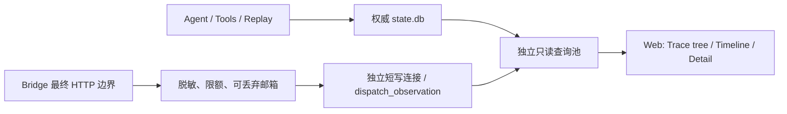

# Developer Observability：技术方案

[功能与需求](../features/observability.md) · [测试方案](../test-plans/observability.md) · [主索引](../feature-map.md)

当前实现对齐 Langfuse 的观测概念与浏览体验；视觉沿用 Steward 的共享主题、控件和间距，只有状态使用语义颜色。运行状态、冻结请求和重放仍由 Steward 持有。参考 [Core concepts](https://langfuse.com/docs/observability/data-model)、[Observation types](https://langfuse.com/docs/observability/features/observation-types) 与 [Good traces](https://langfuse.com/docs/observability/best-practices)。跨功能语义服从 [运行时契约](runtime-contracts.md)。

## 当前架构

- **Session**：Conversation ID，关联多次 Main 执行与后台 Task epoch。
- **Trace**：一次 Main Run 或一个 Root epoch 的执行树。Child 仍属于其 Root trace；Main 创建 Task 的原始回执建立跨 trace 因果关联，不把 Root 显示成 Main 的 Child。
- **Observation**：Agent、Generation、Tool、Retriever、上下文准备、审批等待、工具执行片段、HTTP attempt 和事件。投影读取实际 parent / invocation ID，不从自然语言或时间顺序猜测关系。

状态数据库是业务权威。除新增独立的可丢失 dispatch 证据外，页面直接投影已有记录，不建设第二个调度/重放引擎。

## 查询与模块边界

- `observability/trace.go` 定义查询与投影；`observability/sqlite/traces.go` 负责 Trace/Session、指标与有界 observation 页，`observation_sources.go` 明确各权威表的统一字段，`trace_detail.go` 只读取所选节点的允许正文。
- 复用原独立只读池：`mode=ro`、`query_only(1)`、最多 2 个连接；按当前 Agent 限定 trace 和每次详情读取。Main/Root 列表默认 40、最多 100，按不可变创建时间和 ID keyset 分页；observation 每页最多 100，游标绑定 Root trace。缺席的 parent 显示为页外片段，所选节点可独立读取。
- 详情不返回完整 model_snapshot、配置、所有权 token 或 connection。`content.go` 是冻结 context、Tool 和 Wire 正文共用的 UTF-8 字节分段实现；每段最多 8192 字节，支持 NUL、中文和 emoji，完整内容通过续读读取，拒绝非法偏移。
- Web 依赖自己的 `TraceReader`、`ContextReader`、`ExecutionReader` 小接口；App 只绑定同一检查器。查询状态、服务端视图计算、正文模板、渐进导航和样式各自归属功能文件，不扩充 Conversation Core。旧重复关系页被新详情页替换；既有 `/api/developer/executions` 与 `/relationships` 元数据接口语义保留。
- 新 GET API：`/api/developer/traces`、`/api/developer/observations`、`/api/developer/observation-body`。页面与 API 总期限 3 秒；非法查询 400，缺失/越界节点 404，读故障 503 且不泄露底层错误。沿用 loopback、binding、token/session、CSP、no-store；正文普通转义，SVG 使用数值属性，不注入动态内联脚本/样式。
- 同页读取之间可看到不同的已提交状态；不承诺整次浏览或跨页数据库快照。刷新获取最新状态。原生链接无 JS 可用；渐进导航仅替换 workbench，保存树/时间线滚动位置与 URL/history，不轮询、不调度工作。

### 页面职责与节点导航

`/developer/observability` 只读取 Trace 列表，`/developer/observability/{runID}` 只读取该执行树与关系，详情不依赖全局列表查询成功。浏览器列表点击名称时以共享原生 dialog 抽屉呈现同一个服务端 workbench，非模态列表浏览、共享 Escape/焦点恢复与 URL/history 管理选择，关闭恢复原列表；完整详情页与无脚本路线保持独立。左侧紧凑执行树与右侧内容分开，执行时长位于名称下方；移除重复的底部执行表，Task epoch 通过详情选择器切换。因果/内部标识折叠保留，Main→Task 仍是跨 Trace 链接，Root 不冒充 Main Child。

节点主视图统一为输入／输出和详情（overview / metadata URL 值），按内容职责划分。context / wire / diff 深链接为详情中的次级证据路线；完整 contextReader 保留全部 messages/tools/response/provenance/recall、分页、原始 JSON、UTF-8 偏移及前后 Diff 内容，不再维护并列冻结上下文页面。旧 context/run-query URL 经过原参数校验后仅跳转，API 不变。

### 列表查询与呈现

当前消费者为安装所有者的 Developer 列表及已有 Trace API。新增可选 `search`（最多 200 UTF-8 字节）在当前 Agent、Session、角色、状态、时间范围内，对 Run ID、Task 标题（Main 使用 Main conversation）和模型做字面子串匹配；ASCII 大小写不敏感，不把 `%` 或 `_` 解释为通配符。查询在 keyset 分页前应用，不只过滤当前页，不扫描 observation 正文。API 输出与既有查询保持兼容，不更改持久化 schema、授权或冻结数据。

服务端继续拥有查询机制、指标口径与时间边界；最近 24 小时／7 天／30 天是当前 Web 的时间快照链接，Refresh 不隐式滚动其起点。一级与二级导航共同使用全局 224px 宽度、筛选栏 176px（手机默认收起）、单行分列、Trace ID 首列默认可见及 Trace/Output 独立展示是 Web 呈现策略；列显隐只存当前浏览器。共享 `disclosure.tsx` 使用 Base UI Popover 管理定位/焦点/关闭，顶栏时间字段通过 form 属性关联原列表 form，脚本失效保留 details 表单。详情抽屉复用同一 GET 页面解析的 workbench，不增加第二个详情 API 或查询引擎。

`Traces` 额外返回完整筛选范围的 `total` 与最多 48 个可读时间桶 `activity`（每桶含 `at`／排他 `until`／`count`）。同一个只读事务在 keyset 条件前计算 count/min/max 和分桶；行数据与指标继续分页读取，直方图不从当前 40 条摘要假造全量。无匹配记录返回零计数。未指定边界时使用匹配记录的最早/最晚创建时间，短于一分钟时补足一分钟观察窗；按秒至年的可读区间选择桶宽，桶边界对齐且数量最多 48；指定时间边界时首尾桶严格裁切到该边界，即使无匹配行也保留明确的有界空时间窗；存储时间戳与排序均为 UTC；Web 显示、图表提示和日期筛选输入使用当前浏览器时区，提交边界保留绝对时刻。新增投影字段不修改数据库 schema 或执行状态。

这些组件和查询投影是仓库内实现，不提升为外部插件协议或通用查询语言。当前不实现 Langfuse 的 field:value DSL、facet 计数、保存视图、批量操作或公开分享；只借鉴布局与诊断密度。选择有界元数据子串查询而不增加 FTS 索引，避免将这次列表改造扩大为全文检索基础设施；大规模搜索优化需以真实数据量再验证。

### 详情呈现与可逆交互

树的 HasChildren 与连接线依据已读取 observation parent 关系生成，不按时间猜测祖先。折叠状态只留在本次页面，选择、搜索和节点加载仍读取同一个只读 workbench。搜索保留命中的祖先并临时展开；关闭搜索恢复分支状态。节点类型与状态使用不同语义颜色，未知结果不会因配色被解释为成功。

`resize-handle.ts` 共享 Pointer Capture、取消、键盘、边界与 ARIA 行为；`split-view.ts` 与 `sheet.ts` 分别负责内部/外部尺寸。只持久化有限宽度比例，不保存诊断正文；移动端停用竖向分栏。`read-only-json.ts` 只创建转义后的 DOM text，保留原 pre 与服务端续读链接。树形视图有 2000 节点预算，片段、无效 JSON、不能无损往返的数字回退到原 pre；服务端 prettyBody 使用 json.Number，避免只读展示先把归档数字转为 float64。Formatted/JSON 和折叠不更改权威记录、冻结字节或查询授权。Copy 仅由用户点击复制当前已加载片段。无脚本保持原生文本、链接和 details 阅读。

## 时间、用量与恢复

| 节点/指标 | 语义 |
| --- | --- |
| Agent / Tool lifecycle | 接纳到终态的 wall time，可能包含排队和等待 |
| Generation | 冻结接纳到保存结果；不是一次 HTTP dispatch |
| Provider HTTP | 发送尝试到收到响应头；不冒充完整推理/stream 耗时 |
| Provider operation | 既有 usage ledger 的 latency_ms，包含 provider 准备和流式读取 |
| Approval / spend wait | 实际授权创建到决定；未决定时结束未知 |
| Execute tool | 新事件中的 invocation ID 关联的 start/end 片段；缺事件不推断 |
| Retriever / context | 已保存时间点；历史记录没有开始时间时不给虚构耗时 |
| Result reuse | 从已接纳结果继续的事件；不新增 generation、usage 或外部调用 |

Agent Loop 在实际复用结果和成功提交等待后发出 best-effort 事件；Tool 事件保留真实 invocation ID。旧记录没有该字段时不以跨 generation 可重复的 provider call ID 配对。事件缺失只保留未知，不改变权威执行。

指标仅汇总唯一 model_generation 关联的 provider_usage、spend_reservation 与 generation_cost_estimate；HTTP 重试和 reuse 不倍增。部分 usage 标明已知记录数；费用优先读取已结算账本，否则使用接纳时固定的目录估算，按币种分开。包含目录估算的总额标注“估算”，来源 tooltip 展示目录及版本；未计价调用仍计入部分覆盖。不使用当前价格推算历史，不将缺失 usage、价格或 duration 补零。估算与货币授权账本的边界见[费用设计](operations.md#account-monetary-authorization)。

列表的 Trace ID 前置，时间列收窄；列偏好 v5 将 v4 的 ID 可见性移到首项，继续兼容 v3/v2 的既有迁移，保留用户明确选择。新浏览器默认显示 ID。Tokens／Cost 直接展示已接纳的最新累计值，缺失值不补零；Trace 金额仅展示层舍入到两位小数，提示保留六位精度，存储仍使用原整数微单位。进行中的 Output／Wall time 没有终态证据时显示“—”，Status 继续表达执行状态。

## F-034 冻结上下文

逐轮内容继续由 `model_generation`、`context_compaction` 和 `run_recall` 提供，读取 Host 冻结输入、原始 Schema 与接受结果，不从当前 checkpoint/Memory 重建。Generation 详情默认按角色展示有界预览；完整消息、来源、Schema、压缩记录和旧/新内容由同一 Generation 的 Context 阅读器与 Compare 入口读取。

输入／输出与 Context 文本投影共用密封记忆标记：存在 `memory_text` 信封时，在原 `text` 后标明加密内容与发送前解密语义，避免独立记忆消息被误读为空。该标记仅属于诊断展示，不进入 agent messages、冻结 JSON、请求 hash 或 Diff；检查器不获得 Vault，也不解密历史内容。原始 JSON 和来源保持原样。

同一逻辑输入复用首次召回时，`context_compaction.provenance_json.recall_step` 指向该 Run 内确切的 `run_recall` 记录，后续 Generation 的召回区按此引用读取；Retrieve context 仅由真实召回记录产生，Prepare context 仍记录每次请求准备。旧 provenance 缺此字段时只读本 step 的记录，缺失保持未知，不以最近时间点猜测复用。

相邻输入比较同一 Run 的前一个已存 step，step 不要求连续。消息按 source.ref / tool_call_id / 旧位置，工具按名称，重复键按出现序号对齐，精确区分 added/removed/changed/moved，不做语义猜测。原始归档只显示引用，不因观测授予 Run-only Artifact 访问。

## F-035 最终 HTTP 证据

- `provider-bridge/observability.mjs` 独立拥有脱敏与限额；`bridge.mjs` 在最终 SDK fetch 前和 headers/error 后通知。Account 路径也在 namespace 转换之后采集。每次重试独立 attempt ID，携带 generation ID、UTC 微秒时间、capture/SDK 格式版本、脱敏正文 hash 和状态。
- `generation.observation` 是私有 RPC 的可选、独立诊断通知。只有 Host 在冻结请求外设置 observe 时才发送；不占用 generation.event 序号，不进入请求哈希或 Capability/ModelSnapshot。旧 peer 不产生证据时明确未知；probe 不持久化为业务 observation。
- 不采集请求头/connection；Node 和 Host 都移除已知凭据。图片替换为已知 Artifact 引用、预览 JPEG hash 与原图/预览尺寸；不是原图像素 hash。正文最多 256 KiB，超限保留 hash/原因，不能当逐字原包或用于重放。模型输出仍来自既有已接受结果，不复制原始 SSE 流。
- Host `bridge/observations.go` 校验 registration、字段与上限，诊断错误/回调 panic 不拒绝 generation。`observability/sqlite/recorder.go` 使用 32 条非阻塞邮箱与独立单写连接，busy_timeout 25ms、单条总写期限 100ms；只在该预算内重试本地幂等 INSERT 的 SQLITE_BUSY/LOCKED，其他失败或超时/拥塞可丢弃。Provider 无数据库访问；Web 不取得写连接。App 关闭 provider 后再排空 recorder，强制退出允许留空；已终结的 generation/Run 缺少 HTTP 结束证据时显示 unknown，不冒充仍在请求或补造结束时间。
- capture 的 started 仅证明 fetch 尝试，headers 仅证明响应头被收到；取消、网络错误、丢失事件与终态不确定性各自保留。generation.attempt_count 不能被解释为 HTTP 次数，工具 Host execution starts 也不等于实际网络次数。

Generation Overview 按当前浏览器时区显示各 HTTP 尝试及流时间点。首段数据来自传输层，首段可见文本或首个工具调用来自已解析的模型事件。终止标记记录 Responses 的完成或失败等事件，兼容接口使用 finish reason 或 SDK 完成事件。标记仅包含阶段、时间及关联键。整轮超时也可在发出生成 HTTP 请求之前记录。HTTP 节点的持续时间仍表示等待响应头。

## 存储、兼容与隐私

state schema **31** 引入 `dispatch_observation` 与 Root 查询索引。schema **42** 扩展阶段枚举并复制原 HTTP 尝试记录。旧请求缺失的流时间点保留为未知。诊断表独立于权威记录、冻结请求、审批和恢复键。升级前停止旧进程，统一使用支持 schema 42 的二进制。

敏感冻结输入和脱敏最终请求由同一安装所有者授权查看，保留在本地 state.db 并沿用其保留/加密备份边界。capture 不是业务权威或 exactly-once 证明；未知观测不阻塞业务恢复。没有第三方传输、公开分享、外部导出或观测驱动的执行操作。

未实施：Langfuse 服务/OTel exporter、远程 Prompt Management、Dataset/Evals、聚合 Agent Graph、全文搜索和自动轮询。Prompt 继续由文件/Git 管理，模型质量评测继续离线维护。

## 验证与代码

- [统一数据模型](../../internal/observability/trace.go)
- [只读投影](../../internal/observability/sqlite/traces.go)
- [可丢失采集器](../../internal/observability/sqlite/recorder.go)
- [最终请求脱敏](../../provider-bridge/observability.mjs)
- [Web 读取边界](../../internal/interaction/web/traces.go)
- [Trace 模板](../../internal/plugin/traceinspector/view/trace.html)
- [正文读取](../../internal/observability/sqlite/content.go)

需求级证据与限制统一见 [测试方案](../test-plans/observability.md)，运行命令沿用现有 make/runner，不新建 CI gate 或模型评测框架。

## 协议、实现与配置约束

本功能协议在此维护。既有编号用于追溯协议，不代表所有设计目标均已实现；完成状态以需求主索引为准。

#### 6.5 Agent Event Sink 与可靠性边界

- Agent Loop 只依赖一个 `EventSink`，由外部 Composite Sink 将事件路由到实时流、持久化、事件队列和可观测性实现。
- `message_update`、`tool_execution_update` 等增量更新是 best-effort 实时事件，不进入 EventQueue。
- Conversation 最终消息、Run 状态、Checkpoint 和 Outbox 初始记录属于 durable 写入；日志、指标、流式 Token 和临时进度属于 best-effort。
- durable 写入先于 best-effort 通知；durable 写入失败时进行有限指数退避，并在稳定边界停止，由恢复机制继续。
- `state.db` 与 `conversation.db` 不做分布式事务，使用确定性 ID 和幂等写入；只有所有必要 durable 写入成功后才推进 Checkpoint。
- ToolExecutor 与 EventSink 是独立边界：工具执行日志、结果持久化和副作用幂等由 ToolExecutor 负责，结果持久化成功后才发出 `tool_execution_end`。

### 13. 可观测性与用户进度

#### 13.1 Observability

- Observability 与业务 Operations 分离。
- 内部保存结构化日志、指标、分布式追踪、RunTrace、工具轨迹和 DLQ 状态。
- 原始工具调用轨迹只对研发调试开放。
- 内部异常先由 Main Agent Loop 解释和处理，不向用户直接暴露底层错误。

## 当前设计取舍与兼容约束

观测集成现有 Web 的 Developer 区域，使用本地权威记录与独立惰性只读池，不参与调度或重放，也不依赖第三方平台。Main→Task 因果关联与 Root/Child 树分别表达。

完整 Context 阅读器归入 Generation；树、时间线和节点输入输出共享导航，旧深链接继续有效。上下文从已存冻结记录投影，不从当前 checkpoint 重建；40 项分页与 8192 字节连续 UTF-8 切片保留长文本，来源缺失如实显示，Diff 对重复键按出现顺序比较。

最终 SDK fetch 独立捕捉脱敏 HTTP attempts，恢复复用事件与用量账本分开。schema 30 的索引和 schema 31 的诊断表不改变冻结协议；独立可丢失邮箱与短写隔离诊断故障。请求体与原冻结 context 受相同所有者和本地备份边界保护，不增加第三方导出授权。

Web Trace 列表的普通行点击通过该行的既有名称链接打开非模态详情侧栏；名称仍是键盘与无脚本的原生入口。其他链接、控件、修饰键点击与文字选择不被整行点击处理接管。

TTFT 是新增的只读派生指标 `metrics.ttft_ms`，不迁移 schema、不改变接受回执。Trace 取时间最早的 generation，计算其首次 HTTP started 到具有同 attempt started 证据的首段 first_text／first_tool_call；包含该 generation 的重试时间，不混入后续调用、子执行的文本或 headers／first_body。Generation 的详情使用同口径。没有观测时省略字段，UI 显示未知；first_text 含模型推理，first_tool_call 在工具名称／ID 或非空参数 delta 到达时记录，不等待完整参数。该指标不称为用户首屏送达时间。

Web 在输入／输出及 Provider request 起始页内只读组装最多 2 MiB 的已有内容片段；长度变化、失败或超限保留原片段分页，不改变有界 body API。结构化阅读只解码文字，拒绝重复键与不可无损表达的数字；脱敏原始 JSON 不被改写。可读面板按实际协议的 instructions/system、messages/input/contents、tools 与其余参数组合，不引入新的外部协议。Context 链接经过同一详情导航处理，保留抽屉及树／导航状态。

### Observation 与首输出边界

参照 [Langfuse 数据模型](https://langfuse.com/docs/observability/data-model)、[Observation 类型](https://langfuse.com/docs/observability/features/observation-types)及[最佳实践](https://langfuse.com/docs/observability/best-practices)，Trace 表示一次执行，Generation 表示一次模型调用，Tool 表示接受的工具执行。多轮 Agent 中 Generation 与 Tool 是所属 Agent 下按实际因果关联的独立观察；工具内模型调用归属 Tool，不能把整轮工具循环合并为一个 Generation。现有真实回执与父子关系是机制，树形、筛选、预览和列表聚合是呈现政策，不引入另一套执行引擎或厂商 SDK。

[Langfuse OpenAI 流式实现](https://github.com/langfuse/langfuse-python/blob/main/langfuse/openai.py)在首个迭代项记录 completion_start_time，而非要求可见回答文本。Steward 以首个有内容的文本、推理或工具调用输出作为本地事件边界，排除纯协议帧；Trace 列表取首个 Generation，所选 Generation 单独展示本轮指标，用户交付仍由 Main 接受消息证明。旧 first_tool_call 只在参数完成时记录的时间继续忠实呈现，不倒推缺失的历史 delta。聚合费用／Tokens 只累计独立模型用量，重试及恢复复用不重复记账。该查询契约仅仓库内稳定，不暴露内部 checkpoint 为公共 Observation API。

### 节点详情的阅读与指标边界

当前消费者是所有者的只读 Developer UI/API。沿用已存 observation、冻结请求、provider_usage、spend_reservation、generation_cost_estimate 和 dispatch_observation，不新增采集协议、写入或迁移。`ObservationTree.generation` 是所选 Generation 的可选内部读取投影，固定模型信息来自该次冻结请求，费用按实际记录优先于参考估算。它不暴露账户凭据或当前配置，不稳定化为第三方 SDK 接口。

主视图为输入／输出和详情；旧 context/wire/diff 深链接继续有效，只作为详情内的次级证据阅读路线。输入／输出在有限预算内完整组装，失败／超限保留原始分页；结构化展示不覆盖原始 JSON。Worker 输入取首轮冻结的 task 来源消息，找不到时保留未知。

Generation 的 input_total = input + cache_read + cache_write，缓存分项不重复累加到总量之外。吞吐量只在 accepted completed 调用有已知 usage 且同一 attempt 有 first_text/first_tool_call → stream_terminal 正间隔时计算，单位 Token/s；缺少证据不使用总生命周期替代。未知与真实零值区分。当前 provider 协议没有独立 reasoning token 计数，不推测或新增无来源指标。

内部节点的隐藏是 Web 读取策略，原始树与真实父子关系保持不变；保留所选节点及祖先、失败、压缩、检索和等待。未采用删除记录、把全部模型循环合为一个 Generation、用当前任务重建历史输入或将所有原始请求并列为重复主 Tab。Langfuse 的 observation 类型、重要步骤／减少内部噪声和逐 Generation usage/cost 作为设计参考：[Best practices](https://langfuse.com/docs/observability/best-practices)、[Observation types](https://langfuse.com/docs/observability/features/observation-types)、[Token and cost tracking](https://langfuse.com/docs/observability/features/token-and-cost-tracking)。

### 执行时间线与时间分布筛选

消费者仍为所有者 Developer 详情、列表及只读 API。复用现有 Observation、Trace 统计与分桶 SQL；新增可选读取字段 `ObservationTree.total/errors`（全树节点数及 failed/http_error 节点数）和 `TraceBucket.until`，不迁移持久化模型，不触发执行。失败节点数不是失败 Trace 数，也不将 unknown 当成失败。当前策略为默认展示树与时间线，内部节点的可见性策略独立于记录和汇总。

详情顶部使用一行可换行属性区，区分全 Trace 汇总和右侧所选节点指标。时间线使用实际开始／结束时间，选中 Generation 的首次有效模型输出作刻度；未知结束时间为点，仍在运行且 Trace 未终止的 Agent／Generation／Tool 用观测时刻为虚线边界。其语义是观察快照，不是捏造已完成耗时。缩放和平移只影响浏览器内的时间域，选节点、上下文阅读和历史导航保留同一 Trace 的窗口；换 Trace 各自记忆，重新加载恢复全域。按钮、Ctrl/Command 滚轮、Shift 滚轮、轴键盘和拖选复用同一有界时间窗计算，不新增服务端查询语法。

列表时间直方图使用相同查询条件、UTC 排他边界和浏览器当地显示。柱条的位置、宽度及刷选边界均按实际裁切后的起止时刻成比例计算，不能将短首尾桶拉成完整桶宽。原生 SVG 和增强后的指针逻辑使用同一时间域，浏览器保留账本的微秒精度。点击／刷选只生成已有 `since/until` 查询并清空 keyset cursor，保留搜索／角色／状态／Session；空桶不导航。触屏常驻显示所选当地起止时间、Trace 数量并提供显式 Explore 操作，避免误触即改变查询；键盘箭头逐桶阅读、Shift 箭头选区、Enter 应用、Escape 取消。共享 `chart-tooltip` 仅拥有顶层定位、转义文本和生命周期，业务查询不进入共享控件。

选择保留 Trace 计数一种现有指标，不引入没有消费证据的自定义报表平台、指标语言或任意聚合。没有采用把所有时间点拉成耗时条、用当前页计数替代全量、删除原始节点，或对每次 hover 发起查询。参考 [Langfuse Responsive Timeline](https://langfuse.com/changelog/2026-08-28-responsive-timeline)、[Pulse](https://langfuse.com/docs/observability/features/pulse) 与 [Kibana Discover](https://www.elastic.co/docs/explore-analyze/discover/discover-get-started)，实现仍由 Steward 自有组件及只读模型承载。

Web 在 Requests 起始页内只读组装最多 2 MiB 的已有请求片段；长度变化、失败或超限保留原片段分页，不改变有界 body API。结构化阅读只解码文字，拒绝重复键与不可无损表达的数字；脱敏原始 JSON 不被改写。可读面板按实际协议的 instructions/system、messages/input/contents、tools 与其余参数组合，不引入新的外部协议。Context 链接经过同一详情导航处理，保留抽屉及树／导航状态。

## 独立展示策略与源记录边界

`Inspector.ProjectedObservations` 在同一只读事务中取得授权事实及隐私 epoch，随后以输入描述符调用实验级 `steward.trace-layout/1`。独立包拥有树遍历、缺页父节点／环处理、时间线缩放、Generation TTFT 和 Tab 策略。输入 DTO 只含本页确切身份与时间，不直接开放持久模型。源查询、冻结记录、凭据清洗和结果权威仍归 Host。

宿主验证输出仅引用本页来源且不重不漏、深度／导引线及坐标有界、Tab 为现有只读目的地；文字、状态和父子事实从原始记录重建，插件不能重写。每次向插件释放字节及完成返回前验证 Owner 与隐私 epoch；只读池禁止状态／审计写入。服务首次被选择前保留旧展示策略；选择后停用明确不可用。旧 Trace／Run URL 继续读取同一源记录，不以展示升级改变执行版本。

契约、组件组合及页面皮肤保持 private／experimental／Host 共享三个不同范围。未引入任意 HTML／JavaScript、SQL、Host 服务或数据库权限。冻结上下文对齐、出现顺序匹配、Diff 分页与已知工具回执解释已一并提取。SQL 原始事实查询、账本指标、来源字段、内容分页及共享渲染器继续保留在 Host，完整系统验收仍在进行。

Owner 的 `reader_revision` 仅选择曾激活的解释器，不代替源授权。树／Diff／工具预览共享版本，Context 导航保留引用；源事务和 Guardian 新快照分用只读池，既保留同页一致性，又能看到已提交的隐私撤销，避免并发页面占满原读取池导致自等待。

当前 Host 的两个主视图按 Input / Output 与 Metadata 分组，旧解释器贡献的 context／wire／diff 仍作为各自逻辑证据目的地保留，并通过 reader_revision 继续引用原版本。内部节点开关与实时运行条由现有共享检查器适配，保留插件源行与顺序；新记录的首个 tool delta 是当前首输出指标的直接证据，不通过伪造 first_text 事实送入旧解释器。旧包输入、版本及原始观测不被重写。

### 剩余工作台的私有交互边界

现有消费者是只读 Developer Trace 页面。树搜索／折叠、列偏好 v2–v5 迁移和时间窗计算属于 Trace 功能政策，继续归同一个 `steward.trace-inspector` 包及其版本；不为这些内部操作增加插件、进程或独立生命周期。候选纯 Worker 位于该包的 `view/trace-worker.js`，已接入带冻结图标记的页面树搜索／折叠和列偏好迁移路径，整项迁移仍未完成。 同包 1.1.0 通过私有 `steward.trace-workbench/1` 返回有摘要的 Worker 资源，资源声明与实际文件共同封存，读取请求为空且拒绝额外输入。标准构建复制该文件；初始装配只在实际 manifest 声明此服务时加入独立 Owner 静态资源验收，保留 1.0.1 原三服务组合。静态字节验收不代替 246 项原始语义回归，页面派发另由真实受保护路由与浏览器控件专项验证。

树匹配确实依赖当前授权页面中的节点 ID、父 ID、显示名称和类型；不能仅传布尔值后把匹配政策继续留在 Host。隔离程序只需这些已有展示元数据、查询文字、折叠集合，以及列偏好原字符串或时间数字；无需模型原文、请求／响应正文、账户、凭据、数据库或 DOM。列偏好原字符串保留旧解析失败时的优先级，Host 负责本地存储读取和提交。共享 JSON 阅读器、DOM／链接接纳、授权、原始事实、版本冻结和效果控制继续由 Host 执行。

原始 TypeScript 的执行结果独立封存于 `tests/fixtures/plugins/trace-workbench-original-v1/`。候选实现逐项对比该证据，不以新算法生成期望值。`observability.css` 的 `.obs-*` 仍被已迁移的 Memory 模板与 Host 适配器消费，不能整份搬走；后续只迁移 Trace 专属样式，保留有真实跨功能消费者的共享原语。不公开通用 UI DSL、搜索语言或第三方稳定契约；既有三个诊断契约及历史读取语义仍需保留。

工作台程序资源由现有 Inspector 通过明确的已激活图读取：`TraceWorkbenchProgram` 在原只读授权／privacy epoch 围栏下调用同图私有服务，随后核对声明资源路径、封存文件摘要与实际程序字节。认证资源路由 `/api/developer/traces/program?reader_revision=…` 只接受一个合法非空版本参数，不读观察正文；缺少服务、错误版本或坏资源返回不可用，不恢复原生程序。HTTP 层复用现有 opaque iframe／Worker relay，禁止网络／子 frame／表单能力，顶层导航仅返回纯文本。该资源路由已由页面的树和列偏好读取实际消费；其余客户端业务和原生页面迁移仍待完成。

Trace 私有浏览器适配器 `web/src/trace-browser.ts` 只负责 opaque frame／MessagePort 建连、明确操作的请求类型、逐请求序号／操作匹配、待处理数量／超时和销毁。业务结果作为未知值返回，由页面按原 DOM 快照接纳；传输不承担搜索、列迁移或时间计算。适配器已通过真实浏览器隔离专项，树和列偏好读取已实际接通；其余业务仍按实际消费者继续迁移。

整个 Trace 页面现由 `TraceWorkbenchSelection` 在列表／节点事实读取前冻结解释图，原三秒读取预算不变。已声明工作台服务的图必须通过同图资源调用及封存字节校验，页面和详情容器输出相同 `data-trace-program-revision`，导航／后续读取保留 `reader_revision`。历史 native 边界仅限具名 1.0.1 旧三服务包与未配置托管 reader 的显式嵌入消费者；已启用后停用／缺包／新图缺服务不能静默回退。原有诊断服务和页面选择共用原权限／privacy epoch／Guardian 读取围栏，没有增加新的控制权或另一套选版状态。浏览器已消费该标记进行树搜索／折叠和列偏好迁移；直方图交互也已消费同图程序；其余页面业务替换继续待办。

树 DOM 适配器 `trace-tree.ts` 只读取已授权节点元数据、提交当前查询／折叠集合并按原节点顺序接纳结果；回复须完整校验后才改 DOM，旧序号或已销毁页面的结果直接丢弃。Worker 故障关闭并禁用增强按钮，保留原 SSR 阅读／链接，不调用 legacy 算法。列迁移将四个原存储键的读取值及逐键失败事实交给 Worker，保持原按需读取的错误优先级；只读失败的旧键不能覆盖有效新偏好。树的中英文按钮文字由同包程序提供。

被替代的当前树算法与列迁移循环已从 `observability.ts` 清除，唯一兼容实现位于 `web/src/legacy/trace-workbench-v1.ts`，消费者是明确 1.0.1 图及无托管 reader 的直接嵌入测试／调用方；有新图标记时不得调用。保留理由是这些历史消费者仍需原解释，待旧图和显式嵌入消费者退役后删除该模块。列映射／勾选后的可见性和保存决定也已由同包 `column_controls` 提供；其余导航／筛选政策与整套模板／专属样式仍未完成迁移，不能把本步视为整项 feature 完成。

`trace-columns.ts` 接纳 Worker 的整份列计划后才绑定原列与单元格、重新计算当前可见宽度或写入偏好；列索引必须唯一、属于原表，并排除 SSR 标记的必保留 Trace 列。持久化仅能响应真实用户勾选，初始读取不能发起写入，存储目的地限原列偏好键。传输失败、坏计划和销毁后的回复不恢复 native 算法。页面销毁释放控制器／监听器；持久恢复事件按原冻结页面标记重连。原生列映射与勾选算法只保留在同一具名历史模块，当前页面不再维护另一套默认决策。已有四个历史存储键仍为私有读取契约；不据此承诺任意偏好 schema 或公共存储 API。

时间轴窗口政策已由同一 Worker 的私有 `timeline_window` 操作提供，包括保存窗口的裁剪、Fit／缩放／选中节点边距、键盘平移及滚轮缩放／平移系数。Host 按事件顺序串行提交，后一个动作使用前一个已接纳窗口，防止连续缩放丢失；接纳限于原时间域内的有限正区间，销毁后的回复不应用。树和时间轴通过 `trace-program.ts` 共用同一冻结工作台 Worker，只有一个生命周期；不因新增内部操作增设插件、选版或进程。

原 native 时间轴及窗口算法仅保留在 `legacy/trace-timeline-v1.ts`、`legacy/trace-time-v1.ts`，消费者与删除条件沿用上文 1.0.1／直接嵌入边界。当前 `trace-time.ts` 只保留时间窗事实类型；时间解析／分桶／缩放／格式化算法归 owning Worker，原函数仅在具名 legacy 内保留。刻度／泳道几何／按钮状态已接入同包；节点时间提示也已接入同包；拖选阈值／范围提示与范围计算也已接入同包；其余页面政策仍继续迁移。复验发现并修正原拖选点击抑制误吞随后时间轴工具栏点击的问题：托管和历史 DOM 适配器均保留时间泳道点击抑制，但允许工具栏点击，原窗口数值算法不变。

时间轴消费者现在一次发送 `timeline` 请求，同时取得窗口和刻度／泳道几何／按钮状态，避免为同一 UI 操作增加往返或生命周期。计算只接收已有时间数值、当前宽度、是否选中及原行顺序，不需要名称、模型正文、身份或外部效果。刻度密度、时间格式、裁剪、点与首输出标记、完整范围按钮判断归插件。Host 完整验证窗口、行数、有限有界坐标、标签长度和原按钮字段后，才一起应用窗口与 SVG；几何错误不得半提交窗口或清空原 SSR。

只接纳现有 SVG 原语的有限属性，未开放任意 SVG／HTML／脚本、通用绘图 DSL 或新的公开 SDK 契约。`trace-timeline-projection.ts` 是 owning DOM 接纳器，不保存另一套业务几何；当前 Host 里的刻度步数、泳道裁剪和按钮判断已清理，历史算法仍仅供具名旧图消费者。内部数值原语／回归入口不构成独立 Host 操作或稳定兼容承诺；浏览器请求类型已清理为实际消费者使用的业务操作。直方图交互也已接入同包；页面资源仍继续迁移。

节点时间提示复用原 `timeline` 投影的每行结果，返回同包拥有的中英文时间说明；进行中、未知结束、零时长和首输出为零均保持原解释。Host 只绑定原行名称与共享状态标签，该时间投影不接收名称／状态正文、模型或请求内容；共享 tooltip 原语继续负责纯文本放置、聚焦和销毁。时间文案的判断／拼接已从当前 Host 清理，仅历史模块保留原算法。该变化不增加调用、消息阶段或生命周期；拖选范围提示亦已复用同包数字策略，不再由当前 Host 格式化。

拖选阈值由原时间轴计划返回；范围预览与提交复用同包 `timelineBrush` 数值策略。Host 只读取当前轴的指针分数、捕获／释放指针并绘制有界 SVG。移动时最多保留一个在途预览和一个最新待处理位置，旧版本／旧手势／旧窗口回复不应用；取消或销毁使它们失效。最终松手将最新位置直接提交给现有 `timeline` 操作，不依赖最后一次预览是否完成，避免丢失最终范围。预览是独立的短暂 UI 消费者，不计算整套泳道，也不创建新 Worker 或持久状态。

当前时间轴中的阈值常量、拖选范围几何与时间格式化已清理；`elapsedLabel` 只保留给具名历史 native 时间轴，不再由当前 `trace-time.ts` 导出。DOM 适配器仍负责原生指针／键盘约束、取消、释放捕获和固定 SVG 原语绑定；图形基础样式与整套页面资源的 owning 迁移仍待完成。没有开放任意事件脚本、父 DOM、网络或数据库能力。

### 服务端统一分桶的私有边界

原消费者是 Developer Trace 列表及 `/api/developer/traces`。同一个 `trace-inspector` 包通过私有 `steward.trace-activity/1` 选择最小观察窗、桶宽与对齐配方，只读取原筛选结果的最早／最晚时间和显式时间边界。Host 保留原 agent／session／search／role／status／time 筛选、完整范围统计、游标分页和原始记录；它按有界统一配方执行原计数 SQL，不接受 SQL、身份、过滤器或候选计数。配方须保持显式边界、包含已知事实范围、正步长、有限迭代及至多 48 桶；实际各桶总计必须等于原完整范围 total。

读取沿用原只读事务和 privacy／Guardian 选择，返回所有事实前再次检查相同图围栏。列表 API 的 `reader_revision` 传入实际列表查询，不能在 HTTP 解析后丢失并静默改用当前政策。托管列表停用／缺少新服务不恢复 native；原始 execution／Observation 控制面仍可独立检查事实。`trace_activity_legacy_v1.go` 仅服务未启用／直接嵌入消费者及明确的 1.0.1 历史三服务图，当前最小窗口／桶宽／对齐政策及 interval 列表已从 `traces.go` 清除，待这些消费者退役后删除具名解释器。

独立实现可改变窗口政策而不改数据模型或 Host：正常 1.1 的默认 60 秒与独立编译 1.2 的 120 秒沿用同一服务及真实计数。统一分桶和有界数值配方是此实际消费者的私有实验契约；不暴露内部 Trace／数据库模型，不增加查询 DSL、通用聚合引擎或独立插件生命周期。浏览器直方图政策也已接入同包，原始行为与实际页面交互另行验证；其余页面迁移仍未完成。

### 浏览器直方图展示政策

同包私有 Worker 的 `activity_view` 消费已授权的最多 48 个桶的时间／计数及实际绘图区宽度，决定最大计数、刻度时间和 clock／date 格式。Host 只校验有界投影并调用共享当地时间格式化与 DOM 原语；完整投影通过校验后才替换当前内容，旧 resize 回复、已销毁页面或已失效冻结程序的回复不应用。非法投影关闭程序，不恢复原生政策。此处不新增服务、进程、查询权或公开 SDK。

列表列控件和直方图复用同一页面冻结 Worker，页面销毁时由列控件的页面程序所有者关闭；直方图自身仅清理 ResizeObserver 并拒绝后续回复。历史展示政策限于 `legacy/trace-activity-view-v1.ts`，只服务原始 1.0.1 图及从未启用托管 reader 的显式嵌入消费者，随这些消费者退役删除。原生端已删除本项默认刻度／格式／最大计数决策；直方图拖选／键盘也已接入下述状态机；其余页面资源与整项验收仍待完成。

### 浏览器直方图交互状态机

同包 Worker 的私有 `activity` 操作接收原始桶、上次接纳的临时状态、事件事实和语言，决定桶命中、正反选区／比例、原计数、提示、首个非零焦点、键盘移动／Shift 选区、触屏持久预览／Explore 及空桶不导航。状态仅保留于页面内存，不新增持久表、插件、进程或公开生命周期。业务算法已从当前 `trace-activity.ts` 和 `trace-time.ts` 清除；原 1.0.1 与从未启用托管 reader 的显式嵌入消费者使用 `legacy/trace-activity-v1.ts`／`legacy/trace-time-v1.ts`，随这些消费者退役删除，失败不进入历史路径。

Host 保留指针捕获／事件身份、共享 Tooltip 和当地时间格式化、整体验收及 DOM 绑定。只接纳有限状态、合法桶索引和有界数值，展示计数须等于原桶事实；程序不能返回 URL。导航只可由 pointer-up 或 Enter 的接纳触发，以原桶起止构造同源原路由，保留筛选及冻结 `reader_revision`，清除 cursor。序列队列只保留连续移动的最新事件，按键逐个消费并使用插件内的已接纳焦点，避免异步回复丢步；队列有界，异常关闭程序且保留原 SSR 事实。

Escape／取消／页面销毁使未接纳事件失效，旧程序晚到回复不能重画或导航；pointer-up 已完成但尚未接纳时仍允许 Escape 取消。返回恢复重新绑定原冻结页面，旧实例不影响新实例。这里不承诺浏览器 BFCache 必然接纳页面；原生页面资源／其余导航和整项版本生命周期验收仍须继续完成。

### 工作台控制配方

同包 Worker 的私有 `workbench_controls` 在工作台初始化时只消费现有模式、输入／输出来源是否存在、语言及本页 Trace 位置／数量，返回两种模式的有限按钮状态、复制反馈／复位文案和时间，以及相邻 Trace 索引。正文、地址、剪贴板权限和历史状态不跨该接缝。此方法复用工作台已有程序与版本，不新增服务、进程、持久状态或公开协议。

Host 整体验收有限模式／原始索引和有界文案／时间后才启用控件；复制来源必须仍是已读取 DOM 中存在的原始正文。配方在点击前缓存，复制直接在用户手势内调用共享剪贴板原语，保留 LAN／嵌入浏览器的激活要求，不为每次点击增加异步 RPC。模式跨节点选择保留；旧复制完成、复位计时器和邻接处理器在工作台销毁后失效；销毁同时按原配方复位临时复制反馈，避免同一 DOM 恢复后永久保留已复制提示。只接纳原列表里的前／后索引，Host 用原链接继续既有同源受保护读取及历史操作。

当前 `observability.ts` 中默认模式状态、复制反馈／计时和前后索引政策已清除；`trace-workbench-controls.ts` 仅绑定接纳后的配方及共享机制。具名 `legacy/trace-workbench-controls-v1.ts` 仅供原始 1.0.1 图与从未启用托管 reader 的直接嵌入消费者，随这些消费者退役删除。配方失败禁用增强，不静默调用历史政策。页面模板／文案／专属样式、其余行点击／导航／筛选和完整版本验收仍待迁移；有限控制配方不泛化为任意 UI DSL 或稳定第三方 SDK。

### 请求阅读配方与正文边界

Provider request 页面实际消费同包私有 `request_reader` 配方，只把当前语言发给冻结 Worker，不把已授权原始正文、模型参数或大请求内容发入控制程序。配方决定捕获／正文／遗漏标记字段、模型／系统指令／消息／角色／文本／工具定义的字段优先级、参数排除、摘要长度及原中英文文案。浏览器按有限配方绑定原先已经读出的 JSON，使用共享的精度／重复键保护；不新增原始内容读取权、分页请求、服务、进程或稳定公开 SDK，也不构建通用 UI DSL。

`trace-request.ts` 的当前字段选择和文案常量已替换为配方消费，历史原实现仅保留于 `legacy/trace-request-v1.ts`，供原始 1.0.1 图与从未启用托管 reader 的直接嵌入消费者，随这些消费者退役删除。托管配方失败保留原始证据，不调用历史政策。异步配方在 root 销毁／冻结程序失效后不可绑定；新建 JSON 控件按当前已接纳模式显示，正文及原始源不因切换而改写。

本步不是阅读器全部实现迁移：本地递归文本拼接、段落结构、隐式用户消息和末条默认展开仍在原绑定器，须与整套页面资源继续归属 owning 插件；不以正文保护为名把业务长期留在 Host。当前选择是先开放已存在、可单独验证的字段阅读变化轴，拒绝把大正文送回控制 Worker或预设任意 DOM／表达式执行契约。独立改变消息字段优先级已有真实配方消费回归，整个 UI 包的版本生命周期及全量验收仍另行完成。

### 页面链接与筛选栏控制

同包私有 `page_controls` 消费列表上下文、当前宽度、原生 details 开关和页面内临时状态，决定既有具名链接类别、裸行是否增强／聚焦，以及筛选栏宽窄切换／宽屏偏好。字段不含 URL、选中文字、正文或新的数据库事实。Host 只绑定四种既有链接入口，不接受任意 CSS／URL；修饰键、原生交互控件、选中文字、target／download 与同源受保护路由仍由原浏览器机制保留。配方未接纳时不执行裸行增强；原始链接仍是同一受保护页面的原生链接，不恢复另一套业务策略。

列表复用列控件／直方图的页面 Worker；详情复用树／时间轴／工作台的冻结 Worker。浮层详情使用自己的冻结图和作用域，父列表不代替它处理正文及头部的链接，避免跨版本增强或重复派发。程序只返回具名类别及布尔状态，Host 用既有原链接继续读取和历史操作。`observability.ts` 中原增强链接／裸行及 760px 宽窄政策已删除；历史 `legacy/trace-page-controls-v1.ts` 仅供原始 1.0.1 图与从未启用托管 reader 的直接嵌入消费者，随这些消费者退役删除，不作失败 fallback。

宽窄状态按原 DOM／冻结页面存于私有 WeakMap，同一 DOM 恢复不丢宽屏偏好，不新增持久表或用户设置；原节点退役后可回收。resize 最多一项在途及一项最新待处理，旧实例／失效图不应用晚到回复；程序接纳时不覆盖更新的原生 details 开关。浏览器读写、效果权限及持久执行无变化；焦点／滚动／历史深度／浮层文案和整套页面资源仍待归属迁移，不能把本步视为 Trace 整项完成。

### 直方图样式的封存资源

私有 `steward.trace-workbench/1` 的同包结果同时携带原程序和 `trace-activity-styles` 描述，文件 `views/trace-activity.css` 由相同包版本／摘要封存；没有新增插件、服务或读取权。Inspector 在原图／授权／privacy／Guardian 围栏下检查两个资源各自的 manifest 名称／种类／路径／摘要和实际返回字节，未声明、替换或缺失均失败。工作台资源不读取观测正文。版本仍为未发布的 1.1 候选，原始 1.0.1 无此服务，不作为已发布协议变更。

页面通过 `/api/developer/traces/style?reader_revision=...` 获取同图样式，严格单个显式引用，认证及 no-store 语义复用原资源读取；缺失或失效不回退全局默认。Web 复用 Apps／Memory 的被动 CSS parser，只接纳已存在直方图槽位、属性及有界值，不开放网络、导入、任意身份选择器、内容读取、隐藏正文或任意 CSS。字号／图高／间距可在原槽位内独立迭代；不承诺稳定的通用 CSS API。

当前全局 `observability.css` 中直方图规则已移除，Memory 消费的其他共享 `.obs-*` 规则保持原语义；包内同时清理无当前／保留模板消费者的 span 柱条样式及被同一条件／选择器后续声明覆盖的属性。`legacy-ui/trace-v1/trace-activity.css` 只保留原始 1.0.1 与从未启用托管 reader 的直接嵌入快照，由该具名消费者加载，随消费者退役删除。其余 Trace 模板／文案／样式和阅读绑定器仍继续迁移。

独立编译的 1.2 同时改变分桶窗口和包内柱图高度，实际 Inspector 经升级、旧图读取、精确回退、停用、退役包引用、单独首次冷样式读取及 quarantine 验证封存资源归属；读资源不修改控制状态或账本。此结果不替代整个 UI 的独立版本 App／旧引用及最终全量迁移验收。

### 整页冻结版本边界

一个浏览器 document 使用同一冻结解释图及页面样式；复用 Memory 已有的整页版本边界，不建立多版本全局 CSS 混用或额外的样式作用域框架。服务端对所有具名 reader（包括无工作台服务的历史 1.0.1）输出只读 `data-trace-reader-revision`，它不授予读取权限，也不改变原 Run／数据身份。

增强导航只在显式 `reader_revision` 与当前 document 相同的情况下复用浮层／节点；不同或缺失的引用走原受保护 URL 的完整浏览器导航，使样式、程序和页面一起重建。即使请求 URL 声称同版本，返回页面的 reader 标记也必须相同，否则在替换旧 DOM 之前执行完整导航。该边界属于 Host 的版本冻结机制，不能由候选配方绕过；历史无 Worker／直接嵌入页面仍在自己的标记内保留原增强交互。

### Trace 页面模板的冻结资源边界

当前 `steward.trace-inspector` 同包 `views/trace.html` 持有列表、工作台、时间筛选、节点详情、输入输出、费用与 timing 的十个模板片段。工作台原纯资源调用一次返回程序、直方图样式及模板，封存清单与返回字节的名称／摘要／UTF-8／大小必须一致；页面选择在读取事实前保留该模板。没有增加服务、进程、数据库表或新的选版状态。托管资源缺失或渲染拒绝返回不可用，不恢复原生模板。

Host 只向模板提供请求内已授权的私有 Trace 阅读视图，不提供 Server、其他页面、数据库、凭据或效果方法。复用 Memory 已有的受限 `html/template` AST 检查，两个实际消费者分别声明允许的字段、纯函数和共享片段；Trace 仅增加原模板已使用的局部变量语法。模板名／节点量／循环深度／无环引用与实际事实大小决定的输出预算受限；共享图标、标识符、帮助和 context-reader 仍由 Host 提供，不能被候选重定义。该语法为仓库私有实验实现，不是公共域模型或通用 UI 协议。

渲染在响应写出前完成接纳：禁止脚本、样式、外部资源、事件属性、未知控制器及效果表单；只允许受保护阅读链接和原 GET 筛选，带版本的链接及程序标记必须保留同图引用。列表行必须对应读取到的执行；原始输入／输出／请求证据不能被候选改写或删去。原模板归入 `legacy-ui/trace-v1/`，只供具名 1.0.1 历史图及从未启用托管 reader 的显式嵌入消费者，随这些消费者退役删除。当前默认模板没有第二套原生实现。

本步转移模板组合所有权，尚不代表整个 Trace 完成：专属剩余样式、字段／标签／链接等模板辅助业务、请求阅读绑定与导航状态政策仍需归同包；`money`／时间等确有 Memory 等消费者的共享格式化原语保留。拒绝增加通用页面 DSL 或为每个片段单独设插件生命周期。整页真实 App 换版与历史引用／隐私围栏及最终系统验收仍归整项迁移要求。

### Trace 有限展示规则的模板所有权

列选项的名称／顺序、六种状态选项、角色／Tab／provider timing 标签以及 Main 非空输入优先于任务标题的选择，现由同一个 `views/trace.html` 直接定义。没有增加元数据服务、配置引擎、独立状态或插件生命周期。模板仅使用已有授权阅读事实；Host 新绑定的私有 `nonblank` 只判断字符串是否全为空白，不持有角色或标题政策。原有标签的大小写、未知值与缺失值行为保持原语义。

托管 AST 和函数绑定不再允许 `traceColumns`／`obsStatuses`／`runRole`／`tabLabel`／`providerTimingLabel`／`traceLabel`。原函数已从当前实现中清除，仅在 `trace_legacy_view_v1.go` 以具名历史函数保留，服务 1.0.1 与显式 never-managed 模板；同批删除了没有真实消费者的 `observationIcon` 和注册项。保留与删除条件沿用历史模板边界。导航／几何／读取等剩余辅助业务继续迁移，不能把本项归属扩张为完整 Trace 已完成。

这些规则只有 Trace 当前与历史模板消费者，不是公共 SDK；拒绝把有限选项包装成新的通用配置协议。私有标签片段与页面片段共用现有资源版本及受限渲染，独立版本可以改变角色标签而保留旧冻结引用与原始观测。

节点类别、角色与父 Run 引用表达，以及服务端直方图的最大计数、时间位置、宽度、高度和零桶分支，也已迁入同一 owning 模板。HTTP 名称优先级、wait 类型判定与图标选择由模板持有，原生 `obsKind`／`obsRole`／`parentRun` 和四个 activity 几何函数不再进入托管绑定；历史函数统一限于具名快照。

为此仅扩展既有受限模板的私有局部变量计算：Trace 可更新局部变量，Memory 仍禁止声明／更新；没有执行外部代码或修改来源对象的能力。Host 提供无来源读取能力的时间编码、整数／浮点减法、有限比例计算和字符串去前缀原语。实际消费者是当前 SSR 直方图与父引用展示；坐标范围、缩放常量、最大计数下界和分类条件均留在模板，Host 不保留这些 Trace 选择。算术溢出、零除与非有限结果在写响应前拒绝。该接口私有／实验，不稳定为公共算式引擎；拒绝为这几个展示规则增设服务或图形 DSL。通过保留原运算顺序维持历史 IEEE 数值与 DOM，不能以数学上等价为由改变原始展示。

Host 只固定实际调用的 `observability-page` 与 `trace-list-time-controls` 两个入口，不再登记插件内部片段名。Trace 私有定义限于 `trace-`／`observation-` 命名空间及已有 `generation-metrics`／`provider-timing` 名称；内部片段可独立新增、删除或重排，仍逐一定义与检查 AST、循环深度、输出预算、引用存在性与无环性。共享控件名称不可覆盖，未在候选源中定义的片段不能借 Host 历史模板补齐。Memory 保持原精确五片段契约。这是去除实现细节与 Host 的耦合，不是新公共命名注册协议；私有结构没有稳定承诺，两个入口来自当前真实消费者。

### Trace 详情分组与证据展示

主 Tab 的两个分组、激活状态、证据链接的显隐及任务动作标签由 owning 模板直接定义。托管加载不再执行原生主 Tab 默认值，私有模板模型不再暴露 Host 的 `Tabs`；只传既有同图投影中的 `EvidenceTabs` 阅读能力事实，保持 nil 与空集合的原区别。上一轮次的显示条件也直接由模板对可空 step 计算，不新增策略服务、状态或表达式引擎。

托管函数绑定及 AST 不再允许 `hasPrevious`、`taskAction` 或 `traceHasView`；原主 Tab／前轮／动作标签仅服务具名历史模板。后台保留原事实读取、可用视图校验、授权及冻结引用验证。它们绑定已接受 generation／Tool／Run 与真实来源，保持缺失／unknown 和固定资源预算，不是可替换展示政策；具体消费者与边界见下方读取审计。独立包可以重排实际支持的主 Tab 或改变其标签，不需要 Host 选择布局。

### Trace 时间线样式归属

时间线的泳道、节点、刻度、拖选、运行概览和指标布局共 42 条规则归同包 `views/trace-activity.css`，继续复用原工作台资源、摘要与冻结读取通道。Host 仅扩展实际 DOM 槽位的被动 CSS 能力表，允许原有媒体／具名 observation-detail 容器断点，不开放任意选择器、网络、身份匹配或隐藏证据。独立版本可调整时间线宽度；该能力仍是私有实验实现。

原全局时间线规则同步删除。Memory 仍消费的 pane 定位、容器、sheet 布局及窄屏 heading 四处共享规则保留原位置；其余 Trace 样式继续迁移，不据此宣告整项完成。具名 1.0.1／never-managed 页面从已有 legacy 样式入口保留原时间线，随历史消费者退役删除。未增加插件、服务、状态表或样式 DSL。

请求证据、模型指标、证据链接和 timing 列表的 32 条规则也归同一资源，按原位置插入时间线规则之前以保持覆盖顺序；原全局规则删除，六条 Memory 共用属性列表／单 pane 规则保留。独立版本同时改变请求阅读器间距，真实浏览器检查其计算样式；不增加样式服务或独立生命周期。

Trace 树的节点、状态、图标、折叠区与装饰连线 65 条样式归同一封存资源，原全局规则清除；历史资源保留原字节。被动校验仅为原空连线 content 与三个既有 badge 声明做私有词法归一，实际返回 CSS 不改写；非空／属性读取 content、未知 important 声明仍拒绝。独立版本可改变 guide 缩进，冻结读取／回退与浏览器计算宽度由原门禁验证。Memory pane 与通用 tree-toggle 原语继续共享。

列表、消息与详情剩余 61 条专属样式已归同一封存资源，混合选择器按实际 Memory 消费者拆开，保留共享检查器／可信 Context reader 原语。原全局专属规则已删除；保持原共享控件和冻结读取通道，不增加服务或生命周期。

### 请求阅读器的私有展示配方

同包既有 `request_reader` 配方还持有四组展示顺序、各组／工具／消息展开状态、数组文本分隔与空项处理、非数组输入包装、角色大小写及消息标签分隔。前端只在本地执行有界字段读取、JSON 精度保护与安全 DOM 渲染；Worker 仍仅收到语言，不收到正文、URL、凭据或账本。四个组必须恰好各出现一次，未知组／展开状态、非法包装键和超长分隔符拒绝，保留原始 JSON。

默认配方与原生1.0.1的全部提供方形状／中英文 DOM 保持相同。独立1.2改变分组顺序和展开规则，原图／回退／停用冷引用保留原配方。该有限配方仍为未发布1.1候选的私有实现，不增加服务、进程、状态或通用展示 DSL；具名历史 renderer 只服务原有历史消费者。

### Trace 导航的展示策略与可信替换

同一个冻结 Worker 的私有 navigation 操作只接收 list／current／same_trace／same_selection 四个布尔事实，决定抽屉／原地替换／整页打开，以及筛选、树滚动、详情滚动、焦点和 Tab 的保留。URL、节点 ID、筛选正文与观测证据不进入 Worker。有限枚举和五个布尔投影由 Host 验证，不能指定 DOM、选择器或跳转地址。

Host 保留同源读取、授权 HTML、整页冻结资产一致性、取消旧请求、最新焦点捕获、共享 sheet 与历史状态机制。等待候选期间新导航会取消旧请求；候选晚回复不能替换新 DOM。跨版本始终整页导航，不由插件放宽。页面离开回收同页 Worker，历史1.0.1／never-managed 才使用具名旧策略，不对托管失败回退 native。独立版本能改变同 Trace 筛选保留；默认行为、版本换回与既有浏览器控制流程不变。

### 服务端显隐与运行中泳道的插件归属

当前未发布1.1布局返回节点 Primary／PrimaryHasChildren／Running 与同次计算的 Timeline；来源、类型、名称、状态和选中身份来自已授权元数据，正文不进入该调用。插件持有内部噪声过滤、选中祖先保留及运行中宽度算法；Host 只校验同源行、有限几何、时间范围与已结束来源不能标为运行中，并以原始事实重建行。当前页面直接消费此投影，不再事后重算策略。

具名1.0.1保留旧输入形状与 Owner 预期，读取时不发送新增字段；旧源码和原始 contract 均参与兼容回归。只有该确切包版本允许没有新投影。当前托管页面缺少投影必须失败，不能恢复 native。旧显隐／几何／时钟实现集中在 trace_legacy_view_v1.go，仅供该历史包与明确 never-managed 直接读取者，随其消费者退役删除。不为未发布1.1的中间形状建立兼容分支，不新增服务、进程、表或选版层。

迁移前以固定时钟执行384组原生行为，结果与哈希保存在 trace-layout-original-v1 fixture，插件逐项比较显隐、父链、选中、层级、连线及运行中宽度。当前算法与实际调用已接通；真实独立1.2已验证 Prepare context 显隐、4→8点宽及运行中泳道90%比例变化，并覆盖换版／回退／停用／冷引用；完整浏览器、恢复／隐私与整项验收仍须完成，不能据此将 Trace 整项标为完成。

### 首输出与输出速率的展示解释

同一 layout 输入增加选中记录状态与窄用量事实（known_usage／output_tokens），原 provider timing 已在该输入中。插件选择首个有意义文本／工具事件、TTFT 和成功终态流的输出速率；Host 消费返回投影，不再在当前路径重算。原始用量、timing、权限和独立审计账本不移动或改写。Host 只做来源接纳：首输出时间须命中已记录事件，速率必须有限非负且用量已知；候选不能把缺失用量变成已知指标。

迁移前实际执行的384组原生基线包含重试、事件乱序、早于 started 的事件、缺失 started／首输出／终态及失败／pending 状态；48组首输出未知、336组速率未知。当前结果逐项吻合，选中项不在本页 Items 中时仍依赖显式选中事实，不依赖可见数组。独立1.2改用首文本口径，真实包的 TTFT／首输出／速率变化、换版、回退、停用和冷引用均有专项；显示口径不反写原事实。

旧算法只在具名 legacy helper 中为1.0.1／never-managed消费者保留，旧 contract 不接收新增状态／用量字段；当前托管包缺少投影不回退。仍复用原服务、包和生命周期，不建立统计引擎、事件总线或持久过渡状态。浏览器、整批实际 App 和最终全量验收继续推进。

### 读取审计与缺失 Catalog 的恢复围栏

实际消费者是 Trace 布局、列表时间窗、Workbench 资产选择和逐轮 Diff。是否曾托管以持久化激活／图／manifest 为准，不能由进程内 Catalog 指针是否存在推断。缺失 Catalog 的首次冷读取必须返回不可用；同样的持久化事实在 active／deactivated 下都不允许恢复原生布局、分桶、Diff 或 Workbench。部分插件表存在代表不完整状态，不能当作从未托管。修复复用原选择函数，不增加表、协议或选版框架；原始只读轮次／来源记录仍可独立检查。

`trace_detail.go` 按原 observation 身份读取已存 input、accepted output、脱敏 wire、Task brief、Recall 和 compaction；`context.go` 固定来源 Section、原步号与精度，`completeMessages` 只解释原冻结结构并隐藏加密正文。这些源映射、权限、隐私、unknown 语义和固定行／字节预算保留 Host，避免可替换展示伪造执行事实或解密私有内容。所有完整内容仍沿原授权分页／冻结引用读取；未向插件开放 SQL、数据库或完整 Run 模型。Shared 数字／时长控件保持跨页面规则，专属显隐、排列、TTFT／速率解释、图形、导航、模板及字典归现有 Trace 包。

原生 Diff 只服务无插件表的前期／明确 standalone 读取者和从未激活 Trace 的嵌入；其余旧视图／算法仅服务具名 1.0.1／never-managed 消费者。随这些消费者和已发布旧引用退役删除；托管后 Catalog 缺失不是兼容入口。相关选择门禁覆盖真实隔离包激活后新开只读池，不先配置 Catalog、select 或 update 修补夹具，同时验证原始轮次事实仍可读。
