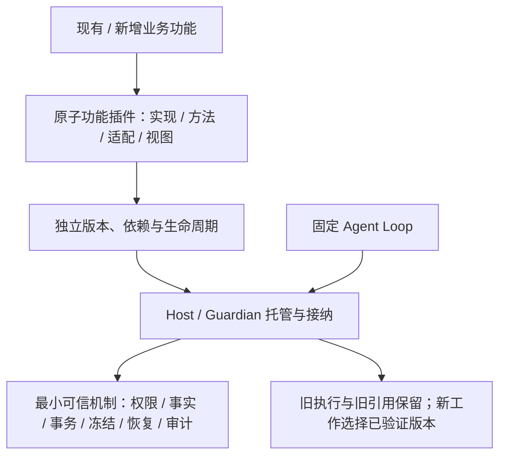
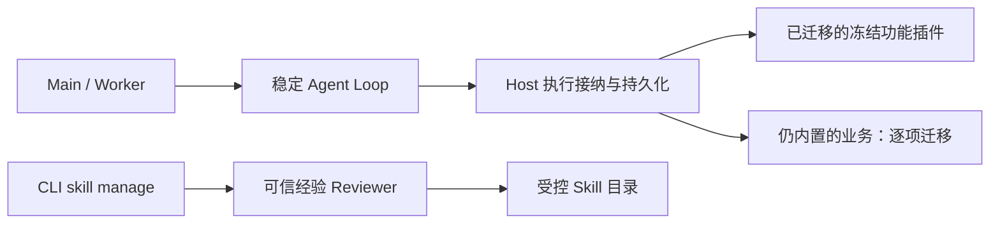
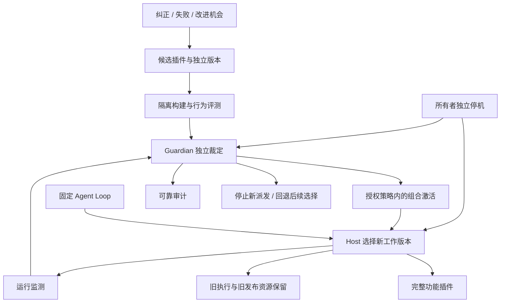
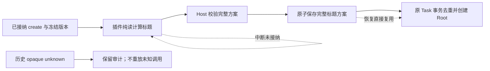

# 功能插件与受控自进化：技术方案

[功能与需求](../features/plugins-evolution.md) · [steward-rsi-plugins 协议](steward-rsi-plugins.md) · [测试方案](../test-plans/plugins-evolution.md) · [需求主索引](../feature-map.md)

## 全量插件化架构约束

**已确认的工程方向是 all in 插件：全部现有与新增业务功能都应归属独立版本化、由 Host／Guardian 托管的插件。** 拆分准则是 **feature 原子＋可独立无损自迭代**；这是后续实现与评审的约束，不表示当前已完成迁移。真实消费者涵盖 Main、Root／Child、所有者操作、工具／服务、后台工作和 Web／终端／飞书界面；插件化须保留下游现有业务协议与数据语义。

### 稳定内核与可变业务

固定 Loop 保留持久推进、等待与终态接纳；Host／Guardian 保留权威事实、凭据、授权／审批、事务、冻结与版本选择、隐私／撤权、受控效果、恢复／unknown 不重放及独立验证／审计／停机。可信资源 driver 可以留在 Host，但必须仅承担明确的固定机制，保留资源身份及兼容约束；不能把可替换业务算法或决策以“安全”为名全部藏回 Host。每次新增内核职责须记录真实调用方、不可下放的不变量、窄强类型接口及取舍。

工具、方法、选择／排序／表达策略、服务适配、后台业务、设置和视图等可变业务归所属插件；按真实职责组合现有机制，不为每个内部函数增加插件或进程。公共契约与内部实现分离，默认私有／实验级；只有独立消费者与验证证据支持时才扩大开放范围或稳定承诺。不借全量迁移增设通用 KV、任意执行接口或预测式扩展点。

插件工具的能力冻结和绑定执行共同投影原图中的声明、Schema 和资源身份。Host 内部以同一构造器为每次调用安装 SQLite 执行围栏，调用者继续明确提供普通 Run、嵌套 Code Mode 或领域约束。MCP 和 Connected Apps 共用已接纳参数、原执行和图的检查及结果接纳；两者的资源身份与对端协议分别由原消费者决定。已发出调用在接纳前失去授权时，按原回执的重放策略记录未知或不可用。此机制是私有事务接线，无插件 API 或独立生命周期。

### 本轮迁移的粒度与范围

本轮交付是现有 feature 的实现迁移、旧实现清理与行为兼容，不包含自动生成候选、自动评测晋级或自动部署的 RSI 新工作流；这些仍属于 F-072。迁移不能成为扩大基础设施的理由。

执行以完整 feature 为批次：同一 feature 的表现、默认值、交互策略和旧实现清理集中迁移，完成必要局部回归后集中运行跨模块验收；不为单条文案或内部函数各建一轮完整迁移流水线。源码在验收期间保持固定，失败修正后重跑受影响检查；不通过减少权限、隐私或恢复验证来换取速度。

生命周期属于原子功能插件，不属于每个内部方法。多个真实调用入口可以共享同一个插件包、版本与冻结图；不因增加一个内部函数而增加插件、进程、独立选版或持久状态。仅有函数不同、输入结构不同或文件不同，均不足以证明独立生命周期的必要性。新增跨边界方法须指出 Host 的实际调用时机与必要输入，优先复用同一业务操作的结果；只有确实独立的消费者或权限／恢复边界才保留单独调用。

当前 Schedule 的日历计算、表单解释、展示及元数据属于一个 `steward.schedule` 包，共用包版本和生命周期；现有私有方法不承诺独立升级或公共稳定性。后续不再按文案、字段或默认值拆插件。收敛重复接线时保留真实调用所需的最小数据和历史冻结语义，不以删除安全校验或强迫旧 Run 改用新版换取接口数量减少。

### 实施与完成判定

1. 新增／扩展业务行为走托管插件路径；迁移中保留 native 只用于明确的历史快照或已记录的过渡边界。服务激活后不可因停用、缺包、失败或重启而静默退回 native。
2. 插件必须实际持有并执行可独立演进的业务职责；仅移动目录、注册 manifest、包一层原生代理或预留 SDK 不算迁移。只提取部分职责时，明确标注已提取边界和剩余业务，不能据此将整个功能标为迁移完成。
3. 完成证据须涵盖真实业务调用、独立实现换版／回退／停用、旧 Run／Child／在途操作／已发布资源及引用兼容，以及适用的审批、撤权／Forget、未知效果不重发。无损保留语义和原始事实；不承诺撤销已发生的外部效果，也不越过当前安全撤权。
4. **迁移当次即清理旧代码**：删除已被替代的业务实现、过渡代理、死分支、无用配置／依赖和只服务已删除行为的测试；不保留两套默认实现。兼容代码仅能由确切历史版本／在途执行／已发布引用证明需要，须标明入口、消费者、保留理由与可删除条件，不能成为新业务的通用 native 兜底。清理纳入迁移完成判定。
5. 实现同步维护 Feature Map、所属功能／设计／测试方案；执行记录保留在 PR／CI／本地 evidence。F-070 只有在全部业务职责的迁移与生命周期均有证据后才能完成；候选包清单不是封闭范围，也不是已经完成的证明。

已拒绝“所有代码都是插件”式扩大可信执行面、把业务长期留在内核的双轨默认实现，以及靠冻结接口掩盖不兼容更新。最小可信内核与全量业务插件化须同时成立；需要改变内核或下游契约时，按原工程／治理规则单独说明，不借候选自进化绕过裁定。

## 当前架构与证据

F-070／F-072 已有 [0.1 协议基础](steward-rsi-plugins.md)。DOCX 读取与 OCR 已接入独立插件和原工具入口，其余功能按下表逐项迁移；自动演化闭环仍待实施，属于 F-072 的独立后续范围，不作为本轮现有功能迁移的完成条件。实际消费者是 Main、Task Worker、Web／终端／飞书入口和本机所有者。下游必须保留当前工具声明、Task／Run 身份、审批、交付、已发布组件、Artifact 和隐私／撤权语义；本方案不授权改写这些契约。

| 已有基础 | 证据与当前限制 |
| --- | --- |
| 插件托管基础 | [Go SDK](../../pkg/rsiplugin/protocol.go)、[Host](../../internal/rsi/control.go) 和 [CLI](../../cmd/steward/plugins.go) 已接入；资源贡献挂载及自动演化策略仍有缺口 |
| 单一执行循环 | [agent/loop.go](../../internal/agent/loop.go)；保持推进、等待、结果接纳机制稳定，不能仅因移动包名就宣称已形成保护边界 |
| 内置能力组合 | [plugin/webaccess/plugin.go](../../internal/plugin/webaccess/plugin.go)、[tool/executor.go](../../internal/tool/executor.go)；原 Registry／Executor 继续接纳，已迁移方法使用冻结插件图；其余业务仍按下表清点 |
| 冻结请求与受控调用 | [agent/sqlite/generation.go](../../internal/agent/sqlite/generation.go)、[agent/sqlite/tools.go](../../internal/agent/sqlite/tools.go)；保持现有 claim、审批及恢复接纳 |
| 版本化方法读取与候选 | [skill/catalog.go](../../internal/skill/catalog.go)、[agent/sqlite/experience.go](../../internal/agent/sqlite/experience.go)；资源漂移可拒绝，但尚无完整旧版本资源托管；经验仍由 CLI 驱动 |
| 执行诊断 | [observability/sqlite/recorder.go](../../internal/observability/sqlite/recorder.go)；诊断允许缺失，不能承担必须成功提交的演化审计 |

## 目标职责与剩余闭环

| 不变机制：领域必需 | 可迭代政策与实现 |
| --- | --- |
| Host 的事实记录、执行权、事务、冻结、审批、凭据、撤权与隐私 fence | 对话策略、上下文选择、召回、研究配方、任务交互、工具适配、视图与渠道协议 |
| Guardian 的候选身份检查、独立验收、授权裁定、可靠审计、激活与恢复 | 插件提交的候选、效果假设、验证建议和可选运行参数；不能放宽 Guardian 的门槛 |
| 固定 Loop 的持久推进、等待与终态接纳 | 功能包提供的模型方法、提示、工具及结果呈现 |

Host 托管不等于允许插件直接读写原始状态。业务状态变更通过消费方定义的窄接口接纳，跨 Task／Run／Delivery 的不变量在 Host 事务内强制。原始字节和权威记录由底座保管，插件只声明所需的状态语义、兼容与迁移。既有同进程 native 模块仍是受信代码；新协议插件在 OS 隔离进程中运行，IPC 本身不构成安全隔离。自生成代码执行前必须有与其权限匹配的进程／OS／VM 隔离、资源限制和受控效果接口，首版载体为 Go 隔离进程；平台限额及尚未实现的边界见协议，不据此宣称完整硬资源隔离。

## 已提取的上下文边界

真实消费者是 Generation 的版本 2 工作集准备路径。`context-compact` 独立进程只收到每条消息的角色、受保护／召回标记、精确模型／帧字节成本和匿名图片去重键，返回保留图片位置、完整历史前缀边界及摘要方法。提示正文、记忆明文、密文、来源引用和数据库句柄均不暴露。Host 重新从原消息构造结果，强制保留 system、当前输入、unknown-effect 等受保护事实与 recall；不得拆开工具交换、虚构图片或超过实际预算。摘要模型、固定安全 system、证据封装、原文归档、费用授权、接纳与恢复仍归 Host。

此处的角色、预算、完整工具交换和隐私检查属于领域必需机制；最近保留条数、图片选择、压缩前缀与摘要表达属于当前可替换政策。接口维持仓库内部实验级，不公开 `llm.Message`／Checkpoint 模型、不提供任意消息重写或数据库能力。拒绝让插件直接返回最终模型请求：这会把事实完整性、权限与策略绑在一起。旧版本 1 压缩及已冻结请求继续使用原解释器，不能以新策略重算。

[migration 53](../../internal/agent/sqlite/migrations/053_rsi_feature_snapshots.sql) 为每个 Run 增加不可变已迁移服务清单。新 Run 从曾激活服务冻结清单；Child 原样继承父级，即使父清单为空。停用不清除迁移边界，缺少实现时明确不可用；不会回到旧原生实现。升级只选择后续新 Run，不重写正在执行的组合。迁移仅从已有 DOCX／OCR 冻结标记恢复这两个旧服务，不把后来新增服务回填到历史 Run；原政策与请求字节保持不变。该清单替代继续为每个迁移项增加布尔字段，未引入通用跨 Run 共享状态或自动状态迁移。

## 已提取的召回边界

真实消费者是自动上下文 Recall 与原 `memory_search` 工具（Main／Worker 和 Code Mode 共用原接纳入口）。`recall` 包独立持有最近问答的检索组合、候选合并顺序、词项及摘录／支持引文选择。领域 Provider 仍按原冻结资源身份检索，Host 先按真实用户／Agent、当前输入、已见证据、来源与隐私时间下界排除候选，再传有限正文及评分；插件不获得原始 source_ref、数据库、凭据或任意搜索接口。Host 只接受候选位置、原文 byte window 与既有引文位置，重建真实来源、作者、时间及完整对象 ID，强制去重、UTF-8、数量和输出预算。XML 不可信证据封装与原 system → history → recall → input 顺序仍由 Host 持有。

[migration 54](../../internal/agent/sqlite/migrations/054_recall_selection.sql) 冻结每次授权候选读取，随后才调用策略；中断恢复不重新搜索变化的语料。Memory 候选必须加密，密钥仅在 SecretStore；固定 key_ref 使配置换钥不改旧快照解释。仅含原始 Conversation 的快照可沿用原对话本地存储边界。独立只读快照密钥解析复用现有受锁保护的密钥分配，不启用 Memory maintenance、不改配置，也不在控制面读取时创建密钥。Forget 清空候选正文及插件结果，隐私代次与执行权在读取、分块释放和结果返回时复查；保留的身份与已冻结模型请求不据此获得继续执行权。

候选冻结、原文／引文完整性、scope／epoch 与预算是领域必需机制；查询补充、排序和摘录位置是当前策略。两个服务与 DTO 保持内部实验级；没有公开 Memory/Conversation 实体模型、跨 Run KV 或底层索引 SQL。未把本地／向量索引驱动混入策略包，驱动继续按已有资源身份冻结；这种分离允许实际独立变动，不是通用检索插件框架。拒绝每次失败重新检索和让插件返回自由文本 Hit，两者都会破坏来源或恢复一致性。

## 已提取的 Main 对话边界

`conversation` 包只负责 Main 的沟通／工作方法：何时直接处理、委派、检查成果和继续推进，及表达方法。实际消费者是新 Main 的初始化路径；输入只有 `role=main`，没有历史、用户正文、能力集合、数据库或凭据，也不请求 hooks／输入读取／状态写权限。Host 从既有冻结 Section 重建一条 system 消息，固定 Ghost／Steward 身份前缀、安全 Section、角色、来源与 `rules` 外框；原消息、权限、输入队列、历史边界、Task 接纳、模型请求及交付回执不由方法包改写。Root／Child 不消费该服务，继续使用自己的冻结 Worker 规则和父级继承。

组合在 Run 创建时已固定；方法在首次上下文准备时经独立进程接纳，并与 History 一起提交 ContextReady，之后不再重新解释。方法结果先有持久调用回执，ContextReady 写入失败可恢复同一结果；模型只能在上下文提交后接纳。旧 Run 无该迁移标记，仍用已有方法；升级不改变已排队 Main 的组合。停用／隔离拒绝尚未装配的方法，不静默回到原生方法；已经接纳的冻结文本作为原请求数据保留，继续受 Host 的执行权、业务停机、权限和隐私约束。

本接口只在仓库内实验使用，不公开任意 system／历史编辑器，不让插件生成身份或安全 Section，不把 Root／Child 方法、渠道渲染、工具适配或交付事务并入 Main 方法包。Role／安全／回执属于必需机制，沟通／委派配方属于可迭代政策。独立 v1.1 测试真实改变方法文本、由所有者另写预期门槛后激活；这些功能门槛证明版本与来源，不代表模型语义质量评测，也不允许候选自改验收政策。拒绝动态注入历史和每轮重新拼方法，避免丢失冻结前缀或把普通版本变化变成运行中热换。

## 已提取的自动记忆边界

实际消费者是私有事实提取、Dreaming 四种既有方法和自动 Dreaming 调度。`memory-curator` 只接收方法样式或空调度请求，独立返回方法及有界触发配方；不收到观察正文、Memory 文档、source_ref、数据库或模型凭据。Host 持有安全 system 前缀、原观察／引用映射、私有模型授权与费用、原文归档、候选与引文验证、revision／scope／privacy fence、写入事务及完成回执。普通请求、秘密和不符合长期事实范围的观察仍由 Host 过滤；方法不能把不合格数据变成真实事实。

[migration 55](../../internal/agent/sqlite/migrations/055_memory_policy_binding.sql) 独立记录 Memory intent 的迁移与组合绑定，不伪造用户 Run。已有事件及旧私有请求继续原解释器；新观察在接受时固定可用的已验收组合，跨推理重试、Dreaming 多轮与升级不改写。停用时新观察保留为未选定实现的 intent，显式重新激活后只绑定一次；不自动复活原生方法。直接 remember／forget 等用户数据控制归 Host，不因方法插件停用而失效。私有模型请求加密保存确切方法及 `policy_revision`，已接纳结果可跨 Memory DB／State DB 恢复且不重复推理；撤权／Forget 仍优先，绑定不授予永久读取权。

自动触发配方在 writer 事务外读取；当前以最少证据数和最大等待时间表达既有 8 条／5 分钟策略，Host 限制范围并在入队事务复查确切组合，防止配方与生成方法混版。续页和需要重建的 injected head 保留现有进展／一致性条件，游标与原始语料不归插件。停用调度只暂停新自动 intent，保留原文和手工控制。自动调度先读取持久激活历史；曾托管的服务即使运行器缺失也不可恢复原生频率，只有从未托管的嵌入保留历史配方。

当前三条独立来源提升 Core、365／545／180／14 天等保留规则属于 Host 自持的数据保留／可信度政策；候选无权自行缩短保留或降低信任门槛。它们不是永久 SDK 语义，改变仍需单独的所有者数据政策与兼容验证。持久化、因果关系、加密、来源校验、隐私与预算是必需机制；提取／综合方法与触发频率是可迭代配方。两个服务保持内部实验级，不公开完整 CurationInput／Mutation 模型，不提供数据库、跨 Run KV 或任意私有推理入口。拒绝在 SQLite writer 内执行插件或让候选直接提交 Memory：两者都会破坏撤权或数据接纳边界。方法回执的来源由不可变 binding 与加密私有 generation 关联，读取方法本身不创造用户 Task、交付或普通 RunTrace。

## 已提取的证据分页边界

实际消费者为 Main 的 `evidence_read` 与本机 Conversation／Task／Artifact、Memory、GitHub 关联证据读取。`evidence-reader` 持有 UTF-8 文本切页和链接页长策略，两个私有实验服务只接收有界字节边界／换行位置或候选数量；不接收正文、对象引用、来源关系、密钥或数据库。Host 打开并验证原件，按原始字节重建正文，强制正向进展、合法字符边界、最大 4096 字节／20 条关系及确切下一位置；每条关联的因果事实与可见性仍由 Host 判断。减少页长只能返回完整前缀并让后续从确切位置继续，不能跳过、伪造、改写正文或凭空添加关系。

新 Run 使用既有不可变服务清单和组合；旧 Run 保持 native 读取。本机页新增 `page_revision` 供后续读取固定已激活组合，独立于 DOCX 的 `reader_revision`，Main 工具不接受所有者选版参数。停用拒绝新读取，显式固定的历史引用可排空；退役保留旧包，隔离／停机与 Forget 可拒绝历史读取。每次从原授权对象重读，不缓存证据副本。分页为无状态纯读，经 domain Fence 的 `ReadService` 调用；最终工具回执沿原管线冻结，不额外写 RSI 调用，避免已接纳 Main／本机读取争抢 SQLite WAL writer。

原字节、权限、来源关系、完整性、游标和隐私检查属于领域必需机制；选择合法切页边界与每页关系数属于可替换策略。保持私有实验接口，不公开 Evidence Page 内部模型、SQL、泛化来源解析器或数据库 effect。独立 v1.1 用不同二进制实际缩短文本和链接页，所有者独立编写验收预期；旧 Run／旧页保持原解释器，回退不丢失新版引用。拒绝插件直接返回正文或引用列表，避免将表达策略变成事实与权限裁定。加密 Memory 解密和 DOCX/OCR 解析仍由各自拥有者负责，不能因分页插件存在而增加来源访问权。

## 已提取的方法库边界

实际消费者是 Main／Root／Child 的原 `skill_list`、`skill_view`，包括 Code Mode 嵌套调用。`skill-library` 独立持有目录排序／查询匹配和默认资源入口：发现只收到本 Run 冻结的名称、用途和有界查询，返回目录位置；资源入口只收到相对 path，不收到 Skill 名称、正文、全文件列表、Scope／Version 或操作系统路径。Host 从原 capability metadata 重建确切名称与用途，拒绝越界／重复位置和超限输出；读取仍通过原不可变文件／内置资源 driver，保留全目录指纹、相对路径、单文件哈希、二进制 Artifact 输出和旧回执。显式请求的 path 不得被候选替换；默认入口可在冻结资源中独立迭代。

新 Run 按现有组合与迁移清单选版，历史 Run 继续 native 搜索／入口政策；新实现不改模型工具名称、Schema、ResourceHash 或 prompt metadata。可信 Host 接纳入口同时覆盖两个工具；方法停用后两者不可回退到原生政策，原 Skill 文件不删除。已接纳结果仍沿原工具回执重放。已排队 Run 的旧二进制和配置可跨升级、回退与退役保留；原目录自身发生内容漂移仍按既有契约拒绝替换，不把插件版本保留伪称为任意文件内容自动归档。每次方法／文件返回前重查执行权、组合隔离与停机；Forget 优先，不因只读操作而绕过撤销。

目录发现、默认入口属于可替换政策；冻结资源身份、精确文件字节、权限和 durable Tool receipt 属于必需机制。接口保持仓库内部实验级，没有公开 Skill 实体或目录写入接口，没有把方法经验晋升、磁盘归档或插件资源挂载泛化到这个消费者。当前文件目录与内置资源仍为 Host 自持资源，插件无需文件系统或网络权限。独立 v1.1 实际改变排序和默认入口，所有者另写预期验证后才激活；旧 Run 可读取已退役版本，回退只改变后续新选择。拒绝插件直接生成 Skill 列表／正文或自行返回宿主文件路径，避免方法选择和事实存储合并。

## 已提取的经验配方边界

实际消费者是既有本机 Reviewer 的 propose／verify／promote／reject／retire 闭环；普通 Main／Worker 仍无 Skill 管理能力。`experience-learning` 独立返回方法引言和所需独立成功 Run 数，输入仅是 success／correction／recovered_failure 原因，不收到提案正文、原始来源、执行证明、数据库或发布目录。Host 验证提案与秘密过滤，逐条核验原有来源及纠正／失败类型，保留原始提案字节，将配方引言与原方法组合后再次验证。通过同一 CAS 与精确命令证明管线处理；候选无权写 Skill 或自行晋升。

[migration 56](../../internal/agent/sqlite/migrations/056_experience_policy_binding.sql) 为候选固定不可变配方组合、原始方法和独立验证数。既有候选保持原方法、hash、状态／version 和 1／2 次配方；新候选的 method identity 同时绑定组合与所需验证数，避免不同可信条件共享同一候选。重复提交同一组合仍复用原候选；改配方产生新的候选身份。验证、晋升与发布恢复不重新请求当前策略。方法正文与策略一起固定，verification 继续绑定确切 method_hash 与独立 Run，升级／回退／退役不改变在途候选。Host 保留命名空间唯一发布归属，两个候选不能同时拥有同名活跃方法；所有者显式退役才释放发布名。

当前可信最低门槛仍为普通成功至少两条独立 Run，纠正／失败恢复至少一条，且必须有实际成功的 `go test -race ./...`、完整未截断输出及正确来源。配方可以提高门槛，不能自行降低；这属于当前所有者可信度政策，并非永久 SDK 常量。独立机械验收即使认可更低数值，实际 Reviewer 仍会在创建候选前拒绝。方法引言和更严格的验证配方属于可迭代政策；原文、来源、秘密过滤、CAS、命令证明、最低门槛及持久发布回执属于 Host 机制／可信政策。

停用阻止新配方，不复活 native；已接受候选可沿已固定事实继续验证、拒绝或退役。隔离／停机阻止绑定该组合的后续晋升，已经发布或写出的确定内容保留并通过原 Reviewer 恢复／退役，不伪装成跨文件系统与 SQLite 的原子回滚。发布仍使用已有受控 staging、精确内容比对和崩溃恢复。本接口保持私有实验级，未开放完整 ReviewRequest／候选实体、目录写入或任意执行接口；未添加自动触发、模型生成提案或自动晋升。拒绝每次 verify 读取新策略、让候选自定可信底线或直接提供最终 Skill 文件，避免改变旧候选条件、混淆事实与方法表达。

## 已提取的 Task 发现与标题边界

实际消费者是原 Main `task_search` 和 `task_manage(create)`，包括既有工具接纳和 Code Mode 路径。`task-control` 独立持有本地词项／分布关联排序与默认标题方法；搜索只收到授权候选的有界检索文本、状态、更新时间和查询，返回位置，不收到 Task／Agent／Conversation ID。Host 按原 scope、status、recent、用户／会话与隐私下界收集候选，从原对象重建全部字段／引用，强制去重、位置和数量。新排序固定浮点求和顺序，避免 map 遍历改变同分次序；历史 native 方法保留。

纯搜索在确认已激活实现、执行权与隐私代次后才读取语料，所有 SQLite writer 均已释放才启动插件。输入按既有 8 MiB 协议预算分块，包含完整保留指令；超预算明确 RESOURCE_LIMIT，不截断语料后宣称完整成功。Host 先计算单 Task 指令总量，再决定是否 materialize group_concat，并累计整个工作集预算；返回仍保持原最多 50 条和摘要字节限制。结果沿原 Tool receipt 冻结，不另写 RSI 调用。分块前、结果返回和异常后复查撤权；底层纯读 RPC 的 transport fault 不能把已经发生的 Forget／执行权丢失包装为未知执行结果。

标题只接收已接纳 create 的文本及“用户显式标题”标记。Host 保留原 Task brief、artifact grants、completion policy、消耗消息身份与 canonical action hash。显式标题只能按原 whitespace／长度规则规范化；默认标题允许独立迭代，但必须为不超过 80 字的单行标签。标题经无状态／无效果回调的 `ReadService` 求值，Host 校验后才在原 Task 事务前按 invocation 固定 `task_label_plan`，事务中复查组合、执行权与原 action hash；尚未接纳的纯计算中断可重算，完整选择恢复时复用。`schema64` 不回写历史请求或通用 `rsi_call`：已有完成标题只读复用，未完成 opaque 调用保留 unknown 审计，绝不调用通用重试接口。Forget 同事务擦除标题正文并撤销旧执行，已擦除方案不能复活。已接受的 task_request／task_invocation 先重放原回执，不依赖重新派发已停用／隔离的方法。

这个持久方案是具体 Task 标签的恢复机制，复用文件／命令领域的先行纯方案模式；只保存标题、原请求 hash 和冻结组合，不保存另一份 Task 效果。未开放新的通用计算缓存、跨 Run 状态或 SDK 重试能力。拒绝让纯标题沿 opaque 调用先写 pending：两个重复 create 的并发计算可能在 Task writer 前后留下永远无法自动判定的记录；也拒绝删除 unknown 或放开通用自动重试来掩盖它。

任务状态、epoch／版本、同 Task 单活动 Root、append 排空、完成条件、unknown effect、审批、来源去重、因果交付和 Forget 属于 Host 机制；搜索顺序与缺省标签属于可替换政策。已定位 Task 的暂停／取消等控制不依赖可替换方法；停用不复活 native 标题／搜索，也不删除任务事实。新 Run 固定迁移标记和组合，旧 Run 仍使用原方法；独立 v1.1 实际改变默认标签与排序，旧 Run／退役待执行版本和回退均验证，显式标题及原 action hash 保持不变。

这两个接缝为私有实验级，不公开完整 Task 实体、任意状态变更／SQL 或生成任务控制操作的接口；不引入自动任务合并／拆分规则、通用工作流引擎或跨 Run KV。已接受 Task 数据的重放与新派发分别处理，防止模型方法停用阻断安全停机，或把派生标签误当作新的业务意图。阶段进度另有提示／筛选接缝；问答／审阅配方另见[任务设计](tasks.md#问答审阅配方独立迭代f-004私有实验接口)；委派方法与预算接缝另见[委派设计](delegation.md#独立委派方法与递归政策私有实验接口)。

## 功能原子与拆分判据

一个功能包按需要包含入口注册、tools／events／commands、Skills／prompts、设置、视图和资源。参考轻量功能包的组合习惯，由 Steward 自主实现，不导入外部 Agent SDK 或插件实现。

**可拆开的条件**：能描述独立用户结果；状态和资源所有权明确；变更仅需声明的版本化依赖；能单独验证新版本并证明旧状态、旧执行和旧引用继续成立。文件少、工具少或目录独立不足以证明边界。允许可选依赖降级，但不能隐藏功能损失。破坏下游契约的改动必须联合变更，不能宣称无损独立升级。

### 当前功能包边界

当前默认装配为40个包。实际迁移与验收状态统一维护在[逐功能清单](../features/plugin-migration-status.md)，本设计不再保留一套落后的候选迁移状态。包内按原子功能组合服务与资源；包名不是独立无损迭代的证明。

| 功能组 | 当前 owning 包 |
| --- | --- |
| 对话与学习 | `conversation`、`context-compact`、`recall`、`memory-curator`、`evidence-reader`、`skill-library`、`experience-learning` |
| 任务与主动工作 | `task-control`、`task-progress`、`task-feedback`、`delegation`、`schedule` |
| 执行与工作区 | `codemode`、`file-tools`、`shell-tools`、`coding-workspace`、`computer-use` |
| 资料处理 | `web-access`、`web-extract`、`docx-reader`、`image-ocr` |
| 连接与发现 | `mcp-bridge`、`connected-apps`、`tool-discovery`、`model-connections`、`feishu-chat` |
| 应用与跟进 | `apps-directory`、`apps-accounts`、`apps-logos`、`apps-interface`、`github-pr-followup` |
| 工作台与展示 | `artifact-workbench`、`intelligent-ui`、`memory-inspector`、`trace-inspector`、`capability-settings`、`terminal-interface`、`web-workbench` |
| 有限业务政策 | `reference-pricing`、`service-watchdog` |

模型来源的设置模板、连接／选模与展示政策归 `model-connections`；真实账户身份、密钥、原始目录事实及固定模型 wire／bridge 保留 Host。没有独立可替换的来源驱动消费者，不为旧候选名称另建 `provider-*` 插件或引入外部 Agent SDK。已发布版本及历史引用的解释器按各 owning 设计保留明确消费者与删除条件。

文件 read／edit／write 共用文件身份与哈希，先保留一包；命令执行有不同资源与 unknown 语义，单独成包。GitHub 精确轮询、规则代次与 Task 接续一起验收。当前浏览器／桌面共享 Guest 与句柄代次，先保持一包。共享控件、字体与品牌不复制成各页面插件；功能贡献自己的设置和视图。搜索供应商、embedding、执行后端和资源可作为版本化依赖，不自动提升为新的用户功能插件。

Gmail、地图、日历、Drive、Health、音视频、图片生成等未实现或待定义需求不算已有功能包。F-028 的重启次数／退避与 F-029 的参考报价已分别提取为有限政策插件；人工停机、健康事实、持久效果接纳、显式费用授权、真实 usage 与整数结算仍属 Host。F-037–F-040 的安装与工程基础保留固定可信机制，不把整个控制面交给业务插件。

## 版本、生命周期与演化协议

当前实验实现与统一语义以 [steward-rsi-plugins](steward-rsi-plugins.md) 为准，覆盖包清单、显式依赖、组合锁定、运行作用域、效果接纳、状态兼容、候选与证据、独立裁定、原子激活和可靠审计。

新工作绑定已验证组合，旧工作保留原实现与资源；撤权／隐私 fence 优先。插件与改进工具可以独立迭代，固定 Loop 和 Host／Guardian 的执行、验收与恢复权力不由候选修改。卸载不删除共享连接或持久事实，版本回退不撤销外部副作用。

## 开放范围、取舍与落地顺序

| 决定 | 理由与代价 |
| --- | --- |
| 仓库内 private／experimental，真实消费者验证后再稳定 | 避免预测通用插件 API；首期包间契约可能调整 |
| 功能独立版本，验证锁定依赖的组合 | 保留独立迭代，避免未验收版本任意拼装；需要组合身份与兼容验证 |
| 旧执行固定版本，不原地热换实现 | 保留恢复语义；必须承担多版本资源和引用管理成本 |
| Host 保持权威状态和跨域事务 | 防止拆包产生第二套 Task／审批；插件不能任意操作数据库 |
| 底座与自生成候选分离 | 候选不能控制自己的验收与执行权；不追求整个系统同时自我改写 |
| 自动回退范围限定为可恢复的选择和兼容状态 | 外部副作用与不可逆迁移无法靠换版本撤销 |

首轮先从 OCR、DOCX 和执行轨迹检查验证资源托管、只读接口及旧引用；再用上下文压缩和 Web Access 验证冻结模型与持久证据。任务控制、命令执行、账户来源需先证明在途资源与授权交接。候选包清单不替代 Feature Map 中现有产品工作优先级，不先建设市场、任意事件钩子、通用工作流 DSL 或永久公开 SDK。

验证与交付遵循 [测试方案](../test-plans/plugins-evolution.md)、[运行时契约](runtime-contracts.md) 和 [工程流程](../features/engineering.md)。后续每次提取仅改必要接缝，保留旧配置／工具／消息格式；新增格式与数据迁移需在实现前给出兼容证据。本页的候选拆分与目标架构不代表全部能力已迁移；现有运行时的实现、限额与剩余缺口以协议和测试方案为准。

CodeMode 的私有纯接缝、原 manifest 资源冻结和说明回复接纳见[CodeMode 设计](codemode.md#独立执行配方与参数说明私有实验接口)。不向方法包开放源代码改写、任意 Host RPC、数据库或 VM 字节替换。

持久隔离／停机属于 Host 权威：恢复已有受管 Run 时，即使当前适配器未装配插件运行器，也必须从原 frozen graph 检查这些记录，不能把进程不可用解释为原生执行授权。没有受管 graph 的历史 native Run 保留其原边界。

文件组件使用纯窗口／定位服务，原 IO、审批、CAS 和 unknown 保留于 Host；固定 driver 指纹与原 native 兼容边界见[文件设计](coding.md#独立文件方法与固定提交机制f-026私有实验接口)。

### 已提取的命令资源边界

命令正文、工作区、审批、沙箱和结果事实留在 Host；私有 `steward.shell-limits/1` 只接收原数值上限和可选用户 deadline，并返回更窄预算。先行不可变配方不授予重放未知命令的权限；历史执行、旧版本、Guest epoch 与撤权行为见[命令设计](coding.md)及[验收方案](../test-plans/coding.md)。不开放通用执行器或命令／输出改写。

### 无载体执行的持久边界

Run 接纳始终从持久激活记录固定 graph 与 managed services，不以当前可执行 catalog 是否存在决定边界；空安装／明确未打包载体也保存空图和空服务。缺少载体时，已采用服务的新执行失败，不恢复 native。Child 继承原 Parent 的确切空／非空边界。schema63 仅为 schema62 历史无载体缺行 Run 补 native 记录，不把当前选择追溯绑定到旧执行；原 Context policy、请求、审批与回执不改写。这是冻结与恢复必需的机制，不能以捕获 RSI_NOT_FOUND 并忽略替代。

Computer 的原生选区方法通过封闭光标方案独立演进，原批准意图／确切原文跨度／原语预算及未知输入不重放继续由 Host／固定 Driver 强制；不开放通用动作替换器。实际消费者、取舍和旧算法清理见[Computer 设计](computer-use.md#原生选区算法与固定输入原语)；同包其他服务、默认组合及固定生命周期边界由 Computer 设计维护。

Computer 的清单排序与对象匹配通过匿名原位置独立演进，原范围、完整排列、精确 ID、已绑定对象和提交租约由 Host 强制；大清单匹配使用同一快照分批，不引入通用查询或效果执行器。实际消费者、私有数据边界、旧三／四服务兼容和清理条件见[Computer 设计](computer-use.md#清单排序与对象匹配私有实验接入)。

Computer 普通动作参数经纯服务计算后，由 Host 在原审批前原子固化；执行只读原完整选择，不用 opaque pending Call 充当准备锁，也不在批准后重算。资源、显式意图、原审批／unknown、隐私单向擦除与旧六服务 Run 仍由 Host 强制，见[Computer 设计](computer-use.md#审批前固化动作参数私有实验接入)。

Computer 的 Playwright capability 参数经第八项私有服务在原审批前固化，保留旧七服务 Run，缺省超时可独立迭代、显式字段不能改变。资源引用不进入候选、受管 map 透传已删除；机制／政策分类及剩余范围见 [Computer 设计](computer-use.md#playwright-参数的私有实验接入)。

Computer 的第九项私有导出展示服务只决定缺省名称／媒体类型，原路径和字节不进入候选；Host 在原审批前解析具体源名称并固化，Artifact staging 与接纳共用所属域的元数据验证。旧八服务、清理条件与取舍见 [Computer 设计](computer-use.md#文件导出展示的私有实验接入)。

Computer 的第十项上传展示服务只接收原公开选择器／预算，Host 解析原 basename 并在原审批前固定完整参数；原图配置仅能选择 Host 自持的确切 FileChooser 资源，不注册程序或扩张 Go SDK 权限。旧九服务、资源保留和文件名协议差异见 [Computer 设计](computer-use.md#浏览器上传展示与固定资源私有实验接入)。

Computer 浏览器观察的标签政策与前缀／顺序选择通过原文长度事实独立演进；固定快照读取和来源证明属于最小可信机制。实际消费者、UTF-16 保真、真实旧十服务保留及受管旧路径清理见 [Computer 设计](computer-use.md#浏览器观察投影与原文快照私有实验接入)。

Apps logo 的真实随包字节、来源优先级和缓存政策已由独立私有包提供；原图命名的 HTTP 引用和缓存／来源隔离保留资源版本；账户效果前固定图片选择，JSON／原生后续响应共用该原图，不让已接受动作被晚切图隐藏。Host 保留原来源、图片安全和停止／隔离检查，普通 Web 选择配方与重复 SVG 树已清理。该具体消费者不扩大为通用资源挂载，也不替代 Apps 前端／模板与默认分发；边界、内存元数据寿命、取舍和删除条件见 [Logo 设计](integrations.md#apps-logo版本化字节与公共来源的私有接入)。

Apps 的服务端与浏览器展示／交互规则已进入同一私有界面包，效果前编译公开语义表，Host 按原事实物化；不开放候选同源脚本或内部领域模型。旧请求、停用、可信接纳回执、兼容消费者和剩余模板布局／资源范围见 [界面设计](integrations.md#apps-界面同一冻结规则的两个消费者)。当前仍是私有实验，不替代完整界面贡献、默认组合和全量业务迁移。

Apps 的五类真实界面区块已有[独立组合接缝](integrations.md#apps-区块组合有限的真实消费者)；同一图的规则与组合在效果前固定，具名旧顺序仅服务原版本消费者。片段内部／完整资源与默认分发仍在清单中，不据此扩大可信内核或完成 F-071。

Apps 的 `/2` [最终文案契约](integrations.md#apps-最终文案实际语言输入与明确版本解释) 让现有中英文在包内独立变化；Host 明确解释旧版本，SSR／JSON／浏览器对新版本不再二次翻译。新包的旧编译包装已移除，兼容仅随真实旧图／引用保留；完整静态资源及默认分发仍在清单中。

Apps 已增加[真实卡片资源消费者](integrations.md#apps-卡片资源现有组件的有限组合)，同批删除普通内联卡片拼装，只保留具名旧顺序。现有原子 markup、其他片段、CSS 和通用资源回收仍属清单，不据此扩大可信内核。

Apps 的[侧栏入口资源](integrations.md#apps-侧栏资源原账户行的有限组合)已成为第二个实际有限视图消费者，同批清理原侧栏内联组合；仅共享已有资源身份机制与本包文件读取，不建立通用 UI 平台。效果后响应复用效果前解释；可选展示故障不能抹去已接纳效果。

Apps 的[卡片／侧栏标记资源](integrations.md#apps-标记资源受限模板与本地显示绑定)已有两个实际消费者，受限语法、平面本地显示数据和独立 DOM 接纳共同防止模板越权；不暴露内部 State，不以原生代理或任意模板执行替代迁移。共享原语与其余片段／CSS 仍属迁移清单。

Trace 文案沿用同一私有 Workbench 服务、包版本及冻结引用，以随包 copy.json 保存原中英文对应值；Host 仅校验资源摘要、结构、数量及重复键。字典不接收观察正文或凭据。Trace 自身翻译与共享 Context 阅读器的翻译须分别绑定，不新增插件、进程或持久状态。页面已消费同图字典并隔离所属 traceTr 与共享 tr；旧词条清理与完整验收仍属待完成边界。

Trace 原生词条的具名保留边界为 `steward.trace-inspector@1.0.1` 的 `legacy-ui/trace-v1` 模板与 `legacyTrace*V1` 标签，以及仍有实际消费者的共享界面。当前候选只读取同图封存字典，未知词条保留原文，不查询原生字典。某个 Trace 专属词条在旧 1.0.1 冻结读取／引用全部退役、且无独立共享消费者后删除；不得根据静态文字搜索为空就推断动态消费者不存在。

Trace 工具预览的业务调用位于工具节点独立分支，不能嵌在 generation 分支内。Host 负责冻结选择、读取原输入及接纳预览；当前托管解释器不得以 managed=false、缺少 projector 或返回空预览为由选择 native。legacyTraceToolOutputV1 的消费者为保留的 1.0.1／无托管 Workbench 历史读取，随这些引用退役删除。

### Main／Task 的历史消费者与冷恢复边界

当前分发只消费冻结的 conversation／task-control／task-feedback 服务；停用或缺包不能使用原生方法。Main 的原 prompt 仍是历史上下文初始化和独立 Owner 原始预期的消费者，不是当前插件失败后的方法来源。Task 原生搜索及问答缺省集中在 `internal/agent/sqlite/task_legacy_v1.go`，只供无迁移标记的历史 Run／反馈和明确 never-managed 嵌入；随这些消费者退役删除，已接纳回执仍作为事实保留。`task.Title` 同时承担显式标题和已存标签的有界规范化校验，不等于替代当前默认标题策略。Reporter 的来源映射、epoch、单次交付和必须如实报告失败的通知保留 Host，避免方法停用吞掉已发生失败。

独立换版测试在回退并退役后关闭原 Store、新建 Store／Catalog，再直接 drain 原排队 Main；不重新选版、不修改原 binding。Main 方法、Task 默认标题与问答配方仍来自原冻结版本；停用后再次重开拒绝新方法，同时原已接纳问题仍可按原配方回答。这些私有接缝不增加公开兼容承诺或通用恢复框架。

验证过程复用本次 Verify 已读取的确切图 manifest，只用于初始状态与声明校验，避免在每项 Owner 用例外再重复读取并 hash 整个执行文件。实际每项仍启动全新独立进程；Runner 保留调用前、调用后的完整封存字节校验，依赖调用与最终环境围栏不变。不新增跨调用缓存、常驻候选进程或可变文件豁免，也不扩大原并发度和启动期限。

目录读取仍校验普通文件和原有大小上限，按已检查的文件大小一次分配；短读或随后出现额外字节均拒绝。此处避免对每次前后完整 hash 的大执行文件反复扩张 ReadAll 缓冲，不增加缓存，不省略内容 hash，也不接受读取期间发生的大小变化。

默认39包的冷准备采用最多四个独立沙箱进程，只并行原组合 DAG 中依赖已完成的节点；仍按原拓扑顺序报告失败，全部通过才保存组合。prepare 没有效果、依赖调用、提案或本地计算端口，且每个进程保留独立 scratch 与前后完整 hash。这个边界解决实际冷启动期限内的独立初始化，不改变有依赖节点的屏障、验证并发度或超时，不引入常驻进程池。

### 本地服务重启配方的私有边界

现有 macOS service 的实际消费者是后台启动会话与离线巡检。`service-watchdog` 只提供重试次数和退避时长，输入为空；不暴露数据根、健康内容、凭据、进程身份或执行端口。此配方属于可替换政策，接口保持仓库私有，不新增通用 supervisor 或稳定公共控制协议。

启动会话把实际选中图和通过校验的配方一次性写入原服务控制文件；部署序号阻止旧会话覆盖新部署。进程死亡、人工停机、致命健康、先记账后 kickstart、通知和独立审计继续由 Host 决定。离线巡检只读取已接纳配方，不因新版本、停用或插件损坏重释运行中的部署；下次显式启动重新接纳。新部署缺失配方不采用原生重试政策，人工停止／启动仍可用。

仅控制文件 v1 的已安装历史部署保留具名原配方；崩溃恢复的 Begin 保留原部署，只有显式 Start／Install 转成 v2 后删除该消费者资格。所有 v1 部署完成转换后可删除解释器。没有保留第二套当前默认实现。拒绝在崩溃后的 Inspector 打开 App／业务库或临时启动插件，也不为简单配方增加迁移代理与热加载服务。

Owner 验证拒绝的定位属于 Host 的独立控制机制，当前消费者是默认图初始化和 Owner CLI。私有错误文本可包含当前冻结策略中的用例序号、绑定／契约和固定失败阶段；子进程仅附加清理后的退出状态及不可信启动报告分类，不披露输入、预期／实际输出或原始 stderr，也不推断具体原因。保留原错误类别、拒绝决定落库与 unknown 不重放；不增加 SDK／manifest 字段或调试开关，不承诺错误文本格式稳定。

Linux 的资源限额由固定系统 `prlimit` 在候选语言运行时初始化前施加，仍为 CPU30秒、文件16MiB、FD128、地址空间2GiB；macOS 保留原有限制和未声明硬 AS 上限的边界。这是所有纯插件的可信进程机制，不能作为可替换业务插件。选择原生 pre-exec 施加限额，拒绝提高 AS 上限、关闭限额或自动重试：对已启动的多线程 Go 载体设置更小 AS 会与线程／GC 分配竞态。Linux 无 helper 时明确不可用，不回退到旧 Go AS 施加路径；不新增插件配额配置或公开协议字段。

Linux 上持有域资源回调的子进程在固定环境中使用 `MALLOC_ARENA_MAX=2`。glibc 可为多个线程分别预约尚未使用的虚拟地址，这些预约也计入 2 GiB 上限。两个 arena 减少大资源传输与解码时的地址预留，代价是线程可能竞争同一个分配器锁。选择该值仅针对短生命周期的域资源进程，私有启动环境由 Host 提供。纯读、Guardian 与其他 Host 工作继承各自原有的环境规则。
