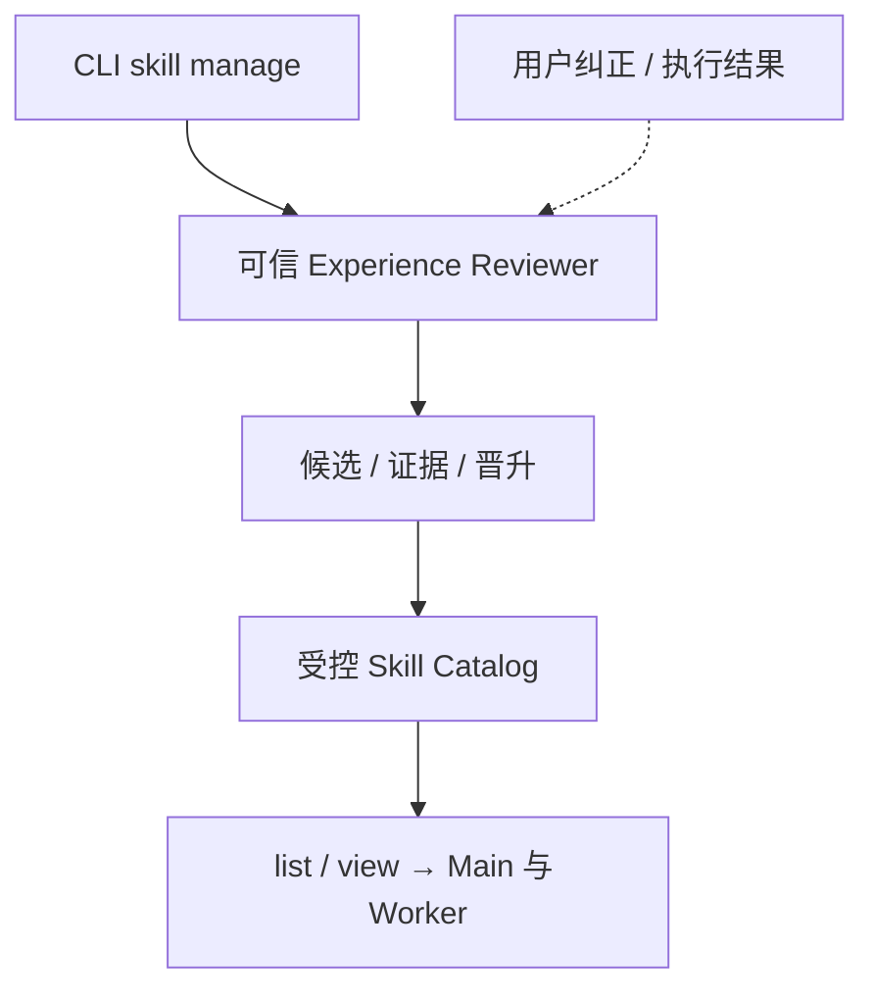

# Skills 与经验沉淀：技术方案

[功能与需求](../features/skills-experience.md) · [测试方案](../test-plans/skills-experience.md) · [主索引](../feature-map.md)

本文的架构与流程描述当前有效实现；明确标记的待实现方案不表示已落地。实现级协议仍服从 [跨功能协议与约束](product-overview.md#contract-0-文档效力与实现规则)。

## 当前架构

Catalog 向 Worker 提供冻结版本的读取工具；可信 Reviewer 维护 skill_candidate 与验证回执，并将已晋升方法发布进目录。自动事件到 Reviewer 的路径尚未连接。

system 不注入 `<skills>` 或 Skill 索引。Agent 通过 `skill_list({query?, limit?})` 按需搜索当前 Run 的冻结目录；query 匹配名称与用途，复用工具发现的确定性关键词排名（支持中英文），空查询按名称浏览。默认 8 条，limit 限于 1–128 条，返回仅含 name/description，不加载正文。Host 的版本、范围、资源来源留在冻结元数据中。`skill_view({name, path?})` 按名称读取正文或相对资源，适配器校验冻结文件指纹；Skill 不声明角色，也不授予工具权限。



## 当前流程与目标差异

读取已有 Skill 按需执行；当前经验流程由 CLI propose → verify → promote → 新 Run 读取新版本。目标是由可信事件驱动候选处理，保留审核边界。

- **F-022**：受控目录 list/view 与全目录指纹冻结已实现。 普通 Main/Worker 不管理目录；变化不热替换旧 Run 的冻结 Skill。
- **F-023**：可信 Reviewer 有 propose/verify/promote/reject/retire；目前由 CLI 显式驱动，缺自动触发与编排。 接入纠正/结果事件与可信 Reviewer；当前验证证据限于经审批的 bash 精确测试命令，需明确其他方法的证据标准。

## 代码与依赖

- [internal/skill/catalog.go](../../internal/skill/catalog.go)
- [internal/skill/experience.go](../../internal/skill/experience.go)
- [internal/agent/sqlite/experience.go](../../internal/agent/sqlite/experience.go)
- [cmd/steward/resources.go](../../cmd/steward/resources.go)

## 验证与交付

验收场景、已有入口和剩余覆盖统一在 [测试方案](../test-plans/skills-experience.md) 维护。实际执行结果以对应版本的 PR 或 CI 证据为准；架构说明不证明回归或 Live 验证通过。

## 协议、实现与配置约束

本功能协议在此维护。既有编号用于追溯协议，不代表所有设计目标均已实现；完成状态以需求主索引为准。

<a id="contract-7-skill-系统"></a>

### 7. Skill 系统

<a id="contract-71-skill-结构与加载"></a>

#### 7.1 Skill 结构与加载

M3 实现说明：本地 Agent 从显式配置的受控目录读取摘要；list/view 对 Main 和 Root/Child Worker 开放；新 Run 冻结 Skill 目录摘要，模型按需搜索，manage 不对普通循环开放。完整目录（含 references/scripts/assets）的内容版本和 scope 进入冻结 ToolSpec `resource_hash` 及 Capability Snapshot `skill_set_hash`。工具描述只说明搜索和读取接口，目录摘要与全文均按需返回。旧 Run 不热更新 Skill；内容或配置漂移时 fail closed。配置、权限和兼容规则见 `docs/designs/integrations.md`。

- 使用成熟的 Agent Skills 目录约定。
- 每个 Skill 以 `SKILL.md` 为入口，可选包含 `scripts/`、`references/` 和 `assets/`。
- 启动时在 Host 冻结 Skill 摘要和资源指纹，模型按需搜索摘要并读取完整内容。
- Skill 保存可复用的方法、工作流和经验，不保存原始执行日志。

<a id="contract-72-skill-工具"></a>

#### 7.2 Skill 工具

```text
builtin__skill_list
builtin__skill_view
builtin__skill_manage
```

- Main 和 Worker Agent Loop 可以列出和读取 Skill；Main 用于聚焦业务调用及委派判断，Worker 独立选择执行方法。旧 Main 仍按原冻结快照恢复，不重写既有能力。
- Skill 修改主要由 Experience Reviewer 执行，普通 Agent Loop 不直接随意修改 Skill。
- 用户明确纠正，或一次失败后得到验证成功的解决方案，可以快速形成候选经验。
- 普通成功执行先保留为候选，重复验证后再提升为稳定 Skill。

<a id="capabilities-skills"></a>

### Skills

The configured catalog belongs to this data root's local Agent. `agent` and
`workspace` identify the curated scope; neither grants cross-Agent access. Each
directory contains frontmatter `name`/`description` in `SKILL.md` and optional
references/scripts/assets. Names match their directories. Symlinks, malformed
metadata and oversized catalogs are rejected. Hashes include every catalog file,
not only the summary. No full body is embedded in the startup description.

`builtin__skill_list({query?, limit?})` searches frozen names and descriptions; an empty query browses alphabetically. Defaults to 8 results, with a 1–128 limit. Ranking reuses deterministic tool keyword search, including CJK terms; this is not embedding search. Only name and description are returned. Versions and curated resource scopes remain in the Host capability snapshot.
`builtin__skill_view({name, path?})` defaults to `SKILL.md`; relative
references must already exist in the catalog. The Host binds reads to frozen file hashes. A changed file returns
`NON_DETERMINISTIC_REPLAY`; paths cannot escape the configured root. The model
cannot select a version; a supplied `version` field is rejected.
Non-UTF-8 assets use the common binary-result Artifact path, preserving bytes
without placing invalid text in model history.
Changing a reference or scope changes the frozen set hash. A restarted old Run
fails compatibility selection if its catalog no longer matches. Restore the old
catalog to continue it; do not silently switch versions. Ordinary Main/Worker
tools cannot manage Skills. The trusted [Experience Reviewer](../features/memory-context.md)
owns the separate propose/verify/promote/retire lifecycle.

Skill frontmatter opens and closes with an unindented `---` delimiter line.
The same punctuation inside a name or description is metadata, and body text
after the closing delimiter remains intact. Publication validates generated bytes
with the catalog's parser and size limit before writing or publishing a candidate;
unreadable metadata cannot advance it to promoted. The writer format and resource
hashes are unchanged, so no data migration is needed. The lifecycle harness covers
punctuation-bearing metadata through promotion, new-process startup, catalog
list/view, retirement and another startup.

Each configured catalog admits at most 128 active Skills. Pending publication
and retained retirement directories do not consume active slots or enter model
summaries. The loader enumerates directory entries in batches of 128, retains at
most 128 active entries, and keeps the existing per-file/per-Skill size limits.
Publication validates the full active catalog, then admits a new Skill under an
exclusive OS lock on the catalog directory. Readers share that lock; retirement
uses the same writer boundary. There is no persistent lock file, and process
exit releases ownership. A contended writer fails closed and can be retried.

At capacity, `skill manage promote` returns `RESOURCE_LIMIT`; the candidate stays
verified at its current version. Retirement preserves its audit copy and frees
one slot, after which that same candidate/version can be promoted. An identical
already-published Skill succeeds even at capacity, recovering a crash between
directory rename and candidate status commit. A partial pending `SKILL.md` can
be rewritten on retry; unexpected staged resources or links are rejected. No
audit copies are removed to make room. These changes need no migration and do
not change valid Skill bytes or frozen resource hashes. The lifecycle harness
proves last-slot publication, full rejection with unchanged candidate state,
retirement, retry and fresh-process readback with more than 128 retained entries.
That cardinality action selects an explicit 131,072-token local Fake profile so
the 128 summaries and list results fit; earlier small-profile compaction and
context-budget assertions run unchanged before that selection.

## Prompt 资源

新 Run 的 Capability Snapshot 保存 Skill 摘要、版本与文件指纹元数据，system 不预载目录或工具操作说明，发现与读取指导放在 Code Mode 和 Skill 工具描述中。正文和相对资源通过 `skill_view({name, path?})` 按需读取，Host 执行冻结校验。模型不传版本；旧必填 version 接口不保留兼容分支，已有 Run 的冻结记录不重写。Skill 无法扩大角色权限。

## 当前设计取舍

Skill 是方法库，Memory 是用户事实，两者分开。Skill 目录保存在冻结的 Host metadata 中；摘要按需搜索，内容按需读取，保留匹配、版本及相对资源约束。经验审核生命周期不授予普通 Main/Worker Skill 管理或写入权限。

方法库发现／资源入口已迁入独立策略包，冻结文件与权限仍归 Host；设计边界见[插件设计](../designs/plugins-evolution.md#已提取的方法库边界)。相关回归为 `TestSkillPlugin*`、`make test-prompts` 与 `capabilities` 实际分发包场景。经验 Reviewer 的原始证据、验证和晋升不因此开放给普通插件。

经验配方已迁入私有独立服务；候选原始方法、版本、可信最低门槛与发布归属仍由 Host 持有。组合固定、升级回退与拒绝降低门槛的边界见[插件设计](../designs/plugins-evolution.md#已提取的经验配方边界)，回归为 `TestExperiencePlugin*` 与 `memory-maintenance` 真实 Reviewer 场景。F-023 的自动触发／编排仍待实现。

### 示范草案的私有边界

浏览器只监听操作者显式开始和停止之间的受信事件，每次限于当前本机页面，最多 32 步。录制文件和最终草案由操作者持有。经身份验证的 Web 入口只接受动作、标签和独立样例的有限状态转移。Host 读取当前有效组合，向 `experience-learning` 独立进程分发私有 `steward.browser-demonstration/1`；停用或隔离后拒绝新的复验。插件生成步骤并从初态沿样例边验证终态，无浏览器、持久化或网络写入能力。此操作独立于带执行证据的经验候选晋升，跨页面录制与网站自动回放超出此试点。
