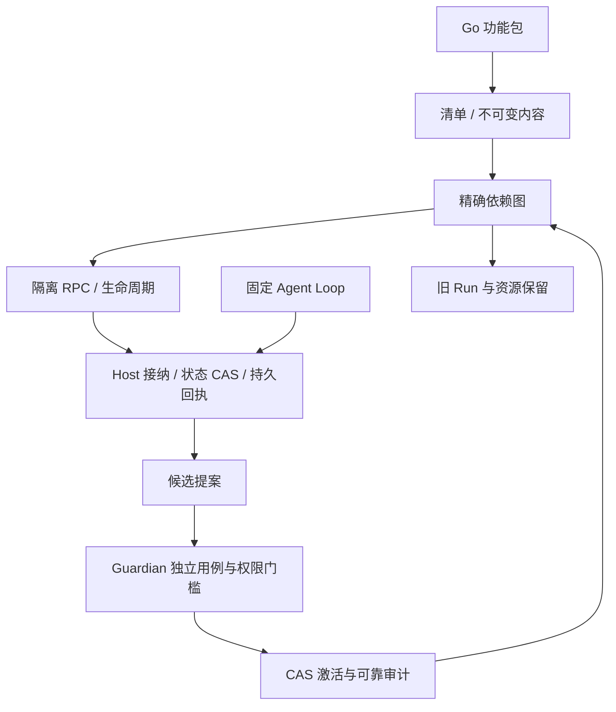
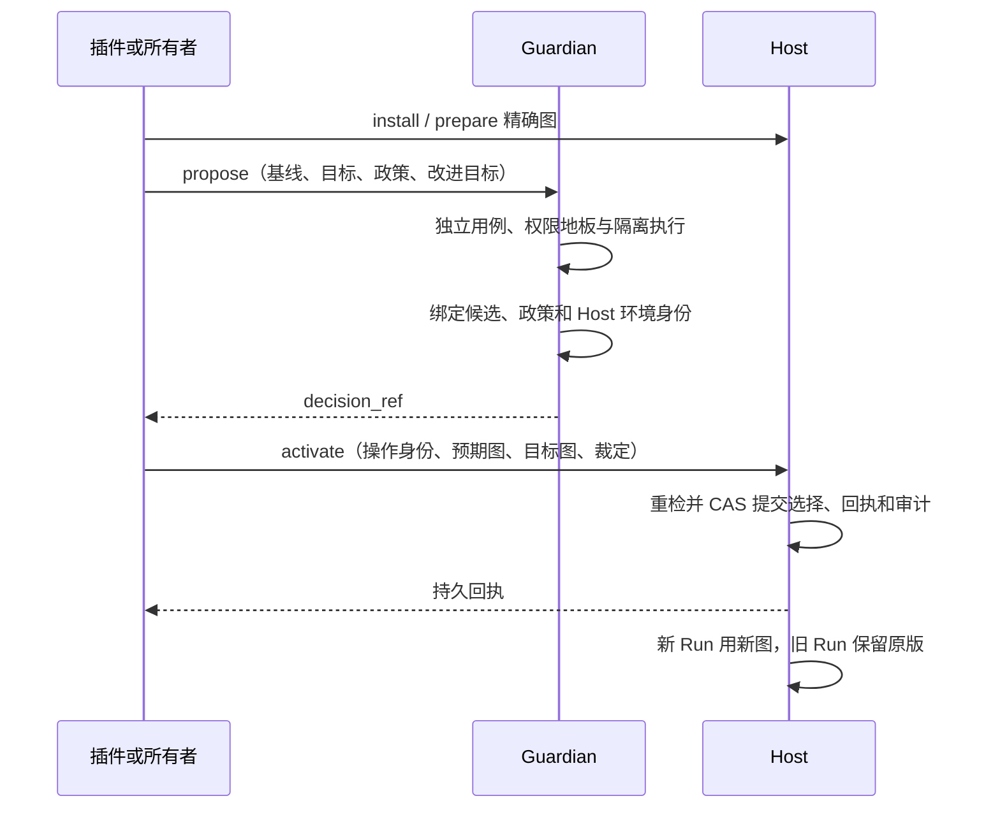
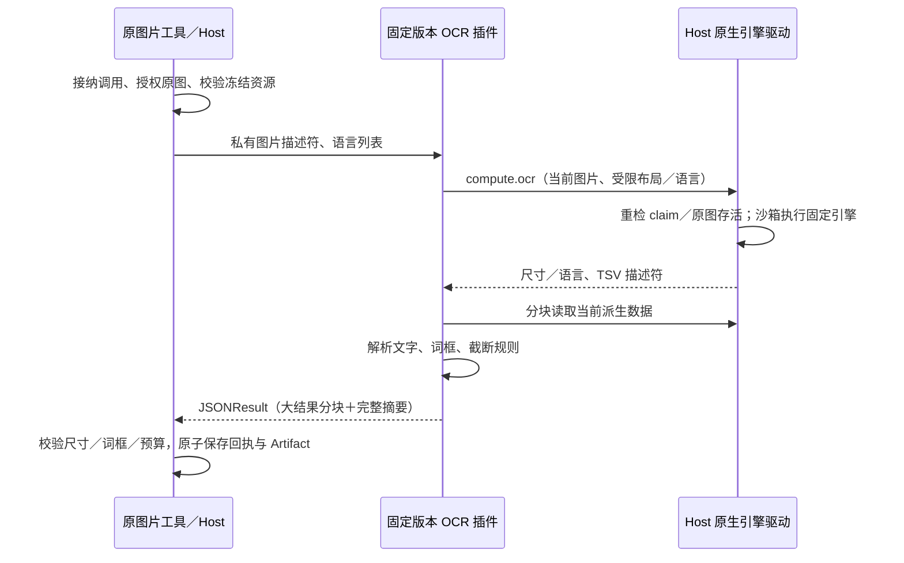
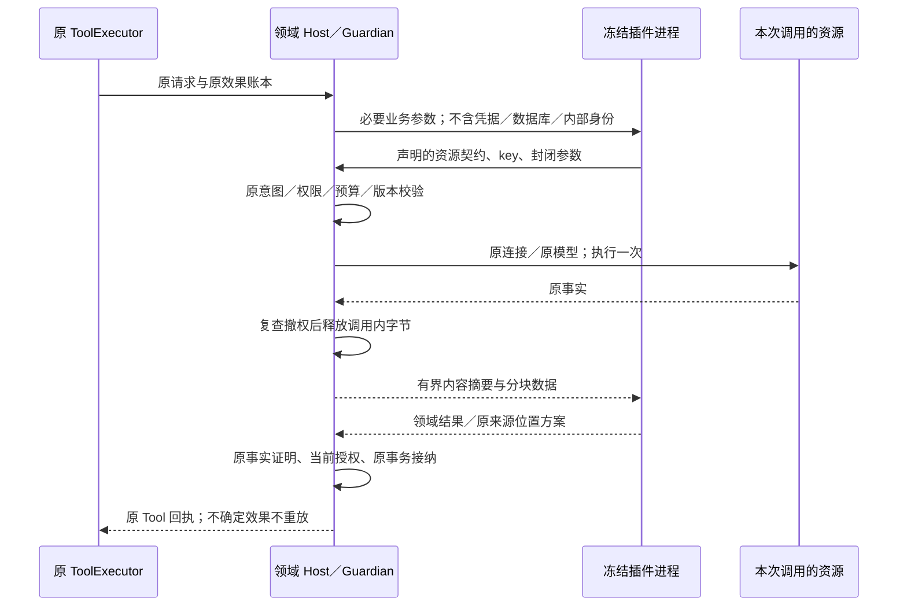

# steward-rsi-plugins：功能插件与自进化协议

[功能与需求](../features/plugins-evolution.md) · [候选功能包](plugins-evolution.md) · [测试方案](../test-plans/plugins-evolution.md) · [需求主索引](../feature-map.md)

## 当前实现与效力

`steward-rsi-plugins/0.1` 已有 Go SDK、内容寻址包、依赖图、隔离进程 RPC、Loop hooks、纯计算工具贡献、调用级资源实验通道、受控提案、独立验证、原子激活、持久事件及人工恢复入口。协议保持 experimental，不承诺永久兼容或公共市场。

RSI 为 Recursive Self-Improvement（递归自我改进）。功能包和生成器／实验工具可以迭代；固定 Agent Loop、Host 执行权与 Guardian 裁定保持受保护。Guardian 当前是 Host 内独立于插件的受信控制代码与存储，尚非独立部署服务。基础协议可用不等于自动生成、长期效果监测或 33 个候选功能已全部插件化，具体状态以 F-070／F-072 为准。

语义服从[运行时契约](runtime-contracts.md)与[治理](../../GOVERNANCE.md)。[SDK 类型](../../pkg/rsiplugin/protocol.go)、严格解码及实际校验共同定义当前结构；Go SDK 只依赖标准库。实现和连接器均由 Steward 自主维护。

## Pi 与 DeepSeek Harness 的借鉴范围

| 官方参考 | 采用的机制 | Steward 的边界 |
| --- | --- | --- |
| [Pi Packages](https://github.com/earendil-works/pi/blob/6e2222a8dda06e3d69fad46d630f152f5873567a/packages/coding-agent/docs/packages.md) | extensions、skills、prompts、themes 组成完整包 | 实现、方法与资源共同版本化，不按每个工具拆包 |
| [Pi Extensions](https://github.com/earendil-works/pi/blob/6e2222a8dda06e3d69fad46d630f152f5873567a/packages/coding-agent/docs/extensions.md) | 小型注册 API、工具、事件与生命周期 | 上游扩展具有进程同等 OS 权限；本项目首版使用 Go SDK 与隔离进程 |
| [Harness Cordis Primer](https://github.com/deepseek-ai/deepseek-harness/blob/fcc0ad462172522aaf5c93a7b2e01f6b9f0b0159/docs/cordis-primer.zh.md) | 声明服务依赖、等待就绪、作用域释放 | 只解析具名依赖；释放不删除事实，旧执行不查找当前最新版 |
| [Harness Architecture](https://github.com/deepseek-ai/deepseek-harness/blob/fcc0ad462172522aaf5c93a7b2e01f6b9f0b0159/docs/architecture.zh.md) | Profile／Bundle 组合与可替换服务 | 保持 Loop／Host／Guardian 受信，最终授权不能由 middleware 短路 |

右列是本项目设计，不是上游安全保证；没有引入外部 Agent SDK 或插件实现。

## 五个契约面



| 契约 | 实现与职责 |
| --- | --- |
| 包 | [清单与包校验](../../internal/rsi/package.go)：文件、内容身份、版本、服务、资源及权限请求 |
| 组合 | SDK `Graph`／`Binding`：实例、配置、依赖、状态 namespace、精确组合身份 |
| 运行 | [Handlers](../../pkg/rsiplugin/handlers.go)、[Serve](../../pkg/rsiplugin/server.go)、[Runner](../../internal/rsi/process.go)：注册、RPC、隔离及资源生命周期 |
| 状态 | [SQLite 存储](../../internal/rsi/sqlite/store.go)、[事件](../../internal/rsi/sqlite/events.go)、[migration 52](../../internal/agent/sqlite/migrations/052_rsi_plugins.sql)／[53](../../internal/agent/sqlite/migrations/053_rsi_feature_snapshots.sql)：接纳、去重、CAS、审计与恢复 |
| 演化 | [控制接口](../../internal/rsi/control.go)、[隔离验证状态](../../internal/rsi/probe.go)、[环境身份](../../internal/rsi/environment.go)：候选、证据、裁定与激活 |

独立政策由 Host 以最多四个顶层用例并行验收；每例仍有独立隔离进程、scratch、初始状态、依赖状态和资源夹具，不复用常驻候选进程。依赖递归和具体计算资源继续执行各自原有限额，这不是所有嵌套子进程合计最多四个的承诺。声明 `compute.ocr` 的包保持原顺序的串行屏障，避免把未承诺并发的原生驱动放入并行调用，也不让其期限耗在队列锁上。全部用例、契约覆盖、前后环境／资源身份检查均通过后才可产生成功裁定；候选无权选择调度、略过用例或放宽限额。这个私有机制用于完整默认组合的首启就绪，不增加 SDK 参数或自动激活权限。

## 1. Go 包契约

实现方导入 `github.com/z-chenhao/assistant/pkg/rsiplugin`，实现以下接口或使用 `Handlers`。完整示例见 [context-notes](../../examples/plugins/context-notes/main.go) 与[清单模板](../../examples/plugins/context-notes/steward.plugin.json)，同时提供一个上下文 hook 和文本工具。

```go
type Plugin interface {
    Describe() Description
    Prepare(context.Context, PrepareInput) error
    Call(context.Context, Call) (Result, error)
    Hook(context.Context, HookCall) (HookResult, error)
    Drain(context.Context) error
    Dispose(context.Context) error
}
```

清单包含协议、`plugin_id`、包版本、入口与超时、文件摘要、服务输入／输出 schema、具名依赖、hooks、工具、资源、配置 schema、状态格式／初值及权限请求。`plugin seal` 对实际构建结果计算文件清单；安装只复制校验后的字节，不执行构建或安装脚本。

`plugin_id + version` 不得重新发布为不同内容，确切身份为 `package_digest`。此约束覆盖可执行文件、资源及清单，也覆盖共享 SDK 更新后的静态重编译：即使服务契约未变，实际封存内容改变仍须发布该包的新版本。各功能包独立决定版本，不引入整套同步版本或绕过冲突的覆盖安装；契约版本和状态格式仅在各自语义变化时修改。路径必须包内相对路径；拒绝符号链接、穿越、未声明文件、哈希漂移和缺失入口。单文件最多 32 MiB，安装总字节最多 64 MiB，最多 256 个文件。服务 schema 复用现有工具的有界 JSON Schema 词汇，未知关键词拒绝。

工具绑定声明服务，首版是纯计算、只读权限，名称使用 `plugin__`；原内建工具协议不变。实际业务包 [docx-reader](../../plugins/docx-reader/steward.plugin.json) 通过 `steward.docx-text/1` 接入原有证据读取，构建入口为 [独立程序](../../cmd/plugins/docx-reader/main.go)，Host 只依赖其[窄契约](../../internal/plugin/docxreader/contract/contract.go)。

资源可声明 skill／prompt／view／settings 并随包保留，**尚未自动挂入既有 Skill Catalog 或 Web**；声明不等于取得显示或执行权限。

## 2. 组合与版本契约

每个 binding 固定实例、包 digest、配置、具名依赖、独立状态 namespace 和状态格式。Host 按 DAG 排序，拒绝环、缺依赖、契约不符及实例／工具／namespace 冲突，生成不可变 `graph_revision`。同包可以有多个明确实例。

包版本、服务契约、状态版本和组合身份分别管理，协议精确匹配 `0.1`。摘要使用 SHA-256 与域分隔；JSON 对象键排序、数组保序、字符串不做 Unicode 归一化，数字保留字面量而不经浮点舍入。因此 `1` 与 `1.0` 身份不同。具体算法和夹具见 [json.go](../../pkg/rsiplugin/json.go) 与 [SDK 测试](../../pkg/rsiplugin/protocol_test.go)。

Main／Root 在创建事务中固定组合，Child 继承父图，迁移前 Run 明确为无插件。工具资源身份还包含组合和 binding；执行时从来源 Run 的图构造目录，不能换用活动版本。持久事件同样使用来源 Run 的图。

## 3. 运行、hook 与权限

### 隔离与生命周期

首版是**每次调用一个隔离进程**：`describe → prepare → call/hook → drain → dispose`。配置实例、版本与状态由 Host 保管，进程内存和 scratch 不构成事实源。部分失败／超时回收进程组和 scratch，不删除包、状态或结果。整图依赖准备成功后才可进入验证。

stdin／stdout 使用带协议和关联 ID 的有界 JSON 帧，每帧最多 1 MiB；日志走 stderr，原始 stderr 不进入模型或审计。Host 校验 Describe、请求关联、schema、输出边界及执行后资源身份。工具与服务参数继续最多 64 KiB；操作员的独立 Policy 文档（含合成夹具）与逻辑身份规范化最多 12 MiB，插件 RPC 仍为 1 MiB。完整服务结果按 2 MiB 预算验证，不扩大工具接纳。RPC 不做 HTML 转义，避免合法 XML 正文被额外膨胀，帧上限仍按实际字节执行。依赖与提案每调用最多 32 次回调，依赖递归最多八层。

插件只读包内容，拥有独立 scratch，不继承父环境密钥；无生产数据库、用户目录、网络或子进程创建权限。Linux 使用 bubblewrap／seccomp，macOS 使用 Seatbelt。调用最长 30 秒，[受信启动器](../../internal/rsi/limits.go)设置 CPU、文件大小和描述符限额，Linux 另设地址空间限额。**macOS 没有同等硬内存上限**；VM 级配额仍是开放任意自生成代码自动运行前的平台门槛。

### 当前 Loop 接缝

| 阶段 | 当前行为与允许改变 |
| --- | --- |
| `prepare_run`／`run_resumed` | 开始／恢复观察，不改变执行权 |
| `input_accepted` | 输入 checkpoint 接纳后观察，不改原消息 |
| `build_context`／`recall` | 既有上下文准备后的扩展窗口，可增加有界不可信上下文 |
| `compact_context` | 冻结前只读观察；真实工作集选择由独立 `steward.context-selection/1` 处理 |
| `select_capabilities` | 只选择当前可见工具子集，后续 hook 不可加回前序移除项，禁止新增或改定义 |
| `before_model_request` | 冻结前增加上下文或进一步拒绝，不换模型／账户 |
| `model_stream` | 实际生成完成后的聚合观察，非逐 token 持久回调，也不改实时显示 |
| `model_result` | 已提交模型结果观察，不改原供应商结果 |
| `prepare_delegation` | Worker 委派前观察；Child 接纳、额度与图继承仍由 Host 强制 |
| `before_tool_call` | 改参数或增加限制，再走 schema、冻结、审批与执行接纳 |
| `tool_result` | 每个结果提交同事务写入订阅待办，包含 Code Mode 嵌套调用 |
| `project_tool_result` | 只改变进入模型的成功结果文本，保留原结果、错误、加载回执与证据 |
| `prepare_reply` | 改最终表达，不改模型原始记录，交付仍走原管线 |
| `suggest_continuation`／`suggest_recovery` | 有界观察／建议，不授予无限续跑、重试未知动作或解除停止的权力 |
| `run_waiting`／`run_settled` | 状态提交同事务写入待办，由独立 lease 消费，不借已释放的 Run claim |

[Loop 端口](../../internal/agent/plugins.go)不加载动态库，[SQLite Host 适配](../../internal/agent/sqlite/plugins.go)负责接纳。额外上下文不能伪装 system／protected；参数建议不覆盖原模型 tool call，实际参数和审批进入 ToolInvocation。Code Mode 同时检查 Run 与脚本执行权。完整模型／渠道／召回／压缩 Service 的业务提取仍需各领域适配，不能把观察 hook 称为实现已可替换。

### 权限与调用

当前可请求 `input.read`、`run.context.read`、`run.tool.read`、`run.reply.read`、`state.run.write`、`evolution.propose`、`compute.ocr`、`compute.web-extract`、`resource.call`；未知请求拒绝。请求须被操作员政策允许，不自行授予权限。未授权正文／参数从 hook 输入移除，输出改写也检查对应权限。

`input.read` 仅允许读取本次调用由领域 Host 明确提供的单个不可变输入，当前上限 8 MiB。`Call.inputs` 记录输入 ID、长度和 SHA-256；`ReadInput` 用每块最多 256 KiB 的 `read_input` 回调传输并核对完整摘要，保持 1 MiB 帧限制，普通调用最多 32 个输入回调；使用 OCR 计算资源的调用可再读取至多 2 MiB 派生数据；HTML／PDF 的私有计算允许至多 8 MiB 派生字节，当前包装器不重复读取原始输入；计算调用总共仍最多 40 个输入回调。输入不接受路径／数据库对象 ID，也不向其他插件或下一次调用继承。每块释放前重检 claim、源对象存活和隐私；验证用例使用独立的 `Case.inputs` 合成资料。持久输入身份只包含摘要，不把原始 ZIP 保存到调用账本。

独立所有者读取及纯策略使用领域提供只读 fence 的 `ReadService`，没有生产 Run 效果、状态写入、提案或外部动作回调，仅接受曾通过激活的组合；含状态写／提案权限的实现不能走该入口。领域可以按来源 Run 的固定图读取纯策略，再沿原 Tool receipt 冻结结果；需要在业务事务前固定的纯选择，由所属领域保存完整且已校验的方案，例如 Task 标题及文件／命令配方。未接纳的纯计算中断可重新求值，不能据此重试 opaque Call。尚使用持久 Call 的历史选择继续沿原完成回执／unknown 裁定处理；通用 Call 的状态 CAS 和未知结果不重放语义不变。纯读 transport 失败后仍复查领域 fence／隔离，优先返回真实撤权原因。

`CallDependency(ctx, binding, key, input, output)` 只访问锁定图内声明的依赖，Host 补齐契约、身份和持久键；没有全局服务查询。`Propose(ctx, proposal)` 只提交候选，不能创建政策、填写 passed、activate、resume 或修改底座。

模型／工具效果保留原授权、预算和隐私 fence。停止／隔离还在模型派发 guard、工具接纳和启动处复查；已发操作按原回执收敛。凭据只在 SecretStore 与受控 Host 适配器解析，首版不开放生产网络或连接凭据。

### HTML／PDF 纯计算接入（私有实验）

`compute.web-extract` 是第二个具体本地计算消费者，不是任意 Node／exec 服务。`web-extract` 包只引用固定的 `extract.mjs` 文件，Host 取原绑定 config 中的解释器 revision；原 Source URL／媒体类型和单个输入 descriptor 与接纳请求逐字段一致。每调用至多一次计算，返回 bounded computed bytes 与标题／正文长度；独立验证和生产都复核实际结果摘要，不信候选自报证明，也不使用固定模拟回复替代模块执行。原 OCR 驱动 API／2 MiB 限制保持不变。

`ExtractService` 是领域消费者入口，复查原 Tool 的 claim／配置／隐私／Guardian；没有新的 pending／效果账本。Run／Child 的原 graph 固定算法和解释器，新 graph 才选择新版；配置授权仍实时有效。Go Host 只依赖 `webextract/contract` DTO，业务实现与模块分别留在插件包装器和封存方法中。普通服务结果／帧上限保持不变；大型正文经 computed descriptor 读取后由原领域物化，不塞入候选返回值。

操作员可先用离线 `steward plugin parser-bundle SOURCE MODULE DEPENDENCIES` 打包方法，再执行 `steward plugin parser-resource MODULE`；后者从当前原配置捕获解释器，输出可直接放入绑定 config 的 `runtime_revision`／`source_identity`，不输出路径或凭据。此入口不是模型工具，候选不能调用它或选择 Host 命令。包安装、组合、独立验证和授权激活仍是原控制流程。业务与历史兼容细节见 [Web Access 托管迁移](integrations.md#web-access-托管迁移进行中)。标准分发在首次选择时捕获原资源；未配置以显式 unavailable 冻结，已有图不自动替换。自定义模块独立版本及来源身份见所属设计，原二十三包的适用产品门禁已验收；当前30包完整组合仍待验收；Linux ARM64 的生产沙箱默认业务链路与完整 Linux 产品／真实 Guest 验收分别界定。

当前 Host 接纳的所有者 Policy 必须含1–512条用例，当前标准33包需要333条；原三十包的243条已经不能代表完整组合；这是实际组合所需的有界控制面容量。各例仍使用独立进程、最多四例并发，原生计算保持串行，候选不能修改政策或绕过末例失败。普通 SDK 的输入／结果／帧大小及单次运行期限不受用例总数调整影响。

## 4. 状态、事件与恢复

插件状态默认是 **Run 内 namespace**，有 schema、初值和 CAS 版本，不能借通用 KV 跨任务共享私有内容。新 Run 可使用新版状态格式，旧 Run 保留原图／格式；不实现运行中热换或不可逆迁移。Task、Memory、审批、交付等跨 Run 事实仍由领域 Host 保管。

调用先保存输入哈希及 pending 身份，输出与状态 CAS 同事务提交后才返回。相同身份同输入重用完成结果，同键异参拒绝；未能提交结果保持 unknown，不自动重发。依赖完成记录同样可重用，状态和结果不会半提交。

持久事件冻结来源状态、确切结果投影及处理器图，不用后来变化的记录伪造旧事实。runtime 后台消费，也可显式 `plugin work`；完成事件不能重做。Forget 清理插件状态及调用／事件正文，撤权和过期执行权拒绝迟到结果，审计只保留必要身份、哈希及裁定。

停用活动图只影响新 Run，旧图与资源保留。卸载须先移出当前选择，再阻止新图选用该包，不删旧 Run 所需内容；同内容重装可恢复未来可选性。`stop`／`quarantine` 阻止相关旧图新派发。首版保留资源，尚无引用感知的物理 GC。

## 5. 演化、验证与激活



政策由操作员控制面创建，独立于候选且不可原地修改。每个声明服务／hook 都须有通过用例，权限和能力不超出允许集合。用例使用独立的可丢弃状态，依赖调用不读取生产 Run；包自带测试不替代门槛。

证据绑定候选、图、政策摘要、用例数量、Host 可执行文件摘要、平台、Go runtime 和协议。验证环境变化拒绝，激活时环境不符须重验。当前是确定性契约／用例验证，不声称真实业务质量或长期收益已被证明。

激活携带预期旧图、目标图、独立裁定和操作身份。CAS 冲突拒绝，关键审计失败回滚整个激活；应答丢失重交同一命令返回原回执，同身份异参拒绝。回退针对当前基线重新验证旧目标，再激活到后续工作；不撤销现实副作用或半途替换 Root 树。

首版不默认启动自动生成、持续评测、效果监测或自动回退策略。独立控制面可使用相同接口编排，费用预算、平台配额和上线政策仍需独立验收。程序发布与底座变更继续走显式工程授权。

## 操作入口

以下均为本机所有者控制面，不注册成模型工具。`seal` 为离线构建操作，不读取配置或打开个人数据根。JSON 从 stdin 严格读取一份对象。

| 命令 | 行为 |
| --- | --- |
| `plugin seal DIR`／`install DIR` | 对实际文件生成摘要／校验并安装不可变包 |
| `plugin prepare` | 输入 SDK `Graph`，返回 `revision`，不激活 |
| `plugin policy`／`propose` | 输入 `rsi.Policy`／`rsi.Candidate`，创建政策／候选 |
| `plugin verify CANDIDATE` | 隔离执行独立用例，返回 `decision_ref` |
| `plugin activate` | 输入 `rsi.Activation`，幂等 CAS 激活与审计 |
| `plugin deactivate` | 输入 `operation_id`、`expected_graph_revision`，新 Run 清除插件选择，已迁移服务明确不可用 |
| `plugin uninstall DIGEST` | 阻止未来选择，保留旧引用；活动包先移出选择 |
| `plugin status`／`audit` | 组合／epoch／停机状态，或最近 200 条审计 |
| `plugin calls RUN`／`work` | 最近 200 个调用状态／显式消费订阅待办 |
| `plugin stop`／`resume`／`quarantine REVISION` | 独立持久控制；隔离图不能重新激活 |
| `plugin retry-call RUN INSTANCE KEY` | 所有者核对后允许未知纯计算重算，完成结果不能重做 |
| `plugin retry-event EVENT` | 重开失败订阅；未知调用须先协调，完成或已撤销事件不能重做 |

### 构建示例

使用可丢弃数据根，不复制个人资料或凭据；安装不启用。

```sh
RSI_DEMO_ROOT=$(mktemp -d)
export STEWARD_DATA_ROOT="$RSI_DEMO_ROOT/data"
mkdir -p "$RSI_DEMO_ROOT/package"
printf 'version: 1\n' > "$RSI_DEMO_ROOT/config.yaml"
go build -o "$RSI_DEMO_ROOT/steward" ./cmd/steward
go build -o "$RSI_DEMO_ROOT/package/plugin" ./examples/plugins/context-notes
cp examples/plugins/context-notes/steward.plugin.json "$RSI_DEMO_ROOT/package/"
"$RSI_DEMO_ROOT/steward" -config "$RSI_DEMO_ROOT/config.yaml" plugin seal "$RSI_DEMO_ROOT/package"
"$RSI_DEMO_ROOT/steward" -config "$RSI_DEMO_ROOT/config.yaml" plugin install "$RSI_DEMO_ROOT/package"
```

`prepare` 输入示例，digest 使用安装实际返回值：

```json
{
  "protocol":"steward-rsi-plugins/0.1",
  "bindings":[{
    "instance_id":"notes",
    "package_digest":"sha256:replace-with-installed-digest",
    "config":{"note":"保留来源，简洁回答。"},
    "state_namespace":"notes",
    "state_version":1
  }]
}
```

该包政策至少测试 `steward.text-normalize/1` 及 `before_model_request`，允许列表对应两项能力，无需正文读取或状态写权限。政策、候选和激活字段见[控制类型](../../internal/rsi/control.go)，验证入口见[测试方案](../test-plans/plugins-evolution.md)。

## 默认业务包与迁移边界

`make build` 和安装器独立构建、封装 DOCX、OCR、Trace 解释、上下文选择、Recall、Main 对话方法、自动记忆、证据分页、方法库、经验配方、Task 策略、进度方法、问答配方、委派方法、Code Mode 配方、文件方法、命令资源、Task 代码工作区、Computer 业务方法及 Web／Extract 插件到 `bin/plugins/{docx-reader,image-ocr,trace-inspector,context-compact,recall,conversation,memory-curator,evidence-reader,skill-library,experience-learning,task-control,task-progress,task-feedback,delegation,codemode,file-tools,shell-tools,coding-workspace,computer-use,web-access,web-extract}/`。正常运行时在尚无任何选择／停机操作的安装上，使用 Host 自持的正常／坏包用例验证，再激活初始组合；后续启动不覆盖所有者的选择、停机或停用。已有自定义组合需显式包含 DOCX 服务，不自动扩写其验收政策。未分发业务包的嵌入式 Host 和历史测试载体保留原生兼容路径。

首次成功激活服务后，新 Run 冻结已迁移服务清单；DOCX／OCR 的历史政策标记保留兼容。停用后不静默复活原生方法：必需解释器明确不可用；可选进度贡献关闭后保留业务和 Host 事实状态。历史 Run／Child 沿用原政策及解释器。DOCX 输入只读；授权、原文件、分页、接纳与隐私仍归领域 Host。所有者分页返回 `reader_revision`，继续读取时可携带该值选择同一已验收解释器；停用不破坏这类旧引用，停机／隔离仍优先。Main 不开放该选择字段，始终使用自己的冻结图。其他功能的迁移状态见[逐项清单](plugins-evolution.md#候选功能包清单)，不能把默认包分发当作全部迁移。

## 取舍与后续边界

采用最窄 Go SDK＋stdio RPC，不建立动态库 ABI、跨语言 SDK、任意 hook／middleware、公共市场、全局服务网格或通用迁移平台。原始领域状态不作为公共协议开放。

后续按[候选清单](plugins-evolution.md#候选功能包清单)逐个验证完整功能闭环，再接实际服务、Skill／视图贡献与自动演化政策。每次提取保留旧格式、资源、授权和恢复语义，不因协议可运行就把未接通功能标记完成。

## OCR 的本地计算边界



唯一当前开放的计算契约为 `steward.ocr-engine/1`，须经独立政策允许 `compute.ocr`，每次服务调用最多执行一次，prepare／hook／drain／dispose 不可使用。驱动只接收当前 Host 已授权的图片字节；不接收路径、任意命令、网络或凭据。插件决定识别布局和语言子集，Host 仅支持已安装的 eng／chi_sim／chi_tra 和受限布局枚举。引擎执行及固定资源校验仍由既有沙箱驱动承担；没有放宽插件 fork 权限。原生引擎仍按冻结哈希管理，不宣称已归档所有动态库或允许旧 Run 静默切到新引擎。

派生 TSV 最多 2 MiB，只在当前调用内可读；计算前后和每次向插件释放字节前重检领域 fence。`JSONResult` 可用最多八个 256 KiB 的 `write_result` 块传回至多 2 MiB 的 JSON。Host 只在最终描述符的大小／摘要、严格 JSON、服务 schema 与领域 fence 均通过后提交；这不是 Artifact 写权限，也不会扩大 1 MiB 单帧或 64 KiB 工具参数上限。此结果通道来自现有合法 OCR 文档序列化超过一帧的实际需求。

验证裁定额外绑定原生计算资源身份；二进制或语言包漂移使旧证据不能用于激活。标准初始验收用 Host 自持的 TSV 与无效输入检查规范化／错误边界；真实像素识别由独立真实引擎集成回归覆盖，二者均不代表模型或 OCR 质量提升。计算 API 与 OCR 契约保持 private／experimental；未开放任意 Host 服务、外部效果或插件自注册驱动。

## Trace 展示策略的只读消费者

`trace-inspector` 的新候选在原 `steward.trace-layout/1`、`steward.trace-diff/1`、`steward.trace-tool-preview/1` 外，提供同包私有 `steward.trace-workbench/1` 和 `steward.trace-activity/1`。基础服务分别消费已授权元数据、冻结指纹和已授权回执，原服务／旧 URL 不变。工作台服务返回同包封存程序和直方图样式，资源分别核对原图 manifest／摘要，客户端在 opaque frame／Worker 内计算树、列、时间轴、直方图交互、工作台／页面控制和请求阅读配方，Host 只接纳有界原语，不开放父 DOM 或原始数据库。Activity 服务只接收筛选后最早／最晚时间和显式时间边界，选择统一分桶配方；筛选 SQL、实际计数、总量一致性及最终 privacy／Guardian 围栏留在 Host。托管 Trace 列表随选中配方读取，停用不恢复 native；独立原始执行／Observation 控制面仍可检查事实。完整 Trace 功能的其余提取按[实际边界](observability.md#剩余工作台的私有交互边界)继续，这些接缝保持 private／experimental。

Trace 的 Diff 输入仅含 source ref／call ID／位置、标签与保存值指纹；重复身份按出现顺序匹配，严格保留 SQLite 数值与文本的原比较语义。工具预览仅接收当前授权且有界的保存回执，保留普通业务 JSON，只解释已知 Code Mode 文本块；Artifact／图片引用和错误仍由 Host 从原回执校验或重建。只读内容读取不写调用账本、插件状态或审计。原始诊断 API 与执行事实不随视图换版改写。

Trace 页面与 Diff 分页返回／传播 `reader_revision`，Before／After、Context、节点选择和续页沿用同一已激活解释器。换版、回退、停用或退役保留旧链接读取；未激活版本不能取得资料，停机／隔离优先。事实快照与撤权复查使用独立只读连接池，避免两个页面持有快照时互相等待复查连接；两个池均强制只读。

CodeMode 的 `steward.codemode-limits/1` 与 `steward.codemode-input-type/1` 为领域私有纯服务；资源选择在原 code_manifest 冻结，说明在 execution 内提交不可变完整回复后确认。具体字节重放、Guardian 和运行时边界见[CodeMode 设计](codemode.md#独立执行配方与参数说明私有实验接口)，不扩张公共 Go SDK 的任意执行或存储权限。

`steward.file-window/1` 与 `steward.file-edit-span/1` 是私有纯文件方法；只消费授权原字节，不开放文件系统 RPC。原三文件工具的 scope／审批／CAS／效果回执和固定 driver 边界见[文件设计](coding.md#独立文件方法与固定提交机制f-026私有实验接口)。


命令资源服务 `steward.shell-limits/1` 使用私有强类型数值请求／结果，不提供 exec/stdio/网络请求能力。Host 从原批准调用重取命令、冻结 driver 与预算，保留原 Tool never/unknown 语义；两个预算整数不是通用执行政策或公开数据库接口。设计与拒绝的扩展见[代码环境](coding.md)。

Computer 原生选区的私有 `steward.computer-text-selection/1` 服务仅返回封闭、有界的光标方案；原审批、确切原文范围、身份、新鲜度与不确定效果仍由所属 Host／固定原语解释器强制。候选不能返回任意键盘或 Driver 操作，Go SDK 没有新增效果权限。兼容与拒绝扩展见[Computer 设计](computer-use.md#原生选区算法与固定输入原语)。

Computer 的私有清单排序／对象匹配服务只返回授权快照中的位置，不签发身份、句柄或效果。Host 保留原事实、范围与精确 ID 约束；大清单使用同一快照有界分批。Go SDK 复用现有只读描述符，不新增权限；窄契约与兼容条件见[Computer 设计](computer-use.md#清单排序与对象匹配私有实验接入)。

Computer 的私有动作参数服务复用已有只读描述符；原始资源引用不发给方法，返回值不能选择 Driver 或效果回调。原审批前完成消费方领域计划接纳，执行复用同一计划；这不是 SDK 的通用事务／效果 DSL，详见[领域边界](computer-use.md#审批前固化动作参数私有实验接入)。


`steward.computer-playwright-parameters/1` 是仓库内实验消费者契约，不是 SDK 通用参数重写 API。它复用原 Computer 完整计划，具体字段、历史七服务边界及固定浏览器权限由 [Computer 设计](computer-use.md#playwright-参数的私有实验接入) 维护。


Computer 的第九项私有导出展示服务只决定缺省名称／媒体类型，原路径和字节不进入候选；Host 在原审批前解析具体源名称并固化，Artifact staging 与接纳共用所属域的元数据验证。旧八服务、清理条件与取舍见 [Computer 设计](computer-use.md#文件导出展示的私有实验接入)。

Computer 的第十项上传展示服务只接收原公开选择器／预算，Host 解析原 basename 并在原审批前固定完整参数；原图配置仅能选择 Host 自持的确切 FileChooser 资源，不注册程序或扩张 Go SDK 权限。旧九服务、资源保留和文件名协议差异见 [Computer 设计](computer-use.md#浏览器上传展示与固定资源私有实验接入)。


Computer 的第十一项浏览器观察投影只接收原文长度事实，返回有界来源选择和完整行排列；原 UTF-16 内容、身份、截图及原文重建仍由 Host 持有。独立快照资源仅由原图配置选择 Host 已知摘要，不增加 SDK、任意程序或通用资源接口，见 [Computer 设计](computer-use.md#浏览器观察投影与原文快照私有实验接入)。

## 调用级资源端口（实验接入）

Web Access 的现有研究执行需要搜索、公开网页、原模型和作用域内证据，不能用一层 native 代理冒充独立实现。当前先接入私有 `steward.web-search/1`：真实 Task／ToolExecutor 调用冻结包，包经 `resource.call` 请求本次 Host 提供的封闭资源，再返回来源位置方案。现有 Web Access 功能已迁移，标准分发的 Web／Extract 已验收；原二十三包门禁已验收；其他业务继续按清单迁移，其余纯服务保持原权限。



| 机制 | 当前边界 |
| --- | --- |
| 授权 | manifest 只声明 `resource.call`；`DriveService` 仍要求原操作 deadline、独立领域 check 和本次提供的资源。声明不授予网络、凭据、任意 Tool 或新目标。 |
| 生命周期 | 回调只在 call 期间可用；prepare／hook／drain／dispose、普通 Call 和纯 ReadService 不获得端口。不得写通用插件状态或提案。 |
| schema | Host 提供每项封闭输入／输出 schema；候选不能注册资源。契约／key 复用要求相同字节，调用内返回原结果，不再次执行。 |
| 数据 | 单次资源请求／响应至多 32 MiB；总传输 128 MiB、至多 64 个唯一资源请求、8 项本次端口；分块和 SHA-256 完整性校验。纯输入仍为 8 MiB、普通结果仍为 2 MiB，旧 RPC frame 不扩大。 |
| 时间 | 原 Tool 总期限保持生效；插件活跃墙时累计计算，仅可信资源回调期间暂停。既有内核 CPU 30 秒、禁止网络／fork 和其他进程限制仍生效，后台计算也受 CPU 限额。 |
| 接纳／恢复 | 不新增 RSI pending/effect ledger；资源所有者保留模型请求、预算与原 Tool 的效果接纳／unknown。进程内缓存不作为持久恢复事实；已不确定的原操作不能靠重建插件进程再发一次。 |
| 验收 | 所有者 `Case.resources` 规定确切契约／key／输入／输出和调用次序；验证只用这些私有样例，不调用生产资源。最终结果匹配而资源轨迹缺项也不能通过。 |

32 MiB 通道服务于既有 24 MiB Web 证据及其 JSON 封装，不把所有纯服务放大，也不缩小原证据支持。接口仍为实验机制；Web 资源 DTO 是仓库私有契约。当前不开放任意 HTTP／模型选择器／文件系统／数据库、全局资源 registry、通用 workflow DSL、通用 state＋effect 事务或自动部署。具体权威字段和效果准入由真实领域消费方定义，不能以资源通道替代它们。


### 原事实纯读流的实验边界

现有账户状态没有功能级字节上限，私有账户排序需要完整原展示名称，迁移前大输入已超过普通 8 MiB 限制。Host 的显式 `ReadServiceStream` 仅为这个真实消费者提供一份不可变 input.read 描述符；沿用声明权限、256 KiB 帧、完整 digest、原图／领域 Fence 和结果接纳，不给予效果、资源、状态写或演化提案权限。读取预算由 Host 原输入大小推导为一次完整遍历，不能由候选指定。SDK `ReadInputTo` 逐块交给本地 writer，调用方在完整身份检查成功前不能发布部分结果。

普通 `ReadService`、生产调用、验证输入与资源通道的原限制不变；没有开放路径、对象 ID、数据库或任意来源读取。这个传输机制属于实验 Host／SDK 接缝；账户排序协议仍为仓库私有契约，尚无稳定公共大文件 API、通用流工作流或部署承诺。排序算法、比较器及页面取舍保留在所属插件；Host 只证明原输入身份与完整原引用排列。
